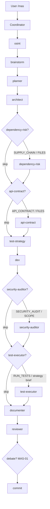
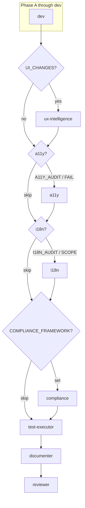
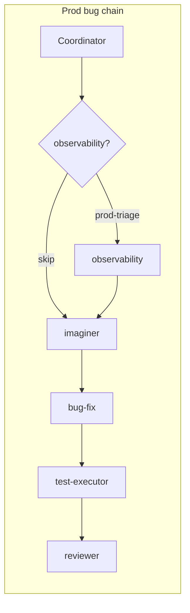
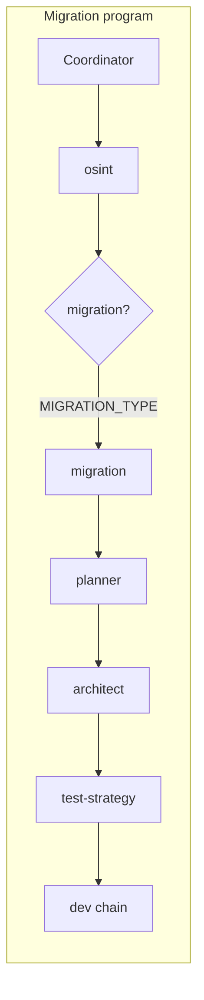
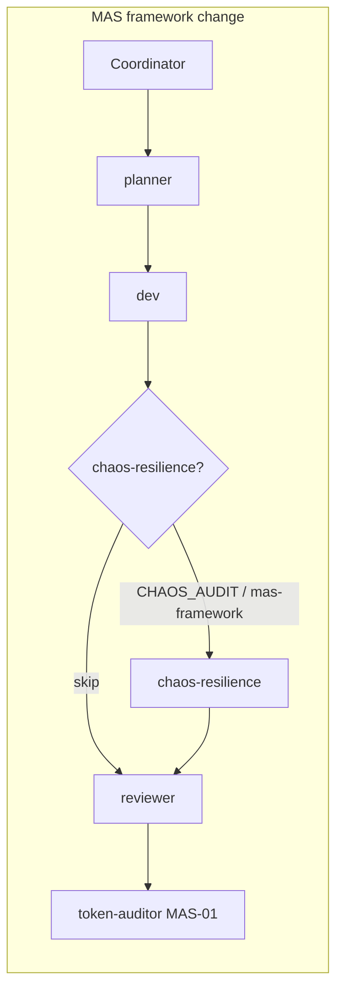
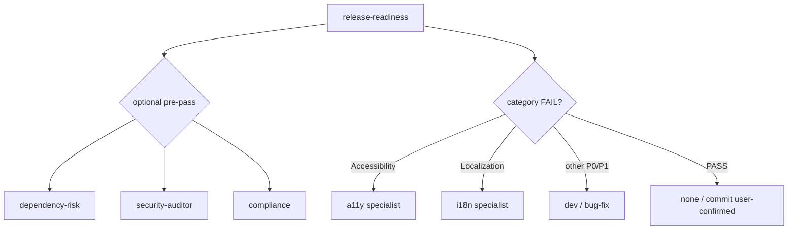

# Architecture Brief — MAS-04

## Architecture

**Option 2 — Phased incremental roster** extends the MAS-01 **deterministic state machine** (Coordinator predicate tables) and **artifact bus** (brief files on disk) with **10 narrow specialist agents** across three releases. No LLM-based specialist selection, no parallel specialist spawn by default, no production code patches from audit specialists.

### Core topology (unchanged from MAS-01)

```
User → Coordinator (inline, normal)
         │
         ├─ init-workflow-session.ps1 → workflow-sessions/{TASK_ID}.json
         ├─ predicate evaluation (zero-token) → specialist slot queue
         ├─ cap check (MAX_CHAIN_AGENTS) → skip optional specialists per priority
         ├─ handoff write → .ai/handoffs/{TASK_ID}[-{agent}].md
         ├─ Task spawn (foreground, model from spawn-model-policy) → Specialist
         ├─ record-workflow-step.ps1
         └─ route via NEXT_AGENT + predicate table (zero-token lookup)
```

### New subsystems (MAS-04)

| Subsystem | Role | Phase |
|-----------|------|-------|
| **P0 audit quartet** | security-auditor, dependency-risk, api-contract, test-executor | A (v1.2.0) |
| **P1 depth trio** | a11y, i18n, compliance | B (v1.2.1) |
| **P2 qualified trio** | observability, migration, chaos-resilience | C (v1.3.0) |
| **Predicate routing** | Handoff flags + FILES + SCOPE → fixed-priority spawn table | A–C |
| **Brief schema registry** | 10 new brief types + context dirs | A–C |
| **Cap overflow policy** | Optional specialist skip order when chain threatens MAX_CHAIN_AGENTS | A |
| **Reviewer conditional reads** | Steps 0f–0j only when specialist brief file exists | A–C |

### Architect gate decisions (open questions resolved)

| Question | Decision | Rationale |
|----------|----------|-----------|
| Should `security-auditor` block merge like reviewer? | **Advisory v1 only.** Findings route to dev/bug-fix. `SECURITY_BLOCKER: yes` is **user opt-in** — when set, reviewer treats Blockers section as merge-blocking findings; specialist still has no independent `Approved:` authority | Preserves reviewer as sole gate; enterprise users can opt into stricter policy without changing skill contracts |
| Is `test-executor` allowed to fix failing tests inline? | **Run-only v1.** Execute commands per test-strategy brief; document failures/flaky notes; route fixes to **bug-fix** | Clear boundary vs test-strategy (plan) and bug-fix (patch); matches AgentForge Tester vs Coder split |
| Reviewer step proliferation for new briefs? | **Conditional read steps 0f–0j** — reviewer reads each specialist brief **only when file exists** at `.ai/context/{type}/{TASK_ID}.md` | Bounds token cost; no schema validation inline in coordinator |
| `compliance` legal disclaimer | **Skill header + brief template** (both) — required "not legal advice" section in compliance brief | Enterprise adoption; HITL for legal/prod remediation |
| Bundle a11y + i18n? | **Separate agents** (Option 2) | Industry pattern (Factory/Copilot/accessibility-agents); distinct release-readiness category routing |
| `PARALLEL_READ: YES` | **Deferred** (MAS-01) | Sequential spawn default; ux-intelligence → a11y → i18n when all triggered |

### Routing predicate table (deterministic, fixed priority)

Evaluated by Coordinator **before each specialist slot** in chain order. **First match wins per specialist slug**; max **one spawn per specialist per TASK_ID** unless `RE_AUDIT: yes`.

| Priority | Predicate (any true) | Specialist | Default chain position |
|----------|------------------------|------------|------------------------|
| P0-1 | `SUPPLY_CHAIN: yes` OR lockfile/manifest/MCP/skills/hooks delta in `FILES` OR `SCOPE: supply-chain` | dependency-risk | Early: after osint, before planner/architect; or pre-release |
| P0-2 | `API_CONTRACT: yes` OR OpenAPI/GraphQL/Proto in `FILES` OR REST/BFF in `SCOPE` | api-contract | After architect; or post-dev pre-reviewer |
| P0-3 | `SECURITY_AUDIT: yes` OR auth/crypto/API in `SCOPE` OR reviewer security finding flag | security-auditor | Post-dev, pre-reviewer (or post-architect for design-time) |
| P0-4 | `RUN_TESTS: yes` OR test-strategy brief exists at `test-strategies/{TASK_ID}.md` | test-executor | Post-dev, pre-reviewer |
| P1-1 | `UI_CHANGES: yes` (existing) | ux-intelligence | Post-dev, pre-documenter (unchanged) |
| P1-2 | `A11Y_AUDIT: yes` OR release-readiness Accessibility FAIL OR interactive widgets in `FILES` | a11y | After ux-intelligence when both; else post-dev |
| P1-3 | `I18N_AUDIT: yes` OR new strings/locale/RTL in `SCOPE` OR release-readiness Localization FAIL | i18n | After a11y when both triggered (sequential) |
| P1-4 | `COMPLIANCE_FRAMEWORK:` set (SOC2\|GDPR\|HIPAA\|EU_AI_ACT\|FedRAMP) | compliance | Post-dev or pre-release-readiness |
| P2-1 | `OBSERVABILITY_MODE: prod-triage` OR `SYMPTOM: prod` OR telemetry in `SOURCES_HINT` | observability | Prod-bug chain entry (before imaginer) |
| P2-2 | `MIGRATION_TYPE:` set (framework\|api\|legacy\|strangler) | migration | After osint, before planner |
| P2-3 | `CHAOS_AUDIT: yes` OR `SCOPE: mas-framework` on protocol/skill TASK_ID | chaos-resilience | Post-dev, pre-reviewer (framework changes) |

**Idempotency:** Coordinator records spawned slugs in session JSON (`specialists_spawned: []`). Re-entry without `RE_AUDIT: yes` skips already-spawned slugs.

### Routing topology — Phase A (full feature: API + auth + deps)



### Routing topology — Phase B (UI feature + a11y/i18n/compliance)



**Spawn rule:** ux-intelligence → a11y → i18n are **sequential only** (a11y before i18n when both). No parallel unless deferred `PARALLEL_READ: YES`.

### Routing topology — Phase C (prod bug, migration, framework)







### Release gate (unchanged topology, optional specialist pre-pass)



Specialists **do not replace** release-readiness ship gate. Category FAIL routes to depth specialist or fix agent; release-readiness re-runs after fixes.

### MAX_CHAIN_AGENTS overflow strategy

| Constant | Full `/mas` | Lite |
|----------|-------------|------|
| `MAX_CHAIN_AGENTS` | **12** | S=2, M=2, L=3, L+=4 |

**What counts:** Every Task-spawned specialist (including new MAS-04 slugs). Coordinator is inline — does not count. Debate and token-auditor count when spawned.

**Protected agents (never auto-skipped by overflow):** osint, brainstorm, planner, architect, test-strategy, dev, android-dev, general-dev, bug-fix, documenter, reviewer, imaginer (when in active bug chain), debate-synthesizer (when triggered by reviewer loop).

**Optional specialists (eligible for skip):** All MAS-04 audit specialists, ux-intelligence (when overflow during dense chains), perf-optimizer, token-auditor.

**Skip order when projected chain > cap** (drop first = lowest priority retained):

```
1. test-executor      ← skip first (lowest retention priority)
2. api-contract
3. dependency-risk
4. security-auditor   ← skip last among P0 optional quartet
5. a11y
6. i18n
7. compliance
8. observability
9. migration
10. chaos-resilience  ← never skip when SCOPE: mas-framework AND CHAOS_AUDIT: yes (user escalation if still over cap)
```

**Coordinator behavior on overflow:**

1. Build projected chain from predicates + mandatory agents before first spawn.
2. If `projected_count > MAX_CHAIN_AGENTS`, remove optional specialists in skip order until `projected_count <= cap`.
3. Log skipped slugs in user summary: `Cap: skipped test-executor, api-contract (MAX_CHAIN_AGENTS=12). Re-run with RE_AUDIT: yes or narrower SCOPE.`
4. Record `skipped_specialists: []` in session JSON for audit.
5. If mandatory agents alone exceed cap → **user escalation** (same as MAS-01 cap breach).

**Lite:** Phase A specialists (SEC/API/DEPS/TEST) allowed in **L tier only** per abbreviated flags; S/M tiers unchanged. Lite overflow uses same skip order within tier cap (3–4).

---

## Modules:

Logical module map (framework repo — not Android Gradle modules). **MAS-01 base unchanged**; additions below.

```
mas-cursor-framework/
├── skills/
│   ├── multi-agent-system/
│   │   ├── protocol/
│   │   │   ├── brief-schemas.md           [UPDATE: +10 types]
│   │   │   ├── spawn-model-policy.md      [UPDATE: +10 slugs]
│   │   │   ├── read-order.md              [UPDATE: subscription rows]
│   │   │   ├── handoff-format.md          [UPDATE: routing flags]
│   │   │   ├── handoff-format-lite.md     [UPDATE: SEC/API/DEPS/TEST/A11Y/I18N]
│   │   │   ├── subagent-spawn.md          [UPDATE: +10 slug rows]
│   │   │   └── token-rules.md             [UPDATE: overflow skip order]
│   │   └── install/
│   │       └── manifest.json              [UPDATE: 1.2.0 → 1.2.1 → 1.3.0]
│   ├── mas-coordinator/                     [UPDATE: predicate table, cap logic]
│   ├── mas-reviewer/                        [UPDATE: conditional 0f–0j reads]
│   ├── mas-lite/                            [UPDATE: L-tier P0 flags, skip order]
│   ├── mas-test-strategy/                   [UPDATE: executor boundary]
│   ├── mas-release-readiness/               [UPDATE: FAIL → a11y/i18n routing]
│   ├── mas-ux-intelligence/                 [UPDATE: a11y/i18n boundary note]
│   ├── mas-imaginer/                        [UPDATE: observability boundary — Phase C]
│   │
│   │   ── Phase A (v1.2.0) ──
│   ├── mas-security-auditor/                [NEW]
│   ├── mas-dependency-risk/                 [NEW]
│   ├── mas-api-contract/                    [NEW]
│   ├── mas-test-executor/                   [NEW]
│   │
│   │   ── Phase B (v1.2.1) ──
│   ├── mas-a11y/                            [NEW]
│   ├── mas-i18n/                            [NEW]
│   ├── mas-compliance/                      [NEW]
│   │
│   │   ── Phase C (v1.3.0) ──
│   ├── mas-observability/                   [NEW]
│   ├── mas-migration/                       [NEW]
│   └── mas-chaos-resilience/                [NEW]
└── .ai/context/
    ├── security-audits/                     [NEW Phase A]
    ├── api-contracts/                       [NEW Phase A]
    ├── supply-chain/                        [NEW Phase A]
    ├── test-runs/                           [NEW Phase A]
    ├── a11y-reviews/                        [NEW Phase B]
    ├── i18n-reviews/                        [NEW Phase B]
    ├── compliance/                          [NEW Phase B]
    ├── observability/                       [NEW Phase C]
    ├── migrations/                          [NEW Phase C]
    └── resilience/                          [NEW Phase C]
```

### Agent slug registry (post-MAS-04)

| Slug | Skill dir | Phase | Manifest version |
|------|-----------|-------|------------------|
| `security-auditor` | `mas-security-auditor` | A | 1.2.0 |
| `dependency-risk` | `mas-dependency-risk` | A | 1.2.0 |
| `api-contract` | `mas-api-contract` | A | 1.2.0 |
| `test-executor` | `mas-test-executor` | A | 1.2.0 |
| `a11y` | `mas-a11y` | B | 1.2.1 |
| `i18n` | `mas-i18n` | B | 1.2.1 |
| `compliance` | `mas-compliance` | B | 1.2.1 |
| `observability` | `mas-observability` | C | 1.3.0 |
| `migration` | `mas-migration` | C | 1.3.0 |
| `chaos-resilience` | `mas-chaos-resilience` | C | 1.3.0 |

**Deferred:** `mas-product` — watch list only; `PRODUCT_SHAPING: yes` when added.

### Per-project context dirs (`.ai/context/`) — additions

| Dir | Brief type | Producer | Consumer(s) |
|-----|------------|----------|-------------|
| `security-audits/` | security-audit | security-auditor | reviewer (0f), dev, bug-fix |
| `api-contracts/` | api-contract | api-contract | reviewer (0g), dev, architect (reference) |
| `supply-chain/` | supply-chain | dependency-risk | reviewer (0g), dev |
| `test-runs/` | test-run | test-executor | reviewer (0d align), bug-fix |
| `a11y-reviews/` | a11y-review | a11y | reviewer (0h), dev |
| `i18n-reviews/` | i18n-review | i18n | reviewer (0h), dev |
| `compliance/` | compliance | compliance | reviewer (0i), release-readiness |
| `observability/` | observability | observability | imaginer, bug-fix, reviewer (0j) |
| `migrations/` | migration | migration | planner, architect, test-strategy |
| `resilience/` | resilience | chaos-resilience | reviewer (0j), coordinator (advisory) |

---

## Layers:

```
┌─────────────────────────────────────────────────────────────┐
│  Presentation / Entry                                         │
│  commands/mas.md, mas-lite.md · rules/multi-agent-hybrid.mdc │
└────────────────────────────┬────────────────────────────────┘
                             │
┌────────────────────────────▼────────────────────────────────┐
│  Orchestration (Coordinator)                                  │
│  mas-coordinator · predicate table · cap overflow             │
│  specialists_spawned / skipped_specialists in session JSON    │
└────────────────────────────┬────────────────────────────────┘
                             │
        ┌────────────────────┼────────────────────┐
        │                    │                    │
┌───────▼───────┐  ┌─────────▼─────────┐  ┌──────▼──────┐
│  Protocol      │  │  Audit specialists │  │  Gates       │
│  brief-schemas │  │  P0/P1/P2 skills   │  │  reviewer    │
│  spawn-policy  │  │  read-only + CI    │  │  release-rdy │
│  token-rules   │  │  bounded commands  │  │  debate MAS01│
└───────┬───────┘  └─────────┬─────────┘  └──────────────┘
        │                    │
┌───────▼────────────────────▼──────────────────────────────┐
│  Artifact store (.ai/context/*, .ai/handoffs/*)              │
│  10 new brief types · durable findings · session telemetry   │
└─────────────────────────────────────────────────────────────┘
```

### Coordinator session JSON extensions (additive)

```json
{
  "specialists_spawned": ["dependency-risk", "test-executor"],
  "skipped_specialists": ["api-contract", "security-auditor"],
  "reviewer_loop_count": 0,
  "debate_used": false
}
```

`specialists_spawned` enforces idempotency. `skipped_specialists` documents overflow decisions for reviewer and token-auditor.

---

## Contracts:

### Handoff routing flags (full `/mas`)

```
SECURITY_AUDIT: yes
API_CONTRACT: yes
SUPPLY_CHAIN: yes
RUN_TESTS: yes
A11Y_AUDIT: yes
I18N_AUDIT: yes
COMPLIANCE_FRAMEWORK: SOC2 | GDPR | HIPAA | EU_AI_ACT | FedRAMP
OBSERVABILITY_MODE: prod-triage
MIGRATION_TYPE: framework | api | legacy | strangler
CHAOS_AUDIT: yes
SECURITY_BLOCKER: yes          # user opt-in; reviewer treats security Blockers as merge-blocking
RE_AUDIT: yes                  # allow re-spawn of same specialist slug
```

**Lite abbreviations (12-line cap):** `SEC:y`, `API:y`, `DEPS:y`, `TEST:y`, `A11Y:y`, `I18N:y`. Compliance, observability, migration, chaos — **full `/mas` only** (enterprise / qualified opt-in).

### Per-agent contracts

#### `security-auditor` (Phase A)

| Field | Value |
|-------|-------|
| Trigger | Predicate P0-3 |
| Input | handoff, skill, read-order; osint, architecture, plans, changed FILES |
| Output | `.ai/context/security-audits/{TASK_ID}.md` |
| `MODEL_CLASS` | `thinking` |
| Method | STRIDE + OWASP Top 10 + OWASP LLM Top 10; candidate → validate → report |
| Never | Patch code; independent `Approved:`; spawn Task |
| Blockers | Advisory unless user `SECURITY_BLOCKER: yes` — reviewer enforces |
| Re-audit | Only when `RE_AUDIT: yes` |

#### `dependency-risk` (Phase A)

| Field | Value |
|-------|-------|
| Trigger | Predicate P0-1 |
| Input | osint, plans, lockfiles/manifest/skills/MCP in FILES |
| Output | `.ai/context/supply-chain/{TASK_ID}.md` |
| `MODEL_CLASS` | `fast` |
| MAS-self-scan | When `SCOPE: mas-framework` or framework TASK_ID — scan skills, hooks, MCP manifest, `.cursorrules` |
| Never | Auto-bump versions; patch code |
| Degrade | Offline CVE lookup → document bounded OSV commands in brief |

#### `api-contract` (Phase A)

| Field | Value |
|-------|-------|
| Trigger | Predicate P0-2 |
| Input | osint, architecture, API specs in FILES |
| Output | `.ai/context/api-contracts/{TASK_ID}.md` |
| `MODEL_CLASS` | `normal` |
| Skip | Gracefully when no OpenAPI/GraphQL/Proto and no REST/BFF in SCOPE |
| Never | Replace architect contract design; patch handlers |

#### `test-executor` (Phase A)

| Field | Value |
|-------|-------|
| Trigger | Predicate P0-4 |
| Input | test-strategies, plans, handoff FILES |
| Output | `.ai/context/test-runs/{TASK_ID}.md` |
| `MODEL_CLASS` | `normal` |
| Requires | test-strategy brief **or** explicit `RUN_TESTS: yes` |
| Run-only v1 | Execute commands; document pass/fail/flaky; route failures to bug-fix |
| Skip rationale | When strategy says skip — document in Gaps section |
| Never | Write new production code; replace test-strategy |

#### `a11y` (Phase B)

| Field | Value |
|-------|-------|
| Trigger | Predicate P1-2 |
| Input | ux-reviews (if exists), plans, UI FILES |
| Output | `.ai/context/a11y-reviews/{TASK_ID}.md` |
| `MODEL_CLASS` | `normal` |
| Scope | WCAG 2.2 AA criterion table, keyboard, screen-reader notes |
| Never | Layout/cosmetic redesign; behavioral friction (→ ux-intelligence) |

#### `i18n` (Phase B)

| Field | Value |
|-------|-------|
| Trigger | Predicate P1-3 |
| Input | plans, string/resource FILES |
| Output | `.ai/context/i18n-reviews/{TASK_ID}.md` |
| `MODEL_CLASS` | `normal` |
| Scope | ICU, locale tags, RTL, pluralization, string extraction |
| Never | Translation vendor workflow; patch unless routed to dev |

#### `compliance` (Phase B)

| Field | Value |
|-------|-------|
| Trigger | Predicate P1-4 — **only when `COMPLIANCE_FRAMEWORK` set** |
| Input | osint, architecture, COMPLIANCE_FRAMEWORK handoff field |
| Output | `.ai/context/compliance/{TASK_ID}.md` |
| `MODEL_CLASS` | `thinking` |
| Disclaimer | Skill header + brief "not legal advice" |
| Never | Auto-approve compliance; legal/prod remediation without HITL |

#### `observability` (Phase C)

| Field | Value |
|-------|-------|
| Trigger | Predicate P2-1 |
| Input | osint, imaginations, SOURCES_HINT telemetry |
| Output | `.ai/context/observability/{TASK_ID}.md` |
| `MODEL_CLASS` | `thinking` |
| Degrade | No telemetry MCP → brief notes "credentials unavailable" → imaginer + user HITL |
| Never | Autonomous prod remediation |

#### `migration` (Phase C)

| Field | Value |
|-------|-------|
| Trigger | Predicate P2-2 |
| Input | osint, brainstorms, prior migrations, architecture |
| Output | `.ai/context/migrations/{TASK_ID}.md` |
| `MODEL_CLASS` | `thinking` |
| Feeds | test-strategy acceptance (behavioral rules); runs **before** api-contract on same upgrade program |
| Never | Big-bang rewrite without phased waves in brief |

#### `chaos-resilience` (Phase C)

| Field | Value |
|-------|-------|
| Trigger | Predicate P2-3 |
| Input | protocol/skills in FILES, workflow session JSON |
| Output | `.ai/context/resilience/{TASK_ID}.md` |
| `MODEL_CLASS` | `normal` |
| Scope | Orchestrator fault injection (timeouts, malformed JSON, rate limits) — framework meta-QA |
| Never | Production fault injection; block workflow (advisory only) |

### Specialist invariants (all 10)

- Read-only audit or bounded CI/shell commands listed in skill
- Chat return = one-line summary + `BRIEF_PATH`
- Never spawn Task subagents
- Never patch production source (test-executor: run only)
- Never replace reviewer approval or release-readiness ship gate

### Reviewer conditional read steps (0f–0j)

| Step | When | Action |
|------|------|--------|
| 0f | `security-audits/{TASK_ID}.md` exists | Verify Validation section; route Blockers as findings; merge-blocking **only** if handoff `SECURITY_BLOCKER: yes` |
| 0g | `api-contracts/` or `supply-chain/` brief exists | Note breaking changes / CVE remediation in review findings |
| 0d ext | `test-runs/{TASK_ID}.md` exists | Consume pass/fail evidence; align with test-strategy brief (existing 0d) |
| 0h | `a11y-reviews/` or `i18n-reviews/` exists | Note WCAG/locale gaps; do not duplicate ux-intelligence friction |
| 0i | `compliance/{TASK_ID}.md` exists | Note evidence gaps; not legal sign-off |
| 0j | `observability/`, `migrations/`, or `resilience/` exists | Incorporate RCA, migration parity, or resilience weak points as advisory findings |

Steps execute **only when brief file exists** — no proactive reads.

### Spawn model policy extensions

| Agent slug | `MODEL_CLASS` |
|------------|---------------|
| security-auditor | thinking |
| api-contract | normal |
| dependency-risk | fast |
| test-executor | normal |
| a11y | normal |
| i18n | normal |
| compliance | thinking |
| observability | thinking |
| migration | thinking |
| chaos-resilience | normal |

Resolution order unchanged: handoff `MODEL_CLASS` → policy table → default.

### Brief schema registry extensions

| Type | Path | Required sections |
|------|------|-------------------|
| security-audit | `.ai/context/security-audits/{TASK_ID}.md` | Threat model, Findings, Validation, Blockers |
| api-contract | `.ai/context/api-contracts/{TASK_ID}.md` | Spec inventory, Breaking changes, Drift, Recommendations |
| supply-chain | `.ai/context/supply-chain/{TASK_ID}.md` | Dependency delta, CVE summary, Blast radius, Remediation |
| test-run | `.ai/context/test-runs/{TASK_ID}.md` | Commands, Pass/fail, Failures, Gaps |
| a11y-review | `.ai/context/a11y-reviews/{TASK_ID}.md` | WCAG table, Findings, Fix priority, Manual checklist |
| compliance | `.ai/context/compliance/{TASK_ID}.md` | Framework map, Gaps, Evidence, Remediation, **Not legal advice** |
| i18n-review | `.ai/context/i18n-reviews/{TASK_ID}.md` | String inventory, Locale gaps, RTL, Recommendations |
| observability | `.ai/context/observability/{TASK_ID}.md` | Hypotheses, Correlation, Root cause, Code areas |
| migration | `.ai/context/migrations/{TASK_ID}.md` | Inventory, Behavioral rules, Waves, Validation |
| resilience | `.ai/context/resilience/{TASK_ID}.md` | Fault scenarios, Pass rates, Weak points, Recommendations |

### Subscription matrix extensions (`read-order.md`)

| Agent | Reads at startup |
|-------|------------------|
| security-auditor | osint, architecture, plans, changed FILES |
| api-contract | osint, architecture, api specs in FILES |
| dependency-risk | osint, plans, lockfiles/manifest/skills in FILES |
| test-executor | test-strategies, plans, handoff FILES |
| a11y | ux-reviews (if exists), plans, UI FILES |
| i18n | plans, string/resource FILES |
| compliance | osint, architecture, COMPLIANCE_FRAMEWORK handoff |
| observability | osint, imaginations, SOURCES_HINT telemetry |
| migration | osint, brainstorms, prior migrations, architecture |
| chaos-resilience | protocol/skills in FILES, workflow session JSON |

---

## Mutual Exclusion Matrix

New specialists **audit and brief**; they do not replace gates.

### vs `reviewer`

| Dimension | reviewer | MAS-04 specialists |
|-----------|----------|-------------------|
| Purpose | Sole change-set approval; build/test/lint | Depth audits in narrow domains |
| Security | Surface-level in general pass | security-auditor: STRIDE, OWASP, exploit-path validation |
| Tests | May run tests; verifies strategy alignment | test-executor: owns execution evidence |
| Output | `Approved: YES\|NO` | Findings tables; no approval authority |
| Blockers | Final gate | security Blockers advisory v1; merge-blocking only with `SECURITY_BLOCKER: yes` |

### vs `release-readiness`

| Dimension | release-readiness | MAS-04 specialists |
|-----------|-------------------|-------------------|
| Purpose | 17-category PASS/FAIL ship gate | Single-category/domain depth |
| Accessibility | Category sweep | a11y: WCAG 2.2 criterion table |
| Localization | Shallow check | i18n: ICU, RTL, pluralization |
| Security | Category PASS/FAIL | security-auditor: threat model |
| Compliance | Play policy ≠ clause map | compliance: framework evidence |
| Dependencies | May note outdated deps | dependency-risk: CVE/EPSS, blast radius |
| Relationship | Stays final ship gate | FAIL → route to specialist; no duplicate WCAG table in release-readiness |

### vs `test-strategy`

| Dimension | test-strategy | test-executor |
|-----------|---------------|---------------|
| Purpose | Plan what to test **before** dev | Execute tests **after** dev |
| Output | `test-strategies/{TASK_ID}.md` | `test-runs/{TASK_ID}.md` |
| Code | Never patches | Run-only; no new production code |
| Chain | Pre-dev | Post-dev, pre-reviewer |

### vs `ux-intelligence`

| Dimension | ux-intelligence | a11y | i18n |
|-----------|-----------------|------|------|
| Purpose | Behavioral friction | WCAG 2.2 AA conformance | Locale/string architecture |
| Scope | Journey simulation | ARIA, contrast, keyboard | ICU, RTL, extraction |
| Exclusions | No WCAG depth | No friction analysis | No translation vendor |
| Chain | Post-dev pre-documenter | After ux-intelligence when UI | After a11y when both |

### vs MAS-01 agents

| MAS-01 agent | Boundary |
|--------------|----------|
| debate-synthesizer | 2-round critic on 2nd reviewer rejection; security-persona capped — not STRIDE depth |
| token-auditor | Post-workflow telemetry; not security/supply-chain audit |
| spawn-model-policy | Extended map only; policy mechanics unchanged |

### Cross-specialist exclusion

| Pair | Rule |
|------|------|
| security-auditor ↔ compliance | Security = exploitability; compliance = regulatory evidence. May both spawn when framework + auth changes |
| api-contract ↔ architect | Architect designs; api-contract lints/diffs only |
| dependency-risk ↔ migration | Point-in-time delta vs behavioral parity program |
| observability ↔ imaginer | Prod signals first vs local code trace |
| chaos-resilience ↔ reviewer | Fault injection advisory; non-blocking |
| migration ↔ api-contract | migration first on same upgrade; api-contract on resulting API surface |

---

## Responsive Strategy:

**N/A — `UI_SCOPE: logic-only`.** No Compose screens or adaptive layouts. Phase B a11y brief may reference UiState field contracts in schema only — not implementation.

Tiered behavior applies to **workflow mode**:

| Mode | Chain depth | MAS-04 specialists |
|------|-------------|-------------------|
| Full `/mas` | up to 12 agents | All phases per predicates; overflow skip order applies |
| Lite S/M | 2 agents | No MAS-04 spawns (unchanged) |
| Lite L | 3 agents | P0 flags (SEC/API/DEPS/TEST) per predicates; overflow skip order |
| Lite L+ | 4 agents | Same as L with broader cap |

---

## Files:

### Phase A — Create

| Path | Owner |
|------|-------|
| `skills/mas-security-auditor/SKILL.md` | A2 |
| `skills/mas-dependency-risk/SKILL.md` | A2 |
| `skills/mas-api-contract/SKILL.md` | A2 |
| `skills/mas-test-executor/SKILL.md` | A2 |
| `.ai/context/security-audits/.gitkeep` | A1 |
| `.ai/context/api-contracts/.gitkeep` | A1 |
| `.ai/context/supply-chain/.gitkeep` | A1 |
| `.ai/context/test-runs/.gitkeep` | A1 |

### Phase A — Update

| Path | Change |
|------|--------|
| `skills/multi-agent-system/protocol/brief-schemas.md` | +4 types |
| `skills/multi-agent-system/protocol/spawn-model-policy.md` | +4 slugs |
| `skills/multi-agent-system/protocol/read-order.md` | +4 subscription rows |
| `skills/multi-agent-system/protocol/handoff-format.md` | routing flags |
| `skills/multi-agent-system/protocol/handoff-format-lite.md` | SEC/API/DEPS/TEST |
| `skills/multi-agent-system/protocol/subagent-spawn.md` | +4 slug rows |
| `skills/multi-agent-system/protocol/token-rules.md` | overflow skip order |
| `skills/mas-coordinator/SKILL.md` | predicate table, cap logic, Phase A chains |
| `skills/mas-reviewer/SKILL.md` | steps 0f, 0g, 0d ext |
| `skills/mas-lite/SKILL.md` | L-tier P0 flags |
| `skills/mas-test-strategy/SKILL.md` | executor boundary |
| `skills/mas-release-readiness/SKILL.md` | optional pre-pass note |
| `skills/multi-agent-system/install/manifest.json` | v1.2.0 + 4 skills |

### Phase B — Create / Update

| Path | Change |
|------|--------|
| `skills/mas-a11y/SKILL.md`, `mas-i18n/`, `mas-compliance/` | B1 |
| `.ai/context/a11y-reviews/`, `i18n-reviews/`, `compliance/` | B0 |
| Protocol files | +3 types, flags, slugs |
| `mas-coordinator`, `mas-reviewer`, `mas-ux-intelligence`, `mas-release-readiness` | B2 |
| `manifest.json` | v1.2.1 |

### Phase C — Create / Update

| Path | Change |
|------|--------|
| `skills/mas-observability/`, `mas-migration/`, `mas-chaos-resilience/` | C1 |
| `.ai/context/observability/`, `migrations/`, `resilience/` | C0 |
| `mas-coordinator`, `mas-imaginer`, `mas-reviewer` | C2 |
| `manifest.json` | v1.3.0 |

### Dependency order (implementation)

```
A0: architecture (this brief) → test-strategy fixtures
A1: protocol foundation (schemas, policy, read-order, handoff, spawn)
A2: P0 skill stubs
A3: coordinator + reviewer + lite routing
A4: manifest + export
A5: dogfood + documenter

B0–B4: protocol → skills → coordinator integration → manifest → dogfood
C0–C4: protocol → skills → chains → manifest → framework self-dogfood
49–52: full roster docs, token-rules final, reviewer regression checklist
```

### MAS-01 exclusion (do not re-implement)

- `mas-debate`, `mas-token-auditor` — extend references only
- `spawn-model-policy` core mechanics — add rows only
- Install dedup / debate v1 / lite abbreviation patterns — unchanged

---

## Usage Report

Model: default
Class: thinking
Tokens: unknown

DONE
