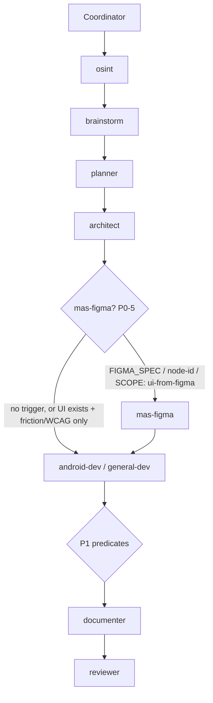

# Architecture Brief — MAS-05

## Architecture

**Option 1 — Dedicated read-only `mas-figma` extraction specialist + new `design-spec` brief type** (per brainstorm Recommended + osint Recommended Approach). Extends the MAS-01 **deterministic state machine** (Coordinator predicate tables) and **artifact bus** (on-disk briefs) with **one narrow feeder specialist**, following the exact MAS-04 specialist-addition file-touch pattern. `UI_SCOPE: logic-only` — no Compose screens, no production patches. `mas-figma` turns a Figma URL/`node-id` into a bounded, token-mapped, reuse-aware `.ai/context/design-specs/{TASK_ID}.md` that `android-dev`/`general-dev` read at startup and implement 1:1.

Core invariants inherited from `osint`/`api-contract`/`ux-intelligence` feeders: read-only, one brief per `TASK_ID`, chat return = one-line summary + `BRIEF_PATH`, no Task spawn, no `Approved:` authority, no routing. Reviewer remains the sole gate.

### Core topology (unchanged from MAS-01/MAS-04)

```
User → Coordinator (inline, normal)
         ├─ init-workflow-session.ps1 → workflow-sessions/{TASK_ID}.json
         ├─ predicate evaluation (zero-token) → specialist slot queue
         ├─ cap check (MAX_CHAIN_AGENTS) → skip optional specialists per priority
         ├─ handoff write → .ai/handoffs/{TASK_ID}[-{agent}].md
         ├─ Task spawn (foreground, model from spawn-model-policy) → Specialist
         ├─ record-workflow-step.ps1
         └─ route via NEXT_AGENT + predicate table (zero-token lookup)
```

`mas-figma` is a new **pre-dev feeder slot** inserted after `architect`/`planner` and before `android-dev`/`general-dev`.

---

## Architect gate decisions (Phase 0 — open questions resolved)

Resolves brainstorm **Risks & Open Questions** and osint **Open Questions**. These are the binding decisions the downstream general-dev implements against.

| # | Question | **Decision** | Rationale |
|---|----------|--------------|-----------|
| D1 | MCP transport: local desktop vs remote `mcp.figma.com` | **Local desktop server is the recommended/default assumption; remote is a degrade path.** `get_variable_defs` requires local (`127.0.0.1:3845`). Skill runs full pipeline on local; on remote-only, skip token names, record raw values, flag `tokens-unresolved (local MCP required)` in Open Questions. Never block solely on transport. | osint Finding #2 (HIGH): `get_variable_defs` is local-only. Degrade-gracefully preserves node map + screenshot value. |
| D2 | Code Connect configured in Android repo? | **Do not assume Code Connect.** Reuse table is dual-source: `get_code_connect_map` when available; else **repo-scan fallback** marking each row `source: repo-scan (unverified)`. Both paths always followed; Code Connect wins when present. | osint Finding #3 (HIGH, adapt). Keeps DRY/reuse-first working without a hard external dependency. |
| D3 | `mas-figma` before or after `architect` for greenfield UI? | **After architect/planner, before dev.** Architecture scopes *which* nodes/screens matter; the design-spec then details them for dev. mas-figma never designs architecture. | brainstorm Logic Flow B/C; osint Open Question. Spec informs implementation; architecture informs spec scope. |
| D4 | Knowledge-graph reuse ledger vs per-task table | **Per-task Component Reuse Table only for v1.** No cross-screen KG ledger. | brainstorm Recommended; osint Finding #3 tradeoff. Avoids infra cost; revisit when multi-screen volume grows. |
| D5 | `MODEL_CLASS` default + escalation | **Default `normal`; escalate `thinking` via handoff complexity flag** (see heuristic below). `fast` not used for v1 (mapping/ambiguity resolution needs reasoning on non-trivial frames). | brainstorm §MODEL_CLASS; osint Finding #7 (adapt). Extraction is mechanical; complex frames benefit from stronger reasoning. |
| D6 | Complexity-score heuristic (v1) | **Node-count threshold with two override triggers** (see below). Simple, deterministic, Coordinator-evaluable at handoff-write time from the get_metadata sweep or handoff hint. | brainstorm Risks (mis-tiering); osint Finding #7. v1 keeps it cheap; refine later. |
| D7 | Semver bump | **`1.2.1` → `1.3.0`** (next minor). New specialist = additive feature capability. `1.3.1` from the plan presumes a non-existent `1.3.0`; the current manifest is `1.2.1`, so the correct next minor is `1.3.0`. MAS-04 Phase C (observability/migration/chaos) was never shipped, so no collision. | Semver: additive, backward-compatible new agent → minor bump. |
| D8 | `MAX_CHAIN_AGENTS` treatment | **`mas-figma` is protected-when-triggered in full `/mas`** (dev depends on the artifact; silent skip would force eyeballing — the exact anti-pattern). If mandatory chain + mas-figma exceeds cap → **user escalation**, not silent drop. **Skippable in Lite** within tier cap. | brainstorm Risks; osint anti-pattern #1. Skipping the feeder defeats the feature's purpose. |
| D9 | Greenfield UI ordering vs ux-intelligence/a11y | **mas-figma runs pre-dev (extraction); ux-intelligence/a11y run post-dev (behavior/WCAG).** No same-hop overlap. When UI already exists and only friction/WCAG in scope → **do not** trigger mas-figma. | brainstorm Mutual Exclusion §4; osint mutual-exclusion. Different chain phases, different inputs. |
| D10 | `figma-design-to-code` prerequisite | **Mandatory prereq before `get_design_context`.** Skill honors Cursor `figma-design-to-code` (or replicates hint priority: Code Connect > component docs > annotations > tokens > raw hex). | osint Implementation Guidance; brainstorm Logic Flow A. First-party skill is the source of truth for extraction hints. |

### MODEL_CLASS complexity heuristic (v1 — D6)

Default `normal`. Coordinator escalates to `thinking` when the handoff carries `FIGMA_COMPLEXITY: high` **or** any of these deterministic triggers is known at routing time:

| Trigger | Threshold (escalate to `thinking`) |
|---------|-----------------------------------|
| Node count (from `get_metadata` sweep, if pre-known, else handoff hint) | `> 40` nodes under target |
| Variant / nesting depth | `≥ 3` nested variant levels |
| Unbound values ratio | `> 30%` of styles are raw hex/px with no Figma variable |

- v1 default path: Coordinator sets `MODEL_CLASS: normal` unless user/upstream sets `FIGMA_COMPLEXITY: high` (or `MODEL_CLASS: thinking` explicitly).
- The three thresholds are documented as the escalation rationale; a full auto-scoring pass is deferred (single flag suffices for v1).
- Resolution order unchanged: handoff `MODEL_CLASS` → policy table (`normal`) → default.

---

## Routing topology

### Trigger predicate (deterministic, zero-token) — extends MAS-04 table

Evaluated by Coordinator **before the dev slot**. First-match wins; **max one `mas-figma` spawn per `TASK_ID`** unless handoff `RE_EXTRACT: yes`. Track in session JSON `specialists_spawned: []`.

| Priority | Predicate (any true) | Specialist | Default chain position |
|----------|----------------------|------------|------------------------|
| **P0-5 (figma)** | `FIGMA_SPEC: yes` **OR** Figma URL/`node-id` present in `SOURCES_HINT`/`FILES` **OR** `SCOPE: ui-from-figma` | **mas-figma** | **After architect/planner; before android-dev/general-dev** |

**Suppression rule:** Skip `mas-figma` when UI already exists and only behavioral friction (→ ux-intelligence) or WCAG (→ a11y) is in scope, even if a Figma URL is incidentally present — the trigger is *implementation-from-design*, not *audit-of-existing-UI*.

**`node-id` requirement:** A Figma URL **without** a `node-id` still triggers routing, but the specialist blocks (writes Open-Questions brief + HITL) rather than guessing a node. Coordinator does not pre-validate node-id — the skill owns that gate.

### Chain shape — UI-from-Figma feature (full `/mas`)

```
Coordinator → osint → brainstorm → planner → architect
  → mas-figma   (P0-5 fires: FIGMA_SPEC:yes | Figma URL/node-id | SCOPE: ui-from-figma)
  → android-dev | general-dev        (reads design-specs/{TASK_ID}.md at startup)
  → [ux-intelligence → a11y → i18n per MAS-04 P1 predicates]
  → documenter → reviewer → [debate?] → [commit?]
```



**Ordering invariants:**

1. `mas-figma` always **after** architect/planner (architecture scopes node selection) and **before** dev (dev consumes the spec).
2. Max one spawn per `TASK_ID` unless `RE_EXTRACT: yes` (idempotency; mirrors `RE_AUDIT`).
3. `mas-figma` **never** runs on the same hop as ux-intelligence/a11y (different chain phase, D9).
4. When both greenfield-from-Figma **and** post-dev UI audits apply, order is: mas-figma (pre-dev) → dev → ux-intelligence → a11y → i18n (post-dev).

### MAX_CHAIN_AGENTS impact (D8)

| Constant | Full `/mas` | Lite |
|----------|-------------|------|
| `MAX_CHAIN_AGENTS` | 12 (unchanged) | S=2, M=2, L=3, L+=4 |

- **Full `/mas`:** `mas-figma` is **protected-when-triggered** — it is *not* added to the token-rules auto-skip list, because dev's implementation fidelity depends on the artifact. If the projected mandatory chain + mas-figma exceeds 12 → **user escalation** (offer narrower `SCOPE` or split workflow), never a silent skip.
- **Lite:** `mas-figma` is **skippable within tier cap** (S/M unchanged, no figma spawn; L/L+ allow `FIG:y` per predicate). If `FIG:y` would breach tier cap, document skip in user summary and recommend full `/mas`.
- token-rules.md auto-skip order (MAS-04) is **unchanged**; add only a note that `mas-figma` is protected-when-triggered in full `/mas` and Lite-skippable.

---

## Modules

Logical module map (framework repo — not Android Gradle modules). MAS-01/MAS-04 base unchanged; MAS-05 additions marked.

```
mas-cursor-framework/
├── skills/
│   ├── multi-agent-system/
│   │   ├── protocol/
│   │   │   ├── brief-schemas.md           [UPDATE: +design-spec type]
│   │   │   ├── spawn-model-policy.md      [UPDATE: +mas-figma row]
│   │   │   ├── read-order.md              [UPDATE: mas-figma reads + dev design-spec subscription]
│   │   │   ├── handoff-format.md          [UPDATE: FIGMA_SPEC / SOURCES_HINT / RE_EXTRACT / FIGMA_COMPLEXITY]
│   │   │   ├── handoff-format-lite.md     [UPDATE: FIG:y]
│   │   │   ├── subagent-spawn.md          [UPDATE: +mas-figma slug row]
│   │   │   └── token-rules.md             [UPDATE: mas-figma protected-when-triggered note]
│   │   └── install/
│   │       └── manifest.json              [UPDATE: 1.2.1 → 1.3.0, +mas-figma]
│   ├── multi-agent-system/SKILL.md          [UPDATE: roster (documenter)]
│   ├── mas-coordinator/                     [UPDATE: P0-5 predicate + chain position]
│   ├── mas-reviewer/                        [UPDATE: conditional design-spec read step]
│   ├── mas-lite/                            [UPDATE: FIG:y tier row]
│   ├── mas-android-dev/                     [UPDATE: design-spec startup read + reference-not-final]
│   ├── mas-general-dev/                     [UPDATE: design-spec startup read + reference-not-final]
│   ├── mas-ux-intelligence/                 [UPDATE: mutual-exclusion one-liner vs mas-figma]
│   ├── mas-a11y/                            [UPDATE: mutual-exclusion one-liner vs mas-figma]
│   └── mas-figma/                           [NEW: read-only Figma extraction specialist]
└── .ai/context/
    └── design-specs/                        [NEW: design-spec brief dir + .gitkeep]
```

### Agent slug registry (MAS-05 addition)

| Slug | Skill dir | MODEL_CLASS | Manifest version |
|------|-----------|-------------|------------------|
| `mas-figma` | `mas-figma` | `normal` (thinking on `FIGMA_COMPLEXITY: high`) | 1.3.0 |

### Per-project context dir addition

| Dir | Brief type | Producer | Consumer(s) |
|-----|------------|----------|-------------|
| `design-specs/` | design-spec | mas-figma | android-dev / general-dev (startup read), reviewer (conditional) |

---

## Layers

```
┌─────────────────────────────────────────────────────────────┐
│  Presentation / Entry                                         │
│  commands/mas.md, mas-lite.md · rules/multi-agent-hybrid.mdc │
└────────────────────────────┬────────────────────────────────┘
┌────────────────────────────▼────────────────────────────────┐
│  Orchestration (Coordinator)                                  │
│  P0-5 figma predicate · protected-when-triggered cap policy   │
│  specialists_spawned / RE_EXTRACT idempotency (session JSON)  │
└────────────────────────────┬────────────────────────────────┘
        ┌────────────────────┼────────────────────┐
┌───────▼───────┐  ┌─────────▼─────────┐  ┌──────▼──────┐
│  Protocol      │  │  mas-figma         │  │  Consumers   │
│  brief-schemas │  │  read-only MCP     │  │  android-dev │
│  spawn-policy  │  │  inspect-first     │  │  general-dev │
│  read-order    │  │  no code patches   │  │  reviewer    │
└───────┬───────┘  └─────────┬─────────┘  └──────────────┘
        │                    │  (plugin-figma-figma MCP: get_metadata,
        │                    │   get_variable_defs, get_design_context,
        │                    │   get_code_connect_map, get_screenshot)
┌───────▼────────────────────▼──────────────────────────────┐
│  Artifact store (.ai/context/design-specs/, .ai/handoffs/)  │
│  design-spec brief · screenshot ref · asset manifest        │
└─────────────────────────────────────────────────────────────┘
```

### Coordinator session JSON (additive — no schema change)

`mas-figma` appends to the existing `specialists_spawned: []` array; `RE_EXTRACT: yes` gates re-spawn exactly as `RE_AUDIT` does for MAS-04 specialists. No new session fields required.

---

## Contracts

### 1. New brief type — `design-spec` (register in `brief-schemas.md`)

| Type | Path pattern | Required sections |
|------|--------------|-------------------|
| design-spec | `.ai/context/design-specs/{TASK_ID}.md` | Node Map, Design Tokens, Layout Spec, Component Reuse Table, Asset Manifest, Screenshot Reference, Open Questions |

**Section field contracts (data shapes — no Compose layout authored here):**

- **Node Map** — table: `node-id | name | type | x | y | width | height | parent-id`. Structural/positional backbone from `get_metadata`. This is the dimensions/positions/hierarchy record.
- **Design Tokens** — table: `figma token name | category (color/spacing/typography/sizing/radius) | raw value | → intended MaterialTheme/CompositionLocal ref`. Follows the Relay mapping *model* (figma style → intermediate token → `MaterialTheme.colorScheme/typography/shapes`; custom scales e.g. spacing via `CompositionLocal`). **Adopt mapping shape only — not Relay tooling.** On remote-only MCP: raw values + `tokens-unresolved` flag.
- **Layout Spec** — per chosen node: auto-layout direction, constraints, spacing, typography, variant structure (from per-node `get_design_context`, marked **"reference — not final code"**).
- **Component Reuse Table** — `figma node / mainComponentId | existing composable or theme token | source (code-connect | repo-scan) | reuse | regenerate`. Repo-scan rows marked `unverified` (D2).
- **Asset Manifest** — `node-id | asset type (icon/image) | exported URL | intended drawable/resource | expiry flag (~7 days)`. Dev must download-and-commit.
- **Screenshot Reference** — saved image path + node-id for dev 1:1 validation; embedded in brief.
- **Open Questions** — ambiguities, blocked steps, transport/token-resolution flags, HITL notes.

**Reviewer validation guidance:** unchanged mechanism — reviewer flags missing required sections as `Approved: NO` schema-gap notes; reviewer does **not** re-extract.

### 2. Protocol touchpoints (MAS-04 file-touch pattern — 8 files + skill + dir)

| File | Edit |
|------|------|
| `brief-schemas.md` | Add `design-spec` registry row + section contract reference; add mas-figma to Validation guidance writers list |
| `spawn-model-policy.md` | Add `mas-figma → normal` row; note `thinking` escalation on `FIGMA_COMPLEXITY: high` |
| `read-order.md` | Add `mas-figma` subscription row; **add** `design-specs/{TASK_ID}.md` to android-dev/general-dev startup reads (conditional on existence) |
| `handoff-format.md` | Document `FIGMA_SPEC: yes`, `SOURCES_HINT` (Figma URL w/ node-id), `RE_EXTRACT: yes`, `FIGMA_COMPLEXITY: high` |
| `handoff-format-lite.md` | Document `FIG:y` (within 12-line cap) |
| `subagent-spawn.md` | Add `mas-figma → ~/.cursor/skills/mas-figma/SKILL.md` slug row |
| `token-rules.md` | Note mas-figma is protected-when-triggered (full `/mas`), Lite-skippable; auto-skip order otherwise unchanged |
| `install/manifest.json` | Version `1.2.1 → 1.3.0`; add `mas-figma` to `skills` array |
| `mas-coordinator/SKILL.md` | Add P0-5 predicate row, chain position, handoff-field routing, suppression rule |
| `mas-reviewer/SKILL.md` | Conditional read step: when `design-specs/{TASK_ID}.md` exists, verify required sections; do not re-extract |
| `mas-android-dev/SKILL.md`, `mas-general-dev/SKILL.md` | Subscribe to design-spec at startup; treat extracted code as reference; validate 1:1 vs Screenshot Reference; download-and-commit assets |
| `mas-ux-intelligence/SKILL.md`, `mas-a11y/SKILL.md` | One-line mutual-exclusion cross-ref vs mas-figma |
| `multi-agent-system/SKILL.md` | Roster entry (documenter) |
| `skills/mas-figma/SKILL.md` | **NEW** — ordered MCP recipe + reference-not-final contract + degrade paths |
| `.ai/context/design-specs/.gitkeep` | **NEW** context dir |

### 3. Handoff routing fields (contracts)

```
# Full /mas
FIGMA_SPEC: yes                 # explicit trigger for mas-figma
SOURCES_HINT: <Figma URL w/ node-id>   # also a trigger; node-id required for extraction
RE_EXTRACT: yes                 # allow re-spawn of mas-figma on same TASK_ID (idempotency override)
FIGMA_COMPLEXITY: high          # escalate MODEL_CLASS normal → thinking
SCOPE: ui-from-figma            # trigger via scope

# Lite
FIG:y                           # figma trigger within 12-line cap
```

Handoffs **without** these flags remain valid (no behavior change). `mas-figma` handoff (Coordinator-written) includes: `TARGET_AGENT: mas-figma`, `MODEL_CLASS: normal|thinking`, `SOURCES_HINT`, upstream `BRIEF_PATH` refs (architecture/plans), `DELIVERABLE: Brief at .ai/context/design-specs/{TASK_ID}.md`, `NEXT_AGENT: android-dev|general-dev`, `SPAWN_STATUS: spawned`.

### 4. `mas-figma` specialist contract

| Field | Value |
|-------|-------|
| Trigger | Predicate P0-5 |
| Input | osint, architecture, plans for `{TASK_ID}`; handoff `SOURCES_HINT`/`FILES` (Figma URL/node-id) |
| Output | `.ai/context/design-specs/{TASK_ID}.md` |
| `MODEL_CLASS` | `normal` (default); `thinking` on `FIGMA_COMPLEXITY: high` |
| MCP pipeline | (1) resolve node-id → **Block if missing** · (2) `get_metadata` → Node Map · (3) `get_variable_defs` → tokens (local-only; degrade + flag if remote) · (4) `get_design_context` **per chosen child node only** (never whole frame) → Layout Spec (reference) · (5) `get_code_connect_map` + repo scan → Reuse Table · (6) `get_screenshot` → Screenshot Reference · (7) Asset Manifest w/ expiry flag |
| Prerequisite | Honor Cursor `figma-design-to-code` before `get_design_context` (hint priority: Code Connect > component docs > annotations > tokens > raw hex) |
| Token mapping | Relay mapping **model** only (figma style → intermediate token → `MaterialTheme`/`CompositionLocal`); no Relay plugin adoption |
| Never | Patch production code; spawn Task; route workflows; issue `Approved:`; whole-frame `get_design_context`; screenshot-eyedropper hex; hand-draw icons/inline SVG; paste MCP React/Tailwind verbatim as final |
| Idempotency | One spawn per `TASK_ID` unless `RE_EXTRACT: yes` |
| Chat return | one-line summary + `BRIEF_PATH` |

### 5. Degrade-gracefully matrix (never fabricate)

| Failure | Handling |
|---------|----------|
| No `node-id` in handoff/URL | **Block:** brief with Open Questions + HITL note; never guess a node/coordinates |
| MCP unreachable | **Block:** brief with Blocked note; route to user HITL; no invented layout |
| Remote-only server (no `get_variable_defs`) | Record raw values + flag `tokens-unresolved (local MCP required)`; continue with node map + screenshot |
| No Code Connect configured | Repo-scan fallback; mark reuse rows `source: repo-scan (unverified)` |
| No Figma variables (raw hex/px) | Record raw values + flag `no design tokens defined`; recommend dev map to nearest project token, not hardcode |
| Asset URL expired (~7 days) | Flag in Asset Manifest; instruct dev to re-export before commit |
| Re-run same `TASK_ID` | Blocked unless `RE_EXTRACT: yes` |
| Multi-screen frame | `get_metadata` sweep only; deep-extract per child node — never whole-frame `get_design_context` |

### 6. Specialist invariants (all must hold)

- Read-only extraction; **never** patches production source.
- One design-spec brief per `TASK_ID`; chat return = one-line summary + `BRIEF_PATH`.
- Never spawns Task subagents; never routes workflows.
- No `Approved:` authority — `reviewer` remains the sole gate; dev owns composables/state/1:1 validation.
- Honors Cursor `figma-design-to-code` as mandatory prereq before `get_design_context`.
- Inspect-first: whole-frame `get_design_context` is **forbidden**; Node Map from `get_metadata` is the positional backbone.
- Reference-not-final: extracted code is a spec reference; dev re-maps to Compose + project tokens.
- No external code copy: describe OSS patterns (composer/SK-agent/Relay) only; do not vendor source.

---

## Mutual Exclusion Matrix

`mas-figma` **extracts and briefs**; it does not implement, audit behavior, or design architecture.

| vs | Boundary |
|----|----------|
| `architect` | System/module design & node-selection scope — mas-figma extracts the visual contract only; designs no architecture. Runs **after** architect. Architecture brief must **not** duplicate design-spec sections (Node Map/Tokens/Layout). |
| `ux-intelligence` | Behavioral friction / journey simulation — **not** design extraction. Post-dev; mas-figma is pre-dev. No same-hop overlap. |
| `a11y` | WCAG 2.2 conformance — **not** layout/token extraction. mas-figma **may surface contrast token values** for a11y to consume; a11y does not re-extract layout. Post-dev. |
| `android-dev` / `general-dev` | Spec only; dev owns composables, state, project-token mapping, asset download-and-commit, and 1:1 validation vs Screenshot Reference. Dev does **not** call Figma MCP when a design-spec exists. |
| `reviewer` | Reviewer validates design-spec schema completeness + dev's 1:1 fidelity; mas-figma has no approval authority. |

**Regression checklist (for test-strategy/reviewer):**

1. UI-from-Figma **triggers mas-figma**, not ux-intelligence.
2. Friction-only / WCAG-only on existing UI **skips mas-figma** (routes ux-intelligence/a11y).
3. Architect brief does **not** duplicate design-spec sections.
4. Dev does **not** call Figma MCP when design-spec exists.
5. Max one mas-figma spawn per `TASK_ID` unless `RE_EXTRACT: yes`.
6. No `node-id` → Blocked brief + HITL, never a guessed node.

---

## Responsive Strategy

**N/A — `UI_SCOPE: logic-only`.** No Compose screens or adaptive layouts authored in MAS-05. The `design-spec` brief *describes* layout/token data shapes (dimensions, token names, layout structure as data fields) that downstream `android-dev`/`general-dev` consume; it does **not** author Compose layouts, pixel values, WindowSizeClass logic, or two-pane strategy. Downstream Android responsive/visual QA is deferred to the future UI implementation workflow that consumes the brief.

Tiered behavior applies only to **workflow mode**:

| Mode | Chain depth | mas-figma |
|------|-------------|-----------|
| Full `/mas` | up to 12 agents | Spawns on P0-5; protected-when-triggered (user escalation on cap breach, not silent skip) |
| Lite S/M | 2 agents | No mas-figma spawn |
| Lite L | 3 agents | `FIG:y` per predicate; inspect-first preserved; skip + warn if tier cap breached |
| Lite L+ | 4 agents | Same as L, broader cap |

---

## Files

### Create

| Path | Purpose |
|------|---------|
| `skills/mas-figma/SKILL.md` | New read-only extraction specialist (ordered MCP recipe, reference-not-final, degrade paths) |
| `.ai/context/design-specs/.gitkeep` | New context dir for design-spec briefs |

### Update

| Path | Change |
|------|--------|
| `skills/multi-agent-system/protocol/brief-schemas.md` | +`design-spec` type row + writer list entry |
| `skills/multi-agent-system/protocol/spawn-model-policy.md` | +`mas-figma → normal` row (thinking escalation note) |
| `skills/multi-agent-system/protocol/read-order.md` | +mas-figma subscription; dev design-spec subscription (conditional) |
| `skills/multi-agent-system/protocol/handoff-format.md` | +`FIGMA_SPEC` / `SOURCES_HINT` / `RE_EXTRACT` / `FIGMA_COMPLEXITY` |
| `skills/multi-agent-system/protocol/handoff-format-lite.md` | +`FIG:y` |
| `skills/multi-agent-system/protocol/subagent-spawn.md` | +`mas-figma` slug → skill path row |
| `skills/multi-agent-system/protocol/token-rules.md` | mas-figma protected-when-triggered note |
| `skills/multi-agent-system/install/manifest.json` | version `1.2.1 → 1.3.0`; +`mas-figma` in skills array |
| `skills/multi-agent-system/SKILL.md` | roster entry (documenter) |
| `skills/mas-coordinator/SKILL.md` | P0-5 predicate, chain position, handoff routing, suppression rule |
| `skills/mas-reviewer/SKILL.md` | conditional design-spec read step |
| `skills/mas-lite/SKILL.md` | `FIG:y` tier row (L/L+) |
| `skills/mas-android-dev/SKILL.md` | design-spec startup read + reference-not-final + asset download-and-commit |
| `skills/mas-general-dev/SKILL.md` | design-spec startup read + reference-not-final + asset download-and-commit |
| `skills/mas-ux-intelligence/SKILL.md` | mutual-exclusion one-liner vs mas-figma |
| `skills/mas-a11y/SKILL.md` | mutual-exclusion one-liner vs mas-figma |

### Dependency order (implementation — aligns with plan Phases 1–5)

```
0 (this brief) → routing topology, transport/Code-Connect/ordering/MODEL_CLASS/semver decisions locked
1  protocol foundation (brief-schemas, spawn-model-policy, read-order, handoff-format[-lite], subagent-spawn, token-rules, design-specs/.gitkeep)
2  skills/mas-figma/SKILL.md   (depends on brief-schemas + read-order)
3  coordinator predicate + downstream consumers (reviewer, android-dev, general-dev, ux-intelligence, a11y)   (depends on 1,2)
4  manifest 1.3.0 + multi-agent-system SKILL roster   (depends on 2)
5  test-strategy fixtures → documenter → dogfood MAS-05-FIGMA-DOGFOOD → mutual-exclusion regression   (depends on 1–4)
```

### Exclusions (do not re-implement)

- MAS-04 auto-skip order in `token-rules.md` — add note only; mechanics unchanged.
- `spawn-model-policy` core resolution — add row only.
- Install/export dedup patterns — unchanged; only extend skills array + version.
- No new session JSON fields — reuse `specialists_spawned` + `RE_EXTRACT` (mirrors `RE_AUDIT`).

---

## Usage Report

Model: default
Class: thinking
Tokens: unknown

DONE
