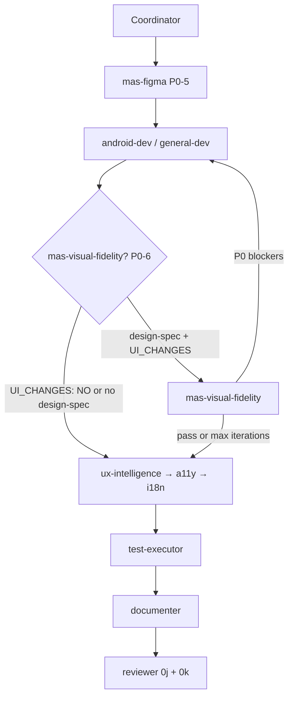

# Architecture Brief — MAS-06

## Architecture

**Option 5 — Composite** (per brainstorm Recommended + osint Recommended Approach): add post-dev **`mas-visual-fidelity`** specialist, new **`visual-qa`** brief type at `.ai/context/visual-qa/{TASK_ID}.md`, slim **Verification Contract** slice on `design-spec`, reviewer step **0k Design-Fidelity Verification** (consumer-only), and **`build-test-visual-qa.md`** artifact-backed gate — so Figma-driven UI cannot pass review on imagined Visual QA alone. Extends MAS-05's pre-dev `mas-figma` → `design-spec` pipeline with a symmetric post-dev evidence layer using the MAS-04 advisory specialist pattern.

`UI_SCOPE: logic-only` — no Compose screens, no production patches. Protocol/skill contracts only.

Core invariants: read-only specialist, one `visual-qa` brief per `TASK_ID`, chat return = one-line summary + `BRIEF_PATH`, no Task spawn, no `Approved:` authority, no routing. Reviewer remains the sole gate. **Immutable extraction** (design-spec sections) vs **mutable verification** (visual-qa only) — parity results never append to design-spec.

### Core topology (extends MAS-01/MAS-04/MAS-05)

```
User → Coordinator (inline, normal)
         ├─ init-workflow-session.ps1 → workflow-sessions/{TASK_ID}.json
         ├─ predicate evaluation (zero-token) → specialist slot queue
         ├─ cap check (MAX_CHAIN_AGENTS) → skip optional specialists per priority
         ├─ handoff write → .ai/handoffs/{TASK_ID}[-{agent}].md
         ├─ Task spawn (foreground, model from spawn-model-policy) → Specialist
         ├─ record-workflow-step.ps1
         └─ route via NEXT_AGENT + predicate table (zero-token lookup)
```

`mas-visual-fidelity` is a new **post-dev verification slot** inserted after `android-dev`/`general-dev` and **before** `ux-intelligence` (and the MAS-04 P1 UI audit trio).

---

## Architect gate decisions (Phase 0 — D1–D5 + open questions resolved)

Binding decisions for downstream general-dev. Aligns plan resolved table, brainstorm Domain & Contracts §1–6, and osint Findings #1–#6.

| # | Question | **Decision** | Rationale |
|---|----------|--------------|-----------|
| D1 | `mas-visual-fidelity` vs extend `test-executor` | **New `mas-visual-fidelity` specialist (Option 5).** test-executor remains run-only; no Figma MCP, no measurement diff ownership in v1. | Clean evidence/judgment split (MAS-04); test-executor blurs pass/fail with design parity. Option 6 documented as fallback only (see below). |
| D2 | Target Android capture infra | **Target-project dependent; MAS framework repo has no Android modules.** Fidelity agent inventories Paparazzi / Compose Preview Screenshot Testing / emulator at runtime from dev handoff `FILES` + test-strategy slice. Missing infra → `BLOCKED` brief + HITL; P0 measurement still runs when layout metrics extractable. **Dogfood (MAS-06-VFID-DOGFOOD):** fixture-only — no live Gradle; test-strategy documents expected commands as contract shapes. | osint Finding #5 (adapt); no MAS-framework Gradle changes. |
| D3 | Baseline staleness policy | **Re-fetch `get_screenshot` at fidelity gate by default** on design-spec `node-id`. Trust committed design-spec Screenshot Reference PNG only when MCP unreachable **and** PNG exists with age **≤ 7 days**. Handoff `BASELINE_STALE: no` = explicit trust override (same semantics as trusting committed baseline). | osint Finding #3 (HIGH); stale pre-dev baseline anti-pattern. |
| D4 | Pixel tolerance | **2px slack on dimensions only** (width, height, padding, gap, position). **Zero tolerance** on colors, token names, and token-mapped values. Subpixel dimension drift → `severity: minor`, not `blocker`. | TSH / buildmvpfast measurement-first; font rendering variance on JVM vs device. |
| D5 | v1 fidelity scope | **Default UI state only** (`state-id: default`). Interaction/hover/motion/loading variants → P2 reviewer imagined rows until v1.1+. | design-spec often static; avoids false blockers on un-specified states. |
| D6 | Multi-screen design-spec | **One sectioned `visual-qa` brief per `TASK_ID`** (per-screen `## Screen: {name}` subsections). Escalate `MODEL_CLASS` to `thinking` when **> 3** screen states in design-spec Node Map. | Balances artifact count vs reviewer consumption; mirrors mas-figma multi-screen inspect-first. |
| D7 | Semver bump | **`1.3.0` → `1.4.0`** (next minor). New protected specialist + brief type = additive feature capability. `1.3.1` reserved for Option 6 fallback-only ship if chain cap blocks full Option 5 at implementation time. | Current manifest is `1.3.0`; semver: additive backward-compatible agent → minor bump. |
| D8 | `MAX_CHAIN_AGENTS` — mas-visual-fidelity | **`mas-visual-fidelity` is protected-when-triggered in full `/mas`** (same policy as `mas-figma`). Not added to token-rules auto-skip list. Cap breach with triggered fidelity → **user escalation** with unresolved P0 table attached — never silent skip in full `/mas`. Lite: skip spawn + warn. | Skipping post-dev fidelity when design-spec + UI changes exist recreates imagined Visual QA anti-pattern. |
| D9 | Chain position vs ux/a11y | **After dev; before ux-intelligence, a11y, i18n.** Objective layout/token parity before behavioral friction and WCAG. No same-hop overlap with mas-figma (pre-dev vs post-dev). | osint Finding #6 (Lane C evidence-before-judgment). |
| D10 | Commercial visual AI (Applitools/SmartUI) | **Adapt brief shape only — no SDK dependency in v1.** Structured diff table + region summary; no vendor paste or API keys in framework. | osint License/Copy Guardrails; R3 mitigation. |
| D11 | Dev handoff `UI_CHANGES` | **Required for `VISUAL_FIDELITY: auto` predicate.** Dev declares `UI_CHANGES: YES` \| `UI_CHANGES: NO`. Auto also fires when `FILES` touch Composables/resources/themes/dimensions without explicit flag (Coordinator inference). | Deterministic suppression when logic-only changes. |
| D12 | Option 6 fallback trigger | **Documented escape hatch only — not default.** Activate when: (a) user explicitly requests cap relief after escalation, **or** (b) ship-time decision that `MAX_CHAIN_AGENTS` cannot be raised and user declines scope split. Fallback: extend `test-runs/{TASK_ID}.md` with required **Visual Fidelity** section (measurement diff + capture paths); test-executor runs Paparazzi/`validateScreenshotTest` commands from test-strategy; **no** `get_screenshot` re-baseline; session JSON `visual_fidelity_fallback: test-executor`. Ship as `1.3.1` patch, not `1.4.0`. | Plan D1 Option 6 stepping stone; preserves chain slot at cost of weaker Figma baseline story. |

### Capture method priority (D2 — target Android projects)

Evaluated by `mas-visual-fidelity` + dev/test-strategy; first available wins:

| Priority | Method | Gradle command (typical) | Notes |
|----------|--------|--------------------------|-------|
| 1 | **Paparazzi** | `./gradlew :<module>:verifyPaparazziDebug` | JVM-fast; preferred for CI; flag host-font variance in Open Questions |
| 2 | **Compose Preview Screenshot Testing** | `./gradlew :<module>:validateDebugScreenshotTest` | `@PreviewTest`; import Figma baseline to `screenshotTest/reference/` |
| 3 | **Emulator `adb screencap`** | Manual/scripted; test-executor may assist | Integration-critical full screens; highest cost |

**MAS framework repo:** no capture commands — dogfood validates schema + routing only via fixtures.

### MODEL_CLASS heuristic (v1)

Default `normal`. Escalate to `thinking` when handoff carries `FIGMA_COMPLEXITY: high` **or** design-spec has **> 3** screen states (D6).

---

## Routing topology

### Trigger predicate (deterministic, zero-token) — P0-6

Evaluated by Coordinator **after the dev slot**, **before ux-intelligence**. First-match wins; max **one `mas-visual-fidelity` spawn per `TASK_ID`** unless handoff `RE_VERIFY: yes`. Track in session JSON `specialists_spawned: []`.

| Priority | Predicate (any true) | Specialist | Default chain position |
|----------|----------------------|------------|------------------------|
| **P0-6 (visual-fidelity)** | `VISUAL_FIDELITY: yes` **OR** (`VISUAL_FIDELITY: auto` AND `.ai/context/design-specs/{TASK_ID}.md` exists AND dev handoff `UI_CHANGES: YES` [or `FILES` touch Composables/resources/themes/dimensions]) | **mas-visual-fidelity** | **After android-dev/general-dev; before ux-intelligence** |

**Suppression rules:**

1. Skip when `UI_CHANGES: NO` — even if design-spec exists.
2. Skip when no `design-specs/{TASK_ID}.md`.
3. Skip when only behavioral friction (→ ux-intelligence) or WCAG (→ a11y) on **existing** UI with no new implementation from spec — same spirit as mas-figma suppression (D9).
4. Lite: **no auto predicate** — skip spawn unless explicit `VFID:y`; always warn "Figma fidelity unverified".

**Explicit overrides:**

| Flag | Effect |
|------|--------|
| `VISUAL_FIDELITY: yes` | Force spawn (full `/mas`) |
| `VISUAL_FIDELITY: auto` | Coordinator evaluates predicate (full `/mas` only) |
| `RE_VERIFY: yes` | Allow re-spawn on same `TASK_ID` (idempotency; mirrors `RE_EXTRACT`) |
| `BASELINE_STALE: no` | Trust committed design-spec Screenshot Reference when MCP blocked |
| `VFID:y` | Lite explicit trigger (within 12-line cap) |

### Chain shape — UI-from-Figma feature (full `/mas`)

```
Coordinator → osint → brainstorm → planner → architect
  → mas-figma                    (P0-5: pre-dev extraction)
  → android-dev | general-dev    (reads design-spec + Verification Contract)
  → mas-visual-fidelity          (P0-6: post-dev fidelity — when triggered)
  → ux-intelligence → a11y → i18n → compliance   (MAS-04 P1, per predicates)
  → test-executor → documenter → reviewer
```



**Ordering invariants:**

1. `mas-visual-fidelity` always **after** dev and **before** ux-intelligence/a11y/i18n when triggered.
2. `mas-visual-fidelity` always **after** `mas-figma` when both fire (pre-dev extraction must complete before post-dev verify).
3. Max one spawn per `TASK_ID` unless `RE_VERIFY: yes`.
4. P0 `blocker` rows → Coordinator routes to dev fix (max **2** iterations) → `RE_VERIFY: yes` re-spawn → user escalation with P0 table if still failing.
5. Reviewer **never** runs before visual-fidelity when P0-6 fired and iteration incomplete.

### Iteration loop

```
dev DONE → mas-visual-fidelity → P0 blockers?
  yes → dev fix (handoff lists delta rows) → RE_VERIFY: yes → mas-visual-fidelity (iteration ≤ 2)
  no  → continue chain → reviewer 0k PASS (P0 resolved) → imagined P2 only
```

Session JSON additive fields: `visual_fidelity_spawned: bool`, `p0_blockers: int`, `iteration_count: int`, optional `visual_fidelity_fallback: test-executor` (Option 6 only).

### MAX_CHAIN_AGENTS impact (D8)

| Constant | Full `/mas` | Lite |
|----------|-------------|------|
| `MAX_CHAIN_AGENTS` | 12 (unchanged) | S=2, M=2, L=3, L+=4 |

**Worst-case UI-from-Figma chain (all predicates fire):** osint + brainstorm + planner + architect + mas-figma + dev + mas-visual-fidelity + ux + a11y + i18n + compliance + test-executor + documenter + reviewer = **13 slots** → exceeds 12.

**Mitigation order:**

1. Apply existing MAS-04 optional skip order (test-executor first) **before** dropping protected specialists.
2. If mandatory chain + mas-figma + mas-visual-fidelity still exceeds 12 → **user escalation** (offer narrower `SCOPE`, split workflow, or Option 6 fallback per D12).
3. **Never** silently skip mas-figma or mas-visual-fidelity when their predicates fired in full `/mas`.

**Lite:** `mas-visual-fidelity` not in default tiers; `VFID:y` explicit only on L/L+ if cap allows; otherwise skip + warn.

---

## Modules

Logical module map (framework repo). MAS-05 base unchanged; MAS-06 additions marked.

```
mas-cursor-framework/
├── skills/
│   ├── multi-agent-system/
│   │   ├── protocol/
│   │   │   ├── brief-schemas.md              [UPDATE: +visual-qa type; design-spec Verification Contract]
│   │   │   ├── spawn-model-policy.md         [UPDATE: +mas-visual-fidelity row]
│   │   │   ├── read-order.md                 [UPDATE: fidelity pipeline subscription matrix]
│   │   │   ├── handoff-format.md             [UPDATE: VISUAL_FIDELITY / UI_CHANGES / RE_VERIFY / BASELINE_STALE]
│   │   │   ├── handoff-format-lite.md        [UPDATE: VFID:y]
│   │   │   ├── subagent-spawn.md             [UPDATE: +mas-visual-fidelity slug]
│   │   │   └── token-rules.md                [UPDATE: mas-visual-fidelity protected-when-triggered]
│   │   ├── references/
│   │   │   ├── visual-fidelity-standards.md  [NEW]
│   │   │   ├── figma-extraction-standards.md [UPDATE: Verification Contract template]
│   │   │   └── build-test-visual-qa.md       [UPDATE: artifact-backed Visual QA rules]
│   │   └── install/
│   │       └── manifest.json                 [UPDATE: 1.3.0 → 1.4.0, +mas-visual-fidelity]
│   ├── mas-visual-fidelity/                  [NEW]
│   ├── mas-coordinator/                      [UPDATE: P0-6 predicate + iteration loop]
│   ├── mas-reviewer/                         [UPDATE: step 0k + startup read #15]
│   ├── mas-lite/                             [UPDATE: VFID:y + skip warn]
│   ├── mas-figma/                            [UPDATE: emit Verification Contract §8]
│   ├── mas-android-dev/                      [UPDATE: Verification Contract startup read]
│   ├── mas-general-dev/                      [UPDATE: Verification Contract startup read]
│   ├── mas-ux-intelligence/                  [UPDATE: mutual-exclusion one-liner]
│   ├── mas-a11y/                             [UPDATE: mutual-exclusion one-liner]
│   ├── mas-test-strategy/                    [UPDATE: visual capture commands slice]
│   ├── mas-test-executor/                    [UPDATE: boundary note; Option 6 fallback]
│   └── multi-agent-system/SKILL.md           [UPDATE: MAS-06 roster section]
└── .ai/context/
    ├── visual-qa/                            [NEW: visual-qa brief dir + .gitkeep]
    └── fixtures/MAS-06-VFID-DOGFOOD/         [NEW: dogfood stubs]
```

### Agent slug registry (MAS-06 addition)

| Slug | Skill dir | MODEL_CLASS | Manifest version |
|------|-----------|-------------|------------------|
| `mas-visual-fidelity` | `mas-visual-fidelity` | `normal` (thinking on `FIGMA_COMPLEXITY: high` or > 3 screens) | 1.4.0 |

### Per-project context dir additions

| Dir | Brief type | Producer | Consumer(s) |
|-----|------------|----------|-------------|
| `visual-qa/` | visual-qa | mas-visual-fidelity | reviewer (step 0k), coordinator (iteration routing) |
| `design-specs/` (slice) | Verification Contract subsection | mas-figma (write); mas-visual-fidelity (read) | android-dev, general-dev, mas-visual-fidelity, test-strategy |

---

## Layers

```
┌─────────────────────────────────────────────────────────────┐
│  Presentation / Entry                                         │
│  commands/mas.md, mas-lite.md · rules/multi-agent-hybrid.mdc │
└────────────────────────────┬────────────────────────────────┘
┌────────────────────────────▼────────────────────────────────┐
│  Orchestration (Coordinator)                                  │
│  P0-5 figma + P0-6 visual-fidelity predicates                 │
│  protected-when-triggered cap policy · iteration loop (max 2) │
│  visual_fidelity_spawned / p0_blockers / iteration_count      │
└────────────────────────────┬────────────────────────────────┘
        ┌────────────────────┼────────────────────┐
┌───────▼───────┐  ┌─────────▼─────────┐  ┌──────▼──────┐
│  Protocol      │  │  mas-visual-fidelity │  │  Consumers   │
│  brief-schemas │  │  read-only post-dev  │  │  reviewer 0k │
│  read-order    │  │  get_screenshot only │  │  ux / a11y   │
│  visual-fid.   │  │  no code patches     │  │  test-strat. │
│  standards     │  └─────────┬─────────┘  └──────────────┘
└───────┬───────┘            │
        │          ┌─────────▼─────────┐
        │          │  mas-figma (pre)   │
        │          │  design-spec +     │
        │          │  Verification      │
        │          │  Contract (input)  │
        │          └─────────┬─────────┘
┌───────▼────────────────────▼──────────────────────────────┐
│  Artifact store                                             │
│  design-specs/ (immutable extraction + read-only contract)  │
│  visual-qa/ (mutable verification output)                   │
└─────────────────────────────────────────────────────────────┘
```

### Three-tier verification (cheapest first)

| Tier | Name | Input | Output | Producer | Gate |
|------|------|-------|--------|----------|------|
| P0 | Token/layout measurement diff | design-spec Design Tokens + Node Map vs captured metrics | `property \| expected \| actual \| delta \| severity` | mas-visual-fidelity | Reviewer 0k — `blocker` → `Approved: NO` |
| P1 | Screenshot pair compare | Figma baseline PNG vs implementation PNG at contract viewport | PASS/FAIL/PARTIAL + regions | mas-visual-fidelity | Reviewer 0k — FAIL without Major note |
| P2 | Subjective polish | Gaps P0/P1 cannot catch (motion, micro-interaction) | Reviewer imagined rows | reviewer | Unchanged |

When `design-spec` exists, reviewer **Layout / Typography / Color / Spacing** imagined rows → **N/A** unless `visual-qa` brief present (`build-test-visual-qa.md`).

---

## Contracts

### 1. New brief type — `visual-qa` (register in `brief-schemas.md`)

| Type | Path pattern | Required sections |
|------|--------------|-------------------|
| visual-qa | `.ai/context/visual-qa/{TASK_ID}.md` | Viewport & State, Baseline Source, Implementation Capture, Measurement Diff, Screenshot Compare, Open Questions / Accepted Debt |

**Section field contracts (reference `visual-fidelity-standards.md` — do not paste full schema in brief-schemas):**

| Section | Fields |
|---------|--------|
| Viewport & State | `width`, `height`, `density`, `fontScale`, `uiMode`, `state-id` |
| Baseline Source | `source: figma-mcp \| design-spec-png`, `node-id`, `path`, `captured-at` |
| Implementation Capture | `path(s)`, `capture-method: paparazzi \| compose-preview \| emulator`, `git-revision` |
| Measurement Diff | `property \| expected \| actual \| delta \| severity(blocker\|major\|minor)` |
| Screenshot Compare | `result: PASS\|FAIL\|PARTIAL`, `regions[]`, `diff-artifact-path` |
| Open Questions / Accepted Debt | Class-C constraints with evidence only |

**Multi-screen (D6):** Single brief; per-screen `## Screen: {name}` subsections each containing the six section blocks.

**Invariant:** Parity results live in `visual-qa` only — never append mutable verification rows to design-spec extraction sections.

### 2. design-spec enhancement — Verification Contract slice

Optional until P0-6 fires; **required when `design-spec` exists at fidelity gate**. Emitted by `mas-figma` as eighth section; overwritten on `RE_EXTRACT: yes`.

| Field | Purpose |
|-------|---------|
| Viewport | w×h from Node Map root; density; `fontScale` variants |
| default `state-id` | `default` for v1 (D5) |
| Capture Recipe | Paparazzi class / `@Preview` name / emulator script — dev + test-strategy fill |
| Baseline Policy | `re-fetch` (default) \| `trust-committed` + max age 7d |
| Tolerance | Dimension px slack (default 2); color exact (D4) |
| Metric Keys | Design Tokens + Node Map dimension columns for P0 diff |

### 3. Protocol touchpoints (MAS-04/05 file-touch pattern)

| File | Edit |
|------|------|
| `brief-schemas.md` | +`visual-qa` registry row; design-spec Verification Contract reference |
| `spawn-model-policy.md` | +`mas-visual-fidelity → normal`; thinking on complexity / > 3 screens |
| `read-order.md` | mas-visual-fidelity reads; reviewer 0k; dev Verification Contract startup |
| `handoff-format.md` | `VISUAL_FIDELITY`, `UI_CHANGES`, `RE_VERIFY`, `BASELINE_STALE` |
| `handoff-format-lite.md` | `VFID:y` |
| `subagent-spawn.md` | +`mas-visual-fidelity` slug row; `run_in_background: false` |
| `token-rules.md` | mas-visual-fidelity protected-when-triggered (full `/mas`); Lite skip cross-ref |
| `visual-fidelity-standards.md` | **NEW** — three-tier table, baseline resolve, capture matrix, tolerance, iteration |
| `figma-extraction-standards.md` | Verification Contract template for mas-figma step 8 |
| `build-test-visual-qa.md` | Artifact-backed Visual QA when design-spec exists |
| `install/manifest.json` | `1.3.0 → 1.4.0`; +`mas-visual-fidelity` |
| `mas-coordinator/SKILL.md` | P0-6 predicate, chain position, iteration loop, session JSON fields |
| `mas-reviewer/SKILL.md` | Step 0k Design-Fidelity Verification (after 0j) |
| `mas-visual-fidelity/SKILL.md` | **NEW** — pipeline mandate, MCP scope, degrade paths |
| `mas-figma/SKILL.md` | Emit Verification Contract; no post-dev parity in design-spec |
| `mas-android-dev/SKILL.md`, `mas-general-dev/SKILL.md` | Verification Contract startup; capture paths in `FILES`; `UI_CHANGES` declaration |
| `mas-ux-intelligence/SKILL.md`, `mas-a11y/SKILL.md` | Mutual-exclusion one-liner; ordering note |
| `mas-test-strategy/SKILL.md` | Visual capture commands aligned with contract |
| `mas-test-executor/SKILL.md` | Boundary: run-only; no Figma re-baseline (unless Option 6) |
| `mas-lite/SKILL.md` | `VFID:y`; skip + warn |
| `multi-agent-system/SKILL.md` | MAS-06 roster section |
| `.ai/context/visual-qa/.gitkeep` | **NEW** context dir |

### 4. Handoff routing fields

```
# Full /mas
VISUAL_FIDELITY: yes              # explicit trigger
VISUAL_FIDELITY: auto             # coordinator predicate (design-spec + UI_CHANGES)
UI_CHANGES: YES | NO              # required on dev DONE for auto predicate
RE_VERIFY: yes                    # re-spawn mas-visual-fidelity (idempotency override)
BASELINE_STALE: no                # trust committed PNG when MCP blocked

# Lite
VFID:y                            # explicit only — no auto predicate
```

Dev handoff **must** declare `UI_CHANGES` when design-spec exists. Coordinator-written mas-visual-fidelity handoff includes: `TARGET_AGENT: mas-visual-fidelity`, `MODEL_CLASS`, upstream design-spec `BRIEF_PATH`, dev `FILES`, `DELIVERABLE: Brief at .ai/context/visual-qa/{TASK_ID}.md`, `NEXT_AGENT: ux-intelligence|test-executor` (per chain), `SPAWN_STATUS: spawned`.

### 5. `mas-visual-fidelity` specialist contract

| Field | Value |
|-------|-------|
| Trigger | Predicate P0-6 |
| Input | design-spec (all sections + Verification Contract), dev handoff `FILES`, test-strategy visual commands slice |
| Output | `.ai/context/visual-qa/{TASK_ID}.md` |
| `MODEL_CLASS` | `normal`; `thinking` on `FIGMA_COMPLEXITY: high` or > 3 screens |
| MCP scope | `get_screenshot` on design-spec `node-id` only — **forbidden:** `get_design_context`, whole-frame pulls |
| Pipeline | (1) read inputs → (2) baseline resolve (re-fetch default; PNG fallback ≤ 7d) → (3) implementation capture per recipe → (4) P0 measurement diff (structured, no LLM spatial reasoning) → (5) P1 screenshot compare → (6) write brief |
| Never | Patch production code; spawn Task; route workflows; issue `Approved:` |
| Idempotency | Overwrites `visual-qa/{TASK_ID}.md`; does not mutate design-spec; re-spawn on `RE_VERIFY: yes` |
| Chat return | one-line summary + `BRIEF_PATH` |

### 6. Reviewer step 0k — Design-Fidelity Verification (consumer-only)

After step 0j (design-spec schema check):

1. No design-spec → 0k **N/A**.
2. design-spec exists → require `visual-qa/{TASK_ID}.md` with all schema sections.
3. P0 rows with `severity: blocker` unresolved → `Approved: NO` (Major minimum).
4. Reviewer does **not** re-call Figma MCP or re-capture — consumes brief only.
5. Implementation Capture paths must exist and be non-empty for `Approved: YES` on Figma-driven UI.
6. P1 PARTIAL → PASS with Major note on regions.

### 7. Degrade-gracefully matrix

| Failure | Handling |
|---------|----------|
| MCP unreachable | `BLOCKED` in brief; trust committed PNG if age ≤ 7d + `BASELINE_STALE: no`; P0 still runs when metrics extractable |
| No capture infra in target project | `BLOCKED` + HITL; reviewer 0k FAIL without Implementation Capture paths |
| Missing Verification Contract | Use design-spec Node Map defaults; flag in Open Questions |
| Font rendering delta ≤ 2px on dimensions | P0 `minor` (D4) |
| Color/token mismatch | P0 `blocker` (D4) |
| Iteration cap (2) exceeded | Coordinator user escalation with P0 table |
| Lite mode | Skip spawn; coordinator warns "Figma fidelity unverified" |

### 8. Specialist invariants (all must hold)

- Read-only verification; **never** patches production source.
- One visual-qa brief per `TASK_ID`; overwrites on re-run; design-spec extraction sections immutable.
- Never spawns Task subagents; never routes workflows.
- No `Approved:` authority — reviewer remains sole gate.
- MCP: `get_screenshot` only at fidelity gate — not `get_design_context`.
- P0 gate is structured measurement diff — not LLM image comparison.
- Dev does not self-attest fidelity without visual-qa brief downstream when design-spec exists.

---

## Mutual Exclusion Matrix

`mas-visual-fidelity` **verifies and briefs**; it does not extract, implement, audit behavior, or approve.

| vs | Boundary |
|----|----------|
| `mas-figma` | Pre-dev extraction (immutable design-spec) vs post-dev verification (mutable visual-qa). mas-figma emits Verification Contract; mas-visual-fidelity consumes it. No same-hop overlap. |
| `android-dev` / `general-dev` | Dev implements + documents capture paths; fidelity agent captures and diffs. Dev does not issue fidelity attestation. |
| `ux-intelligence` | Objective layout/token parity vs behavioral friction. visual-fidelity runs **before** ux when triggered. |
| `a11y` | WCAG conformance vs design parity. a11y may reference P0 color rows from visual-qa; does not re-capture. Runs **after** visual-fidelity. |
| `test-executor` | Run-only test commands vs Figma baseline re-fetch + measurement diff. test-executor does not own fidelity in v1 (Option 6 fallback exception per D12). |
| `reviewer` | Reviewer consumes visual-qa at 0k; does not produce fidelity artifacts or re-fetch Figma. |

**Regression checklist (for test-strategy/reviewer):**

1. design-spec + `UI_CHANGES: YES` → triggers mas-visual-fidelity, not ux-intelligence.
2. `UI_CHANGES: NO` → skips visual-fidelity; reviewer 0k N/A.
3. design-spec without visual-qa → Layout/Typography/Color/Spacing imagined rows cannot PASS.
4. visual-fidelity run does not mutate design-spec extraction sections.
5. `RE_EXTRACT` on mas-figma overwrites Verification Contract only — does not touch visual-qa.
6. Max 2 dev↔fidelity iterations before user escalation.
7. Reviewer 0k does not call Figma MCP.
8. Lite without `VFID:y` → skip + warn present.

---

## Responsive Strategy

**N/A — `UI_SCOPE: logic-only`.** No Compose screens authored in MAS-06. The `visual-qa` brief describes viewport/capture/diff **data shapes** only. Verification Contract carries viewport dimensions from design-spec Node Map for downstream Android projects to honor at implementation time.

Tiered behavior applies to **workflow mode**:

| Mode | mas-visual-fidelity |
|------|---------------------|
| Full `/mas` | Spawns on P0-6; protected-when-triggered |
| Lite S/M | No spawn; warn if design-spec exists |
| Lite L/L+ | `VFID:y` explicit only; skip + warn if cap breached |

---

## Files

### Create

| Path | Purpose |
|------|---------|
| `skills/mas-visual-fidelity/SKILL.md` | Post-dev read-only fidelity auditor |
| `skills/multi-agent-system/references/visual-fidelity-standards.md` | Shared three-tier + capture + tolerance reference |
| `.ai/context/visual-qa/.gitkeep` | New context dir |
| `.ai/fixtures/MAS-06-VFID-DOGFOOD/design-spec-stub.md` | Dogfood design-spec + Verification Contract |
| `.ai/fixtures/MAS-06-VFID-DOGFOOD/visual-qa-expected-shape.md` | Expected visual-qa schema shape |

### Update

| Path | Change |
|------|--------|
| `skills/multi-agent-system/protocol/brief-schemas.md` | +visual-qa; design-spec Verification Contract |
| `skills/multi-agent-system/protocol/spawn-model-policy.md` | +mas-visual-fidelity row |
| `skills/multi-agent-system/protocol/read-order.md` | Fidelity subscription matrix |
| `skills/multi-agent-system/protocol/handoff-format.md` | VISUAL_FIDELITY / UI_CHANGES / RE_VERIFY / BASELINE_STALE |
| `skills/multi-agent-system/protocol/handoff-format-lite.md` | VFID:y |
| `skills/multi-agent-system/protocol/subagent-spawn.md` | +mas-visual-fidelity slug |
| `skills/multi-agent-system/protocol/token-rules.md` | protected-when-triggered note |
| `skills/multi-agent-system/references/figma-extraction-standards.md` | Verification Contract template |
| `skills/multi-agent-system/references/build-test-visual-qa.md` | Artifact-backed Visual QA rules |
| `skills/multi-agent-system/install/manifest.json` | 1.3.0 → 1.4.0; +mas-visual-fidelity |
| `skills/multi-agent-system/SKILL.md` | MAS-06 roster |
| `skills/mas-coordinator/SKILL.md` | P0-6 predicate + iteration |
| `skills/mas-reviewer/SKILL.md` | Step 0k |
| `skills/mas-lite/SKILL.md` | VFID:y |
| `skills/mas-figma/SKILL.md` | Verification Contract §8 |
| `skills/mas-android-dev/SKILL.md` | Verification Contract read + UI_CHANGES |
| `skills/mas-general-dev/SKILL.md` | Verification Contract read + UI_CHANGES |
| `skills/mas-ux-intelligence/SKILL.md` | Mutual-exclusion |
| `skills/mas-a11y/SKILL.md` | Mutual-exclusion |
| `skills/mas-test-strategy/SKILL.md` | Visual capture commands |
| `skills/mas-test-executor/SKILL.md` | Boundary + Option 6 note |

### Dependency order (implementation — aligns with plan Phases 1–7)

```
0 (this brief) → topology, D1–D12, capture priority, semver 1.4.0, Option 6 gate locked
1  protocol foundation (brief-schemas, spawn-model-policy, read-order, handoff-format[-lite], subagent-spawn, token-rules, visual-qa/.gitkeep)
2  visual-fidelity-standards.md + mas-visual-fidelity/SKILL.md   (depends on 1)
3  figma-extraction-standards + mas-figma Verification Contract   (depends on 1, 2)
4  coordinator + downstream consumers (dev, ux, a11y, test-strategy, test-executor, lite)   (depends on 1, 2, 3)
5  build-test-visual-qa + mas-reviewer 0k   (depends on 2)
6  manifest 1.4.0 + multi-agent-system SKILL roster   (depends on 2)
7  test-strategy fixtures + dogfood MAS-06-VFID-DOGFOOD + documenter   (depends on 1–6)
```

### Exclusions (do not re-implement)

- MAS-04 auto-skip order mechanics — add protected note only for mas-visual-fidelity.
- mas-figma P0-5 predicate and extraction pipeline — unchanged except Verification Contract slice.
- Commercial SDK integration (Applitools/SmartUI) — brief shape adapt only (D10).
- Android module code in MAS framework repo — capture commands documented for target projects only.

---

## Usage Report

Model: default
Class: thinking
Tokens: unknown

DONE
