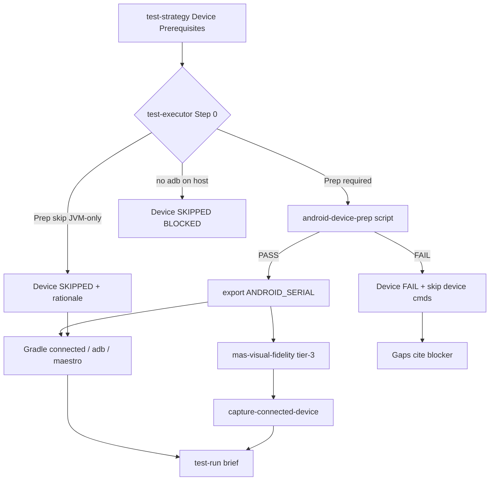

# Architecture Brief — MAS-07

## Architecture

**Option 3 — Composite device prep gate** (per brainstorm Recommended + osint Recommended Approach): shared `android-device-prep` scripts + `device-prep-automation.md` reference + **test-strategy Device Prerequisites** section + **test-executor Step 0** prep invocation + **test-run Device** evidence section — so repeat `/mas` workflows that need `adb`, `connected*AndroidTest`, or tier-3 screencap run a **deterministic preflight** (serial pin, boot/animation stabilization, permission pre-grant) before Gradle/device commands, with actionable blockers on `unauthorized`, `NO_DEVICE`, and `AMBIGUOUS_DEVICE`.

`UI_SCOPE: logic-only` — no Compose screens, no production patches. Framework repo ships prep scripts + protocol/skill contract updates only.

**Relationship to prior MAS-07 capture work (v1.4.1):** `capture-connected-device.{ps1|sh}` already ships for mas-visual-fidelity tier-3 (launch + screencap). This brief adds the **upstream prep gate** (`android-device-prep`) that stabilizes device state **before** any adb consumer — test-executor, Gradle connected tests, and `capture-connected-device`. Prep gate is the single source of truth (SOT) for device discovery, selection policy, boot wait, grants, and `ANDROID_SERIAL` export. Capture script defers selection to prep; retains minimal connectivity check only.

Core invariants (MAS-04/MAS-06 unchanged): test-strategy plans, test-executor runs; mutual exclusion preserved; reviewer 0d consumes test-run **Device** + **Commands**; enrollment honesty — no RSA bypass promise.

### End-to-end flow

```
[Human once]  Developer Options → USB debugging → RSA "Always allow" OR wireless adb pair
       ↓
[Coordinator]  Optional DEVICE_SERIAL / DEVICE_POLICY on test-strategy + test-executor handoffs
       ↓
[test-strategy]  Device Prerequisites table (enrollment, target, policy, grants, prep flag)
       ↓
[dev → mas-visual-fidelity (optional) → … specialists …]
       ↓
[test-executor Step 0]  Prep gate (if required) → export ANDROID_SERIAL → test-run Device section
       ↓
[test-executor Step 1+]  Gradle connected* | adb capture | maestro (serialized adb)
       ↓
[mas-visual-fidelity tier-3]  Reuse ANDROID_SERIAL from Step 0 OR invoke prep → capture-connected-device
       ↓
[test-run brief]  Device + Commands + Pass/fail → reviewer 0d-ext
```



**MAS framework repo:** scripts + fixtures only; no Android modules. Dogfood validates state machine via mocked `adb devices` fixtures — no physical device required in CI.

---

## Architect gate decisions (Phase 0 — D1–D6 confirmed)

Binding decisions for downstream general-dev. Aligns plan resolved table, brainstorm Domain & Contracts §1–6, and osint Findings #1–#6. Does **not** re-litigate Option 3 vs alternatives.

| # | Question | **Decision** | Rationale |
|---|----------|--------------|-----------|
| D1 | Script platforms | **Both** `android-device-prep.ps1` (win32 primary) and `android-device-prep.sh` (bash CI) | User host is win32; shared JSON stdout schema; POSIX twin for Linux agents |
| D2 | Prep ownership | **Shared `android-device-prep` script** — invoked by test-executor Step 0; referenced by mas-visual-fidelity tier-3 and `build-test-visual-qa.md` | Single SOT; no inline adb duplication across specialists; idempotent re-run safe |
| D3 | Default selection policy | **`DEVICE_POLICY: physical`** when `TEST_SURFACE` includes `ui`, Recommended Commands contain `connected`, or handoff has `VISUAL_FIDELITY`; else **`auto`** | Prevents emulator capture when phone connected (MAS-06 coupling); handoff `DEVICE_POLICY` overrides |
| D4 | Maestro scope | **P1 defer** — document optional command template in test-strategy; prep gate still runs when `maestro` in Recommended Commands | Keeps v1.5.0 scope bounded; prep is device-agnostic |
| D5 | Cursor Cloud / no USB | **Hard SKIP** with `BLOCKED: no adb on agent host` in test-run Gaps | Honest limitation; user runs locally or managed-ftl strategy |
| D6 | Wireless `adb connect` | **Defer v1.5.1** — optional `--connect host:port` when strategy lists wireless endpoint | v1.5.0 USB-first; document in reference doc as future |
| D7 | Env var canonical name | **`ANDROID_SERIAL`** (official Android env) exported on prep PASS; **`ADB_SERIAL`** accepted as read alias in capture script and handoffs | Aligns with Android Platform Tools docs; backward compat with existing capture-connected-device |
| D8 | Capture script coupling | **Prep before capture:** test-executor Step 0 runs prep once per session; `capture-connected-device` reads `ANDROID_SERIAL` from env and performs **connectivity-only** re-check (device still `device` state) — does **not** re-run selection policy | Avoids duplicate selection logic; defense-in-depth on disconnect mid-workflow |
| D9 | Semver | **`1.4.0` → `1.5.0`** (minor bump) | Additive cross-specialist capability (prep gate + Device Prerequisites + test-run schema + handoff fields); distinct from v1.4.1 capture-script patch; new protocol surface warrants minor not patch |
| D10 | Framework dogfood | **Fixture harness** with mocked `adb devices` output — `.ai/fixtures/MAS-07-ADB-PREP/` | P0 exit codes validated without physical device in mas-cursor-framework CI |
| D11 | Enrollment honesty | **Non-negotiable** — `UNAUTHORIZED` exit cites enrollment checklist; no RSA bypass | osint Finding #1 (HIGH); official Android security model |
| D12 | Maestro / FTL skip paths | **Managed-ftl** → prep skip with rationale in Device Prerequisites `Target: managed-ftl`; local prep not invoked | Cloud escape hatch documented; not default for desk-phone scenario |

---

## Script JSON contract

### Files (SOT)

| Path | Platform | Purpose |
|------|----------|---------|
| `skills/multi-agent-system/scripts/android-device-prep.ps1` | Windows (primary) | Device prep gate |
| `skills/multi-agent-system/scripts/android-device-prep.sh` | Linux/macOS/CI | POSIX twin |
| `skills/multi-agent-system/references/device-prep-automation.md` | — | State machine, enrollment, selection policy, blocker messages |

Both scripts: **same pipeline, same JSON stdout shape, same exit code enum.**

### CLI flags

| Flag | PowerShell alias | Required | Default | Description |
|------|------------------|----------|---------|-------------|
| `--policy physical\|emulator\|auto` | `-Policy` | no | `auto` | Selection when multiple devices |
| `--serial <id>` | `-Serial` | no | — | Explicit override (mirrors handoff `DEVICE_SERIAL`) |
| `--package <id>` | `-Package` | no | — | Application id for `pm grant` loop |
| `--grants <p1,p2,...>` | `-Grants` | no | — | Comma-separated permission names |
| `--boot-timeout <sec>` | `-BootTimeout` | no | `120` | Max wait for `sys.boot_completed == 1` |
| `--reverse <tcp:host:device>` | `-Reverse` | repeatable | — | `adb reverse` pairs before tests |
| `--no-animation-off` | `-NoAnimationOff` | no | false | Opt out of animator scale disable |
| `--dry-run` | `-DryRun` | no | false | Print planned adb ops; no device required |
| `--help` | `-Help` | no | false | Usage + exit code table |
| `--json-only` | `-JsonOnly` | no | false | Suppress non-JSON stderr on success (agent parsing) |

**v1.5.1 reserved:** `--connect host:port` for wireless-only (D6).

### Pipeline steps (ordered)

1. Parse args; validate flag combinations.
2. **`adb start-server`** — ensure daemon running.
3. **`adb devices -l`** — parse serial + state + transport hints (`product:`, `model:`).
4. **State machine** (see below) — select serial or FAIL.
5. **Export context** — set process env `ANDROID_SERIAL` for child commands (script does not persist to shell parent; test-executor re-exports after parse).
6. **Boot wait** — `adb -s <serial> shell getprop sys.boot_completed` poll until `1` or timeout → `BOOT_TIMEOUT`.
7. **Stabilization** (unless `--no-animation-off`):
   - `settings put global animator_duration_scale 0`
   - `settings put global transition_animation_scale 0`
   - `settings put global window_animation_scale 0`
8. **Permission grants** (when `--package` + `--grants`): `adb -s <serial> shell pm grant <package> <permission>` — idempotent; non-grantable → `grants_skipped` warn, not FAIL.
9. **`adb reverse`** loop (when `--reverse` provided).
10. **Emit JSON stdout**; exit per code table.

### Prep gate state machine (`adb devices -l` parse)

| State / condition | Script action | `exit_code` in JSON | Process exit |
|-----------------|---------------|---------------------|--------------|
| Zero rows in `device` state | FAIL immediately | `NO_DEVICE` | 10 |
| Any row `unauthorized` (and none `device` yet) | FAIL — enrollment required | `UNAUTHORIZED` | 11 |
| Any selected target `offline` | Retry `adb kill-server && adb start-server` once; still offline → FAIL | `OFFLINE` | 12 |
| Exactly one `device` row | Select that serial → continue pipeline | — | — |
| Multiple `device` rows | Apply **selection policy** (§ below) | `AMBIGUOUS_DEVICE` on unresolved | 13 |
| `--serial` set but not in `device` state | FAIL — serial not found/authorized | `SERIAL_NOT_FOUND` | 14 |
| Boot wait exceeds `--boot-timeout` | FAIL | `BOOT_TIMEOUT` | 15 |
| Grants/reverse/stabilization complete | PASS | `PASS` | 0 |
| `adb` not on PATH | FAIL before devices parse | `ADB_NOT_FOUND` | 1 |
| Invalid arguments | FAIL | `INVALID_ARGS` | 7 |

**Note:** When multiple devices exist and policy resolves exactly one serial → continue (not `AMBIGUOUS_DEVICE`). `AMBIGUOUS_DEVICE` only when policy cannot pick unambiguously (e.g. two hardware phones, no `--serial`).

### ANDROID_SERIAL selection policy

Priority order — first match wins:

| Priority | Condition | Selected serial |
|----------|-----------|-----------------|
| 1 | `--serial` flag or handoff `DEVICE_SERIAL` | Exact match required in `device` state; else `SERIAL_NOT_FOUND` |
| 2 | Exactly one `device` row | That serial |
| 3 | `DEVICE_POLICY: physical` (or default per D3) | Sole hardware device (`emulator-*` excluded); FAIL if 0 or >1 hardware |
| 4 | `DEVICE_POLICY: emulator` | Sole `emulator-*` serial; FAIL if 0 or >1 emulator |
| 5 | `DEVICE_POLICY: auto` | Prefer sole hardware over emulators when one of each; single emulator when no hardware |
| 6 | Multiple hardware serials, no override | FAIL `AMBIGUOUS_DEVICE` — never guess wrong phone |

**MAS-06 coupling:** When handoff has `VISUAL_FIDELITY` or design-spec exists with `Capture Recipe: connected-device`, test-strategy defaults `DEVICE_POLICY: physical` unless handoff overrides.

### JSON stdout contract

**Always** emit a single JSON object on stdout (last line if warnings printed to stderr).

#### PASS shape

```json
{
  "status": "PASS",
  "serial": "R58M90ABCDE",
  "exit_code": "PASS",
  "message": "Device ready; ANDROID_SERIAL=R58M90ABCDE",
  "policy_applied": "physical",
  "boot_wait_ms": 3200,
  "grants_applied": [
    "android.permission.CAMERA",
    "android.permission.POST_NOTIFICATIONS"
  ],
  "grants_skipped": [],
  "reverse_applied": ["tcp:8080:8080"],
  "animations_disabled": true,
  "warnings": []
}
```

#### FAIL shape

```json
{
  "status": "FAIL",
  "serial": null,
  "exit_code": "UNAUTHORIZED",
  "message": "Device unauthorized — unlock phone and tap Always allow on USB debugging prompt. See device-prep-automation.md enrollment checklist.",
  "policy_applied": "physical",
  "boot_wait_ms": null,
  "grants_applied": [],
  "grants_skipped": [],
  "reverse_applied": [],
  "animations_disabled": false,
  "warnings": []
}
```

#### Field registry

| Field | Type | Required | Notes |
|-------|------|----------|-------|
| `status` | enum | yes | `PASS` \| `FAIL` |
| `serial` | string \| null | yes | Selected device; null on FAIL before selection |
| `exit_code` | enum | yes | See exit code table |
| `message` | string | yes | Actionable user/agent text |
| `policy_applied` | enum | yes | `physical` \| `emulator` \| `auto` |
| `boot_wait_ms` | int \| null | yes | Elapsed boot wait; null if not reached |
| `grants_applied` | string[] | yes | Permissions successfully granted |
| `grants_skipped` | string[] | yes | Non-grantable or failed grants (warn only) |
| `reverse_applied` | string[] | yes | Reverse rules applied |
| `animations_disabled` | bool | yes | Whether animator scales set to 0 |
| `warnings` | string[] | yes | Non-fatal notes (e.g. `GRANT_SKIPPED: MANAGE_EXTERNAL_STORAGE`) |

### Process exit codes

| Code | `exit_code` enum | Meaning |
|------|------------------|---------|
| 0 | `PASS` | Device ready |
| 1 | `ADB_NOT_FOUND` | `adb` not on PATH |
| 7 | `INVALID_ARGS` | Missing/invalid flags |
| 10 | `NO_DEVICE` | Zero devices in `device` state |
| 11 | `UNAUTHORIZED` | RSA trust not established |
| 12 | `OFFLINE` | Device offline after retry |
| 13 | `AMBIGUOUS_DEVICE` | Policy cannot resolve multi-device |
| 14 | `SERIAL_NOT_FOUND` | Explicit serial absent or not authorized |
| 15 | `BOOT_TIMEOUT` | `sys.boot_completed` not `1` in time |

**Agent parsing rule:** exit 0 + `status: PASS` → proceed; any non-zero OR `status: FAIL` → record Device FAIL, skip device commands.

### Idempotency

Safe to re-run every test-executor spawn. Grants, reverse, and animation settings are no-ops when already applied. Boot wait skipped when `sys.boot_completed` already `1`.

---

## DEVICE_SERIAL / DEVICE_POLICY handoff fields

### Field definitions

| Field | Values | Set by | Consumed by |
|-------|--------|--------|-------------|
| `DEVICE_SERIAL: <id>` | adb serial string | Coordinator (user-provided or ambiguity resolution) | test-strategy, test-executor, prep script `--serial` |
| `DEVICE_POLICY: physical\|emulator\|auto` | enum | Coordinator or inferred from `TEST_SURFACE` / `VISUAL_FIDELITY` | test-strategy Device Prerequisites, prep script `--policy` |

### When Coordinator sets them

| Trigger | Fields to set |
|---------|---------------|
| User names a specific phone ("use my Pixel") | `DEVICE_SERIAL: <id>` |
| User has emulator + phone; workflow needs physical rendering | `DEVICE_POLICY: physical` |
| User explicitly wants emulator tests | `DEVICE_POLICY: emulator` |
| `VISUAL_FIDELITY` or design-spec + `UI_CHANGES: YES` | `DEVICE_POLICY: physical` (default if not set) |
| `TEST_SURFACE: ui` with connected commands | `DEVICE_POLICY: physical` (default if not set) |
| JVM-only workflow (`TEST_SURFACE: unit`) | omit both — strategy documents skip |
| Prior run failed `AMBIGUOUS_DEVICE` | Coordinator asks user; sets `DEVICE_SERIAL` on retry |

### Handoff placement

Add to `handoff-format.md` and `handoff-format-lite.md`:

```
DEVICE_SERIAL: R58M90ABCDE          # optional — multi-phone desk
DEVICE_POLICY: physical             # optional — physical | emulator | auto
```

**Lite equivalent:** `DEV_SER: <id>`, `DEV_POL: physical|emulator|auto` (documenter adds to lite format).

**Propagation:** Coordinator copies fields to **test-strategy** and **test-executor** handoffs when device commands are in scope. test-strategy echoes values in Device Prerequisites table; test-executor passes to prep script flags.

**Distinct from MAS-07 capture fields (v1.4.1):** `DEVICE_CAPTURE: yes` forces tier-3 screencap; `ADB_SERIAL` on visual-fidelity handoff mirrors post-prep serial. After v1.5.0, prefer `DEVICE_SERIAL` on coordinator handoff — prep exports `ANDROID_SERIAL`; capture script reads env. Deprecation note: `ADB_SERIAL` handoff alias retained one minor release.

---

## test-strategy Device Prerequisites schema

New required section when any Recommended Command touches device shell, connected instrumentation, screencap, or Maestro. Register in `test-strategy-standards.md`; test-strategy skill emits in workflow step 8.5 (after Recommended Commands, before write).

### Section template

```markdown
## Device Prerequisites

| Field | Value |
|-------|-------|
| Enrollment | required \| enrolled (assumed) |
| Target | physical \| emulator \| managed-ftl \| none |
| Prep gate | required \| skip |
| DEVICE_SERIAL | <serial> or — |
| DEVICE_POLICY | physical \| emulator \| auto |
| Package | <applicationId> or — |
| Permissions to pre-grant | <list> or — |
| adb reverse | <tcp:host:device pairs> or — |
| Skip rationale | <text when Prep gate = skip> |
```

### Field rules

| Field | Rule |
|-------|------|
| `Enrollment` | `required` on first workflow for project; `enrolled` when repeat runs assume RSA trust |
| `Target` | `managed-ftl` → prep skip + cloud command in Recommended Commands |
| `Prep gate` | `required` when ANY command matches: `adb`, `connected`, `maestro`, `am start`, `uiautomator` |
| `Prep gate` | `skip` when ALL commands JVM-local: `testDebugUnitTest`, `compileDebugKotlin`, Paparazzi, `validateDebugScreenshotTest`, Compose Preview |
| `DEVICE_SERIAL` | Copy from handoff when set; else `—` |
| `DEVICE_POLICY` | Default `physical` when `TEST_SURFACE: ui` or connected commands or `VISUAL_FIDELITY`; else `auto` |
| `Package` | Required when Permissions to pre-grant non-empty |
| `Permissions to pre-grant` | Minimum set only; Android 13+ include `POST_NOTIFICATIONS` when needed |
| `adb reverse` | Repeatable `tcp:8080:8080` style; consumed by prep `--reverse` |
| `Skip rationale` | **Mandatory** when `Prep gate: skip` — e.g. "JVM-only Paparazzi; no adb" |

### Prep required / skip decision table

| Recommended Commands contain | Prep gate |
|-------------------------------|-----------|
| `connectedDebugAndroidTest`, `connectedReleaseAndroidTest` | required |
| `adb exec-out screencap`, `adb shell`, `adb pull` | required |
| `maestro test` | required |
| `verifyPaparazziDebug`, `testDebugUnitTest` only | skip |
| `validateDebugScreenshotTest` only | skip |

### Permissions table (optional sub-table when grants non-trivial)

```markdown
| Package | Permission | Grant method | Notes |
|---------|------------|--------------|-------|
| com.example.app | android.permission.CAMERA | adb pm grant | P0 UI test |
| com.example.app | android.permission.POST_NOTIFICATIONS | adb pm grant | API 33+ |
```

Non-grantable permissions (`MANAGE_EXTERNAL_STORAGE`, etc.) → list in strategy with in-test grant hint; prep logs `grants_skipped`.

---

## test-executor Step 0 workflow

Insert **before** current Workflow step 1 (load commands). Extends `mas-test-executor/SKILL.md`; mutual exclusion with test-strategy unchanged — executor runs prep, never plans it.

### Step 0 — Device prep (before Step 1 load commands)

1. **Startup read:** When test-strategy brief has **Device Prerequisites**, read `device-prep-automation.md` (slice: state machine + exit codes + skip rules).
2. **Environment check:** If `adb` not on PATH → Device section `SKIPPED`; Gaps `BLOCKED: no adb on agent host`; skip all device commands; Overall PARTIAL (D5).
3. **Read Device Prerequisites** from `.ai/context/test-strategies/{TASK_ID}.md`.
4. **Branch:**
   - `Prep gate: skip` → write Device section `SKIPPED` + skip rationale; proceed to Step 1.
   - `Prep gate: required` → invoke prep script (see invocation below).
5. **Invocation (win32):**
   ```powershell
   powershell -File skills/multi-agent-system/scripts/android-device-prep.ps1 `
     -Policy <from strategy> `
     -Serial <if set> `
     -Package <if grants> `
     -Grants <comma-list> `
     -BootTimeout 120 `
     -Reverse <pairs from strategy> `
     -JsonOnly
   ```
   **Invocation (bash):** `android-device-prep.sh` with equivalent flags.
6. **Parse stdout JSON** (last line).
7. **On FAIL:**
   - Write test-run **Device** section (FAIL + exit_code + message).
   - Gaps cite prep blocker verbatim.
   - Mark all device-touching Recommended Commands as `SKIP` (prep reason).
   - Overall PARTIAL if P0 JVM commands still runnable; else FAIL.
   - **Do not run** connected/adb/maestro commands.
8. **On PASS:**
   - Export `ANDROID_SERIAL=<serial>` in agent shell for subsequent commands.
   - Write test-run **Device** section (PASS + serial + grants).
   - Proceed to Step 1.
9. **Serialization:** No parallel adb — Step 0 completes before any Step 1+ command; no concurrent prep + screencap.

### Step 1+ rules (additive)

| Rule | Detail |
|------|--------|
| Connected suite timeout | `block_until_ms` ≥ 600000 (10 min) for P0 `connected*AndroidTest` |
| Prep FAIL | Never run connected tasks — avoid misleading AGP "no devices" stack traces |
| Grant partial | PASS with `grants_skipped` in Device section; note in Gaps if P0 permission missing |
| Same session visual-fidelity | If tier-3 runs later in chain, `ANDROID_SERIAL` already set — visual-fidelity may skip re-prep |

### Output template delta (full `/mas`)

Add after **Gaps**, before **Brief Path**:

```markdown
## Device

| Field | Value |
|-------|-------|
| Prep gate | PASS \| FAIL \| SKIPPED |
| Serial | <serial or —> |
| Policy | physical \| emulator \| auto |
| Exit code | PASS \| NO_DEVICE \| … \| — |
| Grants applied | <list or —> |
| Message | <actionable text> |
```

Lite mode: include prep status in Summary bullets only.

---

## test-run Device section schema

### brief-schemas.md registration

Update `test-run` row:

| Type | Path pattern | Required sections |
|------|--------------|-------------------|
| test-run | `.ai/context/test-runs/{TASK_ID}.md` | Commands, Pass/fail, Failures, Gaps, **Device** |

**Conditional rule (architect):** **Device** section required when:
- test-strategy `Prep gate: required`, OR
- prep was attempted (including FAIL), OR
- any executed/skipped command matched device surface

Omit Device section only when strategy `Prep gate: skip` with documented JVM-only rationale **and** no prep invocation attempted.

### Device section fields

| Field | Type | Required when | Values |
|-------|------|---------------|--------|
| Prep gate | enum | always (when section present) | `PASS` \| `FAIL` \| `SKIPPED` |
| Serial | string | PASS | adb serial; `—` on FAIL/SKIP |
| Policy | enum | prep attempted | `physical` \| `emulator` \| `auto` |
| Exit code | enum | FAIL | `NO_DEVICE`, `UNAUTHORIZED`, `OFFLINE`, `AMBIGUOUS_DEVICE`, `BOOT_TIMEOUT`, `SERIAL_NOT_FOUND`, `ADB_NOT_FOUND`, `PASS`, `—` |
| Grants applied | string | when grants requested | comma-list or `—` |
| Message | string | always | Actionable text from JSON `message` |

### Reviewer 0d-ext dependency

Reviewer step **0d-ext** (test-run alignment):

- P0 connected commands + Device `FAIL` → Overall cannot be PASS.
- Device `SKIPPED` + `BLOCKED: no adb` → document HITL; connected P0 not satisfied.
- Device `PASS` + Gradle FAIL → route bug-fix; Device evidence still PASS.
- Serial in Device must match env used for Commands table (audit consistency).

---

## Integration with visual-fidelity tier-3 adb screencap

### Chain position

```
test-executor Step 0 (prep PASS, ANDROID_SERIAL set)
  → … optional mas-visual-fidelity …
  → tier-3: capture-connected-device (uses ANDROID_SERIAL)
```

When mas-visual-fidelity runs **without** prior test-executor in same workflow (rare — protected specialist before executor):

1. Invoke `android-device-prep` with policy from design-spec Device Target / handoff `DEVICE_POLICY`.
2. On PASS → `capture-connected-device` with `-Serial $env:ANDROID_SERIAL`.
3. On FAIL → `BLOCKED` Implementation Capture + HITL (existing degrade matrix).

### Division of responsibility

| Concern | Owner |
|---------|-------|
| Device discovery + selection | `android-device-prep` |
| Boot wait + animation off + grants + reverse | `android-device-prep` |
| App launch + screencap + optional crop | `capture-connected-device` |
| P0/P1 fidelity diff | mas-visual-fidelity (unchanged) |

### visual-fidelity-standards.md delta

Add to capture matrix row 3 notes: **Requires prep gate PASS** — reference `device-prep-automation.md`; do not duplicate selection logic in capture script.

### build-test-visual-qa.md delta

- `connectedDebugAndroidTest` requires prep PASS before Gradle.
- Tier-3 screencap requires prep PASS before `exec-out screencap`.
- Enrollment prerequisite link to `device-prep-automation.md`.

### Session JSON (optional tracking)

`workflow-sessions/{TASK_ID}.json` may record:

```json
{
  "device_prep": {
    "status": "PASS",
    "serial": "R58M90ABCDE",
    "at": "2026-09-28T14:30:00Z"
  }
}
```

Not required for v1.5.0 ship — executor + test-run Device section are sufficient evidence.

---

## Semver recommendation

| Current | Recommended | Rationale |
|---------|-------------|-----------|
| `1.4.0` (manifest; `1.4.1` capture scripts may exist locally) | **`1.5.0`** | New cross-cutting device prep capability: 2 scripts, 1 reference doc, test-strategy section, test-executor Step 0, test-run schema, handoff fields, coordinator propagation — additive minor feature across 4+ specialists |

**Not `1.4.2`:** v1.4.1 reserved for capture-connected-device patch (MAS-07 capture slice). Prep gate is orthogonal upstream infrastructure warranting minor bump.

**Backward compatibility:** Existing workflows without device commands unchanged; Device section absent only on JVM-only skip path; no new specialist slug.

---

## Modules

Logical module map (framework repo). MAS-07 prep additions marked `[NEW]` or `[UPDATE]`.

```
mas-cursor-framework/
├── skills/
│   ├── multi-agent-system/
│   │   ├── protocol/
│   │   │   ├── brief-schemas.md              [UPDATE: test-run Device section]
│   │   │   ├── handoff-format.md             [UPDATE: DEVICE_SERIAL, DEVICE_POLICY]
│   │   │   ├── handoff-format-lite.md        [UPDATE: DEV_SER, DEV_POL]
│   │   │   └── read-order.md                 [UPDATE: device-prep subscription matrix]
│   │   ├── references/
│   │   │   ├── device-prep-automation.md     [NEW: SOT reference]
│   │   │   ├── test-strategy-standards.md    [UPDATE: Device Prerequisites template]
│   │   │   ├── build-test-visual-qa.md       [UPDATE: prep gate paragraph]
│   │   │   └── visual-fidelity-standards.md  [UPDATE: tier-3 prep dependency note]
│   │   ├── scripts/
│   │   │   ├── android-device-prep.ps1       [NEW]
│   │   │   ├── android-device-prep.sh        [NEW]
│   │   │   ├── capture-connected-device.ps1  [UPDATE: read ANDROID_SERIAL; minimal gate]
│   │   │   ├── capture-connected-device.sh   [UPDATE: same]
│   │   │   └── README.md                     [UPDATE: prep + capture docs]
│   │   └── install/
│   │       └── manifest.json                 [UPDATE: 1.4.x → 1.5.0]
│   ├── mas-test-strategy/                      [UPDATE: Device Prerequisites workflow]
│   ├── mas-test-executor/                      [UPDATE: Step 0, Device output]
│   ├── mas-visual-fidelity/                    [UPDATE: tier-3 prep cross-ref]
│   ├── mas-coordinator/                        [UPDATE: DEVICE_* handoff propagation]
│   └── multi-agent-system/SKILL.md             [UPDATE: MAS-07 roster note]
└── .ai/
    ├── context/
    │   ├── architecture/MAS-07.md              [THIS BRIEF]
    │   ├── test-strategies/MAS-07.md         [dogfood — test-strategy agent]
    │   └── test-runs/MAS-07.md               [dogfood — test-executor agent]
    └── fixtures/MAS-07-ADB-PREP/             [NEW: mocked adb fixtures]
        ├── adb-devices-empty.txt
        ├── adb-devices-unauthorized.txt
        ├── adb-devices-single.txt
        ├── adb-devices-ambiguous.txt
        ├── adb-devices-emulator-plus-phone.txt
        ├── expected-prep-output.json
        ├── handoff-stub.md
        ├── test-strategy-stub.md
        └── test-run-expected-shape.md
```

No new specialist slug.

---

## Layers

```
┌─────────────────────────────────────────────────────────────┐
│  Coordinator (optional DEVICE_SERIAL / DEVICE_POLICY)        │
└────────────────────────────┬────────────────────────────────┘
┌────────────────────────────▼────────────────────────────────┐
│  test-strategy — Device Prerequisites (declarative plan)       │
└────────────────────────────┬────────────────────────────────┘
┌────────────────────────────▼────────────────────────────────┐
│  android-device-prep.{ps1|sh} — discovery, policy, stabilize   │
│  device-prep-automation.md — SOT state machine + enrollment    │
└────────────────────────────┬────────────────────────────────┘
        ┌────────────────────┼────────────────────┐
┌───────▼───────┐  ┌─────────▼─────────┐  ┌──────▼──────┐
│ test-executor │  │ Gradle connected   │  │ capture-    │
│ Step 0 → 1+   │  │ *AndroidTest       │  │ connected-  │
│               │  │                    │  │ device      │
└───────┬───────┘  └────────────────────┘  └──────┬──────┘
        └────────────────────┬────────────────────┘
┌────────────────────────────▼────────────────────────────────┐
│  test-run brief — Device + Commands + Pass/fail → reviewer 0d│
└─────────────────────────────────────────────────────────────┘
```

**Boundaries:**

- test-strategy: plans prerequisites; never shells adb.
- test-executor: runs prep + commands; run-only v1 unchanged.
- mas-visual-fidelity: read-only; invokes prep before tier-3 when executor did not run.
- capture-connected-device: launch + screencap only; no selection policy duplication post-v1.5.0.

---

## Contracts

### Producer / consumer matrix

| Artifact / field | Producer | Consumer |
|------------------|----------|----------|
| Device Prerequisites | test-strategy | test-executor Step 0 |
| Prep JSON stdout | android-device-prep script | test-executor |
| ANDROID_SERIAL env | test-executor (post-prep) | Gradle, adb commands, capture script |
| test-run Device section | test-executor | reviewer 0d-ext |
| DEVICE_SERIAL / DEVICE_POLICY | coordinator | test-strategy, test-executor |
| device-prep-automation.md | general-dev (reference) | test-strategy, test-executor, visual-fidelity |

### Failure → outcome matrix

| Prep exit | test-run Device | Device commands | Overall (P0 connected) |
|-----------|-----------------|-----------------|------------------------|
| PASS | PASS | Execute | Eligible PASS |
| NO_DEVICE / UNAUTHORIZED / … | FAIL | SKIP | PARTIAL/FAIL |
| SKIPPED (JVM-only) | SKIPPED | N/A (none planned) | Per JVM results |
| SKIPPED (no adb cloud) | SKIPPED | SKIP | PARTIAL + HITL |

### Specialist invariants (must hold)

- Enrollment honesty — `UNAUTHORIZED` cites checklist; no bypass.
- Mutual exclusion — strategy plans, executor runs prep + commands.
- Serialize adb — prep completes before capture/connected in same turn.
- Framework dogfood — fixtures validate exit codes without physical device.
- No production patches in MAS repo.

---

## Responsive Strategy

**N/A — `UI_SCOPE: logic-only`.** `DEVICE_POLICY` and `Target` are contract metadata for target Android projects; no Compose layout or size-class decisions.

---

## Files

### Create

| Path | Purpose |
|------|---------|
| `skills/multi-agent-system/references/device-prep-automation.md` | SOT: enrollment, state machine, exit codes, selection policy, grants, cloud skip |
| `skills/multi-agent-system/scripts/android-device-prep.ps1` | Windows prep gate |
| `skills/multi-agent-system/scripts/android-device-prep.sh` | POSIX prep gate |
| `.ai/fixtures/MAS-07-ADB-PREP/*` | Mocked adb output + expected JSON shapes |

### Update

| Path | Change |
|------|--------|
| `skills/multi-agent-system/protocol/brief-schemas.md` | test-run **Device** section + conditional rule |
| `skills/multi-agent-system/protocol/handoff-format.md` | `DEVICE_SERIAL`, `DEVICE_POLICY` |
| `skills/multi-agent-system/protocol/handoff-format-lite.md` | lite equivalents |
| `skills/multi-agent-system/protocol/read-order.md` | prep reference subscription matrix |
| `skills/multi-agent-system/references/test-strategy-standards.md` | Device Prerequisites template |
| `skills/multi-agent-system/references/build-test-visual-qa.md` | prep gate before connected/capture |
| `skills/multi-agent-system/references/visual-fidelity-standards.md` | tier-3 prep dependency |
| `skills/mas-test-executor/SKILL.md` | Step 0 workflow, Device output |
| `skills/mas-test-strategy/SKILL.md` | Device Prerequisites emission |
| `skills/mas-visual-fidelity/SKILL.md` | tier-3 prep cross-ref |
| `skills/mas-coordinator/SKILL.md` | DEVICE_* propagation |
| `skills/multi-agent-system/scripts/capture-connected-device.*` | read ANDROID_SERIAL; slim gate |
| `skills/multi-agent-system/install/manifest.json` | `1.5.0` |
| `skills/multi-agent-system/SKILL.md` | MAS-07 roster note |

### Dependency order (implementation)

```
0 (this brief) → D1–D12 locked, script contract, semver 1.5.0
1  device-prep-automation.md + android-device-prep scripts + fixtures     — depends on 0
2  protocol (brief-schemas, handoff-format, read-order)                   — depends on 0
3  test-strategy-standards + mas-test-strategy                            — depends on 1, 2
4  mas-test-executor Step 0 + test-run Device                             — depends on 1, 2
5  visual-fidelity + build-test-visual-qa + capture script updates        — depends on 1
6  mas-coordinator + manifest 1.5.0                                       — depends on 2–5
7  dogfood fixtures + test-strategies/MAS-07 + test-runs/MAS-07           — depends on 1–6
8  documenter + reviewer                                                    — depends on 7
```

### Exclusions (do not re-implement)

- MAS-04 test-executor run-only boundary — unchanged except Step 0 prep.
- MAS-06 P0/P1 fidelity mechanics — unchanged; tier-3 adds prep dependency only.
- Maestro skill steps — P1 defer (D4).
- Wireless `--connect` — v1.5.1 defer (D6).
- Target app source patches — consumer project only.

---

## Usage Report

Model: default
Class: thinking
Tokens: unknown

DONE
