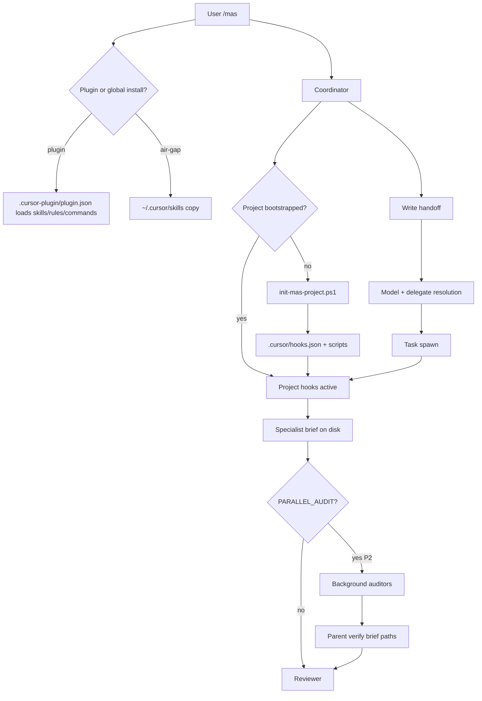

# Architecture Brief — MAS-08

## Architecture

**Option 2 — Platform-native plugin with phased protocol upgrade** (per brainstorm Recommended + osint Recommended Approach + plan Phase 0): ship MAS **v1.6.0** as a **Cursor Plugin** (`.cursor-plugin/plugin.json`) with **project-level hooks** (`.cursor/hooks.json` + `.cursor/hooks/`), refresh **spawn-model-policy** (`inherit` defaults + class→hint table + `MODEL_SLUG:` override), add **hybrid `.cursor/agents/` stubs** (top 8 specialists), **built-in delegation** (`explore` / `bash` / `browser`), optional **PARALLEL_AUDIT** async lane (P2), **MCP plugin template** (P2), and **Plan Mode export** bridge (P3) — while preserving MAS invariants (reviewer sole `Approved:` gate, foreground dev→ux→a11y→i18n chain, self-contained Task prompts, artifact-forward hooks).

`UI_SCOPE: logic-only` — no IDE UI layouts, marketplace screenshots, or styling. Framework repo ships plugin manifest, protocol contracts, hook scripts, bootstrap extensions, and native agent stubs only.

**Relationship to prior work:** MAS-01–07 established artifact bus, specialist roster, spawn-model-policy, user-level `~/.cursor/hooks.json` (`sessionStart` + `subagentStop` via `hooks/mas-session-context.{ps1|sh}`), and device prep (MAS-07). v1.6 **adds distribution + Cloud Agent hook parity** without replacing the Coordinator Task chain or brief-on-disk model.

### End-to-end topology (v1.6+)

```
User: /mas | /mas-lite | Custom Mode (Coordinator pinned)
        ↓
[Install state] PLUGIN_ACTIVE | GLOBAL_FALLBACK (air-gapped init-mas)
        ↓
Coordinator skill (disable-model-invocation: true)
        ├─ init-workflow-session.ps1 → .ai/context/workflow-sessions/{TASK_ID}.json
        ├─ [Bootstrap gate] if !.cursor/hooks.json → init-mas-project.ps1 (idempotent)
        ├─ Write handoff (.ai/handoffs/{TASK_ID}[-{agent}].md, SPAWN_STATUS: spawned)
        ├─ Resolve model: MODEL_CLASS → MODEL_SLUG → spawn-model-policy → default fallback
        ├─ Resolve delegate: DELEGATE → subagent_type (generalPurpose | explore | bash | browser)
        ↓
Task spawn
        ├─ MAS specialist: generalPurpose + self-contained prompt (default)
        ├─ OR native .cursor/agents/{slug}.md (thin wrapper; same prompt contract)
        ├─ OR built-in explore | bash | browser (supplement only; brief paths authoritative)
        ↓
Project hooks (.cursor/hooks.json, version: 1 — committed in repo)
        ├─ subagentStart: validate TASK_ID + handoff SPAWN_STATUS: spawned (fail-open v1.6)
        ├─ subagentStop: followup_message chain reminder (mas-session-context)
        ├─ postToolUse (matcher: Task): record-workflow-step telemetry
        ├─ stop: finalize workflow session JSON
        └─ preCompact: warn incomplete handoffs / unflushed briefs
        ↓
Specialist writes brief → SPAWN_STATUS: complete → next handoff
        ↓
[Optional P2] PARALLEL_AUDIT: yes → async auditors (run_in_background: true) → parent verifies briefs
        ↓
Reviewer Approved: YES | NO → loop or user escalation
```



### Architect gate decisions (Phase 0 — Q1–Q7 + layout confirmed)

Binding decisions for downstream general-dev. Aligns plan resolved table, brainstorm Logic Flow A–G, and osint Findings #1–#10. Does **not** re-litigate Option 2 vs alternatives.

| # | Question | **Decision** | Rationale |
|---|----------|--------------|-----------|
| Q1 | Plugin vs global precedence | **Project paths > plugin bundle > global `~/.cursor`** on name collision when plugin active | Cursor project-scoped precedence; dogfood test required in MAS-08 fixtures |
| Q2 | Runtime model probe | **Static class→hint table in `spawn-model-policy.md`** + optional P1 `agent-models-probe.ps1` (non-blocking, quarterly refresh) | Avoid Coordinator startup CLI dependency; `inherit` + `default` fallback on rejection |
| Q3 | Programmatic Coordinator API | **Out of scope v1.6** — extend `subagentStop` `followup_message` only | No Cursor API for full automation; preserve user-in-the-loop Coordinator |
| Q4 | Enterprise team hooks merge | **Document in `platform-parity.md`:** org hooks run first; **project deny wins** for MAS matchers; MAS hooks fail-open | Architect validates merge semantics in dogfood; no org-hook override of MAS deny |
| Q5 | Async audit default | **`PARALLEL_AUDIT` default `no`**; use Task `run_in_background` param only — **not** agent frontmatter `is_background` | Forum 2.5 parent-verification gap; lite mode ignores flag |
| Q6 | Stub generation | **CI job (P1):** `install/manifest.json` → top 8 `.cursor/agents/*.md` from single Jinja/template; **hand-maintained acceptable for v1.6.0** if CI deferred | Reduces dual-maintenance drift; stubs are thin wrappers only |
| Q7 | CLI `/mas` parity | **`platform-parity.md` matrix** — Task tool partial; adb/device prep IDE+CLI local only; Cloud Agent documents SKIP | Honest boundary per MAS-07 |
| D1 | Canonical skill list SOT | **`skills/multi-agent-system/install/manifest.json`** — plugin `skills` array is **subset ⊆ manifest**; CI validates no orphan plugin paths | Single inventory; air-gapped install reads same manifest |
| D2 | `plugin.json` vs manifest duplication | **Duplicate paths in plugin.json** (repo-relative); **no import symlink** — CI subset check in `Test-InstallParity` or new `validate-plugin-manifest.ps1` | Cursor plugin schema requires explicit paths; manifest remains release SOT |
| D3 | Bootstrap trigger | **Dual path, idempotent:** (a) Coordinator first spawn calls `init-mas-project.ps1` when `.cursor/hooks.json` missing; (b) explicit `init-mas-context.ps1 -BootstrapProject` or `init-mas-project.ps1` for CI/teams | First `/mas` auto-bootstrap; explicit init for committed hooks before Cloud Agent |
| D4 | Hook script source vs project copy | **Source:** repo root `hooks/` (unchanged v1.5 layout); **bootstrap copies** to `.cursor/hooks/` with repo-relative commands in `.cursor/hooks.json` | Cloud Agents load repo hooks only; user `~/.cursor/hooks.json` remains optional fallback for global install |
| D5 | `sessionStart` in project hooks | **Omit from project `.cursor/hooks.json`** — keep user-level only (N/A in Cloud Agent per platform-parity) | Cloud cannot use `sessionStart`; project hooks focus on subagent + telemetry events |
| D6 | Hook fail mode v1.6 | **fail-open** for all MAS hooks — warn/log only; `subagentStart` strict deny deferred to v1.7 opt-in flag in hooks.json | Prevents blocking manual non-MAS Task use |
| D7 | Semver | **`1.5.0` → `1.6.0`** minor bump — additive plugin + protocol fields; air-gapped install script remains fallback | New distribution surface + hook contracts warrant minor not patch |
| D8 | Manifest bump strategy | Bump `install/manifest.json` `version` + add `"plugin": { "path": ".cursor-plugin/plugin.json" }` metadata pointer | Install/export scripts read single version; plugin.json mirrors semver |
| D9 | Native stub count | **Top 8:** `osint`, `brainstorm`, `planner`, `architect`, `general-dev`, `reviewer`, `test-executor`, `security-auditor` | Coordinator-adjacent + P0 audit; remaining specialists stay skill-only until CI expands |
| D10 | Nested async depth | **≤ 2 levels** — Coordinator must not chain async inside async | Forum nested subagent limits; document in `subagent-spawn.md` |
| D11 | MCP preload | **Coordinator must not preload MCP catalogs** — lazy load per specialist skill (P2) | Token efficiency per Cursor 2.4; figma/visual-fidelity on-demand |
| D12 | Programmatic chain automation | **No v1.6 work** beyond existing `subagentStop` followup | Q3 confirmed |

### Non-negotiable invariants (unchanged)

- Reviewer sole `Approved:` gate — hooks never auto-approve
- Foreground sequential dev → ux → a11y → i18n chain (same `FILES`)
- Self-contained Task prompts — subagents do not receive User Rules
- Hybrid rule `multi-agent-hybrid.mdc` with `alwaysApply`
- Artifact-forward — hooks never inject full brief bodies into `additional_context`

---

## Modules:

Logical packaging units for v1.6 — not Android Gradle modules.

| Module | Path | Owner | Phase | Purpose |
|--------|------|-------|-------|---------|
| **PluginManifest** | `.cursor-plugin/plugin.json` | framework release | P0 | Cursor Plugin bundle: skills, rules, commands, hooks reference, version `1.6.0` |
| **InstallManifest** | `skills/multi-agent-system/install/manifest.json` | framework | P0 | Canonical skill inventory SOT; `plugin` metadata pointer; semver |
| **ProjectHooks** | `.cursor/hooks.json` + `.cursor/hooks/*` | bootstrap script | P0 | Repo-committed hooks for Cloud Agent parity |
| **HookScriptsSource** | `hooks/` (repo root) | framework | P0 | Source copies: `mas-session-context`, `validate-subagent-start`, `record-workflow-step-hook`, `finalize-session-hook`, `pre-compact-warn` |
| **Bootstrap** | `skills/multi-agent-system/scripts/init-mas-project.ps1` (+ `.sh` twin) | framework | P0 | Emit `.ai/` scaffold (existing) + `.cursor/hooks.json` + script copies |
| **ModelPolicy** | `skills/multi-agent-system/protocol/spawn-model-policy.md` | protocol | P0 | Class→hint table; `inherit` dev-class defaults; `MODEL_SLUG:` resolution |
| **SpawnProtocol** | `skills/multi-agent-system/protocol/subagent-spawn.md` | protocol | P1 | Delegation map; built-in routing; async rules |
| **HandoffProtocol** | `protocol/handoff-format.md`, `handoff-format-lite.md` | protocol | P0 | `MODEL_SLUG`, `DELEGATE`, `PARALLEL_AUDIT`, `PLAN_MODE` fields |
| **NativeAgentStubs** | `.cursor/agents/{slug}.md` (×8) | framework / CI | P1 | Thin wrappers; model from policy; `readonly: true` on security-auditor |
| **PlatformParity** | `skills/multi-agent-system/protocol/platform-parity.md` | protocol | P1 | IDE / CLI / Cloud capability matrix; precedence; enterprise merge |
| **CoordinatorSkill** | `skills/mas-coordinator/SKILL.md` | coordinator | P1 | Model resolution flow; delegation table; PARALLEL_AUDIT rules; no hard-coded opus strings |
| **MCPTemplate** | `.cursor/mcp.json.template` (plugin-bundled stub) | framework | P2 | Env placeholders only; no bundled server code |
| **CIValidation** | `skills/multi-agent-system/install/validate-plugin-manifest.ps1` (new) | install | P1 | Plugin skills ⊆ manifest; semver match; schema smoke |
| **StubGenerator** | `skills/multi-agent-system/scripts/generate-agent-stubs.ps1` (optional P1) | install | P1 | manifest top-8 → `.cursor/agents/*.md` |
| **DogfoodFixtures** | `.ai/fixtures/MAS-08-PLUGIN/` | test | dogfood | plugin.json, hooks.json, handoff delegation samples |

### Install / distribution state machine

| State | Trigger | Action |
|-------|---------|--------|
| `UNINSTALLED` | New user | Marketplace plugin install **or** `install-mas-framework.ps1` air-gapped |
| `PLUGIN_ACTIVE` | Plugin enabled in workspace | Skills/rules/commands from bundle; version from `plugin.json` |
| `GLOBAL_FALLBACK` | No marketplace | Copy to `~/.cursor/skills/` per existing install script |
| `PROJECT_BOOTSTRAPPED` | First `/mas` or `-BootstrapProject` | `.ai/` scaffold + `.cursor/hooks.json` + `.cursor/hooks/` scripts |
| `COLLISION` | Plugin + global same skill name | Precedence: **project > plugin > global** (Q1) |

---

## Layers:

Separation of concerns across the v1.6 stack (framework orchestration, not app UI).

| Layer | Responsibility | Key artifacts | Consumers |
|-------|----------------|---------------|-----------|
| **Distribution** | Package skills, rules, commands, hook sources for install | `plugin.json`, `manifest.json`, install/export scripts | Users, marketplace, CI |
| **Activation** | Route `/mas` vs ambient chat | `multi-agent-hybrid.mdc`, `mas-coordinator`, commands | Coordinator only |
| **Orchestration** | Handoff write, model/delegate resolve, Task spawn, chain routing | Coordinator skill, `subagent-spawn.md`, handoffs | Coordinator (inline) |
| **Execution** | Specialist work via Task or native stub | Skills, `.cursor/agents/` stubs, self-contained prompts | Subagents |
| **Automation** | Chain reminders, telemetry, validation | Project hooks, hook scripts | Cursor runtime (IDE/CLI/Cloud) |
| **Persistence** | Durable workflow artifacts | `.ai/handoffs/`, `.ai/context/{brief-type}/`, workflow-sessions JSON | All specialists, reviewer |
| **Policy** | Model class, delegation, platform boundaries | `spawn-model-policy.md`, `platform-parity.md`, `token-rules.md` | Coordinator, reviewer |
| **Telemetry** | Session steps, plugin/hooks version metadata | `record-workflow-step.ps1`, session JSON fields | Documenter, memory trim |

### Layer interaction (spawn path)

```
Distribution (plugin.json)
    → Activation (rule + command)
        → Orchestration (Coordinator + handoff)
            → Policy (spawn-model-policy + DELEGATE map)
                → Execution (Task + skill/stub)
                    → Automation (subagentStart/Stop/postToolUse hooks)
                        → Persistence (brief + session step)
```

---

## Contracts:

### Plugin manifest (`plugin.json`)

```json
{
  "name": "mas-cursor-framework",
  "version": "1.6.0",
  "description": "Multi-Agent System for Cursor — skills, commands, rules, project hooks",
  "skills": ["./skills/multi-agent-system", "./skills/mas-coordinator", "..."],
  "rules": ["./rules/multi-agent-hybrid.mdc"],
  "commands": ["./commands/mas.md", "./commands/mas-lite.md"],
  "hooks": "./hooks"
}
```

**Rules:**

- Every path in `skills` must resolve under repo and appear in `install/manifest.json` `skills` array (name or tree path).
- `hooks` points to **source** `hooks/` directory for plugin bundle; project bootstrap emits **`.cursor/hooks.json`** separately.
- No secrets, no bundled MCP server binaries.
- `version` must equal `install/manifest.json` `version`.

### Install manifest extension (v1.6)

Add to `install/manifest.json`:

```json
{
  "version": "1.6.0",
  "plugin": {
    "path": ".cursor-plugin/plugin.json",
    "primaryDistribution": true
  },
  "agentStubs": ["osint", "brainstorm", "planner", "architect", "general-dev", "reviewer", "test-executor", "security-auditor"]
}
```

Existing `hooks`, `commands`, `rules` arrays unchanged. `hooksJson` remains documentation for **user-level** install merge only.

### Project `.cursor/hooks.json` (version 1)

Emitted by bootstrap; **committed per target repo**.

| Event | Matcher | Script | Purpose | Fail mode |
|-------|---------|--------|---------|-----------|
| `subagentStart` | — (filter in script: MAS Task description pattern `MAS {agent} {TASK_ID}`) | `validate-subagent-start.ps1` | Verify handoff exists, `SPAWN_STATUS: spawned`, TASK_ID parseable | fail-open (warn) |
| `subagentStop` | — | `mas-session-context.ps1 -Event subagentStop` | `followup_message` chain reminder | existing |
| `postToolUse` | `Task` | `record-workflow-step-hook.ps1` | Append session step from Task metadata | fail-open |
| `stop` | — | `finalize-session-hook.ps1` | Finalize workflow session; set `ended_at` | fail-open |
| `preCompact` | — | `pre-compact-warn.ps1` | Warn if handoffs have `SPAWN_STATUS: spawned` without `complete` | fail-open |
| `beforeMCPExecution` | — (P2 optional) | `audit-mcp-call.ps1` | Log server + tool name only | fail-open |

**Command pattern (Windows primary):**

```json
{
  "version": 1,
  "hooks": {
    "subagentStart": [{ "command": "powershell -NoProfile -ExecutionPolicy Bypass -File ./.cursor/hooks/validate-subagent-start.ps1" }],
    "subagentStop": [{ "command": "powershell -NoProfile -ExecutionPolicy Bypass -File ./.cursor/hooks/mas-session-context.ps1 -Event subagentStop" }],
    "postToolUse": [{ "command": "powershell -NoProfile -ExecutionPolicy Bypass -File ./.cursor/hooks/record-workflow-step-hook.ps1", "matcher": "Task" }],
    "stop": [{ "command": "powershell -NoProfile -ExecutionPolicy Bypass -File ./.cursor/hooks/finalize-session-hook.ps1" }],
    "preCompact": [{ "command": "powershell -NoProfile -ExecutionPolicy Bypass -File ./.cursor/hooks/pre-compact-warn.ps1" }]
  }
}
```

POSIX twin: `.sh` siblings with same stdin JSON contract; bootstrap selects by `OS` or ships both with shebang detection in docs.

**Security:** Hook scripts read handoff **metadata lines only** (`TASK_ID`, `SPAWN_STATUS`, `TARGET_AGENT`) — never pass full handoff body to shell unescaped; no brief body in logs.

### `subagentStart` validator I/O

**Input (stdin JSON):** Cursor hook payload with `conversation_id`, `subagent` description, `workspace_roots`.

**Validation steps:**

1. Parse Task description for `MAS {agent} {TASK_ID}` — if no match → **exit 0** (non-MAS Task; fail-open).
2. Resolve `{TASK_ID}` handoff path `.ai/handoffs/{TASK_ID}.md` or `.ai/handoffs/{TASK_ID}-{agent}.md`.
3. Require line `SPAWN_STATUS: spawned` — if missing → stdout warn JSON; **exit 0** (v1.6 fail-open).
4. Optional: set env `MAS_TASK_ID`, `MAS_TARGET_AGENT` for child tools (no brief content).

**Output:** `{}` or `{ "warning": "..." }` — never `deny` in v1.6 default template.

### `record-workflow-step` extension (v1.6 fields)

Extend `skills/multi-agent-system/scripts/record-workflow-step.ps1` and hook wrapper `record-workflow-step-hook.ps1`:

| Field | Type | Source | Required |
|-------|------|--------|----------|
| `agent` | string | handoff `TARGET_AGENT` or parse from Task description | yes |
| `model` | string | resolved Task model or `default` | yes |
| `model_class` | `normal` \| `fast` \| `thinking` | handoff `MODEL_CLASS` or policy table | yes |
| `subagent_type` | string | `generalPurpose` \| `explore` \| `bash` \| `browser` | yes (v1.6) |
| `delegate` | string \| null | handoff `DELEGATE:` if set | optional |
| `duration_ms` | int | hook timing or Task metadata | optional |
| `plugin_version` | string | `install/manifest.json` version at session init | session root (v1.6) |
| `hooks_schema_version` | int | `1` | session root (v1.6) |
| `platform` | `ide` \| `cli` \| `cloud` | hook input or env | session root (optional) |

Session JSON root backfill on `init-workflow-session.ps1`: `plugin_version`, `hooks_schema_version`, `platform` when detectable.

### Model resolution contract (v1.6)

**Resolution order:**

1. Handoff `MODEL_CLASS:` (full) or lite `MC:`
2. Handoff `MODEL_SLUG:` explicit override (optional v1.6)
3. Default from `spawn-model-policy.md` for `TARGET_AGENT` slug
4. Map class → Task `model` hint:

| `MODEL_CLASS` | Primary hint | Fallback |
|---------------|--------------|----------|
| `fast` | latest `*-fast` family (table: `composer-2.5-fast` placeholder) | `default` |
| `normal` | **`inherit`** (preferred) | `default` |
| `thinking` | latest thinking-high family (no hard-coded opus slug in coordinator) | `default` |

5. Dev-class agents (`general-dev`, `android-dev`, `bug-fix`) → default class `normal` with hint **`inherit`**
6. Task spawn; on rejection → `model: default`, log in session step — **do not abort chain**

Remove hard-coded `claude-opus-4-7-*` from coordinator-facing docs; reference policy file only.

### Handoff extensions (v1.6)

| Field | Values | Default | Phase |
|-------|--------|---------|-------|
| `MODEL_SLUG:` | explicit Task model enum | unset | P0 |
| `DELEGATE:` | `explore` \| `bash` \| `browser` | unset → `generalPurpose` | P1 |
| `PARALLEL_AUDIT:` | `yes` \| `no` | `no` | P2 |
| `PLAN_MODE:` | `export` | unset | P3 |

Existing handoffs without these fields remain valid.

### Delegation map

| `TARGET_AGENT` | Default `subagent_type` | Built-in when | Handoff flag |
|----------------|---------------------------|---------------|--------------|
| osint | `generalPurpose` | `explore` if `FILES` empty + codebase discovery | `DELEGATE: explore` |
| test-executor | `generalPurpose` | `bash` if shell-only prep + gradle + adb | `DELEGATE: bash` |
| mas-visual-fidelity | `generalPurpose` | `browser` if MCP browser tab required | `DELEGATE: browser` |
| all other MAS specialists | `generalPurpose` | never replace | — |

**Rule:** Built-in output **supplements only** — `BRIEF_PATH` / `FILES` and on-disk briefs remain authoritative; explore does not replace OSINT brief file.

### Native agent stub template

Path: `.cursor/agents/{slug}.md`

```markdown
---
name: {slug}
description: MAS {human name} — {one line from skill frontmatter}
model: {inherit | default | fast | thinking per spawn-model-policy}
readonly: {true for security-auditor only}
---

MAS specialist stub. Coordinator may spawn via Task (generalPurpose + skill prompt) OR reference this file for native agent routing.

**Skill:** `skills/mas-{slug}/SKILL.md` (or `skills/multi-agent-system` for coordinator-adjacent)
**Handoff:** `.ai/handoffs/{TASK_ID}.md`
**Brief schema:** `skills/multi-agent-system/protocol/brief-schemas.md`
**Spawn protocol:** `skills/multi-agent-system/protocol/subagent-spawn.md`

Self-contained Task prompt template remains mandatory — subagents do not receive User Rules. End with `DONE`.
```

**Top 8 slugs:** `osint`, `brainstorm`, `planner`, `architect`, `general-dev`, `reviewer`, `test-executor`, `security-auditor`.

**Model frontmatter mapping (from policy):**

| Stub | `model` frontmatter | `readonly` |
|------|---------------------|------------|
| osint | `fast` | false |
| brainstorm, planner, general-dev, test-executor | `inherit` | false |
| architect, reviewer | `thinking` | false |
| security-auditor | `thinking` | **true** |

Coordinator Task `model` param still resolved per policy when spawning via Task — stub frontmatter is hint only.

### `PARALLEL_AUDIT` coordinator protocol (P2)

**Preconditions:**

- Handoff `PARALLEL_AUDIT: yes` (default `no`)
- Post-dev, pre-reviewer
- Auditors: `dependency-risk`, `api-contract`, `security-auditor`
- Each: `readonly: true`, distinct brief paths, `run_in_background: true` on Task
- Lite mode: **ignore** flag

**Flow:**

```
dev complete → write coordinator handoff with PARALLEL_AUDIT: yes
    → spawn 3 Tasks (background) with distinct handoff suffixes if needed
    → Coordinator wait/collect — MUST verify brief files exist:
        .ai/context/supply-chain/{TASK_ID}.md
        .ai/context/api-contracts/{TASK_ID}.md
        .ai/context/security-audits/{TASK_ID}.md
    → on missing brief: re-spawn or user escalation — do NOT spawn reviewer
    → sequential: test-executor → documenter → reviewer
```

**Regression:** `PARALLEL_AUDIT: no` preserves MAS-04-FIX-P0-ALL sequential audit chain.

### Platform parity matrix (required rows)

Location: `skills/multi-agent-system/protocol/platform-parity.md`

| Capability | Local IDE | CLI | Cloud Agent |
|------------|-----------|-----|-------------|
| Task tool | yes | partial | yes |
| Project hooks (`.cursor/hooks.json`) | yes | yes | yes (repo committed) |
| User hooks (`~/.cursor`) | yes | yes | **no** |
| `sessionStart` hook | yes | varies | **no** |
| Plugin install | yes | N/A | via project |
| `/mas` Coordinator | yes | user-driven | not equivalent |
| MCP lazy load | yes | partial | yes (configured) |
| adb / device prep (MAS-07) | yes | yes if host adb | **no** (default VM) |
| Plan Mode | yes | varies | varies |
| Skill precedence | project > plugin > global | same | same |

Include enterprise hook merge note (Q4) and command visibility toggle troubleshooting pointer.

### CI sync contract (Q6)

| Check | Rule |
|-------|------|
| Plugin skills ⊆ manifest | Every `plugin.json` skill path maps to manifest entry |
| Semver match | `plugin.json.version` == `manifest.json.version` |
| Stub slugs | `.cursor/agents/*.md` names ∈ `manifest.agentStubs` |
| No secrets grep | plugin bundle + mcp template |
| Hand-maintained fallback | v1.6.0 may ship hand-written stubs; CI generator P1 optional |

### Skills `paths:` globs (P1 batch)

Add to specialist `SKILL.md` frontmatter (coordinator skills unchanged):

```yaml
paths:
  - ".ai/**"
  - "skills/mas-{slug}/**"
  - "skills/multi-agent-system/protocol/**"
```

`disable-model-invocation: true` unchanged on `multi-agent-system`, `mas-coordinator`, `mas-lite`.

---

## Responsive Strategy:

**N/A** — `UI_SCOPE: logic-only`. No Compose screens, size classes, or adaptive layouts. Framework deliverables are protocol files, hook scripts, and plugin manifest only.

For **platform surface area** (analogous to compact/medium/expanded):

| Surface | v1.6 behavior |
|---------|---------------|
| **Local IDE** (full) | Plugin + project hooks + Task + MCP + adb |
| **CLI** (partial) | Task partial; hooks; no marketplace UI |
| **Cloud Agent** (constrained) | Project hooks only; no user hooks; no adb — see `platform-parity.md` |

---

## Files:

### New files (create)

| Path | Phase | Owner task |
|------|-------|------------|
| `.cursor-plugin/plugin.json` | P0 | general-dev #2 |
| `.cursor/hooks.json` (template in install bundle; emitted per project) | P0 | general-dev #4 |
| `.cursor/hooks/validate-subagent-start.ps1` (+ `.sh`) | P0 | general-dev #5 |
| `.cursor/hooks/record-workflow-step-hook.ps1` (+ `.sh`) | P0 | general-dev #5 |
| `.cursor/hooks/finalize-session-hook.ps1` (+ `.sh`) | P0 | general-dev #5 |
| `.cursor/hooks/pre-compact-warn.ps1` (+ `.sh`) | P0 | general-dev #5 |
| `skills/multi-agent-system/scripts/init-mas-project.ps1` (+ `.sh`) | P0 | general-dev #4 |
| `skills/multi-agent-system/install/templates/hooks.project.template.json` | P0 | general-dev #4 |
| `skills/multi-agent-system/protocol/platform-parity.md` | P1 | general-dev #12 |
| `.cursor/agents/osint.md` … `security-auditor.md` (×8) | P1 | general-dev #9 |
| `skills/multi-agent-system/install/validate-plugin-manifest.ps1` | P1 | general-dev #2 |
| `skills/multi-agent-system/scripts/generate-agent-stubs.ps1` | P1 optional | general-dev #9 |
| `skills/multi-agent-system/scripts/agent-models-probe.ps1` | P1 optional | general-dev #14 |
| `.cursor/mcp.json.template` | P2 | general-dev #16 |
| `.cursor/hooks/audit-mcp-call.ps1` | P2 optional | general-dev #17 |
| `.ai/fixtures/MAS-08-PLUGIN/*` | dogfood | general-dev #20 |

### Modified files

| Path | Change |
|------|--------|
| `skills/multi-agent-system/install/manifest.json` | version `1.6.0`; `plugin` + `agentStubs` metadata |
| `hooks/mas-session-context.ps1` / `.sh` | v1.6 hook stdin schema; subagentStop unchanged contract |
| `skills/multi-agent-system/scripts/record-workflow-step.ps1` | `subagent_type`, `delegate`, `duration_ms` |
| `skills/multi-agent-system/scripts/init-mas-context.ps1` | call `init-mas-project` when `-BootstrapProject` |
| `skills/multi-agent-system/protocol/spawn-model-policy.md` | `inherit` defaults; class table; `MODEL_SLUG`; remove opus hard-codes |
| `skills/multi-agent-system/protocol/subagent-spawn.md` | delegation table; async depth; model cross-ref |
| `skills/multi-agent-system/protocol/handoff-format.md` | v1.6 fields |
| `skills/multi-agent-system/protocol/handoff-format-lite.md` | lite equivalents where applicable |
| `skills/mas-coordinator/SKILL.md` | model flow; delegation; PARALLEL_AUDIT; MCP lazy-load note |
| `skills/mas-lite/SKILL.md` | PARALLEL_AUDIT ignored |
| `skills/mas-figma/SKILL.md`, `skills/mas-visual-fidelity/SKILL.md` | on-demand MCP (P2) |
| `skills/mas-planner/SKILL.md` | PLAN_MODE export (P3) |
| Specialist `SKILL.md` (batch) | `paths:` globs (P1) |
| `skills/multi-agent-system/install/install-mas-framework.ps1` / `.sh` | plugin path note |
| `skills/multi-agent-system/install/export-mas-framework.ps1` | include `.cursor-plugin/`, agent stubs |
| `README.md` | plugin install, precedence, bootstrap (documenter #22 slice) |

### Unchanged (explicit)

| Path | Reason |
|------|--------|
| `rules/multi-agent-hybrid.mdc` | Invariant — `alwaysApply` unchanged |
| Reviewer `Approved:` gate semantics | Invariant |
| `.ai/context/brief-schemas.md` section registry | No new brief types in v1.6 |
| `hooks/` repo root as source | D4 — bootstrap copies to `.cursor/hooks/` |

### Bootstrap emitted paths (per target repo)

```
.ai/context/          # existing scaffold dirs
.ai/handoffs/
.cursor/hooks.json    # version: 1
.cursor/hooks/*.ps1   # (+ .sh twins)
```

Optional commit: `.cursor/agents/` when framework dogfoods in-repo (this repo).

### Dogfood acceptance (architect)

End-to-end path documented without re-litigating brainstorm options:

1. Install plugin (local bundle) or air-gapped init
2. First `/mas` bootstraps project hooks
3. Coordinator spawns with `inherit` dev model; session JSON records `model_class`, `plugin_version`, `hooks_schema_version`
4. `subagentStop` followup fires from **project** hooks
5. `DELEGATE: explore` handoff fixture maps to `subagent_type: explore`
6. `PARALLEL_AUDIT: no` regression path unchanged
7. `platform-parity.md` documents Cloud + adb SKIP

---

## Usage Report

Model: default
Class: thinking
Tokens: unknown

DONE
