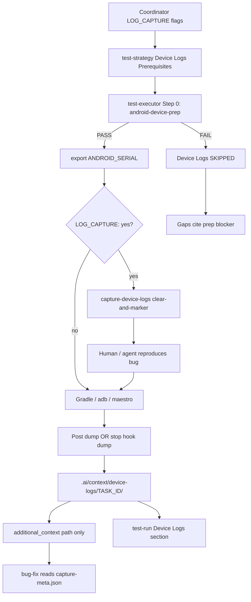

# Architecture Brief — MAS-09

## Architecture

**Option 3 — Two-layer composite repro observability** (per brainstorm Recommended + osint Recommended Approach + plan Phase 0): prep-gated `capture-device-logs.{ps1|sh}` host scripts + `device-log-capture.md` reference + Cursor hook recipes (`stop` dump, optional `beforeSubmitPrompt` clear) + test-executor Step 0b/Post + test-run **Device Logs** slice + handoff flags (`LOG_CAPTURE`, `LOG_PACKAGE`, `LOG_TAG`) + app structured-logging convention slice — so `/mas` bug-repro workflows **clear log buffers before repro**, **dump filtered logcat after repro** to `.ai/context/device-logs/{TASK_ID}/`, and surface **path-only metadata** to agents via hooks (never full log bodies).

`UI_SCOPE: logic-only` — no target app patches, no Compose debug UI, no Chucker/Flipper ingestion. Framework repo ships scripts, reference doc, hook templates, protocol/skill contract updates, and convention documentation only.

**Relationship to prior work:** MAS-07 (`android-device-prep`, `ANDROID_SERIAL` export, test-run **Device** section) provides the upstream serial gate. MAS-08 (project hooks, fail-open v1.6, artifact-forward invariant) provides hook wiring patterns. `capture-connected-device.{ps1|sh}` proves the sibling adb script pattern. MAS-09 adds the **downstream log capture consumer** chained after prep — not a replacement for prep selection logic.

Core invariants: prep coupling (no adb without `ANDROID_SERIAL`); artifact-forward (hooks expose paths only, ~200 chars max); fail-open hooks (capture failure must not block agent `stop`); security (no tokens/PII in logs or meta); Chucker/Flipper optional human debug only.

### End-to-end topology

```
[Coordinator] handoff LOG_CAPTURE: yes, LOG_PACKAGE, LOG_TAG (optional)
       ↓
[test-executor Step 0]  android-device-prep → PASS → export ANDROID_SERIAL
       ↓
[test-executor Step 0b] capture-device-logs clear-and-marker (when LOG_CAPTURE: yes)
       ↓
[Human / agent]  Reproduce bug on device
       ↓
[Cursor stop hook | test-executor Post]  capture-device-logs dump
       ↓
.ai/context/device-logs/{TASK_ID}/
  logcat-main.jsonl | logcat-crash.txt | capture-meta.json | repro-marker.json
       ↓
[Hook additional_context]  path + line_count only (never log body)
       ↓
[bug-fix / general-dev]  Read capture-meta.json; correlate repro_marker timestamp
```



**MAS framework repo:** scripts + fixtures + protocol only; no Android modules. Dogfood validates state machine via mocked adb fixtures — no physical device required in CI.

---

## Architect gate decisions (Phase 0 — D1–D8 confirmed)

Binding decisions for downstream general-dev. Aligns plan resolved table, brainstorm Logic Flow A–F, and osint Findings #1–#8. Does **not** re-litigate Option 3 vs alternatives.

| # | Question | **Decision** | Rationale |
|---|----------|--------------|-----------|
| D1 | Brief type vs slice | **test-run Device Logs slice first** — not standalone `device-logs` brief type until bug-fix-only workflows need logs without test execution | Lower schema churn; promote to brief type in P2 if needed |
| D2 | Inline prep vs require prior prep | **`capture-device-logs` requires prior prep PASS** — does **not** invoke prep inline; FAIL `NO_SERIAL` (exit 10) if `ANDROID_SERIAL` unset | Single serial SOT with MAS-07; matches prep-first invariant |
| D3 | Handoff flags | `LOG_CAPTURE: yes\|no` (default no), `LOG_PACKAGE`, `LOG_TAG` (default `APP_TRACE`), `LOG_BUFFERS` (default `main,crash`), `LOG_FORMAT` (`json\|threadtime`); lite alias `LOG:y` | Brainstorm Q3; align MAS-08 handoff extension process |
| D4 | Default format | API 30+ → `-v json`; else `-v threadtime` with warning in `capture-meta.json` | OSINT API-level guidance; script detects via `adb shell getprop ro.build.version.sdk` |
| D5 | Max lines cap | **P0 unbounded**; **P1 `--max-lines 5000` default** with truncation warning in meta | Balance token cost vs completeness |
| D6 | structlog-timber vs custom tree | **Lightweight custom Timber tree** in convention doc — structlog-timber optional mention only, not framework dependency | Avoid supply-chain in MAS repo |
| D7 | Workflow session field | **`log_capture_path`** (string) pointing to `capture-meta.json`; optional nested `line_count` in session step record only | Minimal schema delta |
| D8 | `beforeSubmitPrompt` auto-clear | **Opt-in only** via handoff `LOG_CAPTURE: yes` + repro keywords — never default-on | Avoids clearing non-bug sessions |
| D9 | Convention doc placement | **Extend `mas-android-dev/SKILL.md`** with **Repro logging convention** slice — do **not** create `mas-repro-logging` skill in v1.7.0 | Single owner for Android conventions; promote to thin skill in P2 only if adoption warrants |
| D10 | Semver | **`1.5.0` → `1.7.0`** (minor bump) | Additive scripts + hooks + protocol; skips 1.6.0 (MAS-08); new cross-specialist capability warrants minor |
| D11 | Fixture dry-run | **`ADB_DEVICES_FIXTURE`** + `ADB_LOGCAT_FIXTURE` env vars mirroring MAS-07 pattern | Framework dogfood without physical device |
| D12 | Cloud Agent / no adb | **Hard SKIP** with platform-parity rationale when `LOG_CAPTURE: yes` but no adb on host — do not FAIL workflow | Same boundary as MAS-07 D5 |
| D13 | PID filter | Resolve via `pidof -s $PACKAGE` **at dump time only**; stale-PID fallback: tag-only filter if `pidof` returns empty | Process restart mid-repro; document in reference |
| D14 | Log filter expression | `$TAG:D *:S` (e.g. `APP_TRACE:D *:S`); optional `--pid` when package resolves | OSINT Finding #1; avoids host `grep` pipe |
| D15 | P2 escalation | **`LOG_ESCALATION: full-bugreport`** deferred — document in reference only; separate artifact dir when implemented | ANR/system_server edge cases; not default repro loop |
| D16 | Observability boundary | **Local logcat (MAS-09) vs prod telemetry (MAS-04 Phase C)** — cross-ref only in P2; no `mas-observability` implementation in v1.7.0 | Clear scope boundary |

### Non-negotiable invariants

- **Prep coupling:** Never run log ops without resolved `ANDROID_SERIAL` (same as MAS-07 / capture-connected-device)
- **Artifact-forward:** Hooks and `additional_context` expose paths only — max ~200 chars context string
- **Fail-open hooks:** Log capture failure must not block agent `stop` or subagent chain (MAS-08 D6)
- **Security:** No tokens/PII in logs or meta; redaction checklist in convention doc
- **Chucker/Flipper:** Optional human debug only — MAS reads logcat artifacts, not inspector DB
- **Reviewer gate unchanged:** hooks never auto-approve; Device Logs is evidence for reviewer, not approval

---

## Script contract (`capture-device-logs`)

### Files (SOT)

| Path | Platform | Purpose |
|------|----------|---------|
| `skills/multi-agent-system/scripts/capture-device-logs.ps1` | Windows (primary) | Log capture gate |
| `skills/multi-agent-system/scripts/capture-device-logs.sh` | Linux/macOS/CI | POSIX twin |
| `skills/multi-agent-system/references/device-log-capture.md` | — | State machine, filters, redaction, format fallback, artifact layout |

Both scripts: **same pipeline, same JSON stdout shape, same exit code enum, same artifact layout.**

### Subcommands

| Subcommand | Preconditions | Actions | Exit |
|------------|---------------|---------|------|
| `clear` | `ANDROID_SERIAL` set (from env or `--serial`) | `adb -s $SERIAL logcat -c` | 0 / prep fail codes |
| `marker` | Serial known | Write `repro-marker.json` with ISO timestamp only (no clear) | 0 |
| `dump` | Serial known | Resolve PID via `pidof -s $PACKAGE` if set; dump `-b main,crash` with format + tag filter; write artifacts + `capture-meta.json` | 0; `CAPTURE_EMPTY` warn if 0 lines |
| `clear-and-marker` | Serial known | `clear` then `marker` atomically | 0 |

**Prep-first gate (D2):** Script does **not** call `android-device-prep`. If `$env:ANDROID_SERIAL` and `--serial` both unset → emit FAIL JSON with `exit_code: NO_SERIAL`, process exit 10. If serial set but device offline/unauthorized → reuse MAS-07 exit codes 11–12 via connectivity check.

### CLI flags

| Flag | PowerShell alias | Required | Default | Description |
|------|------------------|----------|---------|-------------|
| `--serial <id>` | `-Serial` | no | `$env:ANDROID_SERIAL` | Device serial override |
| `--package <id>` | `-Package` | no | — | Application id for `pidof` PID filter |
| `--tag <name>` | `-Tag` | no | `APP_TRACE` | Logcat tag filter (`$TAG:D *:S`) |
| `--buffers <list>` | `-Buffers` | no | `main,crash` | Comma-separated `-b` list |
| `--format json\|threadtime` | `-Format` | no | API-aware (D4) | Override format detection |
| `--output-dir <path>` | `-OutputDir` | no | `.ai/context/device-logs/{TASK_ID}/` | Artifact root |
| `--task-id <id>` | `-TaskId` | yes* | — | TASK_ID for artifact dir (*required for dump/marker) |
| `--max-lines <n>` | `-MaxLines` | no | unbounded (P0); 5000 (P1 default) | Truncate with warning in meta |
| `--dry-run` | `-DryRun` | no | false | Print planned adb ops; no device required |
| `--help` | `-Help` | no | false | Usage + exit code table |
| `--json-only` | `-JsonOnly` | no | false | Suppress non-JSON stderr on success |

**P2 reserved:** `--escalation bugreport` for `LOG_ESCALATION: full-bugreport` (D15).

### Pipeline steps (`dump` subcommand)

1. Parse args; validate `--task-id` present.
2. **Serial gate** — read `ANDROID_SERIAL` or `--serial`; if unset → FAIL `NO_SERIAL` (10).
3. **Connectivity check** — `adb -s $SERIAL get-state` → `device`; else OFFLINE (12) or UNAUTHORIZED (11).
4. **API level detect** — `adb -s $SERIAL shell getprop ro.build.version.sdk` → choose format (D4).
5. **PID resolve** (when `--package` set) — `adb -s $SERIAL shell pidof -s $PACKAGE`; empty → tag-only filter + warning `PID_NOT_FOUND`.
6. **Dump main buffer** — `adb -s $SERIAL logcat -d -b main -v {json|threadtime} [--pid=$PID] $TAG:D *:S` → `logcat-main.jsonl` or `.txt`.
7. **Dump crash buffer** — `adb -s $SERIAL logcat -d -b crash` → `logcat-crash.txt` (no tag filter on crash buffer).
8. **Truncate** (P1 when `--max-lines` set) — tail cap per buffer; add `TRUNCATED: main` to warnings.
9. **Write `capture-meta.json`** — index with paths, line counts, filters, timestamps.
10. **Emit JSON stdout** (last line); exit per code table.

### Fixture / dry-run mode (D11)

| Env var | Purpose |
|---------|---------|
| `ADB_DEVICES_FIXTURE` | Reuse MAS-07 mock for serial gate (optional) |
| `ADB_LOGCAT_FIXTURE` | Path to mock logcat dump output for `dump` dry-run |
| `ADB_API_LEVEL_FIXTURE` | Override API level for format detection tests |

When fixtures set, script skips real `adb` invocation; writes artifacts from fixture files. Fixtures live at `.ai/fixtures/MAS-09-LOG-CAPTURE/`.

### Process exit codes

| Code | `exit_code` enum | Meaning |
|------|------------------|---------|
| 0 | `PASS` | Success |
| 0 | `CAPTURE_EMPTY` | Dump succeeded but 0 lines — **warn only**, not failure |
| 1 | `ADB_NOT_FOUND` | `adb` not on PATH |
| 7 | `INVALID_ARGS` | Missing/invalid flags |
| 10 | `NO_SERIAL` | `ANDROID_SERIAL` unset — prep not run |
| 11 | `UNAUTHORIZED` | Device unauthorized |
| 12 | `OFFLINE` | Device offline |
| 21 | `DUMP_FAILED` | `adb logcat` error or write failure |

**Reuse MAS-07 codes 10–15** where applicable for serial/connectivity failures. Script does **not** emit 13–15 (selection ambiguity) — that is prep's responsibility.

**Agent parsing rule:** exit 0 + `status: PASS` → proceed; `CAPTURE_EMPTY` in `exit_code` or `warnings[]` → proceed with caution; non-zero OR `status: FAIL` → record Device Logs FAIL/SKIPPED.

### JSON stdout contract (last line — mirrors prep style)

#### PASS shape

```json
{
  "status": "PASS",
  "exit_code": "PASS",
  "message": "Dumped 142 lines to .ai/context/device-logs/MAS-09/",
  "capture_meta_path": ".ai/context/device-logs/MAS-09/capture-meta.json",
  "line_count": 142
}
```

#### CAPTURE_EMPTY shape (exit 0)

```json
{
  "status": "PASS",
  "exit_code": "CAPTURE_EMPTY",
  "message": "Dump succeeded but 0 lines captured — check tag filter or repro window",
  "capture_meta_path": ".ai/context/device-logs/MAS-09/capture-meta.json",
  "line_count": 0
}
```

#### FAIL shape

```json
{
  "status": "FAIL",
  "exit_code": "NO_SERIAL",
  "message": "ANDROID_SERIAL unset — run android-device-prep (Step 0) first",
  "capture_meta_path": null,
  "line_count": null
}
```

#### Field registry

| Field | Type | Required | Notes |
|-------|------|----------|-------|
| `status` | enum | yes | `PASS` \| `FAIL` |
| `exit_code` | enum | yes | See exit code table |
| `message` | string | yes | Actionable user/agent text |
| `capture_meta_path` | string \| null | yes | Relative path to meta; null on FAIL before write |
| `line_count` | int \| null | yes | Total lines across buffers; null on FAIL |

---

## Artifact schemas

### Directory layout

```
.ai/context/device-logs/{TASK_ID}/
├── capture-meta.json       # Index (always written on dump)
├── repro-marker.json       # ISO timestamp (clear-and-marker / marker)
├── logcat-main.jsonl       # Main buffer (json format)
│   or logcat-main.txt      # Main buffer (threadtime format)
└── logcat-crash.txt        # Crash buffer (always text)
```

### `capture-meta.json` schema

```json
{
  "status": "PASS",
  "task_id": "MAS-09",
  "serial": "R58M90ABCDE",
  "package": "com.example.app",
  "tag_filter": "APP_TRACE",
  "buffers": ["main", "crash"],
  "format": "json",
  "api_level": 34,
  "pid": 12345,
  "paths": {
    "main": ".ai/context/device-logs/MAS-09/logcat-main.jsonl",
    "crash": ".ai/context/device-logs/MAS-09/logcat-crash.txt",
    "marker": ".ai/context/device-logs/MAS-09/repro-marker.json"
  },
  "line_count": { "main": 142, "crash": 3, "total": 145 },
  "repro_started_at": "2026-10-06T12:00:00.000Z",
  "dumped_at": "2026-10-06T12:05:00.000Z",
  "warnings": []
}
```

| Field | Type | Required | Notes |
|-------|------|----------|-------|
| `status` | enum | yes | `PASS` \| `FAIL` |
| `task_id` | string | yes | TASK_ID from `--task-id` |
| `serial` | string | yes | Device serial used |
| `package` | string \| null | no | Package filter if set |
| `tag_filter` | string | yes | Tag used in filter expression |
| `buffers` | string[] | yes | Buffers dumped |
| `format` | enum | yes | `json` \| `threadtime` |
| `api_level` | int | yes | SDK level at dump time |
| `pid` | int \| null | no | Resolved PID; null if tag-only |
| `paths` | object | yes | Relative paths to artifact files |
| `line_count` | object | yes | Per-buffer + `total` |
| `repro_started_at` | string \| null | no | From `repro-marker.json` if exists |
| `dumped_at` | string | yes | ISO-8601 dump timestamp |
| `warnings` | string[] | yes | e.g. `CAPTURE_EMPTY`, `PID_NOT_FOUND`, `FORMAT_FALLBACK: threadtime`, `TRUNCATED: main` |

### `repro-marker.json` schema

```json
{
  "repro_started_at": "2026-10-06T12:00:00.000Z",
  "task_id": "MAS-09",
  "serial": "R58M90ABCDE"
}
```

Idempotent overwrite on re-run `clear-and-marker` or `marker`.

---

## Handoff flags (D3)

| Field | Values | Set by | Consumed by |
|-------|--------|--------|-------------|
| `LOG_CAPTURE: yes\|no` | default `no` | Coordinator when user requests repro logging | test-executor, hooks, test-strategy |
| `LOG_PACKAGE: <id>` | applicationId | Coordinator or user | capture script `--package`, test-run Device Logs |
| `LOG_TAG: <name>` | default `APP_TRACE` | Coordinator or convention | capture script `--tag` |
| `LOG_BUFFERS: <list>` | default `main,crash` | Coordinator | capture script `--buffers` |
| `LOG_FORMAT: json\|threadtime` | optional override | Coordinator | capture script `--format` |
| `LOG_ESCALATION: full-bugreport` | P2 only | Coordinator | escalation subcommand (deferred) |

**Lite alias:** `LOG:y` on handoff (MAS-08 lite extension process).

**Coordinator routing:** Set flags on test-executor and bug-fix handoffs when user requests repro logging. Bug-fix may receive `BRIEF_PATH: .ai/context/device-logs/{TASK_ID}/capture-meta.json` after dump.

---

## Hook contracts (MAS-08 compatible)

| Hook | Matcher / trigger | Action | Output |
|------|-------------------|--------|--------|
| `beforeSubmitPrompt` | Optional; `LOG_CAPTURE: yes` + repro keywords (`repro`, `bug`, `logcat`) | `capture-device-logs clear --task-id $TASK_ID` | `{}` or warn stderr only — **opt-in D8** |
| `stop` | `status=completed` + latest handoff `LOG_CAPTURE: yes` | `capture-device-logs dump --task-id $TASK_ID` (+ flags from handoff) | `{"additional_context":"Device logs: .ai/context/device-logs/{TASK_ID}/capture-meta.json"}` |
| `afterShellExecution` | matcher `capture-device-logs|adb.*logcat` | Parse stdout JSON; call `record-workflow-step` with `log_capture_path` | path metadata only |
| `subagentStop` | unchanged | Chain reminder; bug-fix handoff may set `BRIEF_PATH` | existing mas-session-context |

**Hook script paths (source → bootstrap copy):**

| Source | Bootstrap destination |
|--------|----------------------|
| `hooks/capture-device-logs-hook.ps1` | `.cursor/hooks/capture-device-logs-hook.ps1` |
| `hooks/capture-device-logs-hook.sh` | `.cursor/hooks/capture-device-logs-hook.sh` |

**Invariants:** fail-open v1.6 — hook failure returns `{}`; stdout valid JSON only; no log body in `additional_context`; Cloud Agent documents adb SKIP (D12).

### `.cursor/hooks.json` template extension

```json
{
  "version": 1,
  "hooks": {
    "stop": [
      { "command": "powershell -NoProfile -ExecutionPolicy Bypass -File ./.cursor/hooks/finalize-session-hook.ps1" },
      { "command": "powershell -NoProfile -ExecutionPolicy Bypass -File ./.cursor/hooks/capture-device-logs-hook.ps1 stop" }
    ],
    "beforeSubmitPrompt": [
      { "command": "powershell -NoProfile -ExecutionPolicy Bypass -File ./.cursor/hooks/capture-device-logs-hook.ps1 beforeSubmitPrompt", "matcher": "repro|bug|logcat" }
    ],
    "afterShellExecution": [
      { "command": "powershell -NoProfile -ExecutionPolicy Bypass -File ./.cursor/hooks/capture-device-logs-hook.ps1 afterShellExecution", "matcher": "capture-device-logs|adb.*logcat" }
    ]
  }
}
```

`beforeSubmitPrompt` entry emitted only when project opts in during bootstrap; default bootstrap may omit (D8).

### Workflow session extension (D7)

Extend `record-workflow-step.ps1` and hook wrapper to accept optional `-LogCapturePath`:

| Field | Type | Location | When set |
|-------|------|----------|----------|
| `log_capture_path` | string | workflow session root OR last step object | After successful dump |
| `line_count` | int | step object (optional) | When parseable from stdout JSON |

Example session fragment:

```json
{
  "task_id": "MAS-09",
  "log_capture_path": ".ai/context/device-logs/MAS-09/capture-meta.json",
  "steps": [
    {
      "agent": "test-executor",
      "log_capture_path": ".ai/context/device-logs/MAS-09/capture-meta.json",
      "line_count": 142
    }
  ]
}
```

---

## test-executor workflow extension

| Step | When | Command |
|------|------|---------|
| 0 | adb surface | `android-device-prep` (existing MAS-07) |
| 0b | `LOG_CAPTURE: yes` + prep PASS | `capture-device-logs clear-and-marker --task-id $TASK_ID --tag $LOG_TAG` |
| 1..N | strategy commands | Gradle / adb / maestro (serialized — no parallel adb) |
| Post | `LOG_CAPTURE: yes` + repro occurred | `capture-device-logs dump --task-id $TASK_ID --package $LOG_PACKAGE --tag $LOG_TAG` → populate test-run **Device Logs** |

**Serialization rule:** Step 0 → 0b → commands → Post dump. Never parallel adb from prep + capture + dump.

**Skip paths:**

| Condition | Device Logs |
|-----------|-------------|
| `LOG_CAPTURE: no` | Omit with JVM-only skip rationale |
| Prep FAIL (Step 0) | `SKIPPED` — clear/dump not invoked |
| Cloud Agent / no adb | `SKIPPED` — platform-parity rationale |
| Dump FAIL | `FAIL` with script message |

---

## test-run Device Logs section (D1)

Register in `brief-schemas.md` parallel to MAS-07 **Device** section.

**Conditional rule:** Required when `LOG_CAPTURE: yes` and capture attempted (PASS/FAIL/SKIP). Omit when JVM-only with documented skip rationale.

| Field | Required when | Values |
|-------|---------------|--------|
| Capture gate | capture attempted | `PASS` \| `FAIL` \| `SKIPPED` |
| Prep prerequisite | always when section present | `PASS (serial)` \| `FAIL` \| `SKIPPED` |
| Clear executed | `LOG_CAPTURE: yes` | `yes` \| `no` |
| Dump path | dump attempted | `.ai/context/device-logs/{TASK_ID}/capture-meta.json` |
| Format | dump PASS | `json` \| `threadtime` |
| Line count | dump PASS | integer |
| Tag filter | dump attempted | e.g. `APP_TRACE` \| `—` |
| Package | when set | applicationId \| `—` |
| Message | always | From script stdout JSON `message` |

---

## Agent ingestion contract (bug-fix / general-dev)

1. At startup, if `BRIEF_PATH` points to `capture-meta.json` (or handoff sets path), read metadata first — paths, filters, `line_count`, `repro_started_at`.
2. Read log files on disk (not injected via hook).
3. **Parse priority:** `logcat-crash.txt` → `APP_TRACE` JSON lines in main → unfiltered main buffer tail.
4. **Correlation:** Match `repro-marker.json` timestamp to first `event=repro_marker` or first app log after marker.

Target skill update: `skills/mas-general-dev/SKILL.md` (bug-fix ingestion notes).

---

## App logging convention (Layer B — target apps only)

Document in `skills/mas-android-dev/SKILL.md` **Repro logging convention** slice (D9). Not shipped as framework code.

| Signal | Mechanism | Log fields |
|--------|-----------|------------|
| Exceptions | `Timber.e(t, msg)` + `Thread.setDefaultUncaughtExceptionHandler` chaining | `event=uncaught`, `priority=E` |
| API calls | Custom OkHttp `EventListener.Factory` (not `LoggingEventListener`) | `event=http`, `method`, `host`, `path`, `status`, `duration_ms` |
| Lifecycle | `ProcessLifecycleOwner` + `ActivityLifecycleCallbacks` | `event=lifecycle`, `screen`, `state` |
| Navigation | Fragment/Compose route observer (app-specific) | `event=nav`, `route` |
| Repro correlation | App logs `event=repro_marker` OR host marker timestamp | matches `repro-marker.json` |

**Tag namespace:** `APP_TRACE` (configurable via `LOG_TAG`). Filter: `adb logcat APP_TRACE:D *:S`.

**Redaction (non-negotiable):** Never log auth headers, tokens, PII, passwords. Document R8 `-assumenosideeffects` for debug `Log` in release. Chucker/Flipper: optional `debugImplementation` only.

**structlog-timber:** Optional third-party mention — not MAS dependency (D6).

---

## Modules:

Logical packaging units for v1.7.0 — not Android Gradle modules.

| Module | Path | Owner | Phase | Purpose |
|--------|------|-------|-------|---------|
| **LogCaptureScripts** | `skills/multi-agent-system/scripts/capture-device-logs.{ps1\|sh}` | framework | P0 | Prep-gated clear/dump/marker; JSON stdout |
| **LogCaptureReference** | `skills/multi-agent-system/references/device-log-capture.md` | framework | P0 | State machine, filters, redaction, format fallback — single SOT with script |
| **PrepCrossRef** | `skills/multi-agent-system/references/device-prep-automation.md` (extend) | framework | P0 | Log capture section; prep prerequisite; chaining after Step 0 |
| **LogCaptureHooks** | `hooks/capture-device-logs-hook.{ps1\|sh}` | framework | P0 | `stop` dump, optional `beforeSubmitPrompt` clear, `afterShellExecution` matcher |
| **HookBootstrap** | `init-mas-project.ps1` + `hooks.project.template.json` (extend) | framework | P0 | Copy hook scripts; emit template entries |
| **InstallManifest** | `skills/multi-agent-system/install/manifest.json` | framework | P0 | Version `1.7.0`; scripts + hook paths |
| **BriefSchemas** | `protocol/brief-schemas.md` (extend) | protocol | P1 | **Device Logs** slice registration |
| **HandoffProtocol** | `handoff-format.md`, `handoff-format-lite.md` (extend) | protocol | P1 | `LOG_CAPTURE`, `LOG_PACKAGE`, `LOG_TAG`, `LOG_BUFFERS`, `LOG_FORMAT`; lite `LOG:y` |
| **TestExecutorSkill** | `skills/mas-test-executor/SKILL.md` (extend) | specialist | P1 | Step 0b + Post; Device Logs output template |
| **TestStrategySkill** | `skills/mas-test-strategy/SKILL.md` (extend) | specialist | P1 | Device Logs Prerequisites subsection |
| **CoordinatorSkill** | `skills/mas-coordinator/SKILL.md` (extend) | coordinator | P1 | `LOG_CAPTURE` routing; bug-fix `BRIEF_PATH` |
| **AndroidDevConvention** | `skills/mas-android-dev/SKILL.md` (extend) | specialist | P1 | Repro logging convention slice |
| **GeneralDevIngestion** | `skills/mas-general-dev/SKILL.md` (extend) | specialist | P1 | capture-meta read order; parse priority |
| **ReadOrder** | `protocol/read-order.md` (extend) | protocol | P1 | Subscription matrix for log capture pipeline |
| **PlatformParity** | `protocol/platform-parity.md` (extend) | protocol | P1 | adb log capture IDE+CLI local only; Cloud SKIP |
| **WorkflowTelemetry** | `record-workflow-step.ps1` + hook (extend) | framework | P1 | `log_capture_path` field |
| **Fixtures** | `.ai/fixtures/MAS-09-LOG-CAPTURE/` | dogfood | P0 | Mock adb, expected JSON shapes, handoff stub |
| **Escalation** | `device-log-capture.md` + script flag (P2) | framework | P2 | `LOG_ESCALATION: full-bugreport` |
| **ObservabilityBoundary** | cross-ref in reference + memory.md (P2) | documenter | P2 | Local logcat vs MAS-04 prod telemetry |

---

## Layers:

| Layer | Components | Responsibility |
|-------|------------|----------------|
| **Distribution** | `install/manifest.json` v1.7.0, bootstrap scripts | Version, script inventory, hook copy |
| **Host automation** | `capture-device-logs.{ps1\|sh}`, `android-device-prep.{ps1\|sh}` | adb clear/dump; serial gate via env |
| **Reference / SOT** | `device-log-capture.md`, `device-prep-automation.md` | State machine, contracts, enrollment |
| **Orchestration** | test-executor Step 0b/Post, Coordinator handoff flags | When to clear/dump; flag propagation |
| **IDE integration** | `.cursor/hooks.json`, `capture-device-logs-hook.*` | Automated dump on stop; fail-open |
| **Evidence bus** | `.ai/context/device-logs/{TASK_ID}/`, test-run **Device Logs** | Artifact storage; reviewer evidence |
| **Agent consumption** | bug-fix/general-dev, hooks `additional_context` | Path-only surfacing; on-disk parse |
| **App convention** | `mas-android-dev` repro logging slice | Structured `APP_TRACE` lines in target apps |
| **Policy** | `platform-parity.md`, `brief-schemas.md` | Cloud SKIP; conditional schema rules |

### Layer interaction

```
Handoff flags (Coordinator)
    → test-strategy prerequisites
    → test-executor Step 0 (prep) → ANDROID_SERIAL
    → test-executor Step 0b (clear-and-marker)
    → repro window
    → test-executor Post dump OR stop hook dump
    → artifacts on disk
    → test-run Device Logs + hook additional_context
    → bug-fix reads capture-meta.json
```

---

## Contracts:

### Cross-module contracts summary

| Contract | Producer | Consumer | SOT |
|----------|----------|----------|-----|
| `ANDROID_SERIAL` env | `android-device-prep` | `capture-device-logs` | MAS-07 architecture |
| Script stdout JSON | `capture-device-logs` | test-executor, hooks | This brief § JSON stdout |
| `capture-meta.json` | `capture-device-logs dump` | bug-fix, reviewer, hooks | This brief § Artifact schemas |
| `repro-marker.json` | `clear-and-marker` / `marker` | bug-fix correlation | This brief § repro-marker |
| Handoff `LOG_*` flags | Coordinator | test-executor, hooks, test-strategy | `handoff-format.md` |
| Device Logs section | test-executor | reviewer | `brief-schemas.md` |
| Hook `additional_context` | `capture-device-logs-hook` | Cursor agent context | MAS-08 artifact-forward |
| `log_capture_path` | hooks / record-workflow-step | workflow session JSON | This brief § Workflow session |
| App `APP_TRACE` lines | target Android app | host dump filter | `mas-android-dev` convention |

### test-strategy Device Logs Prerequisites (template fields)

| Field | Example |
|-------|---------|
| Log capture gate | `required` \| `skip` |
| Tag namespace | `APP_TRACE` |
| Package | `com.example.app` |
| Clear before repro | `yes` |
| Skip rationale | JVM-only / no adb / Cloud Agent |

### Idempotency

- `clear` and `dump` safe to re-run; overwrites artifacts.
- `marker` / `clear-and-marker` overwrite `repro-marker.json` with new timestamp.
- Hook `stop` dump may run even if test-executor Post already dumped — later dump wins.

### Security contract

- No auth tokens, API keys, passwords, or PII in log files or `capture-meta.json`.
- OkHttp EventListener must redact bodies; never use BODY-level `HttpLoggingInterceptor` for MAS.
- Convention doc includes redaction checklist and R8 release-build guidance.

---

## Responsive Strategy:

N/A — `UI_SCOPE: logic-only`. No Compose screens, size classes, or adaptive layouts in MAS framework repo. Target app convention doc may reference responsive screen names in lifecycle `screen` field only.

---

## Files:

### New (P0)

| Path | Task | Owner |
|------|------|-------|
| `.ai/context/architecture/MAS-09.md` | 1 | architect |
| `skills/multi-agent-system/references/device-log-capture.md` | 2 | general-dev |
| `skills/multi-agent-system/scripts/capture-device-logs.ps1` | 3 | general-dev |
| `skills/multi-agent-system/scripts/capture-device-logs.sh` | 4 | general-dev |
| `hooks/capture-device-logs-hook.ps1` | 6 | general-dev |
| `hooks/capture-device-logs-hook.sh` | 6 | general-dev |
| `.ai/fixtures/MAS-09-LOG-CAPTURE/adb-logcat-empty.txt` | 9 | general-dev |
| `.ai/fixtures/MAS-09-LOG-CAPTURE/capture-meta-expected.json` | 9 | general-dev |
| `.ai/fixtures/MAS-09-LOG-CAPTURE/script-stdout-pass.json` | 9 | general-dev |
| `.ai/fixtures/MAS-09-LOG-CAPTURE/script-stdout-capture-empty.json` | 9 | general-dev |
| `.ai/fixtures/MAS-09-LOG-CAPTURE/handoff-stub.md` | 9 | general-dev |
| `.ai/fixtures/MAS-09-LOG-CAPTURE/test-run-expected-shape.md` | 9 | general-dev |

### Extend (P0–P1)

| Path | Change |
|------|--------|
| `skills/multi-agent-system/references/device-prep-automation.md` | Log capture section |
| `skills/multi-agent-system/install/manifest.json` | v1.7.0; scripts + hook paths |
| `skills/multi-agent-system/install/templates/hooks.project.template.json` | stop + optional beforeSubmitPrompt entries |
| `skills/multi-agent-system/scripts/init-mas-project.ps1` (+ `.sh`) | Copy log capture hook scripts |
| `skills/multi-agent-system/protocol/brief-schemas.md` | Device Logs slice |
| `skills/multi-agent-system/protocol/handoff-format.md` | LOG_* flags |
| `skills/multi-agent-system/protocol/handoff-format-lite.md` | `LOG:y` |
| `skills/multi-agent-system/protocol/read-order.md` | Log capture subscription matrix |
| `skills/multi-agent-system/protocol/platform-parity.md` | adb log capture local only |
| `skills/multi-agent-system/references/test-strategy-standards.md` | Device Logs Prerequisites |
| `skills/multi-agent-system/scripts/record-workflow-step.ps1` | `-LogCapturePath` param |
| `skills/mas-test-executor/SKILL.md` | Step 0b + Post + Device Logs template |
| `skills/mas-test-strategy/SKILL.md` | Log capture prerequisites |
| `skills/mas-coordinator/SKILL.md` | LOG_CAPTURE routing |
| `skills/mas-android-dev/SKILL.md` | Repro logging convention slice |
| `skills/mas-general-dev/SKILL.md` | Bug-fix ingestion notes |
| `skills/multi-agent-system/scripts/README.md` | capture-device-logs usage |
| `README.md` | Log capture slice (documenter) |

### Dogfood artifacts (validation chain)

| Path | Owner |
|------|-------|
| `.ai/context/test-strategies/MAS-09.md` | test-strategy (Task 23) |
| `.ai/context/test-runs/MAS-09.md` | test-executor (Task 24) |

### Dependency graph (implementation order)

```
architect (Task 1) → reference + scripts + hooks + fixtures (Tasks 2–9)
                  → protocol + skills (Tasks 10–20)
                  → dogfood test-strategy + test-executor (Tasks 23–24)
                  → documenter + reviewer (Tasks 25–26)
```

---

## Usage Report

Model: default
Class: thinking
Tokens: unknown

DONE
