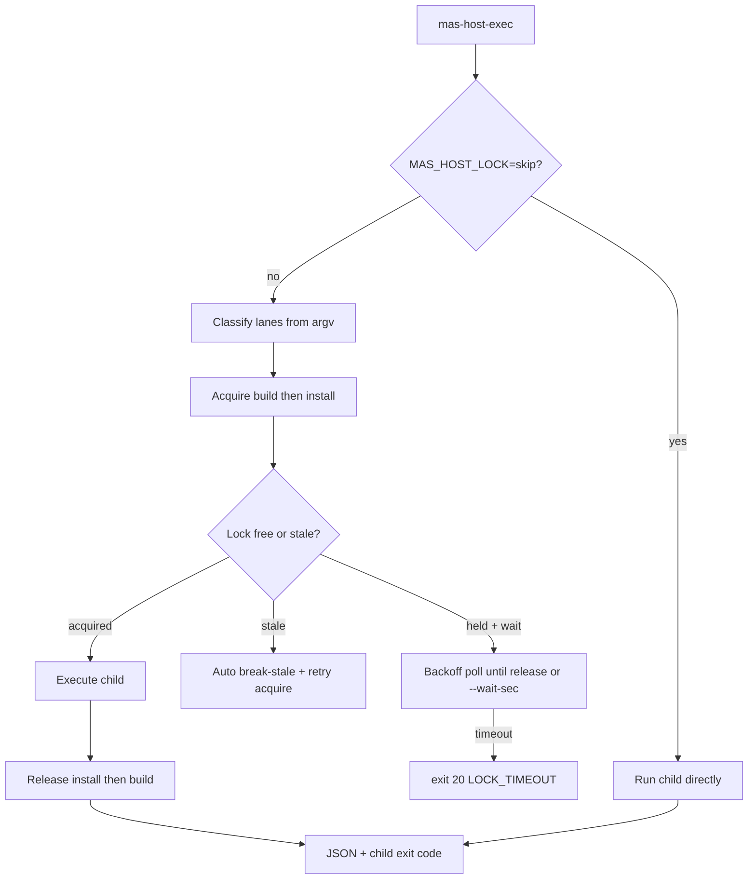

# Architecture Brief — MAS-10

## Architecture

**Option A — Dual-lane host mutex with wrapper CLI** (per plan Proposed approach): ship **`mas-host-lock`** (acquire / release / status / refresh / break-stale) and **`mas-host-exec`** (lane detect → ordered acquire → child exec → trap release) as cross-platform scripts under `skills/multi-agent-system/scripts/`, with SOT reference **`host-build-install-mutex.md`**, specialist skill obligations, fixture harness, and optional **P1 `preToolUse` warn-only** hook — so parallel Cursor chats on one host serialize **Gradle builds** and **device installs** without Gradle plugin changes or daemon tuning in consumer Android repos.

`UI_SCOPE: logic-only` — no Compose, no IDE UI. Framework repo ships scripts + protocol/skill updates only.

**Relationship to prior work:** MAS-07 (`android-device-prep`) stabilizes device selection and exports `ANDROID_SERIAL` — **orthogonal** to host mutex; prep does not install APK. Ordering for device workflows: **host lock (when gated) → prep (Step 0) → Gradle/adb**. MAS-08 (project hooks, **fail-open** D6) governs P1 telemetry; host-lock hook **never denies** in v1.8.

**Non-goal:** Single global queue for all shell commands — only `build` and `install` lanes; unrelated Shell commands unaffected.

### End-to-end topology

```
[Parallel Cursor chats / agents on same host]
        ↓
[Specialist Shell]  mas-host-exec --task-id MAS-XX --workspace <root> -- <gated argv>
        ↓
[Lane classifier]  argv → { build } | { install } | { build, install }
        ↓
[Ordered acquire]  build (if needed) → install (if needed)  — poll + backoff on conflict
        ↓
[Lock files]  %LOCALAPPDATA%\MAS\locks\  (or MAS_LOCK_ROOT / XDG state)
        ↓
[Child process]  gradlew* | adb install* | bundletool install* (P2 doc only)
        ↓
[Release]  reverse order on exit (normal, signal, child non-zero)
        ↓
[JSON stdout]  last line documents result / wait / stale break
```



**MAS framework repo:** fixture harness under `.ai/fixtures/MAS-10-HOST-LOCK/` — no live Gradle/adb required for approval.

---

## Architect gate decisions (Phase 0 — Q1–Q5 + D1–D12 confirmed)

Binding for downstream general-dev. Confirms plan open questions; does **not** re-litigate dual-lane vs single-queue.

| # | Question | **Decision** | Rationale |
|---|----------|--------------|-----------|
| **Q1** | `connected*AndroidTest` lane | **`build` lane only** | Gradle owns compile + APK push to device; `install` lane reserved for explicit `install*` Gradle tasks, `adb install*`, and (P2) `bundletool install*` |
| **Q2** | Nested locks (`installDebug`) | **Acquire `build` then `install`; release reverse** | Prevents install task racing another chat’s compile; `mas-host-exec` auto-orders; `--lanes` override for tests |
| **Q3** | `preToolUse` v1.8 | **P1 warn-only** — stdout `{ "warning": "..." }`; **no `deny`** in default template | MAS-08 D6 fail-open; blocking deferred to **v1.9** opt-in `hooks.json` flag `masHostLock.enforce: block` |
| **Q4** | Lease / wait | **Lease default 7200s**; **heartbeat refresh every 300s** while child runs; **default wait infinite** (`--wait-sec 0`); hooks may pass **`--wait-sec N`** cap | Long AGP builds need long lease; agents avoid burning turns via optional cap + `status --json` polling |
| **Q5** | Wait UX | **Machine JSON on stdout (last line)**; human lines only when **`MAS_LOCK_VERBOSE=1`** | Agents parse `status`, `message`, `holder`; humans get poll hints in verbose mode |
| D1 | Lock scope | **Host-wide** — shared `MAS_LOCK_ROOT` across all workspaces on machine | Parallel chats are the threat model |
| D2 | Lock root default | Windows: `%LOCALAPPDATA%\MAS\locks\`; POSIX: `${XDG_STATE_HOME:-$HOME/.local/state}/mas/locks/`; override **`MAS_LOCK_ROOT`** | User state dir; not repo-local |
| D3 | Lock artifacts | **`build.lock`**, **`install.lock`** — each a **JSON file** with exclusive create (O_CREAT\|O_EXCL / .NET `FileMode.CreateNew`) | Two files, two lanes; no subdirectory per lane required |
| D4 | Skip matrix | **`MAS_HOST_LOCK=skip`** → wrapper passthrough (exit 0, JSON `skipped: true`); **Cloud Agent** → document **SKIPPED** in `platform-parity.md` (no shared FS with local IDE) | Fixtures + framework CI use skip; cloud must not block on non-existent lock |
| D5 | Stale predicates | **(a)** holder PID not alive (platform probe); **(b)** `now > lease_expires_at` **and** `now - last_refresh_at > 600s` grace | Crashed IDE leaves dead PID; hung holder loses lease without refresh |
| D6 | Stale recovery | **Auto-break on acquire** when stale; operator **`mas-host-lock break-stale --lane <lane>`**; idempotent release matches **`task_id` + holder PID** | Avoid manual file delete in normal ops |
| D7 | Poll backoff | **2s initial → exponential cap 30s** between acquire retries | Reduces chatty FS polling |
| D8 | Semver | **`1.7.0` → `1.8.0`** minor bump | Additive scripts + protocol + skill surfaces; P1 hooks may ship in 1.8.0 or 1.8.1 patch |
| D9 | Enforcement primary | **Specialists must wrap** gated commands with `mas-host-exec`; evidence in test-run **Commands** | Gradle plugin not required |
| D10 | WSL / dual OS | **Separate default lock roots per OS session** unless operator sets shared **`MAS_LOCK_ROOT`** on a mounted path | Document in reference doc — WSL Gradle vs Windows Gradle are distinct hosts unless unified root |
| D11 | MAS-07 ordering | **Prep outside install lane** — `android-device-prep` does not acquire `install`; full device flow: **lock → prep → gradle/adb** | Prep has no APK install today |
| D12 | Hook phase in release | **P0:** skills + scripts + reference; **P1:** `mas-host-lock-warn.{ps1|sh}` + commented template entry | Coordinator may ship P1 in same minor or follow-up patch |

---

## Modules:

Logical packaging — not Android Gradle modules.

| Module | Path | Phase | Purpose |
|--------|------|-------|---------|
| **HostLockCLI** | `scripts/mas-host-lock.{ps1,sh}` | P0 | Acquire, release, status, refresh, break-stale |
| **HostExecWrapper** | `scripts/mas-host-exec.{ps1,sh}` | P0 | Lane detect, ordered lock, child exec, trap release |
| **HostMutexReference** | `references/host-build-install-mutex.md` | P0 | Lanes, stale policy, skip env, operator runbook, regex table |
| **FixtureHarness** | `.ai/fixtures/MAS-10-HOST-LOCK/` + optional `Test-MasHostLock.ps1` | P0 | Wait, stale PID, timeout, classifier, skip |
| **SkillSurfaces** | `mas-reviewer`, `mas-test-executor`, `mas-android-dev`, `mas-test-strategy` SKILL.md | P0 | Mandatory wrapper examples + `TASK_ID` |
| **BuildTestQA** | `references/build-test-visual-qa.md` | P0 | Wrapped Gradle/adb examples |
| **PlatformParity** | `protocol/platform-parity.md` | P0 | Cloud **SKIPPED** row |
| **InstallManifest** | `install/manifest.json` | P0 | Version `1.8.0`; register new scripts in `hooks` / scripts metadata as applicable |
| **HookWarn** | `hooks/mas-host-lock-warn.{ps1,sh}` | P1 | `preToolUse` Shell matcher; warn if unwrapped gated pattern |
| **Bootstrap** | `init-mas-project` / export templates | P1 | Copy warn hook; commented `hooks.json` entry |

---

## Layers:

| Layer | Responsibility | Consumers |
|-------|----------------|-----------|
| **Policy** | Which commands require which lanes; skip/env; Cloud boundary | Coordinator, specialists, reference doc |
| **Lock service** | FS-backed mutex, stale detection, JSON status | `mas-host-lock`, fixtures |
| **Exec wrapper** | argv parsing, acquire ordering, child lifecycle, exit code propagation | test-executor, android-dev, reviewer dogfood |
| **Observability (P1)** | Hook warning on bypass attempt | IDE agent Shell tool only |
| **Verification** | Fixture driver + test-strategy matrix | test-executor, reviewer |

No application UI layer. **Responsive Strategy:** N/A (`logic-only`).

---

## Contracts:

### Lock file schema (`build.lock` | `install.lock`)

UTF-8 JSON object (single file per lane). Written atomically on successful exclusive create.

| Field | Type | Required | Description |
|-------|------|----------|-------------|
| `lane` | `"build"` \| `"install"` | yes | Redundant with filename; aids parsing |
| `holder_pid` | int | yes | OS process id holding lock |
| `holder_ppid` | int | no | Parent pid for diagnostics |
| `task_id` | string | yes | Handoff `TASK_ID` (e.g. `MAS-10`) |
| `workspace_root` | string | yes | Absolute path to repo root |
| `command_hint` | string | no | Truncated argv summary (max 500 chars) |
| `acquired_at` | string (ISO-8601 UTC) | yes | First acquire time |
| `lease_expires_at` | string (ISO-8601 UTC) | yes | `acquired_at + lease_sec` (refreshed on heartbeat) |
| `last_refresh_at` | string (ISO-8601 UTC) | yes | Updated by refresh loop in `mas-host-exec` |
| `agent_slug` | string | no | Optional specialist name |

**Stale rule (D5):** If `holder_pid` is not running → stale. Else if `UtcNow > lease_expires_at` and `(UtcNow - last_refresh_at) > 600s` → stale.

### `mas-host-lock` subcommands

| Subcommand | Args | Behavior |
|------------|------|----------|
| `acquire` | `--lane build\|install`, `--task-id`, `--workspace`, `--lease-sec`, `--wait-sec`, `--command-hint` | Exclusive create or poll; auto break-stale before retry |
| `release` | `--lane`, `--task-id` | Remove lock if `task_id` + PID match; no-op success if already released |
| `status` | `--lane` (optional), `--json` | Describe holders; exit 0 always unless invalid args |
| `refresh` | `--lane`, `--task-id`, `--lease-sec` | Extend `lease_expires_at`, set `last_refresh_at` |
| `break-stale` | `--lane` | Force remove lock only when stale predicates true |
| `-Help` / `--help` | — | Usage + exit code table |

**Environment:** `MAS_LOCK_ROOT`, `MAS_HOST_LOCK=skip` (all subcommands no-op success with `skipped: true`), `MAS_LOCK_VERBOSE=1`.

**Stdout:** Valid JSON **last line** on every invocation (`status`, `result`, `exit_code`, `message`). Non-JSON verbose lines (if any) must precede final JSON line when `MAS_LOCK_VERBOSE=1`.

### `mas-host-exec` contract

| Flag | Required | Default | Description |
|------|----------|---------|-------------|
| `--task-id` | yes* | — | From handoff |
| `--workspace` | yes* | cwd | Repo root |
| `--lease-sec` | no | `7200` | Passed to acquire/refresh |
| `--wait-sec` | no | `0` | Infinite wait; `>0` → `LOCK_TIMEOUT` |
| `--lanes` | no | auto | Override classifier: `build`, `install`, `build,install` |
| `--dry-run` | no | false | Print plan JSON; no acquire/child |
| `--` | — | — | Remainder is child argv |

\*Not required when `MAS_HOST_LOCK=skip`.

**Lifecycle:**

1. If skip → `exec` child; JSON `{ "skipped": true, "exit_code": "PASS" }`; exit child code.
2. Classify lanes from child argv (table below).
3. Acquire lanes in order: **build → install**.
4. Start background refresh every **300s** (same process as child supervisor).
5. Run child; propagate **child exit code** as process exit on success path.
6. On wrapper fault before child: release held lanes; exit wrapper error.
7. Release: **install → build** (reverse).

### Lane classifier (argv → lanes)

Evaluated on joined argv string (case-sensitive for task names; normalize `\` → `/` for paths). First matching row wins per lane; both lanes may apply.

| Pattern (regex) | Lane | Examples |
|-----------------|------|----------|
| `(^|[\s/\\])(\./)?gradlew(\.bat)?(\s|$)` | **build** | `./gradlew`, `gradlew.bat`, `..\gradlew` |
| `gradlew(\.bat)?\s+[^\s]*install` | **install** + **build** | `:app:installDebug`, `installRelease` |
| `gradlew(\.bat)?\s+[^\s]*connected[^\s]*AndroidTest` | **build** only | `connectedDebugAndroidTest` (Q1) |
| `gradlew(\.bat)?\s+` (other tasks) | **build** | `assembleDebug`, `compileDebugKotlin`, `test` |
| `\badb\s+install-multiple\b` | **install** | `adb install-multiple -r ...` |
| `\badb\s+install\b` | **install** | `adb install -r app.apk` |
| `\bbundletool\s+.*\binstall\b` | **install** (P2 doc) | defer implementation to P2 if not in v1.8.0 |

**Not gated:** `adb devices`, `adb shell`, `adb logcat`, `adb exec-out screencap`, `android-device-prep`, raw `echo`, non-gradlew Java builds.

### Exit codes (process + JSON `exit_code`)

Aligned with MAS-07 style (7 = args); lock-specific 20–22.

| Code | `exit_code` | Meaning |
|------|-------------|---------|
| 0 | `PASS` | Success (acquire, release, exec child exit 0) |
| 0 | `PASS` + child code | `mas-host-exec` returns **child’s non-zero** as process exit (lock still released) |
| 7 | `INVALID_ARGS` | Bad flags or unknown subcommand |
| 20 | `LOCK_TIMEOUT` | `--wait-sec` exceeded while waiting for lane |
| 21 | `LOCK_HELD` | Non-wait acquire failed (immediate mode / `acquire --no-wait` if implemented) |
| 22 | `LOCK_STALE_BREAK_FAILED` | `break-stale` refused (lock not stale) or FS error |

**Note:** Blocking acquire with default infinite wait returns only on success or stale break failure; timeout applies when `--wait-sec > 0`.

### Multi-chat wait behavior

Chat B’s `mas-host-exec` blocks in acquire poll until Chat A releases or goes stale. JSON on timeout (when capped) includes `holder.task_id`, `holder.workspace_root`, `holder.command_hint` for agent messaging (Q5). Agents may run `mas-host-lock status --json` between polls when coordinating long waits.

### MAS-07 integration

| Step | Mutex | Prep |
|------|-------|------|
| JVM unit tests only | Optional skip / build lane for `gradlew test` | SKIPPED |
| `connected*AndroidTest` | **build** lane on gradlew | Step 0 prep → export serial |
| Tier-3 screencap | No lock (adb screencap not gated) | Step 0 prep |
| `adb install` only | **install** lane | Prep recommended before install if serial needed |

### MAS-08 P1 hook contract (`mas-host-lock-warn`)

| Field | Value |
|-------|-------|
| Event | `preToolUse` |
| Matcher | `Shell` |
| Input | Cursor hook stdin JSON — read tool command string from documented field (`command` / `tool_input`; script tries known keys, else fail-open `{}`) |
| Logic | If command matches **gated** classifier row **and** does not contain `mas-host-exec` → stdout `{ "warning": "Gradle/adb install should use mas-host-exec (see host-build-install-mutex.md)" }` |
| Else | `{}` |
| Errors | **fail-open `{}`** — never block agent |
| Template | Commented entry in `hooks.mas.template.json` / bootstrap; not enabled by default |

**v1.9 reserved:** `deny` + `hooks.json` `masHostLock.enforce: block` — out of scope v1.8.

### Skip matrix

| Context | Behavior |
|---------|----------|
| `MAS_HOST_LOCK=skip` | Full passthrough; JSON notes skip |
| Framework fixture CI | Set temp `MAS_LOCK_ROOT` + skip off for real mutex tests |
| Cursor Cloud Agent | No host lock; parity doc **N/A / SKIPPED** |
| Consumer Android repo | Opt-in via env; default enforced in specialist skills |

---

## Files:

| Action | Path |
|--------|------|
| **new** | `.ai/context/architecture/MAS-10.md` |
| **new** | `skills/multi-agent-system/references/host-build-install-mutex.md` |
| **new** | `skills/multi-agent-system/scripts/mas-host-lock.ps1` |
| **new** | `skills/multi-agent-system/scripts/mas-host-lock.sh` |
| **new** | `skills/multi-agent-system/scripts/mas-host-exec.ps1` |
| **new** | `skills/multi-agent-system/scripts/mas-host-exec.sh` |
| **new** | `.ai/fixtures/MAS-10-HOST-LOCK/*` |
| **new** (P1) | `hooks/mas-host-lock-warn.ps1`, `hooks/mas-host-lock-warn.sh` |
| **edit** | `skills/multi-agent-system/scripts/README.md` |
| **edit** | `skills/multi-agent-system/references/build-test-visual-qa.md` |
| **edit** | `skills/multi-agent-system/protocol/platform-parity.md` |
| **edit** | `skills/mas-reviewer/SKILL.md`, `mas-test-executor/SKILL.md`, `mas-android-dev/SKILL.md`, `mas-test-strategy/SKILL.md` |
| **edit** | `skills/multi-agent-system/install/manifest.json` → `1.8.0` + script registration |
| **edit** (P1) | `skills/multi-agent-system/scripts/init-mas-project.ps1` / export — hook copy |

### Specialist invocation example (binding pattern)

```powershell
powershell -File skills/multi-agent-system/scripts/mas-host-exec.ps1 `
  --task-id MAS-XX `
  --workspace $PWD `
  --wait-sec 0 `
  -- ./gradlew :app:installDebug
```

```bash
./skills/multi-agent-system/scripts/mas-host-exec.sh \
  --task-id MAS-XX \
  --workspace "$(pwd)" \
  -- ./gradlew :app:connectedDebugAndroidTest
```

Handoff `TASK_ID` is mandatory in skill examples for lock attribution and release matching.

### Acceptance mapping (plan criteria)

| # | Criterion | Architectural proof |
|---|-----------|----------------------|
| 1 | Single build | Fixture: second `acquire --lane build` blocks until release |
| 2 | Single install | Fixture: `adb install` via `mas-host-exec` serializes install lane |
| 3 | Dual lane | `installDebug` classifier → both lanes; concurrent compile + adb install uses distinct lanes when safe |
| 4 | Stale | D5 predicates + `break-stale` + auto-break on acquire |
| 5 | Timeout | `--wait-sec` → 20 + JSON |
| 6 | Skip | D4 env + Cloud parity row |
| 7 | Skills | Reference doc + wrapped examples |
| 8 | No consumer gradlew | Fixture-only framework approval |

---

## Usage Report

Model: inherit  
Class: thinking  
Tokens: unknown

DONE
