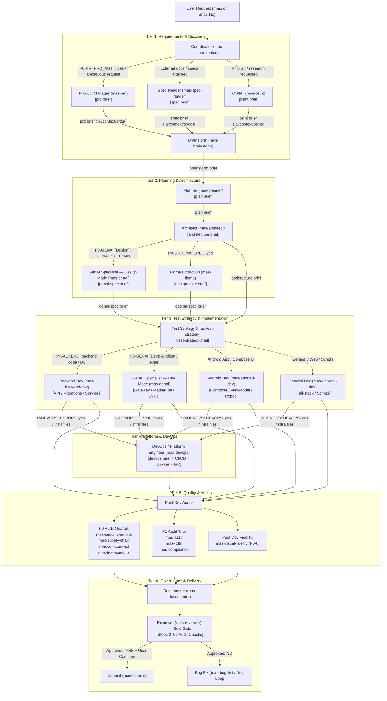
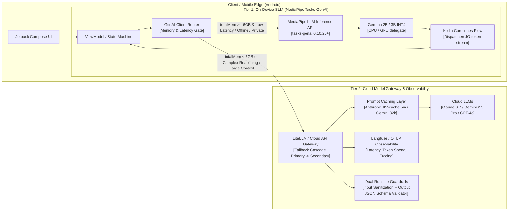

# Architecture Brief — MAS-11

## Architecture

**Option 2 — Modular 4-Specialist SDLC Assembly Line with Dedicated Brief Schemas and Zero-Token Coordinator Routing** (per `.ai/context/brainstorms/MAS-11.md`, `.ai/context/plans/MAS-11.md`, and `.ai/context/osint/MAS-11.md`).

This blueprint upgrades the MAS framework from a developer-focused assistant (v1.8.0) into a comprehensive, autonomous **Full Product Engineering Organization (v1.9.0)**. It introduces four specialized engineering disciplines:
1. **`mas-genai` (GenAI Specialist)**: Governs AI system architecture, prompt engineering, strict JSON tool schemas, hybrid RAG retrieval, token-efficient caching, on-device SLMs (Google MediaPipe Tasks GenAI, Gemma 2B/3B INT4, Coroutines Flow streaming on Android), model gateways (LiteLLM/Langfuse), OWASP LLM Top 10 defenses, and automated evaluation harnesses (`promptfoo`, `DeepEval`). Operates in a dual-mode lifecycle: **Design Mode** (pre-dev architectural specification emitting `genai-spec`) and **Dev Mode** (implementation of model pipelines, gateways, and evals).
2. **`mas-pm` (Product Manager)**: Ingests ambiguous user concepts and authors structured PRDs (`prd` brief) containing user personas, customer journey maps, functional requirements formatted as Gherkin Given/When/Then user stories, non-functional latency/offline budgets, explicit MVP vs Phase 2 scope boundaries, and measurable KPIs.
3. **`mas-backend-dev` (Backend & Cloud Developer)**: Implements clean-architecture server-side services (Domain $\leftrightarrow$ Repository $\leftrightarrow$ Data Source), versioned forward-only database migrations (Flyway, Prisma, Room), parameterized query enforcement (SQL injection defense), REST/gRPC/GraphQL endpoints, authentication/authorization (JWT, OAuth2, RBAC), and idempotency semantics.
4. **`mas-devops` (DevOps & Platform Specialist)**: Authors multi-stage Dockerfiles (least-privilege non-root execution), GitHub Actions CI/CD workflows (matrix testing, SHA-pinned actions), Terraform Infrastructure as Code (IaC), environment configuration contracts (`.env.example`), container health checks (`/healthz`, `/readyz`), and emits structured `devops` briefs.

`UI_SCOPE: logic-only` — framework protocols, specialist skills, reference standards, and brief schemas only; no Android Compose presentation components or mobile UI screens modified.

### Core Invariants

1. **Deterministic Zero-Token Routing**: The Coordinator routes strictly based on deterministic predicates (`P0-PM`, `P0-GENAI`, `P-BACKEND`, `P-DEVOPS`) evaluating handoff flags, file patterns, and scope keywords. No conversational multi-agent chat loops.
2. **Sole Merge Gate**: `mas-reviewer` remains the sole authority issuing `Approved: YES | NO`. Neither `mas-genai`, `mas-backend-dev`, nor `mas-devops` can bypass code review.
3. **Task Foreground Execution**: Specialists are spawned via Cursor's `Task` tool with `subagent_type: generalPurpose`, `run_in_background: false`, self-contained prompts, waiting for `DONE`. Specialists never spawn subagents or route workflows.
4. **Artifact-Forward Filesystem Communication**: All agent handoffs and context sharing occur through task-scoped briefs in `.ai/context/` (`genai/`, `prds/`, `devops/`, `architecture/`, etc.). Coordinator chat output remains capped at one-line outcome summaries + `BRIEF_PATH`.
5. **Protected-When-Triggered Functional Roles**: In full `/mas`, core functional specialists (`mas-pm`, `mas-genai`, `mas-backend-dev`, `mas-devops`) are protected against token overflow auto-skipping when their explicit trigger predicates fire.

---

## Architect Gate Decisions (D1–D8 + Open Questions Resolved)

Binding decisions formulated for downstream development (`mas-general-dev`, `mas-test-strategy`, `mas-documenter`, `mas-reviewer`).

| # | Question / Decision Area | **Binding Decision** | Rationale |
|---|--------------------------|----------------------|-----------|
| **D1** | `mas-genai` slug topology (Single Dual-Mode vs Two Slugs) | **Single `mas-genai` skill with dual execution modes (Design Mode vs Dev Mode).** Design Mode produces `.ai/context/genai/{TASK_ID}.md` (`MODEL_CLASS: thinking`); Dev Mode writes code and eval scripts (`MODEL_CLASS: normal`). | Follows precedent of `mas-spec-reader` and `mas-figma` to avoid slug proliferation while preserving clean lifecycle separation across planning and implementation slots. |
| **D2** | On-Device Model Asset Distribution during Dev & Production | **Local dev and CI use pre-seeded test fixtures or ADB emulator push; production releases mandate background download via Android `WorkManager` with WiFi-only constraint and pre-flight RAM guard ($\ge 6\text{ GB}$).** Release APKs must never bundle multi-gigabyte raw weights. | Packaging 1.5GB–3GB raw weights in release APKs causes Play Store rejection, ballooned install sizes, and instant Out-of-Memory (OOM) kills on low-memory devices. |
| **D3** | Multi-Stack Backend Engineering Standards | **Standardize multi-stack reference architectures in `backend-engineering-standards.md`**: Ktor / Spring Boot for Kotlin-first stacks, FastAPI / Python for AI-first backends, and Node / TypeScript / Prisma for full-stack BFFs. | MAS projects span native Android mobile apps with Kotlin backends, Python AI microservices, and TypeScript full-stack applications. |
| **D4** | DevOps Platform Tooling & Dry-Run Validation | **`mas-devops` executes dry-run syntax and lint validations (`docker build --check`, `terraform validate`, `hadolint`, `actionlint`) during its platform pass; `mas-test-executor` executes integration test suites in CI.** | Separates platform static verification from dynamic container test execution; prevents requiring active Docker daemons on machines running lint checks. |
| **D5** | Framework Version Bump | **Bump `manifest.json` from `1.8.0` to `1.9.0`.** | Additive specialist capabilities, three new brief types, and expanded Coordinator routing table constitute a minor semver release. |
| **D6** | Token Cap Overflow Protection Order | **`mas-pm`, `mas-genai`, `mas-backend-dev`, and `mas-devops` are protected-when-triggered in full `/mas`.** If projected chain exceeds `MAX_CHAIN_AGENTS` (12), Coordinator drops advisory audit specialists in priority order: `test-executor → api-contract → dependency-risk → security-auditor → a11y → i18n → compliance → observability → migration → chaos-resilience`. If chain cap is still breached with core functional roles, Coordinator escalates to the user. | Core scoping, design, and code implementation roles cannot be silently omitted without breaking feature delivery. |
| **D7** | Lite Mode Tier & Abbreviation Strategy | **Support single-discipline focus in `/mas-lite` via abbreviations `PM:y`, `GEN:y`, `BE:y`, and `OPS:y` within strict tier caps (S=2, M=2, L=3, L+=4 subagents, 12-line handoff cap).** If a user request requires multiple new specialists simultaneously, Coordinator advises upgrading to full `/mas`. | Prevents Lite mode prompt truncation and context window degradation while enabling lightweight single-specialist runs. |
| **D8** | Reviewer Verification Governance | **Add conditional verification steps 0l (GenAI), 0m (PRD), 0n (Backend), and 0o (DevOps) to `mas-reviewer`.** `mas-reviewer` remains the sole gate issuing `Approved: YES | NO`. | Preserves centralized quality governance and prevents fragmented per-agent review approvals. |

---

## 6-Tier Product Engineering SDLC Assembly Line Topology

The MAS framework organizes the multi-agent development lifecycle into six deterministic, sequential tiers:



### Tier Execution Summary

| Tier | Primary Objective | Member Agents | Input Contracts | Output Artifacts |
|------|-------------------|---------------|-----------------|------------------|
| **Tier 1: Requirements & Discovery** | Frame problem, capture requirements, define personas, establish MVP boundaries, explore prior art. | `mas-pm`, `mas-spec-reader`, `mas-osint` | User request, raw requirements, external docs, repo state | `.ai/context/prds/{TASK_ID}.md`<br>`.ai/context/specs/{TASK_ID}.md`<br>`.ai/context/osint/{TASK_ID}.md` |
| **Tier 2: Planning & Architecture** | Brainstorm technical options, decompose tasks, design system architecture, specify AI prompts/RAG, extract design specs. | `mas-brainstorm`, `mas-planner`, `mas-architect`, `mas-genai` (Design), `mas-figma` | Tier 1 briefs, existing codebase, project memory | `.ai/context/brainstorms/{TASK_ID}.md`<br>`.ai/context/plans/{TASK_ID}.md`<br>`.ai/context/architecture/{TASK_ID}.md`<br>`.ai/context/genai/{TASK_ID}.md`<br>`.ai/context/design-specs/{TASK_ID}.md` |
| **Tier 3: Test Strategy & Implementation** | Define test matrices, author tests, implement business logic, database migrations, AI pipelines, mobile UI. | `mas-test-strategy`, `mas-backend-dev`, `mas-genai` (Dev), `mas-android-dev`, `mas-general-dev` | Tier 2 briefs, API contracts, design specs | `.ai/context/test-strategies/{TASK_ID}.md`<br>Application source code<br>Database migration scripts<br>Unit & integration tests |
| **Tier 4: Platform & DevOps** | Containerization, CI/CD pipeline automation, Infrastructure as Code, environment configuration, runtime health checks. | `mas-devops` | Tier 3 code changes, deployment requirements | `.ai/context/devops/{TASK_ID}.md`<br>`.github/workflows/*.yml`<br>`Dockerfile`, `docker-compose.yml`<br>`terraform/*.tf` |
| **Tier 5: Quality & Audits** | Automated test execution, security scans, dependency audits, contract drift validation, visual fidelity, accessibility, internationalization. | `mas-visual-fidelity`, `mas-security-auditor`, `mas-dependency-risk`, `mas-api-contract`, `mas-test-executor`, `mas-a11y`, `mas-i18n`, `mas-compliance` | Code changes, running tests, design specs, security rules | `.ai/context/visual-qa/{TASK_ID}.md`<br>`.ai/context/security-audits/{TASK_ID}.md`<br>`.ai/context/api-contracts/{TASK_ID}.md`<br>`.ai/context/supply-chain/{TASK_ID}.md`<br>`.ai/context/test-runs/{TASK_ID}.md` |
| **Tier 6: Governance & Delivery** | Daily changelogs, codebase documentation, comprehensive multi-step audit verification, git commits. | `mas-documenter`, `mas-reviewer`, `mas-commit` | All generated briefs, full git diff, test run logs | Code documentation<br>Daily changelog entry<br>`Approved: YES \| NO`<br>Git commit |

---

## Dual-Mode `mas-genai` Lifecycle (Design vs Dev Mode)

The GenAI Specialist operates across two distinct lifecycle phases to maintain a clean separation between architectural specification and runtime implementation:

```
[Tier 2: Planning & Architecture]
      Architect completes
              ↓
  P0-GENAI (Design) fires
              ↓
  mas-genai (Design Mode)
  • Model Class: thinking
  • Deliverable: .ai/context/genai/{TASK_ID}.md (genai-spec)
  • Action: System prompts, XML tags, JSON tool schemas, RAG chunking, on-device SLM RAM guard, eval metrics
  • Rule: NEVER writes production code
              ↓
[Tier 3: Implementation Slot]
  Test Strategy completes
              ↓
  P0-GENAI (Dev) fires
              ↓
  mas-genai (Dev Mode)
  • Model Class: normal
  • Deliverable: Workspace code + test execution
  • Action: MediaPipe Tasks GenAI integration, LiteLLM gateway, Langfuse traces, promptfoo/DeepEval harnesses
  • Rule: Verifies build and tests pass before handoff
```

### Dual-Tier GenAI Runtime Architecture



### Detailed Mode Specifications

#### 1. Design Mode (Pre-Dev Architectural Specification)
- **Chain Placement**: Immediately following `mas-architect`, preceding `mas-test-strategy`.
- **Trigger**: `GENAI_SPEC: yes`, `SCOPE: genai`, or AI keywords in `SCOPE`/`GOAL` (`llm`, `rag`, `gemma`, `mediapipe`, `prompt`, `embedding`, `langchain`, `langgraph`, `openai`, `vertexai`).
- **Model Class**: `thinking` (`claude-opus-4-7-thinking-high` or thinking-high family).
- **Deliverable**: `.ai/context/genai/{TASK_ID}.md` (`genai-spec`).
- **Required Sections**:
  1. `## Model Selection & Routing Strategy` (Latency budgets, cost thresholds, on-device vs cloud criteria, fallback cascade).
  2. `## Prompt Architecture` (XML tags: `<context>`, `<system_instructions>`, `<constraints>`, `<tools>`, `<output_schema>`, few-shot exemplars).
  3. `## Structured Output & Tool Schemas` (Strict JSON Schema draft-07 tool definitions with `additionalProperties: false`).
  4. `## RAG & Context Architecture` (Chunking size/overlap, embedding model, hybrid search BM25 + vector, reranker, static prompt prefix caching).
  5. `## On-Device SLM Spec` *(Conditional)* (MediaPipe Tasks GenAI options, INT4 quantization, RAM check $\ge 6\text{ GB}$, Coroutines Flow streaming).
  6. `## Safety Guardrails & OWASP Defenses` (Dual runtime guardrails: input XML escaping, prompt injection classifiers, output JSON validation).
  7. `## Evaluation & Quality Metrics` (DeepEval RAG triad targets: Faithfulness $\ge 0.85$, Answer Relevancy $\ge 0.85$, Context Recall $\ge 0.80$, Hallucination $\le 0.10$; `promptfoo` assertions).
- **Prohibitions**: Never writes production code; never generates APK assets; never modifies build configurations.

#### 2. Dev Mode (Implementation Slot)
- **Chain Placement**: Implementation slot in Tier 3 (alongside or sequential with `mas-backend-dev` / `mas-android-dev`).
- **Trigger**: `TARGET_AGENT: mas-genai` on dev handoff; AI pipeline code changes.
- **Model Class**: `normal` (default / `composer-2.5`).
- **Deliverable**: Workspace AI client code, model gateways, test suites, and Dev Done summary.
- **Responsibilities**:
  - Implements Google MediaPipe Tasks GenAI `LlmInference` wrapper with background `Dispatchers.IO` execution and `Flow<String>` token streaming.
  - Implements device RAM check pre-flight guard:
    ```kotlin
    val memInfo = ActivityManager.MemoryInfo().also { activityManager.getMemoryInfo(it) }
    val totalRamGb = memInfo.totalMem / (1024 * 1024 * 1024)
    if (totalRamGb < 6) { /* Fallback to Cloud Gateway */ }
    ```
  - Integrates LiteLLM gateway proxy client with automated fallback cascades (e.g. Claude 3.7 $\rightarrow$ Gemini 2.5 Pro on HTTP 429/500).
  - Wires static prompt prefix caching headers ($\ge 1024$ tokens for Anthropic, $\ge 32\text{k}$ for Gemini).
  - Authors automated evaluation test harnesses (`promptfoo.yaml` config matrix, `test_rag_triad.py` with DeepEval).
  - Runs local build and tests; reports verification commands before issuing Dev Done.

---

## `mas-pm`, `mas-backend-dev`, and `mas-devops` Contracts & Boundaries

### 1. Product Manager (`mas-pm`)
- **Mission**: Transform high-level, ambiguous product ideas into structured, unambiguous PRDs that serve as the single source of truth for planning, architecture, and verification.
- **Skill Path**: `skills/mas-pm/SKILL.md`
- **Deliverable**: `.ai/context/prds/{TASK_ID}.md` (`prd` brief)
- **Required Sections**:
  1. `## Problem Statement & Value Proposition`
  2. `## Target Personas & User Journeys`
  3. `## Functional Requirements & User Stories` (Gherkin syntax: Given / When / Then)
  4. `## Non-Functional Requirements` (p95 latency, cold start, offline caching, accessibility)
  5. `## Scope & Out-of-Scope Boundaries` (Explicit P0 MVP vs P1/P2 Deferred)
  6. `## Success Metrics & KPIs`
- **Execution Boundaries**:
  - Ingests raw user intent at the very beginning of greenfield workflows.
  - Does NOT write code, design database schemas, or author UI layouts.
  - Does NOT spawn subagents or approve PRs.
- **Model Class**: `normal` (escalate to `thinking` for multi-system enterprise platforms).

### 2. Backend & Cloud Developer (`mas-backend-dev`)
- **Mission**: Implement server-side domain models, database migrations, repositories, business logic services, REST/gRPC/GraphQL controllers, and authentication/authorization.
- **Skill Path**: `skills/mas-backend-dev/SKILL.md`
- **Deliverable**: Workspace backend source code + migration scripts + automated tests + Dev Done summary.
- **Engineering Standards**:
  - **Clean Architecture Layering**: Domain models $\leftrightarrow$ Repositories (interfaces) $\leftrightarrow$ Data Sources (implementations).
  - **Database Migration Hygiene**: Versioned, forward-only migrations (Flyway, Prisma, Room); zero hardcoded DDL strings in application startup; both up and down rollback paths verified.
  - **SQL Injection Defense**: Strict parameterized queries; zero string interpolation in SQL/ORM queries.
  - **Idempotency Semantics**: State-mutating endpoints (POST/PUT/DELETE) must enforce `Idempotency-Key` headers or upsert logic.
  - **Authentication & Authorization**: Explicit RBAC / JWT / OAuth2 security middleware on all protected routes.
- **Execution Boundaries**:
  - Operates in Tier 3 implementation slot.
  - Adheres strictly to API contracts agreed upon with mobile/web clients.
  - Does NOT perform deployment or CI/CD authoring (delegates to `mas-devops`).
- **Model Class**: `normal`.

### 3. DevOps & Platform Specialist (`mas-devops`)
- **Mission**: Design, author, and maintain containerization, CI/CD pipeline automation, Infrastructure as Code, environment configuration, and container runtime health checks.
- **Skill Path**: `skills/mas-devops/SKILL.md`
- **Deliverable**: `.ai/context/devops/{TASK_ID}.md` (`devops` brief) + workspace platform code (`.github/workflows/`, `Dockerfile`, `docker-compose.yml`, `terraform/`).
- **Platform Standards**:
  - **Multi-Stage Container Builds**: Builder stage $\rightarrow$ Runtime stage (distroless or alpine base, unprivileged user `appuser:appgroup`, no root execution).
  - **CI/CD Security Hygiene**: GitHub Actions workflows must pin action commits to immutable SHAs (`actions/checkout@11bd719...`); least-privilege `GITHUB_TOKEN` permissions (`contents: read`).
  - **Infrastructure as Code (IaC)**: Terraform modular structure, remote state locking with DynamoDB/GCS, least-privilege IAM roles.
  - **Environment Configuration**: Clear `.env.example` contract; zero plaintext secrets committed to repository; runtime secrets injection from secret managers.
  - **Health Check Endpoints**: Standard `/healthz` (liveness) and `/readyz` (readiness) HTTP probes.
- **Execution Boundaries**:
  - Operates in Tier 4 (post-dev, pre-audits).
  - Executes dry-run syntax/lint checks (`docker build --check`, `terraform validate`, `actionlint`, `hadolint`).
  - Does NOT implement application business logic or database queries.
- **Model Class**: `normal`.

---

## Zero-Token Coordinator Routing Predicates

The Coordinator evaluates predicates deterministically using string inspection, handoff flags, and file patterns. Evaluation is zero-token (no LLM reasoning calls).

| Priority | Predicate Expression | Target Specialist | Default Chain Position | Suppression / Override Rules |
|----------|----------------------|-------------------|------------------------|------------------------------|
| **P0-PM** | `PRD_AUTH: yes` OR greenfield request with high ambiguity (no existing PRD/spec attached) | `mas-pm` | **Tier 1 (Entry)** — before `mas-brainstorm` / `mas-planner` | Suppressed when user attaches existing PRD/spec (→ `mas-spec-reader`) or for bugfix / trivial changes. |
| **P0-GENAI (Design)** | `GENAI_SPEC: yes` OR `SCOPE: genai` OR AI keywords in `SCOPE`/`GOAL` (`llm`, `rag`, `gemma`, `mediapipe`, `prompt`, `embedding`, `langchain`, `langgraph`, `openai`, `vertexai`) | `mas-genai` (Design Mode) | **Tier 2 (Post-Architect)** — after `mas-architect`, before `mas-test-strategy` | Suppressed when `GENAI_SPEC: no` or logic-only changes without AI components. |
| **P-BACKEND** | `BACKEND: yes` OR `FILES` touch server-side code (Node, Python, Go, Spring, Ktor, SQL, Prisma, DB migrations) OR `SCOPE: backend\|api\|database` | `mas-backend-dev` | **Tier 3 (Dev Slot)** — alongside or preceding `mas-android-dev` | Suppressed when Android-only or frontend-only UI changes. |
| **P0-GENAI (Dev)** | `TARGET_AGENT: mas-genai` on dev handoff OR AI engine implementation tasks | `mas-genai` (Dev Mode) | **Tier 3 (Dev Slot)** — implementation pass | Executes in dev slot to implement AI gateways, MediaPipe, and evals. |
| **P-DEVOPS** | `DEVOPS: yes` OR `FILES` touch `.github/workflows/`, `Dockerfile`, `docker-compose.yml`, `*.tf`, k8s manifests OR `SCOPE: devops\|ci-cd\|infra` | `mas-devops` | **Tier 4 (Platform Slot)** — post-dev, pre-audits | Suppressed when no infrastructure or CI/CD files touched. |

### Ordering Invariants

1. **PM First Invariant**: When `P0-PM` fires, `mas-pm` is always the first subagent spawned. Downstream agents (`mas-brainstorm`, `mas-planner`, `mas-architect`) read `.ai/context/prds/{TASK_ID}.md` at startup.
2. **GenAI Design Invariant**: `mas-genai` (Design Mode) always executes *after* `mas-architect` (so overall modular topology is fixed) and *before* `mas-test-strategy` (so test strategy can plan promptfoo/DeepEval assertions).
3. **Full-Stack Dev Sequencing Invariant**: In full-stack workflows requiring both backend and client changes:
   - When API contracts are evolving: `mas-backend-dev` runs first, updates migrations and endpoints, and verifies tests; then `mas-android-dev` / `mas-general-dev` runs to consume those endpoints.
   - When API contracts are fixed via `mas-api-contract`: `mas-backend-dev` and `mas-android-dev` run in sequence with clear boundary separation.
4. **DevOps Post-Dev Invariant**: `mas-devops` always runs *after* the dev slot (so all Dockerfile dependencies, migration files, and environment requirements are known) and *before* the Tier 5 audit suite.
5. **Reviewer Gate Invariance**: `mas-reviewer` remains the sole merging authority. Neither `mas-genai`, `mas-pm`, `mas-backend-dev`, nor `mas-devops` can approve PRs or bypass review.

---

## Brief Schemas for `genai-spec`, `prd`, and `devops`

Registered in `skills/multi-agent-system/protocol/brief-schemas.md`.

### 1. `genai-spec` Brief Schema
- **Path Pattern**: `.ai/context/genai/{TASK_ID}.md`
- **Emitted By**: `mas-genai` (Design Mode)
- **Consumed By**: `mas-test-strategy`, `mas-android-dev`, `mas-backend-dev`, `mas-genai` (Dev Mode), `mas-reviewer` (Step 0l).
- **Required Headings**:
  1. `## Model Selection & Routing Strategy`
  2. `## Prompt Architecture`
  3. `## Structured Output & Tool Schemas`
  4. `## RAG & Context Architecture`
  5. `## On-Device SLM Spec` *(Conditional: required when mobile/edge in scope)*
  6. `## Safety Guardrails & OWASP Defenses`
  7. `## Evaluation & Quality Metrics`

```markdown
# GenAI Specification — {TASK_ID}

## Model Selection & Routing Strategy
- Tier 1 (On-Device SLM): <Model slug, INT4 quantization, RAM threshold >= 6GB>
- Tier 2 (Cloud LLM Gateway): <Primary model, fallback cascade, timeout, retry policy>
- Latency & Cost Budget: <p95 latency budget, token budget per request>

## Prompt Architecture
- System Instructions: <Core behavior, role identity, constraints>
- XML Tag Hierarchy: <`<context>`, `<instructions>`, `<constraints>`, `<tools>`, `<output_schema>`>
- Few-Shot Exemplars: <Positive and negative edge-case examples>

## Structured Output & Tool Schemas
- Tool Calling Schemas: <Strict JSON Schema draft-07, additionalProperties: false>
- Response Validation Schema: <JSON Schema for client-side parsing>

## RAG & Context Architecture
- Chunking Strategy: <Size, overlap, semantic boundary rules>
- Embedding & Retrieval: <Embedding model, hybrid BM25 + vector search, reranking threshold>
- Prompt Caching Directive: <Static prefix structure, min token threshold (1024 / 32k)>

## On-Device SLM Spec
- Engine: Google MediaPipe Tasks GenAI (com.google.mediapipe:tasks-genai:0.10.20+)
- Model Weights: <e.g., gemma-2b-it-cpu-int4.bin / dynamic download via WorkManager>
- Execution: Dispatchers.IO background execution, Kotlin Coroutines Flow<String> streaming
- RAM Pre-flight Guard: ActivityManager totalMem >= 6GB required; dynamic cloud fallback

## Safety Guardrails & OWASP Defenses
- Input Guardrail: XML boundary escaping, prompt injection regex & classifier
- Output Guardrail: Strict JSON Schema validation, PII redaction
- OWASP LLM Top 10 Mitigation Matrix: <Specific defenses per vulnerability>

## Evaluation & Quality Metrics
- DeepEval RAG Triad Thresholds:
  - Faithfulness: >= 0.85
  - Answer Relevancy: >= 0.85
  - Context Recall: >= 0.80
  - Hallucination Score: <= 0.10
- promptfoo Assertion Matrix: <Red-teaming test cases, format assertions>
```

---

### 2. `prd` Brief Schema
- **Path Pattern**: `.ai/context/prds/{TASK_ID}.md`
- **Emitted By**: `mas-pm`
- **Consumed By**: `mas-brainstorm`, `mas-planner`, `mas-architect`, `mas-reviewer` (Step 0m).
- **Required Headings**:
  1. `## Problem Statement & Value Proposition`
  2. `## Target Personas & User Journeys`
  3. `## Functional Requirements & User Stories`
  4. `## Non-Functional Requirements`
  5. `## Scope & Out-of-Scope Boundaries`
  6. `## Success Metrics & KPIs`

```markdown
# Product Requirements Document — {TASK_ID}

## Problem Statement & Value Proposition
- Problem Statement: <Core friction or unmet need>
- Market / User Context: <Why solve this now>
- Value Hypothesis: <Expected customer value delivery>

## Target Personas & User Journeys
- Primary Persona: <Role, technical comfort, primary goal>
- Secondary Persona: <Secondary beneficiary>
- User Journey Map:
  - Discovery & Onboarding: <Steps>
  - Core Workflow: <Happy path>
  - Edge Cases & Recovery: <Error flows>

## Functional Requirements & User Stories
### Story 1: <Title>
```gherkin
Scenario: <Scenario description>
  Given <preconditions>
  When <action taken by user>
  Then <observable system result>
  And <secondary assertion>
```

## Non-Functional Requirements
- Performance: <p95 latency, cold start <= 1.5s, 60fps UI>
- Availability & Offline: <Offline-first caching, sync on reconnect>
- Security & Privacy: <Data encryption at rest/transit, zero PII leakage>
- Accessibility: <WCAG 2.1 AA, dynamic type support>

## Scope & Out-of-Scope Boundaries
- In-Scope (MVP P0): <Explicit list of must-have features>
- Out-of-Scope (Deferred P1/P2): <Explicit list of deferred capabilities>

## Success Metrics & KPIs
- Primary Metric: <e.g. Task Completion Rate >= 90%>
- Guardrail Metric: <e.g. Crash-free users >= 99.9%>
```

---

### 3. `devops` Brief Schema
- **Path Pattern**: `.ai/context/devops/{TASK_ID}.md`
- **Emitted By**: `mas-devops`
- **Consumed By**: `mas-test-executor`, `mas-security-auditor`, `mas-documenter`, `mas-reviewer` (Step 0o).
- **Required Headings**:
  1. `## Infrastructure & Deployment Topology`
  2. `## CI/CD Pipeline Spec & Trigger Matrix`
  3. `## Environment Variables & Secrets Contract`
  4. `## Container & Runtime Specifications`
  5. `## Verification Commands & Health Checks`

```markdown
# DevOps Platform Specification — {TASK_ID}

## Infrastructure & Deployment Topology
- Target Environment: <Local dev, CI, Staging, Production>
- Hosting Architecture: <Cloud provider, serverless / containers / VM>
- Network & Ingress: <Load balancer, TLS termination, VPC boundaries>

## CI/CD Pipeline Spec & Trigger Matrix
- Pipeline Engine: GitHub Actions (.github/workflows/)
- Trigger Matrix:
  - Pull Request: Lint, test, security scan, dry-run build
  - Merge to Main: Release build, container publish, staging deploy
- Security Hardening: Pinned action SHAs, least-privilege GITHUB_TOKEN permissions

## Environment Variables & Secrets Contract
| Variable Name | Environment | Required | Secret Source | Description |
|---------------|-------------|----------|---------------|-------------|
| DATABASE_URL  | Production  | Yes      | Vault/Secrets | PostgreSQL connection string |
| LITELLM_KEY   | All         | Yes      | GitHub Secrets| LLM gateway proxy key |

## Container & Runtime Specifications
- Base Image: <e.g. eclipse-temurin:21-jre-alpine or gcr.io/distroless/static-debian12>
- Multi-Stage Strategy: Builder stage (compilation) -> Runtime stage (minimal footprint)
- Security Context: Non-root user (appuser:10001:10001), read-only root filesystem
- Resource Limits: CPU: 1.0 core, Memory: 512MB

## Verification Commands & Health Checks
- Dry-Run Validation Commands:
  - `docker build --check .`
  - `actionlint .github/workflows/*.yml`
  - `terraform validate`
- Health Check Endpoints:
  - Liveness: `GET /healthz` -> 200 OK
  - Readiness: `GET /readyz` -> 200 OK
```

---

## Model Policies and Token Overflow Rules

### Spawn Model Policy Updates (`spawn-model-policy.md`)

| Agent Slug | Execution Mode | `MODEL_CLASS` | Task `model` Hint | Rationale |
|------------|----------------|---------------|-------------------|-----------|
| `mas-genai` | Design Mode | `thinking` | `claude-opus-4-7-thinking-high` or thinking family | Complex reasoning required for prompt hierarchy, JSON tool schemas, RAG chunking, and eval thresholds. |
| `mas-genai` | Dev Mode | `normal` | default / `composer-2.5` | Standard implementation model for wiring SDKs, gateways, and test scripts. |
| `mas-pm` | PRD Authoring | `normal` | default / `composer-2.5` | Standard model for structured PRD decomposition. Escalate to `thinking` for multi-system enterprise scopes. |
| `mas-backend-dev` | Implementation | `normal` | default / `composer-2.5` | Standard development model for DB migrations, controllers, services, and tests. |
| `mas-devops` | Platform / CI/CD | `normal` | default / `composer-2.5` | Standard development model for Dockerfiles, CI/CD YAMLs, and Terraform files. |

### Token Overflow Rules (`token-rules.md`)

- **Protocol Constant**: `MAX_CHAIN_AGENTS = 12` in full `/mas`.
- **Protected-When-Triggered Roles**: `mas-pm`, `mas-genai` (Design & Dev), `mas-backend-dev`, and `mas-devops` are core functional implementation/scoping agents. They are **never** silently dropped when their explicit trigger predicates fire.
- **Auto-Skip Order for Advisory Specialists**: When a projected chain exceeds `MAX_CHAIN_AGENTS`, drop optional advisory audit specialists in this exact priority order:
  ```
  1. test-executor
  2. api-contract
  3. dependency-risk
  4. security-auditor
  5. a11y
  6. i18n
  7. compliance
  8. observability
  9. migration
  10. chaos-resilience
  ```
- **User Escalation**: If all optional advisory specialists have been skipped and the chain still exceeds `MAX_CHAIN_AGENTS` due to mandatory functional roles, the Coordinator halts auto-spawn and escalates to the user with a structured table of planned specialists.

### Lite Mode Tier Table Updates (`mas-lite/SKILL.md`)

| Tier | Subagent Cap | Allowed Focus Flags | Example Chain |
|------|--------------|---------------------|---------------|
| **S-Tier** | 1–2 agents | `PM:y` OR `OPS:y` | Single specialist: `mas-pm` (scoping only) OR `mas-devops` (infra tweak) |
| **M-Tier** | 2 agents | `BE:y` | Backend dev pass: `mas-backend-dev → reviewer-lite` |
| **L-Tier** | 3 agents | `GEN:y` OR `OPS:y` | GenAI dev pass: `mas-planner → mas-genai (Dev) → reviewer-lite` |
| **L+-Tier** | 4 agents | `PM:y` OR `GEN:y` | Greenfield scoping pass: `mas-pm → mas-brainstorm → mas-planner → dev` |

---

## Reviewer Audit Steps (0l, 0m, 0n, 0o)

Integrated into `skills/mas-reviewer/SKILL.md`. Reviewer remains the sole authority issuing `Approved: YES | NO`.

### 0l. GenAI Specification & Evaluation Verification (when `genai-spec` exists)
- **Goal**: Confirm AI prompt architecture, tool schemas, safety guardrails, and evaluation thresholds are strictly satisfied.
- **Checklist**:
  1. Verify prompt contains standard XML delimiter tags (`<context>`, `<system_instructions>`, `<constraints>`, `<tools>`, `<output_schema>`) and few-shot exemplars.
  2. Verify JSON Schema tool definitions specify `additionalProperties: false` and required property arrays.
  3. Confirm static prompt prefix caching headers are configured for repetitive prompts exceeding minimum thresholds ($\ge 1024$ tokens for Claude, $\ge 32\text{k}$ for Gemini).
  4. For Android on-device SLMs: confirm explicit runtime RAM pre-flight check (`ActivityManager.MemoryInfo.totalMem >= 6GB`) before model loading, INT4 quantization, and background Coroutine Flow streaming.
  5. Verify evaluation harness scores satisfy thresholds: DeepEval RAG triad (Faithfulness $\ge 0.85$, Relevancy $\ge 0.85$, Recall $\ge 0.80$, Hallucination $\le 0.10$) and `promptfoo` assertions pass with zero regressions.
- **Reviewer Output Block**:
  ```markdown
  ## GenAI Verification
  Prompt XML Hierarchy: PASS | FAIL — <details>
  JSON Tool Schemas: PASS (strict draft-07) | FAIL — <untyped fields>
  On-Device RAM Guard: PASS (>= 6GB check enforced) | N/A | FAIL — <missing guard>
  Eval Metrics: PASS (Faithfulness: <score>, Relevancy: <score>) | FAIL — <below threshold>
  Verified: YES | NO
  ```

### 0m. PRD & Requirements Alignment Verification (when `prd` exists)
- **Goal**: Confirm all functional user stories and acceptance criteria from the PRD are implemented without scope creep.
- **Checklist**:
  1. Map each Gherkin Scenario in the PRD to corresponding implementation code and automated tests.
  2. Verify zero Out-of-Scope (Deferred P1/P2) feature creep in code changes.
  3. Confirm non-functional requirements (p95 latency budgets, offline fallbacks) are respected.
- **Reviewer Output Block**:
  ```markdown
  ## PRD Alignment
  User Stories Implemented: <count>/<total>
  Gherkin Acceptance Scenarios: ALL PASS | <failing scenarios>
  Scope Boundary Check: PASS (zero out-of-scope creep) | FAIL — <unauthorized additions>
  Verified: YES | NO
  ```

### 0n. Backend Clean Architecture & Migration Verification (when backend code exists)
- **Goal**: Confirm server-side layering, forward-only database migration safety, parameterized queries, and idempotency.
- **Checklist**:
  1. Verify clean architectural separation: Domain models $\leftrightarrow$ Repository interfaces $\leftrightarrow$ Data Source implementations.
  2. Confirm database migrations are versioned, forward-only, and provide clean rollback paths; zero raw DDL strings in application runtime startup.
  3. Enforce parameterized queries across all database access; verify zero string interpolation in queries.
  4. Verify state-mutating endpoints enforce `Idempotency-Key` headers or upsert semantics.
  5. Verify authentication/authorization checks exist on all sensitive endpoints.
- **Reviewer Output Block**:
  ```markdown
  ## Backend Clean Architecture & Migration
  Layering Integrity: PASS (Domain <-> Repo <-> DataSource) | FAIL — <coupling>
  Database Migrations: PASS (versioned, forward-only) | FAIL — <destructive/unversioned>
  SQL Parameterization: PASS (zero raw string queries) | FAIL — <injection risk>
  Idempotency & Auth: PASS | FAIL — <missing headers/auth>
  Verified: YES | NO
  ```

### 0o. Platform & DevOps Infrastructure Verification (when `devops` brief / infra exists)
- **Goal**: Confirm containerization security, CI/CD pipeline hygiene, secret redaction, and runtime health probes.
- **Checklist**:
  1. Multi-stage Dockerfile: confirm builder stage $\rightarrow$ runtime stage; verify execution as unprivileged non-root user (`appuser:appgroup`).
  2. GitHub Actions CI/CD: confirm all external actions are pinned to immutable commit SHAs; verify least-privilege `GITHUB_TOKEN` permissions.
  3. Environment variables: verify `.env.example` is complete; confirm zero hardcoded secrets or API keys in repository files.
  4. Health checks: verify `/healthz` (liveness) and `/readyz` (readiness) probe endpoints are configured.
- **Reviewer Output Block**:
  ```markdown
  ## DevOps & Platform Verification
  Container Security: PASS (non-root, multi-stage, slim base) | FAIL — <runs as root>
  CI/CD Action SHAs: PASS (pinned commits) | FAIL — <floating tags>
  Secret Redaction: PASS (zero secrets committed) | FAIL — <secret detected>
  Health Check Endpoints: PASS (/healthz, /readyz) | FAIL — <missing probes>
  Verified: YES | NO
  ```

---

## Modules:

The MAS framework is modularized into decoupled skill directories and protocol specifications:

1. **`skills/mas-genai/`**:
   - `SKILL.md`: System prompt, dual execution modes (Design vs Dev), MediaPipe Android patterns, LiteLLM gateway, prompt caching, eval harnesses, and output templates.
2. **`skills/mas-pm/`**:
   - `SKILL.md`: Requirements intake, persona definition, Gherkin user stories, NFR budgets, MVP scoping boundaries, and output templates.
3. **`skills/mas-backend-dev/`**:
   - `SKILL.md`: Clean architecture backend development, forward-only database migrations, parameterized SQL queries, REST/gRPC/GraphQL endpoints, and auth.
4. **`skills/mas-devops/`**:
   - `SKILL.md`: Multi-stage Docker containerization, GitHub Actions workflows, Terraform IaC, environment configuration contracts, and health probes.
5. **`skills/multi-agent-system/references/`**:
   - `genai-engineering-standards.md`: MediaPipe Tasks GenAI, LiteLLM gateway, prompt caching, OWASP LLM defenses, and DeepEval/promptfoo eval matrices.
   - `prd-authoring-standards.md`: Persona mapping, Gherkin acceptance criteria syntax, and scoping rules.
   - `backend-engineering-standards.md`: Clean architecture layering, database migrations, SQL parameterization, and multi-stack examples (Ktor, FastAPI, Node/Prisma).
   - `devops-platform-standards.md`: Multi-stage Docker patterns, GitHub Actions SHA pinning, Terraform modular standards, and secrets management.
6. **`skills/multi-agent-system/protocol/`**:
   - `brief-schemas.md`: Registers `genai-spec`, `prd`, and `devops` brief types.
   - `spawn-model-policy.md`: Maps new specialist slugs to `MODEL_CLASS` and Task `model` hints.
   - `subagent-spawn.md`: Registers new agent slugs and skill path pointers.
   - `read-order.md`: Updates context read subscription matrix for new briefs.
   - `token-rules.md`: Establishes protected-when-triggered status for core functional specialists.
   - `handoff-format.md` & `handoff-format-lite.md`: Adds routing flags and Lite abbreviations.
7. **`skills/mas-coordinator/` & `skills/mas-lite/`**:
   - `SKILL.md`: Implements zero-token routing predicates (`P0-PM`, `P0-GENAI`, `P-BACKEND`, `P-DEVOPS`), ordering invariants, and Lite tier integration.
8. **`skills/mas-reviewer/`**:
   - `SKILL.md`: Implements audit verification steps 0l (GenAI), 0m (PRD), 0n (Backend), and 0o (DevOps).
9. **`skills/multi-agent-system/install/`**:
   - `manifest.json`: Bumps framework version to `1.9.0` and registers new specialist skills.
   - `export-mas-framework.ps1`: Bundles new specialist skill directories into export archives.

---

## Layers:

The MAS architecture maintains strict layer separation across five distinct operational strata:

```
┌─────────────────────────────────────────────────────────────────────────┐
│ Layer 1: Protocol & Registry Layer                                     │
│ • brief-schemas.md, spawn-model-policy.md, subagent-spawn.md,           │
│   read-order.md, token-rules.md, handoff-format.md                      │
└────────────────────────────────────┬────────────────────────────────────┘
                                     │ defines contracts & schemas
┌────────────────────────────────────▼────────────────────────────────────┐
│ Layer 2: Orchestration & Routing Layer (Zero-Token Coordinator)         │
│ • mas-coordinator/SKILL.md, mas-lite/SKILL.md                          │
│ • Zero-token predicates: P0-PM, P0-GENAI, P-BACKEND, P-DEVOPS           │
│ • Session tracking: workflow-sessions/{TASK_ID}.json                    │
└────────────────────────────────────┬────────────────────────────────────┘
                                     │ spawns via Cursor Task tool
┌────────────────────────────────────▼────────────────────────────────────┐
│ Layer 3: Specialized Agent Skills Layer                                │
│ • mas-pm: Requirements & PRD authoring                                 │
│ • mas-genai: Dual-mode AI system design & pipeline implementation      │
│ • mas-backend-dev: Clean architecture services & DB migrations          │
│ • mas-devops: Platform engineering, Docker, CI/CD, IaC                  │
│ • mas-android-dev / mas-general-dev: Mobile & client development        │
└────────────────────────────────────┬────────────────────────────────────┘
                                     │ references engineering rules
┌────────────────────────────────────▼────────────────────────────────────┐
│ Layer 4: Reference Engineering Standards Layer                         │
│ • genai-engineering-standards.md, prd-authoring-standards.md            │
│ • backend-engineering-standards.md, devops-platform-standards.md        │
└────────────────────────────────────┬────────────────────────────────────┘
                                     │ validates deliverables
┌────────────────────────────────────▼────────────────────────────────────┐
│ Layer 5: Verification & Governance Layer                               │
│ • mas-reviewer/SKILL.md (Steps 0–0o audits, sole Approved: gate)       │
│ • mas-test-executor, mas-security-auditor, mas-commit                  │
└─────────────────────────────────────────────────────────────────────────┘
```

---

## Contracts:

### 1. Handoff Flags Contract (`skills/multi-agent-system/protocol/handoff-format.md`)

New optional handoff flags for routing and specialist execution:

| Flag | Values | Emitted By | Consumed By | Description |
|------|--------|------------|-------------|-------------|
| `PRD_AUTH` | `yes` \| `no` | User / Coordinator | `mas-coordinator` | Triggers `P0-PM` predicate to spawn `mas-pm` for PRD authoring. |
| `GENAI_SPEC` | `yes` \| `no` | User / Architect | `mas-coordinator` | Triggers `P0-GENAI (Design)` predicate to spawn `mas-genai` (Design Mode). |
| `BACKEND` | `yes` \| `no` | User / Planner | `mas-coordinator` | Triggers `P-BACKEND` predicate to route backend tasks to `mas-backend-dev`. |
| `DEVOPS` | `yes` \| `no` | User / Dev | `mas-coordinator` | Triggers `P-DEVOPS` predicate to route platform tasks to `mas-devops`. |
| `EVAL_SUITE` | `yes` \| `no` | `mas-genai` | `mas-test-strategy`, `mas-test-executor` | Instructs test executor to run `promptfoo` or `DeepEval` evaluation commands. |

### 2. Lite Mode Abbreviation Contract (`skills/multi-agent-system/protocol/handoff-format-lite.md`)

To respect the strict 12-line handoff cap in `/mas-lite`:

| Lite Flag | Full Equivalent | Specialist Triggered | Scope / Target |
|-----------|-----------------|----------------------|----------------|
| `PM:y` | `PRD_AUTH: yes` | `mas-pm` | Greenfield scoping pass in Lite L+ tier. |
| `GEN:y` | `GENAI_SPEC: yes` | `mas-genai` | GenAI design/implementation pass in Lite L tier. |
| `BE:y` | `BACKEND: yes` | `mas-backend-dev` | Backend dev pass in Lite M/L tier. |
| `OPS:y` | `DEVOPS: yes` | `mas-devops` | Platform / CI/CD pass in Lite S/M/L tier. |

### 3. Context Read Subscription Matrix Contract (`skills/multi-agent-system/protocol/read-order.md`)

| Agent | Task-Scoped Startup Brief Reads |
|-------|---------------------------------|
| `mas-pm` | `osint/{TASK_ID}.md` (if exists), `specs/{TASK_ID}.md` (if exists), user request. |
| `mas-brainstorm` | `prds/{TASK_ID}.md` (if exists), `specs/{TASK_ID}.md` (if exists), `osint/{TASK_ID}.md` (if exists). |
| `mas-planner` | `prds/{TASK_ID}.md` (if exists), `brainstorms/{TASK_ID}.md`, `osint/{TASK_ID}.md` (if exists). |
| `mas-architect` | `prds/{TASK_ID}.md` (if exists), `plans/{TASK_ID}.md`, `brainstorms/{TASK_ID}.md`. |
| `mas-genai` (Design) | `architecture/{TASK_ID}.md`, `plans/{TASK_ID}.md`, `prds/{TASK_ID}.md` (if exists). |
| `mas-genai` (Dev) | `genai/{TASK_ID}.md`, `architecture/{TASK_ID}.md`, `plans/{TASK_ID}.md`, `test-strategies/{TASK_ID}.md`. |
| `mas-backend-dev` | `plans/{TASK_ID}.md`, `architecture/{TASK_ID}.md`, `genai/{TASK_ID}.md` (if exists), `api-contracts/{TASK_ID}.md` (if exists). |
| `mas-devops` | `plans/{TASK_ID}.md`, `architecture/{TASK_ID}.md`, `devops/{TASK_ID}.md` (if exists), changed `FILES`. |
| `mas-reviewer` | All briefs in chain including `genai/{TASK_ID}.md`, `prds/{TASK_ID}.md`, and `devops/{TASK_ID}.md`. |

---

## Responsive Strategy:

`UI_SCOPE: logic-only` — this task specifies framework protocols, subagent roles, deterministic routing predicates, brief schemas, and reviewer quality gates. It introduces no Android Jetpack Compose presentation screens, layouts, or UI components.

When downstream applications utilize the MAS framework to build user interfaces (e.g. mobile apps or AI chat frontends), the following responsive standards apply:
- **On-Device vs Cloud AI Streaming UI**:
  - Jetpack Compose screens consuming on-device MediaPipe `Flow<String>` token streams must buffer tokens using `flowWithLifecycle` and render streaming text smoothly at 60fps without triggering recomposition storms.
  - Adaptive two-pane layouts (foldables and tablets) place the prompt input and chat history in the primary pane and the AI output artifacts / RAG context inspection in the detail pane.
- **WindowSizeClass Adaptive Boundaries**:
  - Compact (< 600dp width): Single-column conversational view with bottom sheet for tool execution inspection.
  - Medium / Expanded (>= 600dp width): Master-detail split view displaying user prompts alongside live model evaluation graphs and tool execution traces.

---

## Files:

### Newly Created Files

1. `skills/mas-genai/SKILL.md` — GenAI Specialist skill instructions, dual execution modes (Design vs Dev), MediaPipe Android patterns, LiteLLM gateway, and output templates.
2. `skills/mas-pm/SKILL.md` — Product Manager skill instructions, requirements intake, Gherkin user stories, and PRD output templates.
3. `skills/mas-backend-dev/SKILL.md` — Backend Developer skill instructions, clean architecture standards, forward-only database migrations, and Dev Done templates.
4. `skills/mas-devops/SKILL.md` — DevOps & Platform Specialist skill instructions, Docker, CI/CD, IaC, and devops brief templates.
5. `skills/multi-agent-system/references/genai-engineering-standards.md` — Technical standards for MediaPipe Tasks GenAI, LiteLLM, prompt caching, OWASP LLM defenses, and DeepEval/promptfoo eval matrices.
6. `skills/multi-agent-system/references/prd-authoring-standards.md` — Standards for persona mapping, Gherkin Given/When/Then acceptance criteria, NFRs, and MVP scope boundaries.
7. `skills/multi-agent-system/references/backend-engineering-standards.md` — Standards for clean architecture layering, forward-only database migrations, SQL parameterization, idempotency, and multi-stack examples.
8. `skills/multi-agent-system/references/devops-platform-standards.md` — Standards for multi-stage Docker builds, GitHub Actions SHA pinning, Terraform IaC, environment configurations, and health probes.
9. `.ai/context/genai/.gitkeep` — Context directory tracking for task-scoped `genai-spec` briefs.
10. `.ai/context/prds/.gitkeep` — Context directory tracking for task-scoped `prd` briefs.
11. `.ai/context/devops/.gitkeep` — Context directory tracking for task-scoped `devops` briefs.
12. `.ai/context/architecture/MAS-11.md` — This architectural blueprint.

### Modified Files

1. `skills/multi-agent-system/protocol/brief-schemas.md` — Register `genai-spec`, `prd`, and `devops` brief schemas and validation guidance.
2. `skills/multi-agent-system/protocol/spawn-model-policy.md` — Add default model mappings and Task `model` hints for the four new specialist roles.
3. `skills/multi-agent-system/protocol/subagent-spawn.md` — Register new specialist slugs and skill file paths.
4. `skills/multi-agent-system/protocol/read-order.md` — Update context read subscription matrix for new briefs.
5. `skills/multi-agent-system/protocol/token-rules.md` — Register protected-when-triggered status for core functional specialists.
6. `skills/multi-agent-system/protocol/handoff-format.md` — Register routing flags (`PRD_AUTH`, `GENAI_SPEC`, `BACKEND`, `DEVOPS`, `EVAL_SUITE`).
7. `skills/multi-agent-system/protocol/handoff-format-lite.md` — Register Lite mode abbreviations (`PM:y`, `GEN:y`, `BE:y`, `OPS:y`).
8. `skills/mas-coordinator/SKILL.md` — Implement zero-token routing predicates (`P0-PM`, `P0-GENAI`, `P-BACKEND`, `P-DEVOPS`) and chain ordering invariants.
9. `skills/mas-lite/SKILL.md` — Integrate single-discipline focus flags into Lite mode tier tables.
10. `skills/mas-test-strategy/SKILL.md` — Extend test strategy to plan AI eval suites (`promptfoo`, `DeepEval`) and platform verification checks.
11. `skills/mas-test-executor/SKILL.md` — Add execution commands for AI evaluation harnesses and container verification.
12. `skills/mas-reviewer/SKILL.md` — Implement review audit verification steps 0l (GenAI), 0m (PRD), 0n (Backend), and 0o (DevOps).
13. `skills/multi-agent-system/SKILL.md` & `README.md` — Update framework overview, specialist roster table, and 6-tier SDLC assembly line diagram.
14. `skills/multi-agent-system/install/manifest.json` — Bump version to `1.9.0` and register new skill names in `skills` array.
15. `skills/multi-agent-system/install/export-mas-framework.ps1` — Update export archive packaging scripts to include new skills.

---

## Usage Report

Model: default
Class: thinking
Tokens: unknown

DONE
