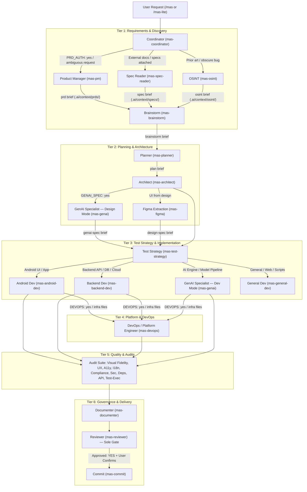
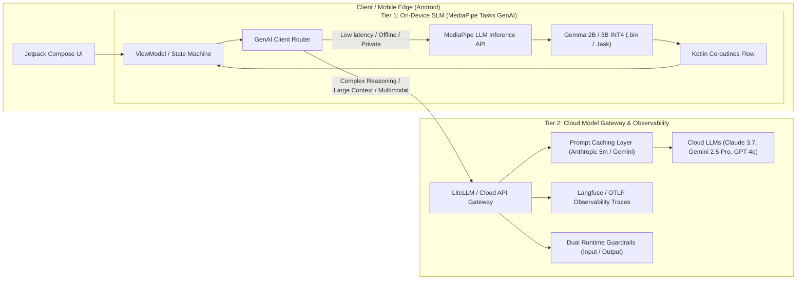

# Brainstorm Brief — MAS-11

## Problem & User Outcome

**Problem:**  
The existing Multi-Agent System (MAS v1.5.0) provides robust coverage for Android mobile development (`mas-android-dev`), generic coding (`mas-general-dev`), design extraction (`mas-figma`), fidelity verification (`mas-visual-fidelity`), and a comprehensive audit suite (P0 security/deps/API/test quartet and P1 a11y/i18n/compliance trio). However, it lacks:
1. **A dedicated GenAI Specialist (`mas-genai`)**: Generative AI features are currently treated as generic code, leading to prompt fragility, lack of structured tool-calling schemas, absence of token-efficient caching (Anthropic/Gemini prompt caching), ungrounded RAG retrieval, vulnerable runtime attack surfaces (OWASP LLM Top 10), and zero on-device SLM support (Google MediaPipe LLM Inference API, Gemma 2B/3B, LiteRT on Android). Furthermore, LLM features regress silently without automated evaluation harnesses (`promptfoo`, `DeepEval`).
2. **Key SDLC Product Engineering Disciplines**:
   - *Product Management (`mas-pm`)*: Inability to transform high-level, ambiguous user ideas into structured PRDs, user stories, and acceptance criteria (currently `mas-spec-reader` only ingests pre-existing external documentation).
   - *Backend & Cloud Engineering (`mas-backend-dev`)*: Dedicated ownership of database migrations (Flyway, Prisma, Room), REST/gRPC/GraphQL endpoints, transactional business logic, and cloud services.
   - *DevOps & Platform Engineering (`mas-devops`)*: Dedicated ownership of CI/CD automation (GitHub Actions), containerization (Docker, Compose), orchestration (Kubernetes), and Infrastructure as Code (Terraform).

**User Outcome:**  
Transform MAS into an enterprise-grade, autonomous **Full Product Engineering Organization** capable of turning raw, ambiguous product concepts into production-ready full-stack software. It establishes a dedicated GenAI practice bridging Android edge intelligence with cloud LLM gateways, supported by specialized product management, backend, and platform engineering roles, all coordinated through deterministic zero-token routing, structured filesystem briefs, and the central `mas-reviewer` quality gate.

**UI Scope:**  
`logic-only` (per handoff). This brief designs role definitions, skill architectures, handoff contracts, deterministic routing predicates, brief schemas, model policies, and integration contracts. It modifies no UI layouts, Compose components, or presentation styling.

**OSINT Delta:**  
Synthesizes findings from `.ai/context/osint/MAS-11.md`:
- *Google AI Edge / MediaPipe LLM Inference API & Gemma*: Standard on-device SLM pattern with INT4 quantization, background coroutine dispatching, and Kotlin Coroutine Flow token streaming.
- *Anthropic Agent Architecture & Prompt Caching*: XML tagging boundaries, few-shot exemplar blocks, strict JSON tool schemas, and prompt caching to slash repetitive token costs up to 80%.
- *LiteLLM & Langfuse Gateway Pattern*: Universal OpenAI-compatible gateway with automatic fallback cascades (e.g. 429/500 retries) and OTLP observability traces.
- *DeepEval & promptfoo CI/CD Evals*: Automated RAG triad (faithfulness, answer relevance, context recall) and LLM-as-a-judge regression assertions in CI.
- *MetaGPT / CrewAI Role Topology*: Standard Operating Procedures (SOPs) mapping human software organizations (PM -> Architect -> Engineer -> QA) into deterministic multi-agent assembly lines.
- *OWASP Top 10 for LLMs*: Multi-layer defense (input sanitization, prompt injection classifiers, output JSON validation).

---

## Options

| # | Option | Pros | Cons | Risk | Effort | Fits Memory & Architecture? |
|---|--------|------|------|------|--------|-----------------------------|
| 1 | **Monolithic Dev & Architect Overload** — Fold GenAI into `mas-architect` and `mas-general-dev`; handle PRD scoping in `mas-spec-reader` / `mas-brainstorm`; fold backend and DevOps into `general-dev` with instructions. | Zero new skill files; no routing changes; minimal manifest growth. | Severe prompt bloat; generic agents perform poorly on strict JSON tool schemas and RAG evals; lacks specialized validation gates; does not deliver requested "product engineering team". | High | S | No — violates MAS specialization and token efficiency principles. |
| 2 | **Modular 4-Specialist SDLC Assembly Line (Recommended)** — Create 4 dedicated specialist skills (`mas-genai`, `mas-pm`, `mas-backend-dev`, `mas-devops`) with typed brief schemas (`genai-spec`, `prd`, `devops`), zero-token routing predicates (`P0-PM`, `P0-GENAI`, `P-BACKEND`, `P-DEVOPS`), model policies, and lite mode aliases. | Clear separation of concerns; aligns with industry SOPs (MetaGPT/Anthropic); clean filesystem contracts; token-efficient zero-token routing; preserves `mas-reviewer` sole gate; fully fulfills user goal. | Adds 4 skills and 3 brief directories; expands Coordinator routing table. | Low | M | **Yes** — perfectly matches MAS v1.2–v1.5 precedent (P0 quartet, P1 trio, Figma/Visual fidelity). |
| 3 | **External Agent Swarm / Out-of-Band Subsystem** — Deploy a separate Python-based multi-agent daemon (CrewAI / LangGraph / AutoGen) that runs externally and outputs completed code into the workspace. | Highly dynamic agent-to-agent conversational loops; native Python LLM library bindings. | Violates MAS invariants: Cursor `Task` tool single-agent hops, deterministic filesystem briefs, Windows/PowerShell native operation; runaway token consumption; bypasses review and audit gates. | High | L | No — hostile to MAS local developer architecture. |
| 4 | **Phased Dual-Cluster Integration** — Phase 1 introduces `mas-genai` and `mas-pm` (Intelligence + Scoping); Phase 2 defers `mas-backend-dev` and `mas-devops` to a future task. | Smaller initial PR footprint; immediate focus on GenAI capabilities. | Leaves product engineering team incomplete; backend and cloud features remain stranded without specialized ownership. | Medium | M | Partial — delays delivering user's explicit request. |

---

## Recommended

**Option 2 — Modular 4-Specialist SDLC Assembly Line with Dedicated Brief Schemas and Zero-Token Coordinator Routing.**

### Rationale vs Alternatives:
- **vs Option 1 (Monolithic Overload):** Software industry research (Anthropic, MetaGPT) proves that generalist prompts degrade significantly when tasked with high-precision engineering like strict JSON Schema tool definitions, RAG retrieval chunking, or Terraform IaC. Dedicated agents with focused system prompts achieve higher accuracy and lower prompt token overhead.
- **vs Option 3 (External Swarm / LangGraph Daemon):** MAS is built on deterministic single-agent hops orchestrated by Cursor's `Task` tool and bounded by filesystem briefs. An external swarm introduces non-deterministic chat loops, fragile external runtimes, and breaks the central governance of `mas-reviewer`.
- **vs Option 4 (Phased Dual-Cluster):** The user explicitly requested: *"include multiple agents that support product development. the final result should be a full product engineering team."* Option 2 delivers the complete product engineering lifecycle in an integrated, unified architectural standard.

### Phased Delivery Sequence (Planner Roadmap):

| Phase | Milestone | Deliverables | Dependencies |
|-------|-----------|--------------|--------------|
| **P0: GenAI Specialist Core** | `mas-genai` Skill & Reference Architecture | `skills/mas-genai/SKILL.md`<br>`skills/multi-agent-system/references/genai-engineering-standards.md`<br>Brief schema `genai-spec` at `.ai/context/genai/{TASK_ID}.md` | None |
| **P1: Requirements & Product Management** | `mas-pm` Skill & PRD Specification | `skills/mas-pm/SKILL.md`<br>`skills/multi-agent-system/references/prd-authoring-standards.md`<br>Brief schema `prd` at `.ai/context/prds/{TASK_ID}.md` | None |
| **P2: Full-Stack Dev & Platform Engineering** | `mas-backend-dev` & `mas-devops` Skills | `skills/mas-backend-dev/SKILL.md`<br>`skills/mas-devops/SKILL.md`<br>`skills/multi-agent-system/references/backend-engineering-standards.md`<br>`skills/multi-agent-system/references/devops-platform-standards.md`<br>Brief schema `devops` at `.ai/context/devops/{TASK_ID}.md` | None |
| **P3: Coordinator & Protocol Integration** | Zero-token Routing, Model Policy & Lite Mode | Update `mas-coordinator/SKILL.md`, `multi-agent-system/SKILL.md`, `brief-schemas.md`, `spawn-model-policy.md`, `handoff-format.md`, `handoff-format-lite.md` | P0, P1, P2 |
| **P4: Quality Gate & E2E Validation** | Evals & Audit Alignment | Update `mas-test-strategy`, `mas-test-executor`, and `mas-reviewer` for `genai-spec`, backend migrations, and devops verification | P3 |

---

## Logic Flow

### A. Full 6-Tier Product Engineering Assembly Line



### B. Dual-Mode GenAI Specialist Execution Lifecycle

`mas-genai` operates in two distinct modes depending on its lifecycle placement:

1. **Design / Architecture Mode (Pre-Dev)**:
   - *Placement*: Immediately following `mas-architect`, preceding `mas-test-strategy`.
   - *Trigger*: `GENAI_SPEC: yes` or AI keywords in scope.
   - *Action*: Read architecture brief; define prompt architectures (system instructions, XML boundary tags, few-shot exemplars), tool-calling JSON schemas, RAG chunking and vector index configs, caching directives, on-device SLM task options, and evaluation matrices.
   - *Output*: Emits `.ai/context/genai/{TASK_ID}.md` (`genai-spec`). Does NOT write production code.
   - *Model Class*: `thinking`.

2. **Implementation / Dev Mode (Dev Slot)**:
   - *Placement*: In the implementation slot alongside or in sequence with `mas-android-dev` / `mas-backend-dev`.
   - *Trigger*: `TARGET_AGENT: mas-genai` on dev handoff; AI pipeline code changes.
   - *Action*: Implements LLM clients, LiteLLM gateway wrappers, MediaPipe LLM Inference integrations on Android, RAG vector store queries, and `promptfoo` / `DeepEval` test suites.
   - *Output*: Code files in workspace + test execution verification.
   - *Model Class*: `normal`.

### C. Dual-Tier GenAI Runtime Architecture



### D. Product Manager (`mas-pm`) Discovery & Scoping Flow

```
[Coordinator] Receives ambiguous user request (e.g. "build a smart recipe app with camera meal logging")
       ↓
[P0-PM Predicate Fires] Sets TARGET_AGENT: mas-pm, MODEL_CLASS: normal
       ↓
[mas-pm Execution]
   1. Frame problem & target personas (primary & secondary users).
   2. Map core user journeys (happy path, edge cases, error states).
   3. Author Functional Requirements as Gherkin User Stories (Given / When / Then).
   4. Define Non-Functional Requirements (latency budgets, privacy, offline support).
   5. Draw strict Scope Boundaries: MVP (P0) vs Phase 2 (Out of Scope).
   6. Define measurable Success Metrics / KPIs.
       ↓
Emits brief: .ai/context/prds/{TASK_ID}.md
       ↓
Coordinator routes to mas-brainstorm (reads PRD brief at startup).
```

### E. Backend Developer (`mas-backend-dev`) Service Implementation Flow

```
[Test Strategy / Coordinator] Sets TARGET_AGENT: mas-backend-dev, NEXT_AGENT: devops | security-auditor
       ↓
[mas-backend-dev Execution]
   1. Read .ai/context/plans/{TASK_ID}.md and architecture/genai briefs.
   2. Design / update relational/NoSQL schemas & write versioned migrations (Flyway, Prisma, Room).
   3. Implement repository pattern with parameterized queries (SQL injection defense).
   4. Implement domain service logic with transaction boundary isolation.
   5. Expose REST / gRPC / GraphQL endpoints with strict input validation (Zod, Pydantic, Kotlinx Serialization).
   6. Implement authentication / authorization checks (RBAC, JWT, OAuth2).
   7. Write unit & integration tests covering happy paths, 4xx/5xx error contracts, and idempotency.
       ↓
Verifies build & tests pass -> Emits Dev Done Summary.
```

### F. DevOps & Platform Specialist (`mas-devops`) Delivery Flow

```
[Dev Completion] Coordinator evaluates P-DEVOPS predicate (files touch CI/CD, Docker, Terraform, or DEVOPS: yes)
       ↓
[mas-devops Execution]
   1. Author / update multi-stage Dockerfiles (least privilege, non-root user, slim base image).
   2. Maintain docker-compose.yml for local integration test dependencies (databases, localstack, redis).
   3. Configure CI/CD pipeline workflows (.github/workflows/): build, test, lint, security scans, artifact publication.
   4. Define Infrastructure as Code (Terraform) for cloud resources (buckets, serverless functions, gateways).
   5. Specify environment configuration contract (.env.example, secrets injection policy).
   6. Emits brief: .ai/context/devops/{TASK_ID}.md or commits infra code.
       ↓
Coordinator routes to Audit Suite / Documenter.
```

---

## Domain & Contracts

### 1. Agent Profiles & Mission Boundaries

| Agent Slug | Display Name | Primary Mission | Upstream Feeder | Downstream Consumer | Deliverable Artifact |
|------------|--------------|-----------------|-----------------|---------------------|----------------------|
| `mas-genai` | GenAI Specialist | Architect, configure, optimize, and validate all Generative AI, prompt engineering, RAG, tool calling, and on-device SLM capabilities. | `mas-architect`, `mas-planner` | `mas-test-strategy`, `mas-android-dev`, `mas-backend-dev`, `mas-reviewer` | `.ai/context/genai/{TASK_ID}.md` (`genai-spec`) or workspace AI source code |
| `mas-pm` | Product Manager | Transform ambiguous requests into structured PRDs, user stories with Given/When/Then acceptance criteria, persona journeys, and strict MVP boundaries. | `mas-coordinator` (entry) | `mas-brainstorm`, `mas-planner`, `mas-reviewer` | `.ai/context/prds/{TASK_ID}.md` (`prd`) |
| `mas-backend-dev` | Backend Developer | Implement backend services, database migrations, REST/gRPC/GraphQL APIs, auth/authz, and cloud serverless logic at enterprise clean-architecture standards. | `mas-test-strategy`, `mas-architect` | `mas-devops`, `mas-security-auditor`, `mas-api-contract`, `mas-documenter` | Workspace backend source code + test suite |
| `mas-devops` | DevOps / Platform Engineer | Design, configure, and maintain CI/CD pipelines, containerization (Docker), orchestration, Terraform IaC, and deployment environments. | `mas-backend-dev`, `mas-android-dev` | `mas-test-executor`, `mas-security-auditor`, `mas-documenter`, `mas-reviewer` | `.ai/context/devops/{TASK_ID}.md` (`devops`) + workspace infra files (`.github/workflows/`, `Dockerfile`, etc.) |

---

### 2. Brief Schema Registry Extensions (`brief-schemas.md`)

#### A. `genai-spec` Brief (`.ai/context/genai/{TASK_ID}.md`)
Required markdown sections:
1. `## Model Selection & Routing Strategy` — On-device SLM vs Cloud LLM criteria, fallback cascade configuration, latency & cost budgets.
2. `## Prompt Architecture` — System instructions, XML delimiter tag hierarchy (`<context>`, `<rules>`, `<schema>`), few-shot exemplar blocks, role boundaries.
3. `## Structured Output & Tool Schemas` — Strict JSON Schema definitions for function/tool calling and structured output parsing.
4. `## RAG & Context Architecture` — Chunking strategy (size, overlap), embedding model, hybrid search (BM25 + vector cosine), reranking threshold, context window budget, static prompt prefix caching directives.
5. `## On-Device SLM Spec` *(Conditional: required when mobile/edge in scope)* — MediaPipe Tasks GenAI configuration, model weights target (`gemma-2b-it-cpu-int4`), max tokens, temperature, Coroutines Flow streaming signature, device RAM check policy (> 4GB).
6. `## Safety Guardrails & OWASP Defenses` — Dual runtime guardrails: Input sanitization / prompt injection regex & classifier; Output JSON Schema validator; PII redaction policy.
7. `## Evaluation & Quality Metrics` — Target scores for DeepEval RAG triad (Faithfulness $\ge 0.85$, Answer Relevancy $\ge 0.85$, Context Recall $\ge 0.80$, Hallucination $\le 0.10$); `promptfoo` test assertion matrix.

#### B. `prd` Brief (`.ai/context/prds/{TASK_ID}.md`)
Required markdown sections:
1. `## Problem Statement & Value Proposition` — Core user problem, market context, and value hypothesis.
2. `## Target Personas & User Journeys` — Primary and secondary personas, journey maps, key friction points.
3. `## Functional Requirements & User Stories` — Prioritized user stories with Gherkin-formatted acceptance criteria:
   ```gherkin
   Scenario: User queries recipes with diet restriction
     Given the user has selected "Gluten-Free" in dietary preferences
     When the user searches for "pasta dishes"
     Then the system returns only gluten-free verified pasta recipes
     And displays a "Gluten-Free" badge on each recipe card
   ```
4. `## Non-Functional Requirements` — Latency budgets, cold start thresholds, offline capability, security/privacy, accessibility tier.
5. `## Scope & Out-of-Scope Boundaries` — Explicit MVP (In-Scope) vs Deferred / Phase 2 (Out-of-Scope).
6. `## Success Metrics & KPIs` — Measurable product outcomes (e.g. task completion rate, retention, time-to-value).

#### C. `devops` Brief (`.ai/context/devops/{TASK_ID}.md`)
Required markdown sections:
1. `## Infrastructure & Deployment Topology` — Environment tiers (local dev, CI, staging, production), network boundaries, hosting platform.
2. `## CI/CD Pipeline Spec & Trigger Matrix` — GitHub Actions workflow triggers, branch policies, job stages (lint, test, build, scan, deploy).
3. `## Environment Variables & Secrets Contract` — Required runtime configuration keys, default values, secret store source (e.g. GitHub Secrets), redaction policy.
4. `## Container & Runtime Specifications` — Base image, multi-stage build layers, non-root security context, port mappings, resource limits (CPU/RAM).
5. `## Verification Commands & Health Checks` — Smoke tests, health check endpoints (`/healthz`, `/readyz`), rollback triggers.

---

### 3. Coordinator Routing Predicates & Invariants

| Priority | Predicate (any condition true) | Specialist Agent | Default Chain Position |
|----------|--------------------------------|------------------|------------------------|
| **P0-PM** | `PRD_AUTH: yes` OR greenfield request with high ambiguity (no existing PRD/spec attached) | `mas-pm` | **Entry agent** (before `mas-brainstorm` / `mas-planner`) |
| **P0-GENAI (Design)** | `GENAI_SPEC: yes` OR `SCOPE: genai` OR AI keywords in `SCOPE`/`GOAL` (`llm`, `rag`, `gemma`, `mediapipe`, `prompt`, `embedding`, `langchain`, `langgraph`, `openai`, `vertexai`) | `mas-genai` (Design Mode) | After `mas-architect`, **before** `mas-test-strategy` |
| **P-BACKEND** | `BACKEND: yes` OR `FILES` touch server-side code (Node, Python, Go, Spring, Ktor, SQL, Prisma, DB migrations) OR `SCOPE: backend\|api\|database` | `mas-backend-dev` | **Dev slot** (can run alongside or sequentially with `mas-android-dev`) |
| **P0-GENAI (Dev)** | `TARGET_AGENT: mas-genai` on dev handoff OR implementation of AI client pipelines / eval suites | `mas-genai` (Dev Mode) | **Dev slot** |
| **P-DEVOPS** | `DEVOPS: yes` OR `FILES` touch `.github/workflows/`, `Dockerfile`, `docker-compose.yml`, `*.tf`, k8s manifests OR `SCOPE: devops\|ci-cd\|infra` | `mas-devops` | **Platform slot** (post-dev, pre-audits) |

#### Ordering Invariants:
1. **PM First Invariant:** `mas-pm` runs before `mas-brainstorm` or `mas-planner` whenever greenfield ambiguity is detected. It authors the PRD that downstream agents consume.
2. **GenAI Design Placement:** `mas-genai` (Design Mode) runs *after* `mas-architect` (so system architecture is established) and *before* `mas-test-strategy` (so test strategy can plan promptfoo/DeepEval assertions).
3. **Full-Stack Dev Sequencing:** In full-stack workflows requiring both backend and mobile changes, `mas-backend-dev` runs first to establish APIs and DB migrations, followed by `mas-android-dev` to consume those APIs; alternatively, they run independently when contracts are fixed by `mas-api-contract`.
4. **DevOps Post-Dev Invariant:** `mas-devops` always runs after the dev slot (so all Dockerfile, migration, and application dependencies are finalized) and before the audit quartet.
5. **Reviewer Gate Invariance:** Neither `mas-genai`, `mas-backend-dev`, nor `mas-devops` can bypass `mas-reviewer`. `mas-reviewer` remains the sole `Approved: YES | NO` authority.

---

### 4. Directory Structures & File Layout

```
mas-cursor-framework/
├── skills/
│   ├── mas-genai/
│   │   └── SKILL.md                              # GenAI specialist instructions & prompt standards
│   ├── mas-pm/
│   │   └── SKILL.md                              # Product Manager instructions & PRD standards
│   ├── mas-backend-dev/
│   │   └── SKILL.md                              # Backend developer standards & clean architecture
│   ├── mas-devops/
│   │   └── SKILL.md                              # DevOps / Platform engineer instructions
│   └── multi-agent-system/
│       └── references/
│           ├── genai-engineering-standards.md    # MediaPipe, LiteLLM, prompt caching, RAG & eval standards
│           ├── prd-authoring-standards.md        # Gherkin acceptance criteria, persona & scoping standards
│           ├── backend-engineering-standards.md  # Database migrations, REST/gRPC/GraphQL, auth, clean arch
│           └── devops-platform-standards.md      # Docker multi-stage, GitHub Actions CI/CD, Terraform IaC
│
└── .ai/
    └── context/
        ├── genai/                                # Task-scoped GenAI briefs (.ai/context/genai/{TASK_ID}.md)
        ├── prds/                                 # Task-scoped PRD briefs (.ai/context/prds/{TASK_ID}.md)
        └── devops/                               # Task-scoped DevOps briefs (.ai/context/devops/{TASK_ID}.md)
```

---

### 5. Model Policy & Task Spawn Configuration

Updates to `skills/multi-agent-system/protocol/spawn-model-policy.md`:

| Agent Slug | `MODEL_CLASS` | Task `model` Hint | Rationale |
|------------|---------------|-------------------|-----------|
| `mas-genai` (Design) | `thinking` | `claude-opus-4-7-thinking-high` or thinking family | Complex reasoning required for prompt boundaries, RAG chunking, and eval matrices. |
| `mas-genai` (Dev) | `normal` | default / `composer-2.5` | Standard implementation model for wiring SDKs and writing eval scripts. |
| `mas-pm` | `normal` | default / `composer-2.5` | Structured PRD authoring; escalate to `thinking` on complex multi-system product scopes. |
| `mas-backend-dev` | `normal` | default / `composer-2.5` | Standard development model for DB migrations, controllers, services, and tests. |
| `mas-devops` | `normal` | default / `composer-2.5` | Standard development model for Dockerfiles, CI/CD YAMLs, and Terraform files. |

---

### 6. Lite Mode Abbreviations (`handoff-format-lite.md`)

To support token-efficient `/mas-lite` workflows under the strict 12-line handoff cap:

| Full `/mas` Flag | Lite Flag | Agent Triggered | Notes |
|------------------|-----------|-----------------|-------|
| `GENAI_SPEC: yes` | `GEN:y` | `mas-genai` | Inserts GenAI specialist into Lite L/L+ chains |
| `PRD_AUTH: yes` | `PM:y` | `mas-pm` | Runs PM scoping prior to planner in Lite L+ |
| `BACKEND: yes` | `BE:y` | `mas-backend-dev` | Selects backend developer for dev slot in Lite |
| `DEVOPS: yes` | `OPS:y` | `mas-devops` | Triggers platform / CI/CD pass in Lite M/L |

---

### 7. Concrete Technical Integration Specifications

#### A. Prompt Engineering & Structured Tool Schema Contract
`mas-genai` enforces the following system prompt standard:
- **XML Delimiters**: Strict hierarchy separating `<context>`, `<system_instructions>`, `<constraints>`, `<tools>`, and `<output_schema>`.
- **Few-Shot Exemplars**: Standardized `<examples>` block containing $\ge 2$ positive and $\ge 1$ negative edge case examples.
- **Strict JSON Schema**: Tool parameters defined with explicit JSON Schema draft-07 types, `required` arrays, and `additionalProperties: false`.
- **Prompt Caching Header**: Invariant static prefix (system prompt + tool schemas + persistent context) structured to exceed minimum token thresholds (1,024 tokens for Claude, 32k for Gemini) to trigger automatic KV-cache reuse.

#### B. Android On-Device SLM (MediaPipe Tasks GenAI) Contract
- **Dependency**: `com.google.mediapipe:tasks-genai:0.10.20+`
- **Device RAM Guard**: Require $\ge 6\text{ GB}$ total RAM device check before instantiating `LlmInference`; fallback to cloud gateway on lower-memory devices.
- **Quantization**: Strict INT4 model weights (`gemma-2b-it-cpu-int4.bin` or `gemma-2b-it-gpu-int4.bin`).
- **Streaming Flow**: Off-main-thread execution via `Dispatchers.IO` / `Dispatchers.Default` emitting a Kotlin `Flow<String>` consumed by Compose state with backpressure buffering.

#### C. Backend Service & Database Contract
- **Clean Architecture Boundaries**: Domain models $\leftrightarrow$ Repositories (interfaces) $\leftrightarrow$ Data Sources (implementations).
- **Migration Hygiene**: Versioned, forward-only migrations; zero hardcoded DDL in application startup.
- **Idempotency**: All mutation endpoints (POST/PUT/DELETE) must support `Idempotency-Key` headers or upsert semantics.
- **Secrets Management**: Zero secrets in source code; injection via environment variables or secret manager adapters.

#### D. DevOps & CI/CD Contract
- **Multi-Stage Dockerfile**: Builder stage (compilation, test dependencies) $\rightarrow$ Runtime stage (distroless or alpine base, non-root user `appuser:appgroup`).
- **Matrix Testing**: CI workflows test against matrixed targets (JVM versions, database versions, OS platforms).
- **Deterministic Toolchains**: Pin all Docker base image digests, GitHub Actions SHA commits, and Gradle/tooling versions.

---

## Edge Cases

| # | Edge Case Scenario | Impact | Mitigation / Handling Strategy |
|---|-------------------|--------|--------------------------------|
| 1 | **Android Low-RAM Device attempting On-Device Gemma Inference** | Out-Of-Memory (OOM) kill by Android OS low-memory killer (LMK). | `mas-genai` mandates runtime memory check (`ActivityManager.MemoryInfo.totalMem >= 6GB`). If below threshold, dynamically fallback to Cloud Gateway API. |
| 2 | **Cloud API Rate Limits (HTTP 429) & Provider Outages** | Application AI features fail completely. | `mas-genai` architectures must include LiteLLM fallback cascades: Primary model (Claude 3.7) $\rightarrow$ Secondary fallback (Gemini 2.5 Pro) with exponential backoff and jitter. |
| 3 | **Silent Semantic Regression in LLM Output** | Unit tests pass, but AI output hallucinated or violated JSON format. | `mas-test-strategy` and `mas-test-executor` invoke `promptfoo eval` and `DeepEval` RAG triad checks in CI; failures treat as test run failures and route to `bug-fix`. |
| 4 | **Ambiguous PRD with Missing Technical Constraints** | Downstream architects build unfeasible solutions. | `mas-pm` handoff explicitly defines Out-of-Scope boundaries; `mas-brainstorm` flags feasibility risks; if unresolvable, Coordinator pauses for user clarification. |
| 5 | **Conflicting Full-Stack Changes (API Drift between Backend & Mobile)** | Mobile build breaks due to unexpected JSON field rename in Backend. | `mas-api-contract` runs after architect and post-dev to assert zero unversioned contract drift; OpenAPI / Proto specs act as single source of truth. |
| 6 | **Database Migration Rollback Failure in CI** | Migration scripts pass forward test but break dirty state recovery. | `mas-backend-dev` must provide both up and down migrations (or repeatable idempotent scripts); CI pipeline verifies migration on clean and dirty DB fixtures. |
| 7 | **Missing Docker / Rootless Container Daemon in Host CI Environment** | `mas-devops` pipeline tests fail due to socket permissions. | Devops specifications mandate fallback verification modes (e.g. docker-in-docker or podman rootless); document host prerequisite checklist. |
| 8 | **Token Budget Cap Breach during 6-Tier Chain** | Chain length exceeds `MAX_CHAIN_AGENTS` (12 agents). | Coordinator applies token overflow skip order: advisory audit specialists skip first per `token-rules.md`; `mas-genai`, `mas-pm`, `mas-backend-dev`, `mas-devops` are core functional agents and are protected when their explicit predicates fire. |
| 9 | **Prompt Injection via User RAG Documents** | Malicious document text overrides system prompt instructions. | `mas-genai` mandates input boundary sanitization (escaping XML tags) and secondary output guardrail verification against JSON Schema. |
| 10 | **Unquantized Model Weights Packaging in APK** | APK size balloons to > 2.5GB, rejected by Google Play Store. | On-device SLM spec strictly forbids bundling weights inside APK assets for production release; mandates runtime download via `WorkManager` with WiFi-only constraint. |
| 11 | **Concurrent Workflows with Database Locking** | Host mutex deadlock or migration lock timeout. | Integrated with MAS-10 `mas-host-lock` (build and install lanes) to ensure serial database fixture execution during local integration tests. |
| 12 | **Lite Mode Token Overrun** | Multi-discipline prompt exceeds Lite mode 12-line cap. | Enforce single-discipline focus in Lite mode (`BE:y` or `OPS:y` or `GEN:y`); for full multi-discipline product workflows, escalate to full `/mas`. |

---

## Quality Bar

- **Zero-Token Routing Invariance:** Coordinator routes strictly based on deterministic predicates (handoff flags, file paths, keywords) without extra LLM hops.
- **Reviewer Governance:** `mas-reviewer` remains the sole merging authority. Neither `mas-genai`, `mas-backend-dev`, nor `mas-devops` can bypass code review.
- **Artifact-Forward Communication:** Agents communicate via task-scoped filesystem briefs in `.ai/context/` (`genai/`, `prds/`, `devops/`). Never inject raw multi-thousand-line briefs or log dumps into chat context.
- **Security & OWASP Compliance:**
  - AI pipelines: OWASP Top 10 for LLMs defense (input sanitization, prompt injection defense, output validation, sensitive data masking).
  - Backend: Parameterized queries (no raw string interpolation), strict authz decorators, encrypted secret storage.
  - DevOps: Non-root container execution, minimal attack surface base images, zero hardcoded secrets.
- **Test Strategy Integration:**
  - Standard code: Unit, integration, and UI tests.
  - AI pipelines: Evaluation harness tests (`promptfoo`, `DeepEval`) with measurable statistical thresholds.
  - Infrastructure: Linting (`hadolint`, `tflint`), container build verification, dry-run Terraform validation.

---

## Risks & Open Questions

### Risks

| Risk | Severity | Mitigation |
|------|----------|------------|
| **Increased Workflow Latency from Expanded Agent Roster** | M | Enforce deterministic zero-token predicate filtering so that only relevant specialists spawn; support Lite mode abbreviations (`GEN:y`, `BE:y`, etc.) for smaller tasks. |
| **Model Weight Hosting & Download Flakiness on Mobile** | M | On-device SLM specs mandate robust retry mechanisms using Android `WorkManager`, background resume, and hash checksum validation. |
| **Evaluation Cost in CI/CD (LLM-as-a-judge)** | M | Use lightweight evaluation models (e.g. Gemini 2.5 Flash, Claude 3.5 Haiku) for automated promptfoo test runs; run full DeepEval matrix only on PR merge to main. |
| **Coordinator Complexity Growth** | L | Modularize Coordinator predicates into cleanly isolated priority tiers (`P0-PM`, `P0-GENAI`, `P-BACKEND`, `P-DEVOPS`). |

### Open Questions (for Planner & Architect)

1. **Dual Mode vs Two Separate Slugs for GenAI**: Should `mas-genai` handle both architecture (`genai-spec`) and dev implementation via a single skill in dual modes, or should it be split into `mas-genai-architect` and `mas-genai-dev`?  
   *(Recommendation: Single `mas-genai` skill with dual modes, matching the precedent of `mas-spec-reader` and `mas-imaginer` / `mas-figma` to prevent slug proliferation).*
2. **On-Device Model Asset Distribution during Local Development**: For debug builds and automated instrumentation tests, should we bundle a micro-SLM (e.g. Gemma-2B-INT4) directly in test fixtures, or require pre-seeding the emulator storage via ADB?  
   *(Recommendation: Pre-seed via ADB script or local test assets for CI; CDN download for production).*
3. **Backend Stack Defaults**: While `mas-android-dev` targets Kotlin/Compose/Gradle, what reference stacks should `mas-backend-dev` officially standardize on in `backend-engineering-standards.md`?  
   *(Recommendation: Document multi-stack standards: Ktor/Spring Boot for Kotlin-first teams, FastAPI/Python for AI-first teams, and Node/TypeScript/Prisma for general full-stack).*
4. **DevOps Tooling Validation in Test Executor**: Should `mas-test-executor` natively execute `docker build` and `terraform validate` commands, or should `mas-devops` run its own dry-run validation before completion?  
   *(Recommendation: `mas-devops` performs dry-run validation during its pass; `mas-test-executor` executes end-to-end integration tests).*

---

## Suggested Next

**planner** — Decompose MAS-11 into implementation tasks across:
1. P0: `mas-genai` skill, `genai-engineering-standards.md`, and `genai-spec` brief schema.
2. P1: `mas-pm` skill, `prd-authoring-standards.md`, and `prd` brief schema.
3. P2: `mas-backend-dev` and `mas-devops` skills, standards, and `devops` brief schema.
4. P3: Coordinator routing predicates (`P0-PM`, `P0-GENAI`, `P-BACKEND`, `P-DEVOPS`), `spawn-model-policy.md`, and Lite mode flags.
5. P4: Test strategy and reviewer gate updates.

---

## References

- `.ai/context/osint/MAS-11.md`
- `skills/multi-agent-system/SKILL.md`
- `skills/mas-coordinator/SKILL.md`
- `skills/multi-agent-system/protocol/brief-schemas.md`
- `skills/multi-agent-system/protocol/spawn-model-policy.md`
- `skills/multi-agent-system/protocol/handoff-format.md`
- `skills/multi-agent-system/protocol/handoff-format-lite.md`
- `skills/multi-agent-system/protocol/subagent-spawn.md`
- `skills/multi-agent-system/protocol/subagent-role.md`
- `.ai/context/memory.md`
