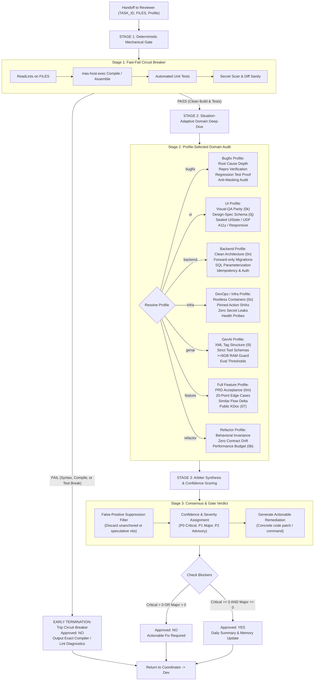
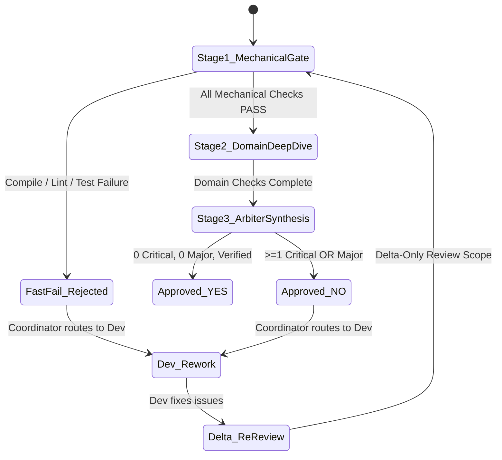

# Brainstorm Brief — REV-01: Multi-Stage Adaptive Review Architecture

## Problem & User Outcome

**Problem:**  
The current `mas-reviewer` (`skills/mas-reviewer/SKILL.md`) has evolved into an 825+ line monolithic agent. Over successive framework releases (MAS-04 through MAS-11), it accumulated 15 disjoint pre-checks (`0`, `0b`–`0o`) and 8 numbered general verification steps. In every review invocation, a single LLM turn attempts to:
1. Run deterministic mechanical tasks (ReadLints, Gradle build, unit tests);
2. Ingest up to 10+ disparate specialist briefs (`genai-spec`, `prd`, `devops`, `visual-qa`, `security-audits`, `test-strategies`, etc.);
3. Execute domain-specific checklists across mobile UI, backend databases, cloud infrastructure, AI prompt engineering, and bug reproduction;
4. Perform imaginary visual rendering and edge case mental tracing;
5. Synthesize a 120-line findings report with a binding `Approved: YES | NO` verdict.

This monolith suffers from four severe failure modes:
- **Attention Degradation & Context Bloat:** Feeding an 825-line prompt with 15 conditional sections causes the LLM to dilute attention, hallucinate non-existent issues, or rubber-stamp approvals without deep scrutiny.
- **Absence of Fast-Fail Circuit Breaker:** If code has syntax errors or fails Gradle compilation, the reviewer still reads and reviews the entire codebase, wasting tokens and hallucinating semantic feedback on uncompilable code.
- **Situation-Blind Review:** A one-line bug fix, a Figma-driven Compose screen, a Flyway database migration, and a Dockerfile refactor are all subjected to the same monolithic checklist, resulting in verbose "N/A" boilerplate and poor domain depth.
- **Review Instability & False Positives:** LLMs frequently elevate minor stylistic preferences or impossible nullability scenarios into blocking `Major`/`Critical` findings, causing developer-reviewer ping-pong loops and developer frustration.

**User Outcome:**  
Transform `mas-reviewer` into a robust, high-reliability **Multi-Stage Adaptive Review Architecture**. The review process is split into a **3-stage lifecycle** (Fast-Fail Mechanical Gate $\rightarrow$ Situation-Adaptive Domain Deep-Dive $\rightarrow$ Arbiter Synthesis with Confidence Scoring). It tailors verification to the specific technical context (Bugfix, UI, Backend, Infra, GenAI, Full Feature, Refactor, or Lite) using modular profiles, enforces evidence-anchored findings with false-positive suppression, and outputs deterministic, actionable remediation so that the final approval verdict is rock-solid and trustworthy.

**UI Scope:**  
`logic-only` (per handoff). This brainstorm defines agent architectures, execution pipelines, stage contracts, profile routing predicates, verification schemas, and reliability protocols. It contains no UI layout or styling code.

---

## Options

| # | Option | Pros | Cons | Risk | Effort | Fits Memory & Architecture? |
|---|--------|------|------|------|--------|-----------------------------|
| 1 | **Monolithic Profile Inlining (Single Prompt, Parameterized Sections)** — Retain `mas-reviewer` as a single file, but add if/else prompt conditionals to only display relevant checks based on a `REVIEW_PROFILE` tag. | Single file; no new skills or files; preserves current subagent spawn call verbatim. | Prompt remains large; does not solve prompt maintenance bloat; LLM still runs mechanical build and semantic review in one turn; no hard fail-fast. | Med | S | Partial — leaves monolithic prompt maintenance burden intact. |
| 2 | **Physical 3-Subagent Committee (Gatekeeper $\rightarrow$ Domain Specialist $\rightarrow$ Arbiter)** — Coordinator spawns three independent subagents sequentially for every review: `mas-gatekeeper` (build/lint), `mas-reviewer-{domain}`, and `mas-review-arbiter`. | Total physical isolation; zero risk of context pollution; mechanical gate runs in a clean execution context. | Triples subagent spawn overhead and latency on every task; high token consumption for simple changes; heavy Coordinator orchestration. | Med | L | No — violates token efficiency and lightweight philosophy for standard workflows. |
| 3 | **Full Adversarial Debate Panel (Tournament / Red-Team Panel)** — Coordinator spawns multiple competing agents (Red Team, Architect, QA) in parallel, followed by a debate-synthesizer arbiter. | Unmatched adversarial depth for critical security and crypto modules; exposes subtle logic flaws. | Massive token cost (4x-5x); extreme latency; excessive overhead for routine bug fixes and standard features. | High | L | No — severe overkill for 95% of software tasks. |
| 4 | **Modular 3-Stage Adaptive Review Architecture (Recommended)** — Modularize `mas-reviewer` into a lean stage orchestrator (~160 lines) executing an explicit 3-stage lifecycle: (1) Deterministic Fast-Fail Gate, (2) Situation-Adaptive Profile Deep-Dive (modular files in `references/review-profiles/*.md`), and (3) Arbiter Synthesis with Evidence Anchoring & False-Positive Suppression. In Lite/Normal mode, runs within a single disciplined subagent; in High-Risk mode (`SECURITY_BLOCKER: yes` or `RELEASE_BRIEF`), Coordinator can chain `test-executor` before reviewer. | Slashes reviewer prompt by 65%; deterministic fast-fail terminates immediately on build/lint break; situation-specific rigor; strict confidence & evidence anchor eliminates hallucinated blockers; modular files allow clean expansion; 100% backward compatible with existing MAS handoffs. | Requires creating 7 profile reference files and updating `mas-reviewer/SKILL.md` + Coordinator handoff defaults. | Low | M | **Yes** — perfectly aligns with MAS v1.2–v1.5 modular references and token-conscious governance. |

---

## Recommended

**Option 4 — Modular 3-Stage Adaptive Review Architecture.**

### Rationale vs Alternatives:
- **vs Option 1 (Monolithic Inlining):** Merely adding flags inside an 825-line prompt fails to prevent context bloat and prompt maintenance decay. Modularizing into distinct reference documents (`review-stage-gate.md`, `review-arbiter-standards.md`, and `review-profiles/{profile}.md`) allows the agent to load only the relevant domain knowledge, slashing active prompt tokens and focusing model attention.
- **vs Option 2 (Physical 3-Subagent Pipeline):** Spawning 3 separate subagents for every routine code review creates unacceptable latency (3x task spawns) and wastes tokens on redundant file reading across turns. Option 4 achieves the same staged rigor inside a single focused agent execution while retaining the ability for Coordinator to split stages when physical verification (e.g. connected device tests) is required.
- **vs Option 3 (Adversarial Debate Panel):** Multi-agent tournaments are expensive and non-deterministic. MAS already provides `mas-debate-synthesizer` for exceptional architectural disagreements; baking a debate tournament into daily code review would cripple framework throughput.

### Phased Delivery Sequence (Planner Roadmap):

| Phase | Milestone | Deliverables | Dependencies |
|-------|-----------|--------------|--------------|
| **P0: Core Stage Standards & Fast-Fail Gate** | Stage 1 & Stage 3 Reference Architecture | `skills/multi-agent-system/references/review-stage-gate.md`<br>`skills/multi-agent-system/references/review-arbiter-standards.md` | None |
| **P1: Situation-Adaptive Review Profiles** | Modular Domain Verification Profiles | `skills/multi-agent-system/references/review-profiles/` (`bugfix.md`, `ui.md`, `backend.md`, `infra.md`, `genai.md`, `feature.md`, `refactor.md`) | P0 |
| **P2: Refactor `mas-reviewer` Core** | Lean Stage Controller & Engine | Refactor `skills/mas-reviewer/SKILL.md` to ~160 lines orchestrating Stage 1 $\rightarrow$ Stage 2 $\rightarrow$ Stage 3 | P0, P1 |
| **P3: Coordinator & Routing Integration** | Automated Profile Detection & Handoff Schema | Update `mas-coordinator/SKILL.md`, `multi-agent-system/SKILL.md`, `handoff-format.md`, and `handoff-format-lite.md` with `REVIEW_PROFILE` predicate | P2 |
| **P4: Dogfood & Regression Verification** | End-to-end Verification across Profiles | Validate Bugfix, UI, Backend, and Lite workflows against new staged architecture | P3 |

---

## Logic Flow

### A. 3-Stage Review Execution Pipeline



### B. State Transition & Re-Review Loop



---

## Domain & Contracts

### 1. Situation-Adaptive Review Profiles

The profile is resolved automatically by Coordinator using deterministic file/context predicates, or passed explicitly via handoff `REVIEW_PROFILE:`:

| Profile | Trigger Predicates | Target Domain Focus | Active References Loaded |
|---------|--------------------|---------------------|--------------------------|
| `bugfix` | Handoff contains `ORIGINAL_SYMPTOM`, `ROOT_CAUSE`, or `REPRO_STEPS`; or `TARGET_AGENT: bug-fix` in chain. | Forensic verification that root cause is solved; repro steps re-run; regression test exists; no symptom masking. | `references/review-profiles/bugfix.md` |
| `ui` | `UI_CHANGES: YES` or `design-specs/{TASK_ID}.md` exists; or files include Compose/XML/CSS/layout. | Visual-QA fidelity (step 0k); design-spec schema (step 0j); UDF state machines; touch targets; responsive; accessibility. | `references/review-profiles/ui.md`, `references/build-test-visual-qa.md` |
| `backend` | Files touch `server/`, `api/`, `db/`, `migrations/`, `entities/`, or `mas-backend-dev` in chain. | Clean architecture layering (step 0n); forward-only safe DB migrations; parameterized SQL; idempotency keys; RBAC. | `references/review-profiles/backend.md`, `references/backend-engineering-standards.md` |
| `infra` | Files touch `Dockerfile`, `.github/`, `k8s/`, `terraform/`, `scripts/`, or `mas-devops` in chain. | Rootless containers (step 0o); 40-char pinned commit SHAs; zero secret leaks; `.env.example` sync; health probes (`/healthz`). | `references/review-profiles/infra.md`, `references/devops-platform-standards.md` |
| `genai` | `.ai/context/genai/{TASK_ID}.md` exists; or files touch LLM clients, prompt templates, RAG retrievers. | XML prompt boundary tags (step 0l); strict tool JSON schemas; on-device $\ge 6\text{GB}$ RAM guards; DeepEval/promptfoo evals. | `references/review-profiles/genai.md`, `references/genai-engineering-standards.md` |
| `feature` | Greenfield feature; multi-tier implementation; standard full `/mas` chain without specialized single profile. | PRD acceptance criteria (step 0m); full 20-point edge case matrix; architecture layering; similar flow consistency; KDoc. | `references/review-profiles/feature.md`, `references/data-flow-imagination-standards.md` |
| `refactor` | Refactoring, code optimization, perf improvement (`optimizations/{TASK_ID}.md` exists). | Behavioral invariance; zero API contract drift; test suite equivalence; memory/rendering performance invariants (step 0b). | `references/review-profiles/refactor.md`, `references/list-surface-performance.md` |
| `lite` | `MODE: LITE` or `REVIEWER_MODE: lite`. | Minimal single-turn mechanical check + one-line visual/perf/test check. | `references/reviewer-lite.md` |

### 2. Stage 1: Mechanical & Deterministic Gate Contract

Stage 1 executes deterministic tools via PowerShell and the MAS host mutex (`mas-host-exec`).

```markdown
## Stage 1: Mechanical Gate Results
| Check | Tool / Command | Exit Code | Result | Diagnostics |
|-------|----------------|-----------|--------|-------------|
| Static Linter | ReadLints (FILES) | 0 | PASS | Clean (0 errors, 0 warnings) |
| Compilation | mas-host-exec ./gradlew :core:compileDebugKotlin | 0 | PASS | Build successful in 4.2s |
| Test Suite | mas-host-exec ./gradlew :core:testDebugUnitTest | 0 | PASS | 14 passed, 0 failed |
| Secret Scan | Regex / Git diff pattern match | 0 | PASS | Zero secrets / keys detected |

Stage 1 Gate Status: PASS (Proceed to Stage 2) | FAIL (Circuit Breaker Tripped)
```

**Fast-Fail Circuit Breaker Invariant:** If any check in Stage 1 returns `FAIL`:
1. The reviewer immediately stops execution.
2. It outputs `Stage 1 Gate Status: FAIL` followed by the exact raw error messages, file names, line numbers, and compiler stack traces.
3. It sets `Approved: NO`.
4. It does not load Stage 2 profiles or evaluate imaginary visual QA.

### 3. Stage 3: Arbiter Synthesis & Evidence Contract

To eliminate subjective nitpicks and hallucinated blocks, every finding emitted in Stage 3 must satisfy the **Evidence Anchor Contract**:

```markdown
### Finding Schema
- **ID:** `[CRITICAL-01]` | `[MAJOR-01]` | `[ADVISORY-01]`
- **Domain:** `RootCause` | `Security` | `Concurrency` | `Migration` | `VisualQA` | `Contract`
- **Confidence:** `HIGH` (verified by compiler/test/unambiguous code path) | `MEDIUM` (plausible edge-case defect) | `LOW` (speculative / stylistic)
- **Anchor:** `path/to/File.kt#L142-L148`
- **Defect Description:** Concrete explanation of why this code fails, crashes, corrupts data, or violates contract.
- **Reproducing Scenario / Trigger:** Input, state, or event sequence that exposes the flaw.
- **Actionable Remediation:** Drop-in code snippet or exact shell command to resolve.
```

**False-Positive Suppression Filter Rules:**
1. **Rule 1 (Evidence Anchor):** Any finding that cannot cite an exact file and line number with an executable failure scenario is automatically discarded or downgraded to `ADVISORY`.
2. **Rule 2 (Type-System Invariance):** The reviewer must not flag potential `NullPointerException` or null-safety issues on types marked non-nullable by Kotlin or TypeScript type systems.
3. **Rule 3 (Compilation Truth):** The reviewer must not flag "missing import", "unresolved class", or "syntax error" unless Stage 1 `ReadLints` or compilation explicitly failed on that line.
4. **Rule 4 (Style vs Correctness):** Stylistic preferences, naming nuances, or optional comment requests are strictly classified as `ADVISORY` and can **never** block `Approved: YES`.

---

## Reliability & Edge Cases

### A. Reliability Mechanisms

| Reliability Threat | Manifestation in Current Monolith | Counter-Measure in Adaptive Architecture |
|--------------------|-----------------------------------|------------------------------------------|
| **Hallucinated Syntax/Import Errors** | Reviewer claims a library or class is missing when it is properly imported. | **Stage 1 Compilation Authority:** If Gradle/linter passed, Stage 3 Arbiter strictly rejects any LLM claim of compiler or import invalidity. |
| **Rubber-Stamping Complex Code** | Reviewer prints "Everything looks good!" without testing edge cases. | **Mandatory Profile Checklists:** Profile requires explicit `Handled | Missing | N/A` marking across domain-specific failure categories with code line citations. |
| **Review Ping-Pong Loops** | Reviewer rejects PR for Issue A; dev fixes A; reviewer then rejects for Issue B that existed in the original diff. | **Delta-Only Re-Review Scope:** On second review, reviewer is restricted to verifying fixes for previously flagged issues + checking for regressions introduced by the fix. New blockers on unchanged code are forbidden. |
| **False-Positive Severity Inflation** | Minor cosmetic nit or missing log statement marked as `Major`, blocking delivery. | **Strict Severity Definitions:** Only crash risks, data loss, security vulnerabilities, broken acceptance criteria, or build failures qualify as `Critical`/`Major`. |
| **Token Exhaustion on Large Reviews** | Monolithic prompt exceeds context or truncates output before reaching approval verdict. | **Modular Profile Decoupling:** Reducer reduces base skill to ~160 lines, dynamically reading only the single relevant profile file (~80-120 lines). |

### B. Review Edge Cases Matrix

| Edge Case Scenario | Reviewer Behavior & Resolution |
|--------------------|--------------------------------|
| **Multi-Domain Feature (e.g., UI + Backend + GenAI)** | Coordinator sets primary profile to `feature` and lists secondary profiles in handoff: `REVIEW_PROFILE: feature (secondary: backend, genai)`. Reviewer loads composite checklist slices. |
| **Flaky or Environment-Dependent Tests** | If a unit test fails due to external network or missing emulator: Stage 1 records `NOT_RUN (Environment constraint: <details>)`. Does not block if documented in `test-strategy` brief. |
| **Zero Files Changed (`FILES: []`)** | Reviewer immediately returns `Approved: YES` (or `NO` if files were expected) without running Stage 1 build commands. |
| **Post-Bugfix with No Repro Test** | In `PROFILE_BUGFIX`, a bug fix without an automated regression test or documented manual repro verification command is automatically flagged as `MAJOR-01` (missing verification evidence). |
| **Emergency Hotfix / Revert** | Coordinator sets `REVIEW_PROFILE: bugfix` with `HOTFIX: yes`. Skips non-critical lint warnings and focuses exclusively on root cause and regression safety. |

---

## Quality Bar

- **Fast Gate Time-to-Verdict:** If compilation or tests fail, reviewer trips the circuit breaker in under 15 seconds, saving 80% of tokens compared to monolithic evaluation.
- **Deterministic Approval Rule:**
  - `Approved: YES` **strictly requires**: Stage 1 PASS, 0 Critical findings, 0 Major findings, and all applicable Profile Invariants verified.
  - `Approved: NO` **mandatory when**: Any Stage 1 check fails, any Critical finding exists, any Major finding exists, or `PROFILE_BUGFIX` reports `Issue Resolved: NO`.
- **Actionable Remediation Quality:** Every rejection must include a cut-and-paste code replacement or concrete corrective command so Dev can resolve it in a single iteration.

---

## Risks & Open Questions

### Risks
1. **Profile Misclassification:** If Coordinator misclassifies a backend change as a UI change, backend checks might be skipped.  
   *Mitigation:* Coordinator derives profile from file paths (`api/`, `db/`, `.kt` Compose) with automatic fallback to `feature` if multiple heterogeneous domains are touched.
2. **Modular File Load Overhead:** Reading external profile files via `read_file` could introduce an extra tool turn.  
   *Mitigation:* Profile reference files are lightweight (~80-120 lines) and placed in standard reference paths; Coordinator can inject the profile path directly into handoff `BRIEF_PATH` or `DOCS`.
3. **Subagent Tool Limitations:** Reviewer subagents need access to `mas-host-exec` and `ReadLints`.  
   *Mitigation:* `mas-reviewer` runs with `TypeName: self` and `Workspace: inherit`, inheriting full shell and file tools.

### Open Questions for Planner & Architect
1. *Should `REVIEW_PROFILE` be explicit in handoff metadata or solely auto-inferred by the reviewer?*  
   *Recommendation:* Both. Coordinator sets `REVIEW_PROFILE` based on task type, with Reviewer fallback to auto-detection from changed `FILES`.
2. *Should we retain an imagined visual QA fallback for UI when no Figma `design-spec` exists?*  
   *Recommendation:* Yes, keep imagined visual rendering in `references/review-profiles/ui.md` as a fallback when `design-specs` is absent.

---

## Suggested Next

**`mas-planner`** — To define the phased task breakdown, file inventory, profile specifications, and backward compatibility tests for REV-01.
