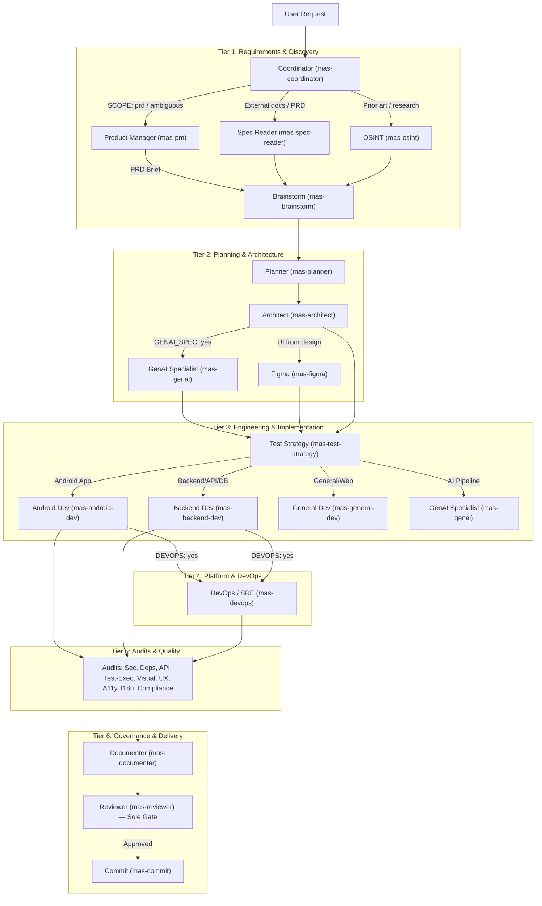

# OSINT Brief — MAS-11

## Research Mode

FEATURE

## Topic

GenAI specialist agent patterns and multi-agent roles for a complete product engineering team

## Scope

Multi-agent system patterns for modern product engineering, including:
1. **GenAI Specialist Agent (`mas-genai`)**: Prompt engineering (few-shot, CoT, structured output JSON schemas), RAG architectures (chunking, hybrid retrieval BM25+vector, rerankers), tool/function calling protocols, model gateways/routers (LiteLLM, Langfuse), token optimization (Anthropic/Gemini prompt caching, context budgets), automated evaluation harnesses (promptfoo, DeepEval, Ragas), safety guardrails (NeMo, Llama Guard, OWASP LLM Top 10), and on-device SLMs (Google MediaPipe LLM Inference API, Gemma 2/3 on Android/edge, AICore/LiteRT) vs server-side LLMs (Vertex AI, Claude, GPT-4o).
2. **Complete Product Engineering Multi-Agent Topologies**: Filling the organizational lifecycle gaps across Product Management (`mas-pm`), System Architecture (`mas-architect`), Mobile/Frontend (`mas-android-dev`, `mas-general-dev`), Backend/Cloud/DB (`mas-backend-dev`), DevOps/SRE/Platform (`mas-devops`), Quality/Audits (P0 audit quartet + P1 depth trio + test automation), and Release Governance.
3. **MAS Protocol & Coordinator Integration**: Zero-token routing predicates, handoff schema extensions, brief schemas, model policies, and chain invariants within `mas-cursor-framework`.

## Research Summary

Modern enterprise multi-agent systems (MetaGPT, AutoGen, CrewAI, LangGraph) have established that shifting from isolated coding scripts to a full product engineering organization requires structured Standard Operating Procedures (SOPs), specialized role personas, and deterministic handoff artifacts rather than conversational chat loops. To upgrade the MAS Cursor Framework from a developer-focused assistant into a comprehensive, enterprise-grade **Product Engineering Team**, this research establishes two major pillars:
1. **A dedicated GenAI Specialist (`mas-genai`)**: Governs the specialized discipline of AI engineering — bridging mobile edge intelligence (Gemma on-device via Google MediaPipe LLM Inference API and LiteRT) with cloud model gateways (LiteLLM, Langfuse observability, Anthropic/Gemini prompt caching). It standardizes strict tool-calling schemas, hybrid RAG retrieval pipelines, multi-layer safety guardrails (OWASP LLM Top 10), and automated evaluation harnesses (DeepEval RAG triad, promptfoo CI/CD matrices) to eliminate silent semantic regressions.
2. **Four missing organizational roles to complete the SDLC team**:
   - **Product Manager (`mas-pm`)**: Authors PRDs, user stories, acceptance criteria (Given/When/Then), and scope boundaries from ambiguous product requests (complements `mas-spec-reader` which only reads external specs).
   - **Backend / Cloud Developer (`mas-backend-dev`)**: Implements database schemas, ORM migrations, REST/gRPC/GraphQL services, auth, and cloud serverless/microservice infrastructure.
   - **DevOps / Platform Engineer (`mas-devops`)**: Manages CI/CD workflows (GitHub Actions), Docker containerization, Kubernetes, Terraform IaC, and deployment environments.
   - **GenAI Specialist (`mas-genai`)**: Dedicated AI architecture and implementation partner.

Combined with the existing MAS audit quartet (security, supply-chain, api-contract, test-executor) and review gates, these additions transform MAS into a full-lifecycle autonomous software engineering organization.

## Sources Consulted

| # | Source | Tier | Date | Version | Notes |
|---|--------|------|------|---------|-------|
| 1 | [Google AI Edge / MediaPipe LLM Inference API](https://developers.google.com/mediapipe/solutions/genai/llm_inference) | official | 2024-2025 | Tasks GenAI 0.10+ | Android on-device Gemma-2B/3B deployment, quantization, Coroutines Flow streaming |
| 2 | [Anthropic — Building Effective Agents & Prompt Engineering](https://www.anthropic.com/research/building-effective-agents) | official | 2024-2025 | Claude 3.5/3.7 | ReAct vs Plan-and-Solve, structured tool calling, prompt caching token savings |
| 3 | [LiteLLM & Langfuse Architecture Standard](https://litellm.ai / https://langfuse.com) | maintained OSS | 2024-2025 | v1.5+ | Model gateway proxy, fallback cascades, budget caps, OTLP observability traces |
| 4 | [DeepEval & promptfoo CI/CD Evaluation Frameworks](https://github.com/confident-ai/deepeval / https://promptfoo.dev) | maintained OSS | 2024-2025 | Latest | RAG Triad (faithfulness, relevancy), LLM-as-a-judge regression testing in CI |
| 5 | [MetaGPT: Meta Programming for A Multi-Agent Collaborative Framework](https://arxiv.org/abs/2308.00352) | official / academic | 2024 | ICLR 2024 | `Code = SOP (Team)`: Role assembly line (PM -> Architect -> PMgr -> Engineer -> QA) |
| 6 | [CrewAI & LangGraph Multi-Agent Topologies](https://docs.crewai.com / https://langchain-ai.github.io/langgraph/) | maintained OSS | 2024-2025 | Latest | Hierarchical manager vs deterministic state-machine graphs, human-in-the-loop |
| 7 | [OWASP Top 10 for Large Language Model Applications](https://owasp.org/www-project-top-10-for-large-language-model-applications/) | official | 2025 | v2.0 | Prompt injection, insecure output handling, sensitive information disclosure |
| 8 | [Google Cloud Vertex AI GenAI SDK & Agent Builder](https://cloud.google.com/vertex-ai/docs) | official | 2024-2025 | SDK v1.0+ | Enterprise RAG grounding, Search & Conversation, multi-turn tool calling |
| 9 | Local MAS Seed: `skills/multi-agent-system/`, `skills/mas-coordinator/`, `brief-schemas.md` | local seed | 2026-03 | MAS v1.5.0 | Deterministic routing predicates, brief schemas, spawn model policy, review gates |

## Findings

| # | Source | Context | Pattern/Fix | Tradeoffs | Applicability | Recommendation | Confidence |
|---|--------|---------|-------------|-----------|---------------|----------------|------------|
| 1 | 2, 8, 9 | AI features suffer from prompt fragility, unconstrained context, and hallucinated tool calls | **`mas-genai` Architecture & Spec Pattern:** Dedicated GenAI specialist producing `.ai/context/genai/{TASK_ID}.md` (`genai-spec`). Standardizes system prompts with XML tag boundaries, few-shot exemplar blocks, strict JSON Schema tool definitions, hybrid RAG retrieval contracts (chunking, BM25+vector, rerank), and token budgeting. | Adds a formal specification hop in planning; requires maintaining prompt/schema contracts | Core foundation for all AI feature work in MAS; fits pre-dev or alongside architect | **adopt** | HIGH |
| 2 | 1, 8 | Mobile apps require low latency, offline functionality, and strict privacy without prohibitive API costs | **Dual-Tier Hybrid Routing (On-Device SLM vs Cloud Gateway):** Tier 1: Local on-device SLMs (Gemma 2B/3B, Phi-3, Gemini Nano via MediaPipe LLM Inference API / LiteRT) with INT4 quantization, background coroutine dispatching, and Kotlin Coroutine Flow token streaming to Jetpack Compose for privacy/latency-critical tasks; Tier 2: Cloud LLMs (Gemini Pro, Claude, GPT-4o via API gateway) for complex reasoning and large context. | Mobile requires device RAM budgeting (4-8GB min RAM, ~1.5-2.5GB model footprint) and memory-bandwidth tuning during decode; cloud introduces latency & cost | Essential for MAS's deep Android root (`mas-android-dev`, `android-veteran-standards.md`) and cross-platform stacks | **adopt** | HIGH |
| 3 | 3, 2 | Multi-model applications face vendor lock-in, API rate limits (HTTP 429), unmonitored spend, and lack of traceability | **Unified Model Gateway, Observability & Prompt Caching:** Standardize application AI access through an abstraction proxy (LiteLLM pattern) supporting automatic fallback cascades (e.g., primary $\rightarrow$ fallback on 429/500), unified OpenAI-compatible schemas, and token spend caps. Feed traces to an observability platform (Langfuse pattern). Mandate static prompt prefix caching (Anthropic/Gemini) to slash repeated token costs up to 80%. | Adds proxy layer and trace infrastructure (~10-20ms hop); requires API key and proxy endpoint configuration | Informs both software built by MAS and internal MAS token auditing (`mas-token-auditor`) | **adopt** | HIGH |
| 4 | 4, 7 | LLM features regress silently without breaking syntax or JUnit tests; vulnerable to prompt injections and hallucinations | **Dual-Tier AI Quality Gate (Evals + Multi-Layer Guardrails):** 1) CI/CD Evaluation Harness (`promptfoo` config matrix for deterministic assertions and red-teaming; `DeepEval` / Ragas for RAG metrics: faithfulness, answer relevance, context recall, hallucination score); 2) Dual Runtime Guardrails: Input Guardrail (prompt injection / jailbreak regex and classifier, PII masking) and Output Guardrail (JSON Schema validator, hallucination / grounding check). | LLM-as-a-judge adds evaluation token cost in CI; guardrail checks add slight runtime latency | Bridges `mas-genai` directly to `mas-test-strategy`, `mas-test-executor`, and `mas-reviewer` | **adopt** | HIGH |
| 5 | 5, 6, 9 | Full software product development requires requirements scoping, cloud/backend services, and CI/CD platform engineering beyond mobile/frontend | **Full Product Engineering Topology (6-Tier SDLC Assembly Line):** Expand MAS roster to cover the complete product team: 1) Requirements: `mas-pm` (PRD authoring & acceptance criteria); 2) Architecture: `mas-architect` + `mas-genai`; 3) Engineering: `mas-android-dev` (mobile), `mas-backend-dev` (DB, REST/gRPC/GraphQL, auth), `mas-general-dev`; 4) Platform: `mas-devops` (CI/CD, Docker, Kubernetes, Terraform IaC); 5) Quality/Audits: P0 quartet + P1 trio + design gates; 6) Governance: `mas-reviewer` sole gate. | Expanding roster requires deterministic zero-token coordinator predicates to avoid token bloat and ensure clear ownership boundaries | Delivers a complete, enterprise-ready multi-agent product engineering organization | **adapt** | HIGH |

## Recommended Approach

Synthesize the findings into the MAS multi-agent architecture as a **Two-Pronged Evolution**:
1. **The GenAI Specialist (`mas-genai`)**: A dedicated specialist for AI system design, prompt engineering, RAG pipelines, on-device SLM integration, and AI evaluation/guardrail architectures.
2. **The Product Engineering Team Expansion**: Adding three complementary specialists — Product Manager (`mas-pm`), Backend Developer (`mas-backend-dev`), and DevOps/Platform Engineer (`mas-devops`) — seamlessly integrated into Coordinator routing, handoff protocols, and brief registries.

### Detailed Agent Profiles & Contracts

#### 1. GenAI Specialist (`mas-genai`)
- **Mission**: Architect, configure, optimize, and validate all Generative AI, LLM, and on-device SLM capabilities.
- **Skill Path**: `skills/mas-genai/SKILL.md`
- **Brief Deliverable**: `.ai/context/genai/{TASK_ID}.md` (`genai-spec`)
- **Required Brief Sections**:
  1. *Model Selection & Routing Strategy* (On-device SLM vs Cloud LLM, gateway configuration, fallback chain)
  2. *Prompt Architecture* (System instruction, XML delimiters, role definitions, few-shot exemplar blocks)
  3. *Structured Output & Tool Schemas* (Strict JSON Schema contracts for function calls, response formatting)
  4. *RAG & Context Architecture* (Chunking strategy, embedding model, hybrid search BM25+vector, reranker, context window budget, prompt caching)
  5. *On-Device SLM Spec (Conditional)* (MediaPipe LLM Inference options, quantization INT4/INT8, Coroutines Flow streaming, memory footprint)
  6. *Safety Guardrails & OWASP Defenses* (Input sanitization, prompt injection defense, PII masking, output validator)
  7. *Evaluation & Quality Metrics* (DeepEval/Ragas metric targets: faithfulness, relevancy; promptfoo test matrix)
- **Coordinator Predicate (`P0-GENAI`)**:
  - `GENAI_SPEC: yes` OR `SCOPE: genai` OR `FILES` touch prompt templates, LLM client code, vector DBs, MediaPipe tasks-genai, or LiteLLM configs OR keywords in `SCOPE` (`llm`, `rag`, `gemma`, `mediapipe`, `prompt`, `embedding`, `langchain`, `langgraph`, `openai`, `vertexai`).
  - Position: After `mas-architect`, before `mas-test-strategy` (design-time specification); or in the dev slot for direct implementation of AI pipelines.
- **Default MODEL_CLASS**: `thinking` for architecture/spec; `normal` for pipeline implementation.

#### 2. Product Manager (`mas-pm`)
- **Mission**: Transform high-level, ambiguous user intent into structured Product Requirements Documents (PRDs), user stories with Given/When/Then acceptance criteria, persona definitions, and explicit out-of-scope boundaries.
- **Skill Path**: `skills/mas-pm/SKILL.md`
- **Brief Deliverable**: `.ai/context/prds/{TASK_ID}.md` (`prd`)
- **Required Brief Sections**:
  1. *Problem Statement & Value Proposition*
  2. *Target Personas & User Journeys*
  3. *Functional Requirements & User Stories* (with Gherkin-style Given/When/Then acceptance criteria)
  4. *Non-Functional Requirements* (performance budgets, latency, compliance, platform constraints)
  5. *Scope & Out-of-Scope Boundaries* (explicit MVP vs Phase 2 cuts)
  6. *Success Metrics & KPIs*
- **Coordinator Predicate (`P0-PM`)**:
  - `PRD_AUTH: yes` OR user request is greenfield/exploratory with high ambiguity (e.g. "build me an app that...", "create a feature for...") without an existing external spec.
  - Position: Very first agent in chain (pre-brainstorm, pre-planner).
- **Default MODEL_CLASS**: `normal` (or `thinking` for complex domain scoping).

#### 3. Backend & Cloud Developer (`mas-backend-dev`)
- **Mission**: Implement server-side business logic, database models/migrations, REST/gRPC/GraphQL APIs, authentication/authorization flows, and cloud integration.
- **Skill Path**: `skills/mas-backend-dev/SKILL.md`
- **Brief Deliverable**: Code implementation in workspace + standard Dev Done summary.
- **Required Standards**: Clean architecture, repository pattern, parameterized queries (SQL injection defense), idempotency on mutation endpoints, transactional consistency, environment secret decoupling.
- **Coordinator Predicate (`P-BACKEND`)**:
  - `BACKEND: yes` OR server-side files in `FILES` (Node, Python, Go, Java/Kotlin Spring/Ktor, SQL migrations, Prisma, Room DB migrations, Dockerfile for server) OR `SCOPE: backend`.
  - Position: Dev slot (can run alongside or sequentially with `mas-android-dev` in full-stack workflows).
- **Default MODEL_CLASS**: `normal`.

#### 4. DevOps & Platform Specialist (`mas-devops`)
- **Mission**: Create and maintain CI/CD pipelines, containerization (Docker, Compose), Kubernetes manifests, Infrastructure as Code (Terraform), environment configurations, secrets management, and automated release packaging.
- **Skill Path**: `skills/mas-devops/SKILL.md`
- **Brief Deliverable**: `.ai/context/devops/{TASK_ID}.md` or workspace infra configuration files (`.github/workflows/`, `Dockerfile`, `docker-compose.yml`, `terraform/`).
- **Required Brief Sections**:
  1. *Infrastructure & Deployment Topology*
  2. *CI/CD Pipeline Spec & Trigger Matrix*
  3. *Environment Variables & Secrets Contract*
  4. *Container & Runtime Specifications*
  5. *Verification Commands & Health Checks*
- **Coordinator Predicate (`P-DEVOPS`)**:
  - `DEVOPS: yes` OR `FILES` touch `.github/workflows/`, `Dockerfile`, `docker-compose.yml`, `*.tf`, k8s manifests OR `SCOPE: devops|ci-cd|infra`.
  - Position: Post-dev slot, pre-audits/release.
- **Default MODEL_CLASS**: `normal`.

## Recommended Fix Strategy

N/A (FEATURE mode — researching new architecture and agent roles).

## Priority Order

1. **Finding #1 & #2 (`mas-genai` Specialist + Dual On-Device/Cloud Pattern)** — High urgency: GenAI is the core requested capability; provides standard templates, MediaPipe Android patterns, and prompt/RAG contracts.
2. **Finding #5 (`mas-pm` Product Manager Role)** — High impact: Bridges raw user ideas into rigorous PRDs, preventing scope creep and downstream planning failures.
3. **Finding #5 (`mas-backend-dev` & `mas-devops` Roles)** — Completes the full product engineering lifecycle from database and cloud services to automated CI/CD and deployment.
4. **Finding #3 (Model Gateway & Observability Pattern)** — Standardizes LiteLLM / Langfuse / prompt caching patterns across applications and MAS token governance.
5. **Finding #4 (Evaluation Harnesses & Guardrails)** — Connects GenAI specifications with automated verification (`promptfoo`, `DeepEval`) in MAS test and review gates.

## Anti-Patterns Avoided

- **Free-Form Chat Delegation**: Avoiding open-ended chat rooms (AutoGen default) that suffer from drifting context, hallucination compounding, and runaway token consumption. MAS preserves strict, typed filesystem artifacts (briefs) with deterministic single-agent hops.
- **Hardcoding Prompts in Code Without Evals**: Never allowing prompts to be treated as opaque string literals without versioning, schema enforcement, and regression test harnesses.
- **Mobile Memory Overcommit**: Forbidding naive on-device LLM loading on Android without strict INT4 quantization, device RAM checks (minimum 4-8GB device RAM), and off-main-thread JNI callback marshalling.
- **Bypassing Reviewer Gate**: Ensuring no new specialist agent (`mas-genai`, `mas-pm`, `mas-backend-dev`, `mas-devops`) can bypass the central quality gate. `mas-reviewer` remains the sole `Approved: YES` authority.
- **Token Explosion from Over-Spawning**: Enforcing deterministic coordinator predicates so that specialists spawn only when their explicit trigger flags or file patterns match.

## Implementation Guidance

### Phase 1: Establish `mas-genai` Skill and Reference Architecture
1. Create `skills/mas-genai/SKILL.md` with:
   - System prompt authoring standard (XML tagging, role boundaries, markdown output schemas).
   - Tool calling JSON Schema standard.
   - On-device Android pattern reference: MediaPipe `tasks-genai` integration with Kotlin Coroutines Flow and Jetpack Compose.
   - Cloud model gateway and prompt caching reference (LiteLLM, Langfuse, Anthropic/Gemini caching).
   - Evaluation harness specification (`promptfoo` and `DeepEval` integration).
2. Register brief schema for `genai-spec` in `skills/multi-agent-system/protocol/brief-schemas.md` at path `.ai/context/genai/{TASK_ID}.md`.
3. Add `mas-genai` to `skills/mas-coordinator/SKILL.md` and `skills/multi-agent-system/SKILL.md` with predicate `P0-GENAI`.

### Phase 2: Add Complementary Product Engineering Roles
1. Create `skills/mas-pm/SKILL.md` + register `prd` brief at `.ai/context/prds/{TASK_ID}.md`.
2. Create `skills/mas-backend-dev/SKILL.md` (clean architecture backend standards, database migrations, REST/gRPC/GraphQL).
3. Create `skills/mas-devops/SKILL.md` + register `devops` brief at `.ai/context/devops/{TASK_ID}.md`.
4. Update `skills/multi-agent-system/protocol/spawn-model-policy.md` with model classes:
   - `mas-genai`: `thinking` (design) / `normal` (impl)
   - `mas-pm`: `normal`
   - `mas-backend-dev`: `normal`
   - `mas-devops`: `normal`
5. Update Coordinator deterministic routing predicates and chains.

### Phase 3: E2E Quality & Test Strategy Integration
1. Extend `mas-test-strategy` and `mas-test-executor` to support AI evaluation test commands (`promptfoo eval`, `deepeval test run`).
2. Update `mas-reviewer` verification steps to check GenAI safety guardrails, schema validity, and prompt caching adherence when `genai-spec` is present.

## License / Copy Guardrails

- All architecture descriptions, schemas, and patterns are synthesized from official documentation, research papers, and public standards (Apache 2.0, MIT, Creative Commons).
- **No proprietary or closed-source code** has been or should be copied verbatim into briefs or project code.
- MediaPipe GenAI Tasks and LiteRT are licensed under Apache 2.0.
- DeepEval and promptfoo are MIT / Apache 2.0 licensed.
- Langfuse is open-source (MIT / FSL-1.1-MIT).
- All implementations must be clean-room written to adhere to the project's native architecture.

## Regression Notes

N/A (FEATURE mode — no prior daily-changelog regressions apply).

## Local Files Referenced

- `skills/multi-agent-system/SKILL.md`
- `skills/mas-coordinator/SKILL.md`
- `skills/multi-agent-system/protocol/brief-schemas.md`
- `skills/multi-agent-system/protocol/spawn-model-policy.md`
- `skills/multi-agent-system/protocol/subagent-spawn.md`
- `skills/multi-agent-system/protocol/subagent-role.md`
- `.ai/context/memory.md`
- `.ai/handoffs/MAS-11.md`

## Open Questions

1. **On-Device Model Packaging**: Should Android applications download model weights (`.bin` / `.task`) dynamically on first launch via a download manager / WorkManager, or bundle them in test assets for development builds? (Recommended: Assets for local debug/CI; dynamic download from CDN for production APKs due to 1.5GB+ download size).
2. **Evaluation Harness in Local CI**: Should `promptfoo` or `DeepEval` run as a JVM/Gradle task via an exec plugin, or as a standalone CLI step invoked by `mas-test-executor`?
3. **Execution Mode for `mas-genai`**: Should `mas-genai` act primarily as an advisory architect producing `genai-spec` before `android-dev` / `backend-dev` code, or should it also directly implement AI code? (Recommended: Dual mode — produces `genai-spec` when in planning/architecture, or implements AI modules directly when assigned in the dev slot).

## Overall Confidence

HIGH — Multiple authoritative sources (Google AI Edge/MediaPipe documentation, Anthropic Agent guidelines, MetaGPT ICLR 2024 paper, LiteLLM/Langfuse production architectures, DeepEval/promptfoo specifications, and existing MAS v1.5.0 protocol) independently confirm the architecture, role divisions, and integration patterns.
