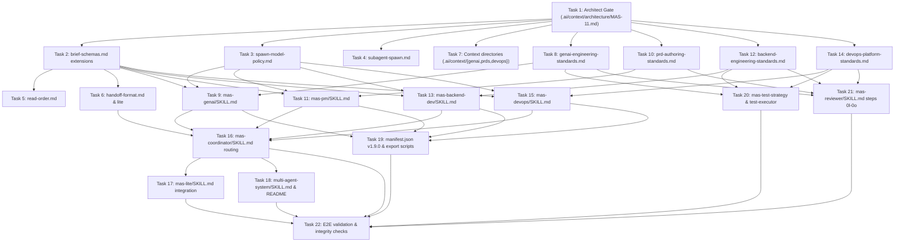

# Plan Brief — MAS-11

## Plan

Goal:
Implement **Option 2 — Modular 4-Specialist SDLC Assembly Line with Dedicated Brief Schemas and Zero-Token Coordinator Routing** (per `.ai/context/brainstorms/MAS-11.md` and `.ai/context/osint/MAS-11.md`): introduce four dedicated specialist skills to transform MAS into an autonomous Full Product Engineering Organization:
1. `mas-genai`: Dedicated GenAI specialist operating in dual modes — Design Mode emitting `genai-spec` briefs and Dev Mode implementing prompt architectures, structured JSON tool schemas, hybrid RAG retrieval, model gateways (LiteLLM/Langfuse), prompt caching, on-device SLMs (Google MediaPipe Tasks GenAI, Gemma 2B/3B, LiteRT on Android), OWASP LLM guardrails, and automated evaluation harnesses (`promptfoo`, `DeepEval`).
2. `mas-pm`: Product Manager specialist transforming ambiguous user goals into structured `prd` briefs containing user journeys, prioritized Gherkin Given/When/Then user stories, acceptance criteria, non-functional latency/offline budgets, strict MVP vs Phase 2 scope boundaries, and measurable KPIs.
3. `mas-backend-dev`: Backend & Cloud Developer implementing database migrations (Flyway, Prisma, Room), repository patterns with parameterized queries, domain business logic, REST/gRPC/GraphQL endpoints, authentication/authorization (JWT, OAuth2, RBAC), and cloud serverless logic at enterprise clean-architecture standards.
4. `mas-devops`: DevOps & Platform Engineer authoring multi-stage Dockerfiles (least-privilege non-root execution), GitHub Actions CI/CD workflows, Terraform Infrastructure as Code (IaC), environment configuration contracts, and emitting structured `devops` briefs.

Alongside:
- Three typed brief schemas (`genai-spec`, `prd`, `devops`) and filesystem directories (`.ai/context/genai/`, `.ai/context/prds/`, `.ai/context/devops/`).
- Zero-token Coordinator routing predicates (`P0-PM`, `P0-GENAI` Design/Dev, `P-BACKEND`, `P-DEVOPS`) preserving `mas-reviewer` as the sole gate.
- Model resolution policies in `spawn-model-policy.md` (`mas-genai` Design: `thinking`, Dev: `normal`; `mas-pm`: `normal`; `mas-backend-dev`: `normal`; `mas-devops`: `normal`).
- Subagent spawn registration in `subagent-spawn.md` with Task tool invocation mapping.
- Context read subscription matrix in `read-order.md`.
- Handoff formats and lite abbreviations (`GEN:y`, `PM:y`, `BE:y`, `OPS:y`) in `handoff-format.md` and `handoff-format-lite.md`.
- Lite mode tier table integration in `mas-lite/SKILL.md`.
- Reference engineering standards (`genai-engineering-standards.md`, `prd-authoring-standards.md`, `backend-engineering-standards.md`, `devops-platform-standards.md`).
- Reviewer verification steps (0l, 0m, 0n, 0o) and test strategy / test executor evaluation alignment.
- Framework manifest registration (`manifest.json` bumping to `1.9.0`) and export script updates.
- **Logic-only** — no mobile UI layouts or Compose presentation components altered; framework protocols, skills, and references only.

**Resolved Open Questions (D1–D4):**

| ID | Decision | Rationale |
|---|----------|-----------|
| **D1** | **Single `mas-genai` skill with dual execution modes** (Design Mode vs Dev Mode) | Follows precedent of `mas-spec-reader` and `mas-figma` to avoid slug proliferation while preserving clean lifecycle separation. Design Mode produces `genai-spec` (`MODEL_CLASS: thinking`); Dev Mode writes code and eval scripts (`MODEL_CLASS: normal`). |
| **D2** | **On-Device Model Asset Distribution during Development & Production** | Local dev and CI use pre-seeded test fixtures or ADB emulator pushes; production releases mandate background download via Android `WorkManager` with WiFi-only constraints and a pre-flight device RAM check ($\ge 6\text{ GB}$). Release APKs must never bundle multi-gigabyte raw weights. |
| **D3** | **Multi-Stack Backend Engineering Standards** | Standardize multi-stack reference architectures in `backend-engineering-standards.md`: Ktor / Spring Boot for Kotlin-first stacks, FastAPI / Python for AI-first backends, and Node / TypeScript / Prisma for full-stack BFFs. |
| **D4** | **DevOps Platform Tooling & Dry-Run Validation** | `mas-devops` executes dry-run syntax and lint validations (`docker build --check`, `terraform validate`, `actionlint`) during its platform pass; `mas-test-executor` executes integration test suites in CI. |

**Version Target:** `1.9.0` (new functional specialists + brief types; semver bump in `manifest.json`).

**NEXT_AGENT:** `architect`

---

Tasks:

### Phase 0 — Architect Gate (Pre-Implementation)

1. **Architect confirms multi-agent SDLC topology, routing predicates, and verification gates**
   - **Description:** Formulate the formal architecture specification for the 6-tier SDLC assembly line, defining the exact chain positions, priority predicates (`P0-PM`, `P0-GENAI`, `P-BACKEND`, `P-DEVOPS`), dual-mode `mas-genai` lifecycle (post-architect design vs dev slot implementation), token-cap overflow policy (`MAX_CHAIN_AGENTS = 12`), and Reviewer verification steps (0l–0o).
   - **Files:** `.ai/context/architecture/MAS-11.md` (new)
   - **Dependencies:** None (builds on `.ai/context/brainstorms/MAS-11.md` and `.ai/context/plans/MAS-11.md`)
   - **Acceptance Criteria:** Architecture brief documents:
     - 6-tier assembly line diagram and contract matrix.
     - Dual-mode `mas-genai` execution lifecycle and triggers.
     - Predicate table for `P0-PM`, `P0-GENAI`, `P-BACKEND`, `P-DEVOPS` with deterministic zero-token evaluation logic.
     - Token-cap overflow protection order: core functional specialists protected when triggered; advisory audit specialists skipped first per `token-rules.md`.
     - Reviewer verification steps (0l, 0m, 0n, 0o) maintaining `mas-reviewer` as the sole merge gate.
     - Resolves architectural decisions D1–D4.

---

### Phase 1 — Protocol & Schema Foundation (Shared Registry & Contracts)

2. **Extend `brief-schemas.md` with `genai-spec`, `prd`, and `devops` schemas**
   - **Description:** Register the three new brief types in the schema registry table with required markdown headings and path patterns.
   - **Files:** `skills/multi-agent-system/protocol/brief-schemas.md`
   - **Dependencies:** Task 1
   - **Acceptance Criteria:**
     - Registry table includes:
       - `genai-spec` at `.ai/context/genai/{TASK_ID}.md` (Required sections: Model Selection & Routing Strategy, Prompt Architecture, Structured Output & Tool Schemas, RAG & Context Architecture, On-Device SLM Spec, Safety Guardrails & OWASP Defenses, Evaluation & Quality Metrics).
       - `prd` at `.ai/context/prds/{TASK_ID}.md` (Required sections: Problem Statement & Value Proposition, Target Personas & User Journeys, Functional Requirements & User Stories, Non-Functional Requirements, Scope & Out-of-Scope Boundaries, Success Metrics & KPIs).
       - `devops` at `.ai/context/devops/{TASK_ID}.md` (Required sections: Infrastructure & Deployment Topology, CI/CD Pipeline Spec & Trigger Matrix, Environment Variables & Secrets Contract, Container & Runtime Specifications, Verification Commands & Health Checks).
     - Brief writer and Reviewer validation guidance tables updated.

3. **Extend `spawn-model-policy.md` for new specialist roles**
   - **Description:** Map the new specialist slugs to their designated `MODEL_CLASS` and Cursor Task `model` hints, defining explicit escalation triggers.
   - **Files:** `skills/multi-agent-system/protocol/spawn-model-policy.md`
   - **Dependencies:** Task 1
   - **Acceptance Criteria:**
     - Default map table updated with:
       - `mas-genai` (Design Mode) $\rightarrow$ `thinking` (`claude-opus-4-7-thinking-high` or thinking-high family).
       - `mas-genai` (Dev Mode) $\rightarrow$ `normal` (default / `composer-2.5`).
       - `mas-pm` $\rightarrow$ `normal` (default / `composer-2.5`; escalate to `thinking` for multi-system enterprise PRDs).
       - `mas-backend-dev` $\rightarrow$ `normal` (default / `composer-2.5`).
       - `mas-devops` $\rightarrow$ `normal` (default / `composer-2.5`).
     - Notes on dual-mode resolution and Lite `MC:` cross-references included.

4. **Extend `subagent-spawn.md` with new specialist slugs and spawn templates**
   - **Description:** Add `mas-genai`, `mas-pm`, `mas-backend-dev`, and `mas-devops` to the agent slug table, pointing to their respective skill folders.
   - **Files:** `skills/multi-agent-system/protocol/subagent-spawn.md`
   - **Dependencies:** Task 1
   - **Acceptance Criteria:**
     - Agent slug $\rightarrow$ skill path table contains all four new specialists (`~/.cursor/skills/mas-{slug}/SKILL.md`).
     - Mandatory parameters preserved: `generalPurpose`, `run_in_background: false`, self-contained prompt, wait for `DONE`.

5. **Extend `read-order.md` subscription matrix for new specialists**
   - **Description:** Update the context read subscription matrix for `{TASK_ID}` briefs, defining startup reading requirements for the new specialists and downstream consumers.
   - **Files:** `skills/multi-agent-system/protocol/read-order.md`
   - **Dependencies:** Task 2
   - **Acceptance Criteria:**
     - Subscription table updated:
       - `mas-pm`: reads `osint/{TASK_ID}.md` (if exists), `specs/{TASK_ID}.md` (if exists), user request.
       - `mas-brainstorm`: adds `prds/{TASK_ID}.md` to startup read order.
       - `mas-planner`: adds `prds/{TASK_ID}.md` to startup read order.
       - `mas-architect`: adds `prds/{TASK_ID}.md` to startup read order.
       - `mas-genai` (Design): reads architecture, plans, and prds for `{TASK_ID}`.
       - `mas-genai` (Dev): reads genai-spec, architecture, plans, and test-strategies for `{TASK_ID}`.
       - `mas-backend-dev`: reads plans, architecture, genai-spec, api-contracts, and test-strategies for `{TASK_ID}`.
       - `mas-devops`: reads plans, architecture, devops briefs, and changed application `FILES`.
       - `mas-reviewer`: adds `genai/{TASK_ID}.md`, `prds/{TASK_ID}.md`, `devops/{TASK_ID}.md` to conditional startup reads.

6. **Extend `handoff-format.md` and `handoff-format-lite.md` with routing flags and abbreviations**
   - **Description:** Add handoff templates, routing flags, and Lite abbreviations for the new specialists, preserving the 12-line cap in Lite mode.
   - **Files:** `skills/multi-agent-system/protocol/handoff-format.md`, `skills/multi-agent-system/protocol/handoff-format-lite.md`
   - **Dependencies:** Task 1, Task 2
   - **Acceptance Criteria:**
     - `handoff-format.md` registers optional flags: `PRD_AUTH: yes`, `GENAI_SPEC: yes`, `BACKEND: yes`, `DEVOPS: yes`, `EVAL_SUITE: yes`.
     - `handoff-format-lite.md` registers Lite abbreviations: `PM:y`, `GEN:y`, `BE:y`, `OPS:y`.
     - `TARGET_AGENT` enum updated in both full and lite handoff templates.
     - Lite 12-line cap and disambiguation rules preserved.

7. **Create deliverable context directories**
   - **Description:** Create filesystem directories and `.gitkeep` markers for the new brief types.
   - **Files:** `.ai/context/genai/.gitkeep`, `.ai/context/prds/.gitkeep`, `.ai/context/devops/.gitkeep`
   - **Dependencies:** None
   - **Acceptance Criteria:** Directories exist in the project filesystem and are tracked.

---

### Phase 2 — GenAI Specialist Core (`mas-genai`)

8. **Author GenAI engineering reference standards**
   - **Description:** Create comprehensive reference standards for GenAI engineering covering prompt engineering architectures (XML tagging, few-shot exemplars, role boundaries), strict JSON Schema tool definitions, hybrid RAG retrieval contracts (chunking, BM25+vector, reranking), model gateway patterns (LiteLLM fallback cascades, Langfuse observability), prompt caching headers (Anthropic/Gemini KV-cache reuse), on-device SLMs (Google MediaPipe Tasks GenAI, Gemma 2B/3B INT4, Kotlin Coroutine Flow token streaming, device RAM guards $\ge 6\text{ GB}$), OWASP LLM Top 10 defenses, and CI/CD evaluation harnesses (`promptfoo`, `DeepEval` RAG triad).
   - **Files:** `skills/multi-agent-system/references/genai-engineering-standards.md` (new)
   - **Dependencies:** Task 1
   - **Acceptance Criteria:** Standard document covers:
     - Prompt hierarchy with standard XML delimiter tags (`<context>`, `<system_instructions>`, `<constraints>`, `<tools>`, `<output_schema>`).
     - JSON Schema tool-calling specifications (`additionalProperties: false`, required fields).
     - Android on-device SLM architecture: MediaPipe Tasks GenAI `0.10.20+`, INT4 quantization, `ActivityManager.MemoryInfo.totalMem >= 6GB` guard, `Dispatchers.IO` background execution, Flow token streaming.
     - Cloud Gateway: LiteLLM proxy, fallback cascades, Langfuse OTLP tracing, static prompt prefix caching ($\ge 1024$ tokens for Claude, $\ge 32\text{k}$ for Gemini).
     - OWASP LLM Top 10 defense: input XML sanitization, prompt injection regex/classifiers, JSON Schema output validation.
     - Eval metrics: DeepEval RAG triad (Faithfulness $\ge 0.85$, Answer Relevancy $\ge 0.85$, Context Recall $\ge 0.80$, Hallucination $\le 0.10$) and `promptfoo` assertions.

9. **Author `mas-genai` specialist skill**
   - **Description:** Create the `mas-genai` skill file detailing responsibilities, dual execution modes (Design Mode vs Dev Mode), startup sequence, Degrade-Gracefully matrix, and exact output templates.
   - **Files:** `skills/mas-genai/SKILL.md` (new)
   - **Dependencies:** Task 2, Task 3, Task 8
   - **Acceptance Criteria:** Skill file includes:
     - Frontmatter with `disable-model-invocation: true` and comprehensive description.
     - Responsibilities for Design Mode (emits `genai-spec` brief, does not write production code) and Dev Mode (implements SDKs, models, gateways, and evals).
     - Forbidden actions: no Task spawning, no Coordinator routing, no bypassing review gate, no packaging unquantized weights in release APKs.
     - Startup reading sequence per `read-order.md`.
     - Degrade-gracefully handling for: low device RAM (< 6GB fallback to cloud), missing API keys, rate limits (HTTP 429), and eval harness failures.
     - Exact output templates for full `/mas` and `/mas-lite`.

---

### Phase 3 — Product Management Specialist (`mas-pm`)

10. **Author PRD authoring reference standards**
    - **Description:** Create reference standards for transforming ambiguous, high-level product goals into enterprise-grade PRDs with structured persona journey maps, prioritized user stories with Gherkin Given/When/Then acceptance criteria, non-functional requirements (latency, offline, cold starts), strict MVP vs Out-of-Scope boundaries, and measurable product KPIs.
    - **Files:** `skills/multi-agent-system/references/prd-authoring-standards.md` (new)
    - **Dependencies:** Task 1
    - **Acceptance Criteria:** Reference document covers:
      - Persona definition and journey mapping standards.
      - Gherkin syntax formatting for user story acceptance criteria:
        ```gherkin
        Scenario: <Description>
          Given <preconditions>
          When <action>
          Then <verifiable outcome>
          And <additional assertion>
        ```
      - NFR specifications (p95 latency, crash-free rates, offline caching).
      - Strict MVP scoping principles (P0 must-have vs P1/P2 deferred).
      - Measurable success metrics and telemetry events.

11. **Author `mas-pm` specialist skill**
    - **Description:** Create the `mas-pm` skill file defining responsibilities, requirements intake flow, startup sequence, scoping boundary enforcement, and output templates.
    - **Files:** `skills/mas-pm/SKILL.md` (new)
    - **Dependencies:** Task 2, Task 3, Task 10
    - **Acceptance Criteria:** Skill file includes:
      - Frontmatter with `disable-model-invocation: true`.
      - Responsibilities: framing problems, user personas, Gherkin acceptance criteria, NFRs, scope boundaries, emitting `.ai/context/prds/{TASK_ID}.md`.
      - Forbidden actions: never writes code, never spawns Task subagents, never issues review approvals.
      - Startup read order and graceful handling of ambiguous requests.
      - Output templates for full `/mas` and `/mas-lite`.

---

### Phase 4 — Full-Stack Backend & DevOps Specialists (`mas-backend-dev` & `mas-devops`)

12. **Author backend engineering reference standards**
    - **Description:** Create reference standards for backend services covering clean architecture layering (Domain $\leftrightarrow$ Repository $\leftrightarrow$ Data Source), versioned forward-only database migrations (Flyway, Prisma, Room), parameterized query requirements (zero raw SQL string interpolation), REST/gRPC/GraphQL API contracts, authentication/authorization patterns (JWT, OAuth2, RBAC), idempotency semantics (`Idempotency-Key` headers), and unit/integration testing standards.
    - **Files:** `skills/multi-agent-system/references/backend-engineering-standards.md` (new)
    - **Dependencies:** Task 1
    - **Acceptance Criteria:** Reference document covers:
      - Clean architecture module structure and dependency inversion rules.
      - Forward-only migration standards (no breaking schema changes in single deployment).
      - Parameterized query enforcement against SQL injection.
      - Input validation schemas (Zod, Pydantic, Kotlinx Serialization).
      - Idempotency guarantees for state-mutating endpoints.
      - Multi-stack examples: Ktor / Spring Boot, FastAPI, Node / TypeScript / Prisma.

13. **Author `mas-backend-dev` specialist skill**
    - **Description:** Create the `mas-backend-dev` skill file defining responsibilities, clean-architecture development workflow, database migration hygiene, testing requirements, and dev output templates.
    - **Files:** `skills/mas-backend-dev/SKILL.md` (new)
    - **Dependencies:** Task 2, Task 3, Task 12
    - **Acceptance Criteria:** Skill file includes:
      - Responsibilities: implementing server-side controllers, services, repositories, database migrations, and integration tests.
      - Forbidden actions: no Task spawning, no hardcoding secrets, no unparameterized SQL queries, no unversioned database mutations.
      - Build & test verification requirements before completing handoff.
      - Dev Done summary output format.

14. **Author DevOps and platform engineering reference standards**
    - **Description:** Create reference standards for platform engineering covering multi-stage containerization (builder stage $\rightarrow$ distroless/alpine runtime stage, non-root user `appuser:appgroup`), GitHub Actions CI/CD workflows (matrix testing, SHA-pinned action commits, security linting), Terraform Infrastructure as Code (modular structure, remote state locks, least privilege IAM), environment variable contracts (`.env.example`), and container health check endpoints (`/healthz`, `/readyz`).
    - **Files:** `skills/multi-agent-system/references/devops-platform-standards.md` (new)
    - **Dependencies:** Task 1
    - **Acceptance Criteria:** Reference document covers:
      - Multi-stage Dockerfile patterns with minimal attack surfaces and unprivileged execution.
      - CI/CD workflow security hygiene (pinned SHAs, least privilege `GITHUB_TOKEN` permissions).
      - Terraform formatting, validation, and state isolation standards.
      - Secrets injection contract (zero secrets in repo; runtime injection from secrets managers).
      - Health check and graceful shutdown contract.

15. **Author `mas-devops` specialist skill**
    - **Description:** Create the `mas-devops` skill file defining responsibilities, platform delivery workflow, dry-run validations, brief authoring (`devops` brief), and output templates.
    - **Files:** `skills/mas-devops/SKILL.md` (new)
    - **Dependencies:** Task 2, Task 3, Task 14
    - **Acceptance Criteria:** Skill file includes:
      - Responsibilities: authoring Dockerfiles, docker-compose fixtures, GitHub Actions workflows, Terraform IaC, and `.ai/context/devops/{TASK_ID}.md` briefs.
      - Dry-run validation commands (`docker build --check`, `terraform validate`, `hadolint`, `actionlint`).
      - Forbidden actions: no hardcoding secrets, no running containers as root, no Task spawning.
      - Output templates for full `/mas` and `/mas-lite`.

---

### Phase 5 — Coordinator Zero-Token Routing & Framework Integration

16. **Update `mas-coordinator/SKILL.md` with routing predicates and assembly line flows**
    - **Description:** Integrate the new specialists into the Coordinator routing logic with deterministic zero-token predicates, execution ordering invariants, handoff builders, and brief summarization.
    - **Files:** `skills/mas-coordinator/SKILL.md`
    - **Dependencies:** Task 2, Task 3, Task 4, Task 6, Task 9, Task 11, Task 13, Task 15
    - **Acceptance Criteria:** Coordinator skill updated with:
      - **P0-PM predicate:** `PRD_AUTH: yes` OR greenfield request with high ambiguity $\rightarrow$ routes to `mas-pm` as entry agent before `mas-brainstorm` / `mas-planner`.
      - **P0-GENAI (Design) predicate:** `GENAI_SPEC: yes` OR `SCOPE: genai` OR AI keywords $\rightarrow$ routes to `mas-genai` (Design Mode) after `mas-architect`, before `mas-test-strategy`.
      - **P-BACKEND predicate:** `BACKEND: yes` OR backend files in `FILES` OR backend scope $\rightarrow$ routes to `mas-backend-dev` in dev slot.
      - **P0-GENAI (Dev) predicate:** `TARGET_AGENT: mas-genai` on dev handoff OR AI engine implementation $\rightarrow$ routes to `mas-genai` (Dev Mode) in dev slot.
      - **P-DEVOPS predicate:** `DEVOPS: yes` OR infra files in `FILES` OR devops scope $\rightarrow$ routes to `mas-devops` post-dev, pre-audits.
      - Ordering invariants enforced: PM first, GenAI Design post-architect pre-test-strategy, DevOps post-dev pre-audits, Reviewer sole merge gate.
      - Handoff generation rules for all four agents with appropriate `MODEL_CLASS` and `BRIEF_PATH`.

17. **Update `mas-lite/SKILL.md` for Lite tier integration**
    - **Description:** Extend MAS Lite tier tables and chains to support single-discipline focus flags (`PM:y`, `GEN:y`, `BE:y`, `OPS:y`) within the strict subagent and token caps.
    - **Files:** `skills/mas-lite/SKILL.md`
    - **Dependencies:** Task 6, Task 16
    - **Acceptance Criteria:**
      - Tier table updated:
        - S-Tier: allows single-specialist passes (`mas-pm` for scoping only, `mas-devops` for infra tweaks only).
        - M-Tier: allows backend dev in dev slot (`BE:y`).
        - L-Tier: allows `mas-genai` (`GEN:y`) or `mas-devops` (`OPS:y`) within the 3-subagent cap.
        - L+-Tier: allows `mas-pm` (`PM:y`) preceding planner within the 4-subagent cap.
      - Multi-discipline escalation rule: if request requires multiple new specialists simultaneously, Coordinator recommends upgrading to full `/mas`.

18. **Update `multi-agent-system/SKILL.md` and framework overview**
    - **Description:** Update the main MAS manifest documentation to present the full product engineering organization, updating the specialist skills table, SDLC assembly line flow diagram, brief schemas, and routing flags.
    - **Files:** `skills/multi-agent-system/SKILL.md`, `README.md`
    - **Dependencies:** Task 16, Task 17
    - **Acceptance Criteria:**
      - Specialist skills table lists `mas-genai`, `mas-pm`, `mas-backend-dev`, and `mas-devops`.
      - Assembly line diagram reflects 6-tier organization.
      - Routing flags and brief path tables updated.

19. **Update framework manifest and export scripts**
    - **Description:** Register the four new skills in `manifest.json`, bump framework version to `1.9.0`, and update packaging scripts if necessary.
    - **Files:** `skills/multi-agent-system/install/manifest.json`, `skills/multi-agent-system/install/export-mas-framework.ps1`
    - **Dependencies:** Task 9, Task 11, Task 13, Task 15
    - **Acceptance Criteria:**
      - `manifest.json` version bumped to `"1.9.0"`.
      - `skills` array contains `"mas-genai"`, `"mas-pm"`, `"mas-backend-dev"`, and `"mas-devops"`.
      - Export script verified to include the new skill folders in framework bundles.

---

### Phase 6 — Quality Gates, Reviewer Verification & E2E Validation

20. **Update `mas-test-strategy` and `mas-test-executor` for AI evals and platform checks**
    - **Description:** Extend `mas-test-strategy` to plan evaluation test suites (`promptfoo` assertion matrices, `DeepEval` RAG triad benchmarks) and infrastructure test surfaces. Extend `mas-test-executor` to execute these commands and report results.
    - **Files:** `skills/mas-test-strategy/SKILL.md`, `skills/mas-test-executor/SKILL.md`
    - **Dependencies:** Task 8, Task 12, Task 14
    - **Acceptance Criteria:**
      - `mas-test-strategy`: plans RAG triad thresholds (Faithfulness $\ge 0.85$, etc.), tool-calling JSON schema tests, database migration tests, and container dry-runs.
      - `mas-test-executor`: executes `npx promptfoo eval`, `deepeval test run`, and infra verification commands, recording results in `.ai/context/test-runs/{TASK_ID}.md`.

21. **Update `mas-reviewer/SKILL.md` with product engineering verification steps**
    - **Description:** Add conditional verification steps (0l, 0m, 0n, 0o) to the Reviewer workflow for evaluating `genai-spec`, `prd`, backend clean architecture / migrations, and DevOps infra briefs.
    - **Files:** `skills/mas-reviewer/SKILL.md`
    - **Dependencies:** Task 2, Task 8, Task 10, Task 12, Task 14
    - **Acceptance Criteria:** Reviewer skill adds:
      - **Step 0l (GenAI Specification & Evaluation Verification):** verifies prompt XML tag hierarchy, JSON Schema tool specs, caching headers, on-device SLM RAM guards ($\ge 6\text{ GB}$), and eval scores against thresholds.
      - **Step 0m (PRD & Requirements Alignment Verification):** verifies that all Gherkin user stories have corresponding implementation and tests; verifies zero Out-of-Scope feature creep.
      - **Step 0n (Backend Clean Architecture & Migration Verification):** verifies clean repository/service boundaries, versioned forward-only migrations, parameterized SQL queries, idempotency headers, and auth checks.
      - **Step 0o (Platform & DevOps Infrastructure Verification):** verifies non-root Docker execution, pinned CI/CD action SHAs, secret redaction, and health check endpoints.
      - Preserves `mas-reviewer` as the sole authority issuing `Approved: YES | NO`.

22. **End-to-End framework validation & integrity verification**
    - **Description:** Perform syntax and schema validation across all modified and newly created skill files, reference standards, brief schemas, and manifest files. Verify that no broken links or missing headings exist.
    - **Files:** All modified and created files in Phases 1–6
    - **Dependencies:** Tasks 1–21
    - **Acceptance Criteria:**
      - All JSON files (`manifest.json`) validate with zero syntax errors.
      - All skill markdown frontmatter headers validate with required fields.
      - All heading structures conform exactly to `brief-schemas.md`.
      - Cross-references across skills, protocols, and references resolve cleanly.

---

## Dependencies:



---

## Risks:

| # | Risk | Impact | Severity | Mitigation Strategy |
|---|------|--------|----------|---------------------|
| 1 | **Workflow latency & token budget cap breach (`MAX_CHAIN_AGENTS = 12`)** | Chain terminates prematurely or drops crucial gates. | High | Enforce deterministic zero-token predicate filtering (`P0-PM`, `P0-GENAI`, `P-BACKEND`, `P-DEVOPS`) so only relevant specialists spawn. Preserve token overflow skip order: advisory audit specialists skip first per `token-rules.md`; core functional specialists are protected when their explicit predicates fire. |
| 2 | **Android on-device SLM RAM exhaustion (LMK kill)** | Application crashes on low-memory Android devices when initializing Gemma 2B/3B. | High | `mas-genai` mandates explicit runtime device RAM checks (`ActivityManager.MemoryInfo.totalMem >= 6GB`) before model loading; automatically falls back to cloud API gateway on lower-memory devices. |
| 3 | **Cloud LLM API rate limits (HTTP 429) & provider downtime** | AI features fail intermittently during execution. | Medium | Reference standards require LiteLLM fallback cascades (e.g., Claude 3.7 $\rightarrow$ Gemini 2.5 Pro) with exponential backoff and jitter. |
| 4 | **Silent semantic regression in AI features** | Code compiles and tests pass, but LLM output hallucinates or violates JSON schema. | High | `mas-test-strategy` and `mas-test-executor` enforce automated `promptfoo` assertions and `DeepEval` RAG triad metric thresholds (Faithfulness $\ge 0.85$, Relevancy $\ge 0.85$, Recall $\ge 0.80$) in CI. |
| 5 | **API contract drift between backend services and mobile clients** | Mobile app crashes or breaks due to unversioned backend payload changes. | High | `mas-backend-dev` enforces OpenAPI / Proto schemas as single source of truth; `mas-api-contract` runs to verify zero breaking drift. |
| 6 | **Lite mode 12-line handoff cap overflow** | Complex multi-discipline prompts truncate or fail in Lite mode. | Medium | Enforce single-discipline focus in Lite mode (`GEN:y`, `PM:y`, `BE:y`, or `OPS:y`); if multiple disciplines required simultaneously, Coordinator instructs user to run full `/mas`. |
| 7 | **Container build failures in non-Docker host environments** | CI/CD or platform tests fail on developer machines without container daemons. | Low | DevOps standards mandate dry-run validation (`docker build --check`, `terraform validate`, `hadolint`) that does not require active host container runtime. |

---

## Build & Test Plan:

- **Gradle Modules:** `N/A — logic-only` (no Gradle builds or Android compilation units modified; target changes are framework skills, references, protocols, and schemas).
- **Test Surfaces & Verification Commands:**
  - **Manifest Integrity Test:** Validate JSON syntax and skill registry completeness in `skills/multi-agent-system/install/manifest.json`:
    ```powershell
    Get-Content skills\multi-agent-system\install\manifest.json | ConvertFrom-Json
    ```
  - **Skill Frontmatter & Heading Linting:** Verify that all newly created and updated `SKILL.md` files have valid YAML frontmatter and standard sections:
    - `skills/mas-genai/SKILL.md`
    - `skills/mas-pm/SKILL.md`
    - `skills/mas-backend-dev/SKILL.md`
    - `skills/mas-devops/SKILL.md`
  - **Schema Alignment Verification:** Verify that the required headings in `brief-schemas.md` match the output templates of `mas-genai` (`genai-spec`), `mas-pm` (`prd`), and `mas-devops` (`devops`).
  - **Export Script Dry-Run:** Execute `export-mas-framework.ps1` in dry-run/test mode to confirm all 4 new skill directories are bundled into export archives:
    ```powershell
    Test-Path skills\mas-genai, skills\mas-pm, skills\mas-backend-dev, skills\mas-devops
    ```
  - **Reviewer Audit Verification:** Reviewer will execute Step 0l (GenAI), Step 0m (PRD), Step 0n (Backend), and Step 0o (DevOps) verification procedures on deliverable briefs.

---

## Visual QA Scenarios:

`N/A — logic-only` (Framework architecture, specialist skills, reference standards, brief schemas, and coordinator protocols only; no UI layouts, Jetpack Compose screens, or presentation styling modified).

---

## Required Agents:

1. **`architect`**: Authors `.ai/context/architecture/MAS-11.md` establishing the 6-tier assembly line topology, predicate priority, and Reviewer verification contracts.
2. **`general-dev`**: Implements Phase 1–5 files: skill instructions, reference standards, brief schemas, coordinator routing predicates, spawn model policies, and manifest updates.
3. **`test-strategy`**: Reviews and refines the test plan for eval harnesses (`promptfoo`, `DeepEval`) and backend/devops verification surfaces.
4. **`documenter`**: Synchronizes in-code documentation and updates `README.md` and `multi-agent-system/SKILL.md` with the new product engineering capabilities.
5. **`reviewer`**: Final quality and protocol gate; verifies that all brief schemas, routing rules, and manifest entries satisfy MAS standards before issuing `Approved: YES`.

---

## Usage Report

Model: default
Class: normal
Tokens: unknown

DONE
