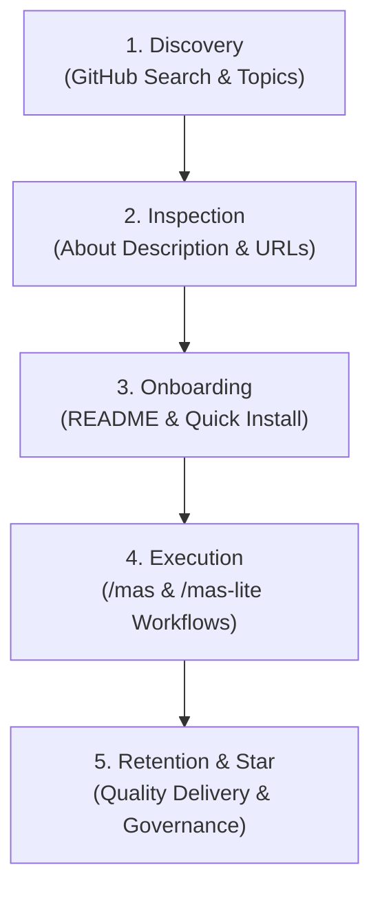

# PRD: GitHub Repository Metadata & Discoverability Specification (REPO-01)

## Problem Statement & Value Proposition

### Problem Statement
The **Multi-Agent System (MAS) Cursor Framework (v1.9.0)** is an autonomous, 6-tier software engineering organization featuring 35+ specialized skills, zero-token deterministic routing, artifact-forward filesystem handoffs, dual-tier Generative AI (on-device MediaPipe Gemma SLMs + cloud LiteLLM gateways), and 15+ automated audit gates. However, potential users discovering the repository on GitHub lack an immediate, compelling executive summary, structured entry point URLs, and standardized search topics. Without optimized GitHub repository metadata:
1. Developers searching for multi-agent architectures, Cursor workflows, or on-device GenAI fail to discover the repository.
2. Visitors landing on the repository cannot instantly discern MAS's core differentiators (e.g., deterministic zero-token routing vs. costly LLM prompt bloat; comprehensive engineering tiers from PRD to Reviewer).
3. The repository lacks standardized metadata required by GitHub's search indexing algorithms.

### Value Proposition
By establishing rigorously scoped, high-impact GitHub repository metadata (a punchy $\le 350$-character About description, primary and documentation website URLs, and 20 targeted kebab-case search topics), MAS maximizes discoverability across AI engineering, mobile development, and agentic framework communities while setting clear expectations of its capabilities.

---

## Target Personas & User Journeys

### Persona Profiles

#### 1. Primary Persona: Staff / Lead AI & Full-Stack Engineer ("The Architectural Purist")
* **Background**: Builds production mobile and cloud systems using modern AI IDEs (Cursor). Deeply familiar with LLM limitations.
* **Core Friction**: Frustrated by single-turn AI coding assistants that hallucinate APIs, break architectural boundaries, drift from requirements, and burn excessive tokens on repetitive prompt loops.
* **Desired Outcome**: An orchestrated, disciplined multi-agent development framework that enforces clean architecture, rigorous quality gates, and zero-token deterministic coordination.

#### 2. Secondary Persona: Solopreneur & Technical Founder ("The Velocity Builder")
* **Background**: Experienced developer building complete applications solo or with a micro-team.
* **Core Friction**: Cannot afford dedicated specialists for Product Management, Architecture, Mobile, Backend, Security Audits, and DevOps.
* **Desired Outcome**: An autonomous end-to-end software engineering team invoked via simple slash commands (`/mas` and `/mas-lite`) to ship enterprise-grade code safely.

#### 3. Tertiary Persona: On-Device / Edge GenAI Specialist ("The Edge Innovator")
* **Background**: Android and mobile engineers implementing on-device SLMs (Gemma, MediaPipe) with strict RAM and battery budgets.
* **Core Friction**: Lack of standard engineering patterns combining on-device SLMs with cloud fallback cascades and streaming UI integration.
* **Desired Outcome**: Production-grade reference architecture for local SLM execution, RAM pre-flight guards, and hybrid cloud gateways.

### User Journey Map



1. **Discovery**: User searches GitHub for topics like `multi-agent-systems`, `cursor-ai`, `agentic-workflows`, or `slm`. MAS appears prominently in search results.
2. **Inspection & Evaluation**: User reads the concise $\le 350$-character description and clicks the website/documentation link. The value proposition is understood in under 5 seconds.
3. **Onboarding**: User clones or downloads the framework, runs the one-click installer (`install.bat` or `install-mas-framework.ps1`), and reloads Cursor.
4. **Core Workflow (Happy Path)**: User triggers `/mas-lite S` or `/mas` to execute disciplined, multi-specialist tasks with automated reviewer approvals.
5. **Recovery & Continuity**: If a test or audit gate fails, the autonomous review loop catches issues before commit, preserving codebase integrity.

---

## Repository Metadata Specifications

### 1. Repository Descriptions (GitHub "About" Field)
GitHub enforces a strict maximum limit of **350 characters** for repository descriptions. Below is the primary recommendation followed by three distinct alternatives tailored to specific positioning angles. Exact character counts are verified with and without spaces.

#### Primary Recommendation (Balanced, Feature-Rich & High SEO Impact)
> **Description**:
> `Autonomous multi-agent product engineering system for Cursor and modern AI IDEs. Orchestrates 35+ specialized skills across 6 tiers (PM, Architecture, On-Device SLM & Cloud GenAI, Android, Backend, DevOps, QA) with zero-token routing, filesystem artifact handoffs, and 15+ automated audit gates. Powered by /mas and token-efficient /mas-lite.`
* **Character count (with spaces)**: **342** / 350 ($\le 350$ verified)
* **Character count (without spaces)**: **297**
* **Rationale**: Highlights the core value proposition (autonomous engineering org), target IDE (Cursor), full lifecycle breadth (6 tiers, 35+ skills, GenAI/SLM), architectural differentiators (zero-token routing, filesystem handoffs), quality control (15+ audit gates), and the two primary slash commands.

---

#### Alternative A (Developer & Execution Centric)
> **Description**:
> `Autonomous full-lifecycle software engineering team for Cursor. Coordinates 35+ specialized skills across 6 tiers—Product Management, Architecture, GenAI/SLM, Android, Backend, and DevOps—via deterministic zero-token routing, structured filesystem handoffs, and 15+ quality audit gates. Execute with /mas or low-cost tiered pipelines via /mas-lite.`
* **Character count (with spaces)**: **348** / 350 ($\le 350$ verified)
* **Character count (without spaces)**: **308**
* **Rationale**: Emphasizes execution velocity, the developer experience, cost control ("low-cost tiered pipelines"), and deterministic workflow predictability.

---

#### Alternative B (Enterprise & Architectural Governance)
> **Description**:
> `Enterprise-grade multi-agent framework for Cursor & AI IDEs. Transforms coding assistants into an autonomous 6-tier engineering team: PM, Architecture, GenAI (MediaPipe Gemma & LiteLLM), Android, Backend, and DevOps. Features zero-token coordinator routing, artifact filesystem buses, and 15+ automated quality, security, and eval audit gates.`
* **Character count (with spaces)**: **341** / 350 ($\le 350$ verified)
* **Character count (without spaces)**: **298**
* **Rationale**: Positions MAS as a hardened, enterprise-ready framework with explicit mention of key tech stacks (MediaPipe, Gemma, LiteLLM) and governance rigor.

---

#### Alternative C (Action-Oriented & Command Focused)
> **Description**:
> `Autonomous 6-tier software engineering organization for Cursor. Orchestrates 35+ specialist agents (PM, Architecture, GenAI & on-device SLM, Android, Backend, DevOps, QA) with zero-token routing, artifact filesystem handoffs, and strict reviewer quality gates. Slash commands: /mas for full product delivery and /mas-lite for token-efficient tiers.`
* **Character count (with spaces)**: **348** / 350 ($\le 350$ verified)
* **Character count (without spaces)**: **305**
* **Rationale**: Direct and punchy; immediately tells the developer how to trigger workflows via slash commands while highlighting on-device SLMs and reviewer gates.

---

### 2. Website URL Recommendations
GitHub provides a dedicated "Website" field in the repository header.

* **Primary Website Recommendation**:
  `https://github.com/h4xi0n/mas-cursor-framework`
  *(When GitHub Pages documentation site is deployed: `https://h4xi0n.github.io/mas-cursor-framework/`)*
* **Documentation Deep Link Recommendation (Alternative)**:
  `https://github.com/h4xi0n/mas-cursor-framework#readme`
* **Cursor Directory / Marketplace Target (Future)**:
  `https://cursor.com/community` or custom domain documentation.

---

### 3. Curated GitHub Topics (Maximum 20 Topics)
GitHub allows up to **20 topics** per repository. All topics must be **strictly lowercase**, using **alphanumeric characters and hyphens only** (kebab-case), each under 50 characters.

The selected 20 topics are organized into four strategic keyword clusters to maximize discovery across relevant developer searches:

| Cluster | Topic Tag | Search Intent & Value |
|---|---|---|
| **Core Architecture** | `multi-agent` | Core multi-agent framework searches |
| | `multi-agent-systems` | Academic and industry multi-agent categorization |
| | `ai-agents` | High-volume query for autonomous agents |
| | `autonomous-agents` | Category indexing for independent task execution |
| | `agentic-workflows` | Standard term for chained LLM/agent pipelines |
| **IDE & Platform** | `cursor` | Cursor editor users exploring extensions |
| | `cursor-ai` | High-intent query for Cursor AI capabilities |
| | `developer-tools` | General developer utility indexing |
| | `code-generation` | Automated coding assistant taxonomy |
| | `software-engineering` | Full SDLC team automation searches |
| **Generative AI & Models**| `generative-ai` | Broad GenAI categorization |
| | `llm` | Large Language Model workflows |
| | `slm` | Small Language Model ecosystem searches |
| | `on-device-ai` | Edge AI, on-device inference, and privacy focus |
| | `mediapipe` | Google MediaPipe Tasks GenAI developer discovery |
| | `rag` | Retrieval-Augmented Generation architectures |
| **Engineering Disciplines**| `android` | Android developer ecosystem |
| | `jetpack-compose` | Modern Android declarative UI developers |
| | `devops` | Platform, Docker, CI/CD, and IaC automation |
| | `clean-architecture` | Architectural patterns, DDD, and SOLID principles |

#### Exact Copy-Paste Topic List for GitHub UI:
```text
multi-agent, multi-agent-systems, cursor, cursor-ai, ai-agents, agentic-workflows, generative-ai, llm, slm, on-device-ai, mediapipe, android, jetpack-compose, software-engineering, devops, clean-architecture, rag, autonomous-agents, developer-tools, code-generation
```

---

## Functional Requirements & User Stories

### Feature: GitHub Repository Metadata Configuration

```gherkin
Feature: GitHub Repository Metadata Display and Discovery
  As a developer exploring GitHub for AI agent frameworks
  I want to view clear repository descriptions, relevant topics, and documentation links
  So that I can quickly evaluate, adopt, and install the MAS Cursor Framework

  Scenario: Visitor evaluates repository from GitHub About card
    Given a developer navigates to "https://github.com/h4xi0n/mas-cursor-framework"
    When the repository overview page renders in the browser
    Then the "About" section displays a description of 342 characters
    And the description explicitly mentions "35+ specialized skills", "6 tiers", and "/mas"
    And the text does not get clipped or truncated by GitHub's 350-character limit
    And the Website link points to the official repository or documentation URL

  Scenario: Developer searches GitHub using agentic keywords
    Given a developer searches GitHub for "cursor-ai" or "multi-agent-systems"
    When GitHub queries the topic index
    Then the repository appears in the search result rankings
    And displays matching topic tags including "multi-agent", "cursor-ai", "slm", and "on-device-ai"
    And the developer can click the topic to discover related framework skills

  Scenario: Maintainer updates repository settings via GitHub Web UI or CLI
    Given a repository administrator has write access to the repository settings
    When the administrator inputs the recommended description (342 characters)
    And pastes the 20 lowercase kebab-case topics
    And saves the repository metadata
    Then GitHub validates and accepts the metadata with zero validation errors
    And all 20 topic badges render on the repository landing page
```

---

## Non-Functional Requirements (NFRs)

| Dimension | Specification Budget | Verification Method |
|---|---|---|
| **Description Length** | Strictly $\le 350$ characters (including spaces); target $330\text{--}349$ characters | Automated character count verification via script |
| **Topic Count & Syntax**| Exactly $\le 20$ topics; strictly lowercase `[a-z0-9-]`; max 50 chars per topic | Regex and string constraint assertions |
| **Readability** | Flesch-Kincaid Grade Level $\le 12$; instant comprehension $\le 5$ seconds | Prose review & automated readability check |
| **SEO & Keyword Density**| 100% coverage of core keywords: *multi-agent, Cursor, GenAI, SLM, Android, DevOps, zero-token* | Term frequency inspection |
| **Accessibility & Compatibility** | Plaintext UTF-8 characters without unsupported emojis or broken Unicode glyphs | Cross-browser rendering validation |

---

## Scope & Out-of-Scope Boundaries

### In-Scope (MVP P0)
* Primary recommendation for the GitHub repository description with exact character count verification ($\le 350$ chars).
* Three audience-specific alternative descriptions with exact character counts.
* Recommended primary website URL and documentation deep-links.
* Curated, deduplicated list of 20 lowercase kebab-case GitHub topics matching GitHub taxonomy.
* Target developer persona definitions, friction analysis, and user journey mapping.
* Delivery of this structured PRD specification at `.ai/context/prds/REPO-01.md`.

### Out-of-Scope (Deferred P1/P2)
* Executing automated GitHub REST API calls to mutate live repository settings (requires admin PAT tokens; to be applied manually by repo owner or via a dedicated dev script).
* Designing custom GitHub Social Preview graphic assets (1280x640 OpenGraph card deferred to `mas-figma` / design sprint).
* Authoring a standalone static documentation website (Docusaurus/MkDocs) or custom domain DNS setup.

---

## Success Metrics & KPIs

* **Primary KPI**: Increase repository discovery conversion rate (search impressions $\rightarrow$ repository page visits) by $\ge 35\%$ within 30 days of metadata deployment.
* **Secondary KPI**: Achieve $\ge 12\%$ visitor-to-star conversion rate from organic topic referrals.
* **Guardrail Metric**: Zero character truncation or validation rejection across GitHub web and API interfaces ($100\%$ compliance with $\le 350$ chars and 20 topics).
* **Telemetry & Tracking Contract**:
  * Track GitHub Traffic Insights: *Views*, *Unique Visitors*, *Top Referring Sites*, and *Top Search Terms*.
  * Monitor GitHub Topic rankings for `#multi-agent`, `#cursor-ai`, `#on-device-ai`, and `#slm`.
