# MAS Cursor Framework

[](skills/multi-agent-system/install/manifest.json)
[](LICENSE)
[](skills/multi-agent-system/install/README.md)
[](skills/mas-coordinator/SKILL.md)

Portable distribution of the **Multi-Agent System (MAS)** for [Cursor](https://cursor.com) and modern AI IDEs. 

MAS orchestrates a specialized, autonomous **Full Product Engineering Organization** through simple slash commands — `/mas` for full-lifecycle multi-agent assembly lines and `/mas-lite` for token-efficient, tiered execution.

---

## Overview

MAS transforms single-turn coding assistants into an enterprise-grade software delivery team. Instead of an unconstrained generalist agent writing unchecked code, MAS enforces strict separation of concerns, structured filesystem handoffs, task-scoped context feeds, and rigorous quality gates.

```mermaid
flowchart TD
    subgraph Tier1["Tier 1: Requirements & Discovery"]
        PM["mas-pm<br/>(PRD & User Stories)"]
        SR["mas-spec-reader<br/>(API & Contract Intake)"]
        OSINT["mas-osint<br/>(Prior Art Research)"]
    end

    subgraph Tier2["Tier 2: Planning & Architecture"]
        Brainstorm["mas-brainstorm<br/>(Logic & Tradeoffs)"]
        Planner["mas-planner<br/>(Task Breakdown)"]
        Architect["mas-architect<br/>(System Topology)"]
        GenAIDesign["mas-genai<br/>(Design: genai-spec)"]
        Figma["mas-figma<br/>(Design Extraction)"]
    end

    subgraph Tier3["Tier 3: Multi-Discipline Engineering"]
        Backend["mas-backend-dev<br/>(APIs, DB, Auth)"]
        GenAIDev["mas-genai<br/>(Dev: AI Client & Evals)"]
        Android["mas-android-dev<br/>(Compose & Mobile)"]
        General["mas-general-dev<br/>(Full-Stack / Web)"]
        BugFix["mas-bug-fix<br/>(Targeted Fixes)"]
    end

    subgraph Tier4["Tier 4: Platform & Infrastructure"]
        DevOps["mas-devops<br/>(Docker, CI/CD, IaC)"]
    end

    subgraph Tier5["Tier 5: Quality & Audits"]
        VisualQA["mas-visual-fidelity<br/>(UI Parity)"]
        P0["P0 Audit Quartet<br/>(Security, Deps, API, Test-Exec)"]
        P1["P1 Depth Trio<br/>(A11y, I18n, Compliance)"]
        Perf["mas-perf-optimizer<br/>(Bottlenecks)"]
    end

    subgraph Tier6["Tier 6: Governance & Delivery"]
        Doc["mas-documenter<br/>(Codebase Docs)"]
        Reviewer{"mas-reviewer<br/>(Sole Approval Gate)"}
        Commit["mas-commit<br/>(Git Commit & Push)"]
    end

    Tier1 --> Tier2 --> Tier3 --> Tier4 --> Tier5 --> Tier6
```



---

## Key Capabilities (v1.9.0)

* **Full Product Engineering Team**: Covers the complete software engineering lifecycle: Product Management (`mas-pm`), System Architecture (`mas-architect`), Generative AI (`mas-genai`), Mobile (`mas-android-dev`), Backend (`mas-backend-dev`), DevOps (`mas-devops`), and QA.
* **Dual-Tier Generative AI Architecture**: On-device Small Language Models (Google MediaPipe Tasks GenAI / Gemma 2B/3B INT4 on Android with Kotlin Flow streaming) paired with resilient cloud LLM gateways (LiteLLM fallback cascades, Langfuse observability, prompt caching, and DeepEval/promptfoo eval suites).
* **Deterministic Zero-Token Coordinator**: Coordinator routes tasks using static file, scope, and flag predicates—never burning context tokens on LLM orchestration prompts.
* **Artifact-Forward Filesystem Bus**: Specialists communicate strictly through structured, versioned markdown briefs under `.ai/context/`—eliminating prompt pollution, conversation degradation, and lost context.
* **Independent Quality Governance**: The `mas-reviewer` acts as the sole merge authority across 15+ automated audit steps (0–0o), enforcing code cleanliness, security, database migrations, accessibility, and AI evaluation metrics.

---

## Specialist Roster

MAS provides specialized skills organized by functional discipline:

### 1. Requirements & Discovery
| Specialist | Skill Slug | Model Class | Focus & Deliverables | Brief Artifact |
|---|---|---|---|---|
| **Product Manager** | `mas-pm` | `normal` | Problem framing, customer journeys, Gherkin Given/When/Then user stories, NFR budgets, MVP vs Phase 2 scope | `.ai/context/prds/{TASK_ID}.md` |
| **Spec Reader** | `mas-spec-reader` | `fast` | Ingests PRDs, OpenAPI, GraphQL, and design specifications into structured briefs | `.ai/context/specs/{TASK_ID}.md` |
| **OSINT Specialist** | `mas-osint` | `fast` | Researches external prior art, GitHub patterns, and AOSP/AndroidX references | `.ai/context/osint/{TASK_ID}.md` |

### 2. Planning & Architecture
| Specialist | Skill Slug | Model Class | Focus & Deliverables | Brief Artifact |
|---|---|---|---|---|
| **Brainstorm** | `mas-brainstorm` | `normal` | Evaluates implementation options, logic, data flow, and error contracts | `.ai/context/brainstorms/{TASK_ID}.md` |
| **Planner** | `mas-planner` | `normal` | Granular task breakdowns, dependencies, risk mitigation, and verification gates | `.ai/context/plans/{TASK_ID}.md` |
| **Architect** | `mas-architect` | `thinking` | System topology, modularization, clean architecture layering, and interfaces | `.ai/context/architecture/{TASK_ID}.md` |
| **GenAI Specialist (Design)** | `mas-genai` | `thinking` | Prompt XML tags, JSON tool schemas, hybrid RAG, on-device SLM RAM guard ($\ge 6\text{ GB}$), LiteLLM fallback, DeepEval targets | `.ai/context/genai/{TASK_ID}.md` |
| **Figma Specialist** | `mas-figma` | `normal` | Extracts design tokens, typography, component hierarchies, and verification contracts | `.ai/context/design-specs/{TASK_ID}.md` |

### 3. Core Engineering
| Specialist | Skill Slug | Model Class | Focus & Deliverables | Output |
|---|---|---|---|---|
| **GenAI Specialist (Dev)** | `mas-genai` | `normal` | MediaPipe GenAI Android wrappers, Kotlin Flow streaming, LiteLLM gateway, Langfuse tracing, DeepEval/promptfoo eval suites | Client & eval code |
| **Backend Developer** | `mas-backend-dev` | `normal` | Clean Architecture (Domain $\leftrightarrow$ Repo $\leftrightarrow$ DataSource), forward-only DB migrations (Flyway, Prisma, Room), parameterized SQL, idempotency, auth | Server APIs & migrations |
| **Android Developer** | `mas-android-dev` | `normal` | Modern Android, Jetpack Compose, Coroutines/Flow, MVI/MVVM, Material 3, responsive foldables/tablets | Mobile code & tests |
| **General Developer** | `mas-general-dev` | `normal` | Full-stack web, CLI utilities, frontend components, and cross-platform scripting | Implementation code |
| **Bug Fix Specialist** | `mas-bug-fix` | `normal` | Root-cause diagnosis and minimal, surgical patches without regression | Targeted patches |

### 4. Platform & Infrastructure
| Specialist | Skill Slug | Model Class | Focus & Deliverables | Brief Artifact |
|---|---|---|---|---|
| **DevOps / Platform** | `mas-devops` | `normal` | Multi-stage rootless Dockerfiles (`appuser:10001:10001`), SHA-pinned GitHub Actions CI/CD, Terraform IaC, `.env.example`, health probes | `.ai/context/devops/{TASK_ID}.md` |

### 5. Quality, Verification & Audits
| Specialist | Skill Slug | Model Class | Focus & Deliverables | Brief Artifact |
|---|---|---|---|---|
| **Test Strategy** | `mas-test-strategy` | `normal` | Test plans, boundary matrices, mocks, AI eval strategies | `.ai/context/test-strategies/{TASK_ID}.md` |
| **Test Executor** | `mas-test-executor` | `normal` | Runs unit, integration, connected Android tests, and eval assertions | `.ai/context/test-runs/{TASK_ID}.md` |
| **Visual Fidelity** | `mas-visual-fidelity` | `normal` | Compares rendered UI against Figma design specs (measurement, screenshot, polish) | `.ai/context/visual-qa/{TASK_ID}.md` |
| **Security Auditor** | `mas-security-auditor` | `thinking` | STRIDE threat modeling, OWASP Top 10, authz/crypto/input validation | `.ai/context/security-audits/{TASK_ID}.md` |
| **Dependency Risk** | `mas-dependency-risk` | `fast` | Supply-chain CVE scanning, license compliance, abandoned library alerts | `.ai/context/supply-chain/{TASK_ID}.md` |
| **API Contract** | `mas-api-contract` | `normal` | Breaking change detection across OpenAPI, GraphQL, and Proto schemas | `.ai/context/api-contracts/{TASK_ID}.md` |
| **Accessibility (A11y)** | `mas-a11y` | `normal` | WCAG 2.1 AA/AAA compliance, screen readers, touch targets ($\ge 48\times 48\text{dp}$) | `.ai/context/a11y-reviews/{TASK_ID}.md` |
| **Internationalization (I18n)** | `mas-i18n` | `normal` | Hardcoded string audits, RTL layout support, plurals, date/number formatting | `.ai/context/i18n-reviews/{TASK_ID}.md` |
| **Compliance** | `mas-compliance` | `thinking` | Regulatory audit evidence (SOC2, GDPR, HIPAA, EU AI Act, FedRAMP) | `.ai/context/compliance/{TASK_ID}.md` |
| **Performance Optimizer** | `mas-perf-optimizer` | `normal` | Profiling, rendering jank, memory leaks, and CPU optimization | `.ai/context/perf/{TASK_ID}.md` |
| **Imaginer** | `mas-imaginer` | `fast` | Trace analysis and execution hypothesis for complex, silent bugs | `.ai/context/imaginations/{TASK_ID}.md` |

### 6. Governance & Delivery
| Specialist | Skill Slug | Model Class | Focus & Deliverables | Brief Artifact |
|---|---|---|---|---|
| **Documenter** | `mas-documenter` | `fast` | Synchronizes codebase documentation, API comments, and daily work log | `.ai/context/daily-changelog.md` |
| **Reviewer** | `mas-reviewer` | `thinking` | Centralized quality gate enforcing steps 0–0o; sole `Approved: YES \| NO` authority | `.ai/handoffs/{TASK_ID}-review.md` |
| **Commit Specialist** | `mas-commit` | `normal` | Drafts Conventional Commits; commits and pushes only with explicit confirmation | Git commit & push |
| **Debate Synthesizer** | `mas-debate` | `thinking` | Synthesizes security vs simplicity tradeoffs upon repeated Reviewer rejections | `.ai/context/debates/{TASK_ID}.md` |
| **Token Auditor** | `mas-token-auditor` | `fast` | Post-workflow advisory telemetry and prompt optimization audits | `.ai/context/audits/{TASK_ID}.md` |

---

## Generative AI Engineering (`mas-genai`)

The `mas-genai` specialist implements modern generative AI architectures across edge mobile devices and cloud infrastructure:

* **Dual-Tier Model Routing**:
  * **On-Device SLM (Tier 1)**: Google MediaPipe Tasks GenAI (`tasks-genai:0.10.20+`) running quantized Gemma 2B/3B INT4 models. Enforces runtime RAM pre-flight checks (`ActivityManager.MemoryInfo.totalMem >= 6GB`), background `Dispatchers.IO` execution, and non-blocking `Flow<String>` token streaming directly to Jetpack Compose UI.
  * **Cloud Gateway (Tier 2)**: LiteLLM proxy gateway with automated fallback cascades (e.g. Claude $\rightarrow$ Gemini), exponential backoff, and Langfuse tracing for token latency and cost attribution.
* **Prompt Architecture & Engineering**:
  * Strict XML hierarchy (`<context>`, `<system_instructions>`, `<constraints>`, `<tools>`, `<output_schema>`) preventing prompt delimiter collisions.
  * Static prompt prefix caching optimization ($\ge 1024$ tokens for Anthropic KV-cache, $\ge 32\text{k}$ for Gemini context caching) reducing repetitive token costs by up to 80%.
* **Structured Output & Function Calling**:
  * Strict JSON Schema draft-07 tool declarations with `additionalProperties: false` and required attribute arrays ensuring zero-hallucination structured tool calls.
* **Hybrid RAG & Retrieval**:
  * Semantic chunking with overlap boundaries, combining sparse keyword search (BM25) and dense embeddings with cross-encoder reranking.
* **Safety Guardrails & OWASP Defenses**:
  * Dual runtime guardrails: input XML escaping and prompt injection classifiers; output JSON validation and PII redaction. Mitigates the OWASP Top 10 for LLM Applications.
* **Evaluation Harnesses**:
  * DeepEval RAG Triad test suites (Faithfulness $\ge 0.85$, Answer Relevancy $\ge 0.85$, Context Recall $\ge 0.80$, Hallucination $\le 0.10$).
  * `promptfoo` red-teaming matrix and deterministic schema validation assertions integrated into CI/CD.
* **Standards Reference**: [genai-engineering-standards.md](skills/multi-agent-system/references/genai-engineering-standards.md)

---

## Operating Modes

MAS supports two operating modes tailored for different task scales:

### 1. Full Mode (`/mas`)
Activated by typing `/mas <request>`. Executes full quality gates, multi-specialist pipelines, and comprehensive documentation:
* Includes Spec Reader, Brainstorm, Planner, Architect, Specialists, and full Reviewer.
* Emits full structured handoffs at `.ai/handoffs/{TASK_ID}.md`.
* Mandatory `mas-reviewer` approval gate before git commit.

**Coordinator Routing Flags:**
```markdown
PRD_AUTH: yes          # Routes to mas-pm
GENAI_SPEC: yes        # Routes to mas-genai (Design Mode)
BACKEND: yes           # Routes to mas-backend-dev
DEVOPS: yes            # Routes to mas-devops
SECURITY_AUDIT: yes    # Triggers mas-security-auditor
API_CONTRACT: yes      # Triggers mas-api-contract
SUPPLY_CHAIN: yes      # Triggers mas-dependency-risk
RUN_TESTS: yes         # Triggers mas-test-executor
A11Y_AUDIT: yes        # Triggers mas-a11y
I18N_AUDIT: yes        # Triggers mas-i18n
COMPLIANCE_FRAMEWORK: SOC2 | GDPR | HIPAA | EU_AI_ACT | FedRAMP
```

### 2. Lite Mode (`/mas-lite`)
Activated by typing `/mas-lite <tier> <request>` (e.g. `/mas-lite S`, `/mas-lite M`, `/mas-lite L`). Designed for speed and token efficiency below Opus costs:
* **Tier S**: 1 agent (direct dev, bug-fix, or single specialist).
* **Tier M**: 2 agents (dev $\rightarrow$ reviewer lite; or dev $\rightarrow$ ux-intelligence).
* **Tier L**: 3 agents (planner $\rightarrow$ dev $\rightarrow$ reviewer lite).
* **Tier L+**: 4 agents (brainstorm $\rightarrow$ planner $\rightarrow$ dev $\rightarrow$ reviewer lite).
* Uses concise 12-line handoffs with fast flags: `PM:y`, `GEN:y`, `BE:y`, `OPS:y`, `SEC:y`, `API:y`, `DEPS:y`, `TEST:y`, `A11Y:y`, `I18N:y`, `FIG:y`, `VFID:y`.

---

## Repository Structure

```text
mas-cursor-framework/
├── .ai/                               # Framework context & durable artifacts
│   ├── context/
│   │   ├── prds/                      # mas-pm PRDs
│   │   ├── genai/                     # mas-genai genai-spec briefs
│   │   ├── devops/                    # mas-devops briefs
│   │   ├── architecture/              # mas-architect blueprints
│   │   ├── plans/                     # mas-planner task breakdowns
│   │   ├── brainstorms/               # mas-brainstorm briefs
│   │   ├── osint/                     # mas-osint research
│   │   ├── design-specs/              # mas-figma design specs
│   │   ├── visual-qa/                 # mas-visual-fidelity reports
│   │   ├── security-audits/           # mas-security-auditor briefs
│   │   ├── supply-chain/              # mas-dependency-risk briefs
│   │   ├── api-contracts/             # mas-api-contract briefs
│   │   ├── test-runs/                 # mas-test-executor reports
│   │   ├── a11y-reviews/              # mas-a11y reviews
│   │   ├── i18n-reviews/              # mas-i18n reviews
│   │   ├── compliance/                # mas-compliance reports
│   │   ├── daily-changelog.md         # Ephemeral daily work log
│   │   └── memory.md                  # Durable project memory & decisions
│   └── handoffs/                      # Active inter-agent handoff files
├── commands/                          # Cursor slash command definitions (/mas, /mas-lite)
├── hooks/                             # Session context hooks for Cursor
├── rules/                             # Workspace AI rules (multi-agent-hybrid.mdc)
├── skills/                            # Specialist skill implementations
│   ├── mas-coordinator/              # Orchestration & routing engine
│   ├── mas-pm/                       # Product Management specialist
│   ├── mas-genai/                    # Generative AI specialist (dual-mode)
│   ├── mas-backend-dev/              # Backend & Cloud developer
│   ├── mas-android-dev/              # Android & Mobile developer
│   ├── mas-devops/                   # DevOps & Platform engineer
│   ├── mas-architect/                # System architect
│   ├── mas-planner/                  # Planner specialist
│   ├── mas-reviewer/                 # Quality gate (steps 0–0o)
│   ├── mas-commit/                   # Git commit specialist
│   └── multi-agent-system/           # Framework core
│       ├── protocol/                  # Brief schemas, model policies, spawn rules
│       ├── references/                # Engineering standards & guidelines
│       ├── scripts/                   # PowerShell & Bash automation tooling
│       └── install/                   # Canonical installer & manifest
├── LICENSE                            # MIT License
└── README.md                          # Framework documentation
```

---

## Installation & Setup

### Windows (Quick Install)

1. Clone or unzip this repository.
2. Double-click `skills\multi-agent-system\install\install.bat`.
3. In Cursor, reload window (**Ctrl+Shift+P** $\rightarrow$ **Developer: Reload Window**).

### Windows (PowerShell)

```powershell
cd path\to\mas-cursor-framework\skills\multi-agent-system\install
.\install-mas-framework.ps1
```

### macOS / Linux

```bash
cd path/to/mas-cursor-framework/skills/multi-agent-system/install
chmod +x install-mas-framework.sh
./install-mas-framework.sh
```

### Verify Installation
1. Open Cursor Agent chat and type `/` — verify that **mas** and **mas-lite** appear in the command palette.
2. In a project directory, bootstrap per-project MAS context:
   ```powershell
   ~/.cursor/skills/multi-agent-system/scripts/init-mas-context.ps1 -ProjectPath "C:\path\to\project" -Stack auto
   ```
3. Test a quick command: `/mas-lite S create a health-check endpoint`.

---

## Automation Tooling & Hardware Testing

The framework includes automated scripts in `skills/multi-agent-system/scripts/`:

* **Host Mutex (MAS-10)**: Prevents conflicting concurrent Gradle builds or installations across terminal sessions:
  ```powershell
  powershell -File skills/multi-agent-system/scripts/mas-host-exec.ps1 -ProjectPath . -Lane build -Command "gradle assembleDebug"
  ```
* **Connected Device Testing (MAS-07)**: Prepares physical or emulated Android devices with auto-detection and permissions:
  ```powershell
  powershell -File skills/multi-agent-system/scripts/android-device-prep.ps1 -Policy physical -JsonOnly
  ```
* **Logcat Capture (MAS-09)**: Automates log buffer clearing and filtered crash dump analysis during bug reproduction:
  ```powershell
  powershell -File skills/multi-agent-system/scripts/capture-device-logs.ps1 dump -TaskId BUG-01 -Package com.example.app -Tag APP_TRACE -JsonOnly
  ```

---

## Technical References

For in-depth architectural standards, refer to the documents in `skills/multi-agent-system/references/`:

* [GenAI Engineering Standards](skills/multi-agent-system/references/genai-engineering-standards.md) — Prompts, RAG, MediaPipe SLM, LiteLLM, evals.
* [PRD Authoring Standards](skills/multi-agent-system/references/prd-authoring-standards.md) — Personas, customer journeys, Gherkin user stories.
* [Backend Engineering Standards](skills/multi-agent-system/references/backend-engineering-standards.md) — Clean Architecture, DB migrations, SQL parameterization, auth.
* [DevOps & Platform Standards](skills/multi-agent-system/references/devops-platform-standards.md) — Rootless Docker, SHA-pinned GitHub Actions, Terraform IaC.
* [Android Veteran Standards](skills/multi-agent-system/references/android-veteran-standards.md) — Jetpack Compose, Kotlin Flow, Material 3, responsive layouts.
* [Host Build & Install Mutex](skills/multi-agent-system/references/host-build-install-mutex.md) — Multi-agent host locking contracts.

---

## License

This project is licensed under the [MIT License](LICENSE).
