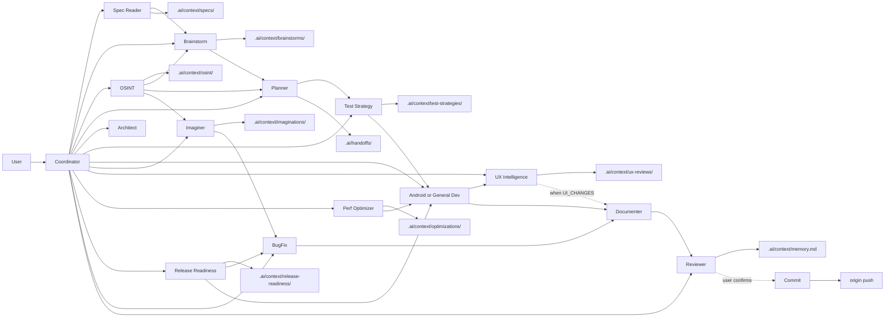

# Multi-Agent System

Entry point for orchestrated multi-agent workflows. Load `mas-coordinator` skill when activated.

## Activation

| Command | Skill | Use |
|---------|-------|-----|
| `/mas` | multi-agent-system → mas-coordinator | Full quality gates, Spec Reader, Documenter, full Reviewer |
| `/mas-lite` | mas-lite → mas-coordinator (Lite Mode) | 1–3 subagents; below Opus token cost on S/M tasks |

Triggered when user message starts with `/mas` (not lite) or explicitly requests full Coordinator/multi-agent workflow.

## Hybrid Mode

- **Without `/mas` or `/mas-lite`**: Do not preload `.ai/context/` unless the task needs it.
- **With `/mas-lite`**: See [mas-lite/SKILL.md](../mas-lite/SKILL.md).
- **With `/mas`**: Act ONLY as Coordinator until workflow completes.

## Read Order

See [protocol/read-order.md](protocol/read-order.md).

## Workflow



## Coordinator Instructions

1. Read [mas-coordinator/SKILL.md](../mas-coordinator/SKILL.md) and follow it exactly.
2. Never implement, architect, review, or debug directly in Coordinator mode.
3. Write handoffs to `.ai/handoffs/{TASK_ID}.md` per [protocol/handoff-format.md](protocol/handoff-format.md).
4. Delegate **every** specialist step via **Task** tool per [protocol/subagent-spawn.md](protocol/subagent-spawn.md) — `generalPurpose`, **`run_in_background: false`**, self-contained prompt, wait for `DONE`.
5. Specialists follow [protocol/subagent-role.md](protocol/subagent-role.md) — no nested Task spawning.
6. Enforce [protocol/token-rules.md](protocol/token-rules.md).

## Bootstrap New Project

```powershell
~/.cursor/skills/multi-agent-system/scripts/init-mas-context.ps1 -ProjectPath "C:\path\to\project" -Stack auto
```

Creates `.ai/context/` including `memory.md` and **daily changelog** (`daily-changelog.md` from template with today's local date). Existing projects without init get the changelog on first `/mas` or `/mas-lite` via `ensure-daily-changelog.ps1`. See [daily-changelog-policy.md](protocol/daily-changelog-policy.md).

## Transfer to Another PC / Mac

See [install/README.md](install/README.md). Export zip on source machine, run installer on target:

```powershell
# Export (Windows)
~/.cursor/skills/multi-agent-system/install/export-mas-framework.ps1

# Install (Windows)
.\install-mas-framework.ps1 -ZipPath ~\Desktop\mas-cursor-framework.zip
```

```bash
# Install (Mac)
./install-mas-framework.sh -z ~/Desktop/mas-cursor-framework.zip
```

## Specialist Skills

| Agent | Skill |
|-------|-------|
| Full `/mas` | mas (alias) → multi-agent-system |
| MAS Lite | mas-lite |
| Coordinator | mas-coordinator |
| Spec Reader | mas-spec-reader |
| Brainstorm | mas-brainstorm |
| Planner | mas-planner |
| Architect | mas-architect |
| Android Dev | mas-android-dev |
| General Dev | mas-general-dev |
| OSINT | mas-osint |
| Imaginer | mas-imaginer |
| UX Intelligence | mas-ux-intelligence |
| Perf Optimizer | mas-perf-optimizer |
| Release Readiness | mas-release-readiness |
| Test Strategy | mas-test-strategy |
| Bug Fix | mas-bug-fix |
| Documenter | mas-documenter |
| Reviewer | mas-reviewer |
| Commit | mas-commit |

## Protocol Files

- [handoff-format.md](protocol/handoff-format.md) — full `/mas`
- [handoff-format-lite.md](protocol/handoff-format-lite.md) — `/mas-lite`
- [subagent-spawn.md](protocol/subagent-spawn.md) — Task tool spawn rules (Coordinator)
- [subagent-role.md](protocol/subagent-role.md) — specialist subagent behavior
- [reviewer-lite.md](references/reviewer-lite.md) — lite Reviewer only
- [read-order.md](protocol/read-order.md)
- [token-rules.md](protocol/token-rules.md)
- [memory-policy.md](protocol/memory-policy.md)
- [daily-changelog-policy.md](protocol/daily-changelog-policy.md)

## Android Veteran Reference

For Kotlin, Jetpack Compose, responsive UI, and production Android quality bar:

- [android-veteran-standards.md](references/android-veteran-standards.md)

Used by: mas-brainstorm, mas-planner, mas-architect, mas-android-dev, mas-imaginer, mas-bug-fix, mas-reviewer.

## Logic-first brainstorm

Implementation options, domain logic, and product-quality patterns (no UI by default):

- [logic-brainstorm-standards.md](references/logic-brainstorm-standards.md)

## Data Flow Imagination

Trace user-action data flow for bugs and regressions (Imaginer agent):

- [data-flow-imagination-standards.md](references/data-flow-imagination-standards.md)

## Open Source Intelligence

Research external prior art for features and difficult bugs (OSINT agent):

- [open-source-intelligence-standards.md](references/open-source-intelligence-standards.md)

Ephemeral briefs: `.ai/context/osint/{TASK_ID}.md` — consumers read at startup when present; research-only, never copy implementations verbatim.

## UX Intelligence

Simulate real-user interaction and recommend behavioral fixes without visual redesign (UX Intelligence agent):

- Skill: [mas-ux-intelligence/SKILL.md](../mas-ux-intelligence/SKILL.md)
- Standards: [ux-intelligence-standards.md](references/ux-intelligence-standards.md)
- Brief output: `.ai/context/ux-reviews/{TASK_ID}.md` — Dev reads on UX fix pass; Reviewer reads for Interaction QA

## Performance Optimization

Profile existing implementations for measurable production gains (Perf Optimizer agent):

- Skill: [mas-perf-optimizer/SKILL.md](../mas-perf-optimizer/SKILL.md)
- Standards: [performance-optimization-standards.md](references/performance-optimization-standards.md)
- Brief output: `.ai/context/optimizations/{TASK_ID}.md` — Dev reads on perf fix pass; Reviewer reads for Performance Verification

## Release Readiness

Pre-release audit across 17 production-readiness categories (Release Readiness agent):

- Skill: [mas-release-readiness/SKILL.md](../mas-release-readiness/SKILL.md)
- Standards: [release-readiness-standards.md](references/release-readiness-standards.md)
- Brief output: `.ai/context/release-readiness/{TASK_ID}.md` — fix agents read on release fix pass; Reviewer reads for Release Readiness Verification

## Test Strategy

Plan what to test, what to skip, and why before Dev writes tests (Test Strategy agent):

- [test-strategy-standards.md](references/test-strategy-standards.md)

## Build, Test & Visual QA

Mandatory Gradle build, tests, and imagined visual QA for product-quality output:

- [build-test-visual-qa.md](references/build-test-visual-qa.md)

## In-Code Documentation

Comment create/update/delete after Dev or Bug Fix:

- [code-documentation-standards.md](references/code-documentation-standards.md)

## Spec & Requirements Intake

Read PRDs, API contracts, and design docs before planning:

- [spec-intake-guide.md](references/spec-intake-guide.md)

## Git Commit & Push

Commit message, commit, and push with user confirmation:

- [git-commit-standards.md](references/git-commit-standards.md)
