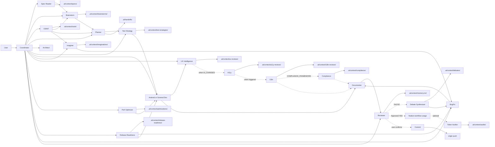

# Multi-Agent System

Entry point for orchestrated multi-agent workflows. Load `mas-coordinator` skill when activated.

## Activation

| Command | Skill | Use |
|---------|-------|-----|
| `/mas` | multi-agent-system → mas-coordinator | Full quality gates, Spec Reader, Documenter, full Reviewer |
| `/mas-lite` | mas-lite → mas-coordinator (Lite Mode) | 1–3 subagents; below Opus token cost on S/M tasks |

Triggered when user message starts with `/mas` (not lite) or explicitly requests full Coordinator/multi-agent workflow.

## Hybrid Mode

- **Without `/mas` or `/mas-lite`**: Do not preload `.ai/context/` unless the task needs it.
- **With `/mas-lite`**: See [mas-lite/SKILL.md](../mas-lite/SKILL.md).
- **With `/mas`**: Act ONLY as Coordinator until workflow completes.

## Read Order

See [protocol/read-order.md](protocol/read-order.md).

## Workflow



## Coordinator Instructions

1. Read [mas-coordinator/SKILL.md](../mas-coordinator/SKILL.md) and follow it exactly.
2. Never implement, architect, review, or debug directly in Coordinator mode.
3. Write handoffs to `.ai/handoffs/{TASK_ID}.md` per [protocol/handoff-format.md](protocol/handoff-format.md).
4. Delegate **every** specialist step via **Task** tool per [protocol/subagent-spawn.md](protocol/subagent-spawn.md) — `generalPurpose`, **`run_in_background: false`**, self-contained prompt, wait for `DONE`.
5. Specialists follow [protocol/subagent-role.md](protocol/subagent-role.md) — no nested Task spawning.
6. Enforce [protocol/token-rules.md](protocol/token-rules.md).

## Bootstrap New Project

```powershell
~/.cursor/skills/multi-agent-system/scripts/init-mas-context.ps1 -ProjectPath "C:\path\to\project" -Stack auto
```

Creates `.ai/context/` including `memory.md` and **daily changelog** (`daily-changelog.md` from template with today's local date). Existing projects without init get the changelog on first `/mas` or `/mas-lite` via `ensure-daily-changelog.ps1`. See [daily-changelog-policy.md](protocol/daily-changelog-policy.md).

## Transfer to Another PC / Mac

See [install/README.md](install/README.md) (pointer) or canonical [skills/multi-agent-system/install/README.md](../multi-agent-system/install/README.md). Export zip on source machine, run installer on target:

```powershell
# Export (Windows) — canonical path
~/.cursor/skills/multi-agent-system/install/export-mas-framework.ps1

# Install (Windows)
cd skills\multi-agent-system\install
.\install-mas-framework.ps1
```

```bash
# Install (Mac)
./install-mas-framework.sh -z ~/Desktop/mas-cursor-framework.zip
```

## Specialist Skills

| Agent | Skill |
|-------|-------|
| Full `/mas` | mas (alias) → multi-agent-system |
| MAS Lite | mas-lite |
| Coordinator | mas-coordinator |
| Spec Reader | mas-spec-reader |
| Brainstorm | mas-brainstorm |
| Planner | mas-planner |
| Architect | mas-architect |
| Android Dev | mas-android-dev |
| General Dev | mas-general-dev |
| OSINT | mas-osint |
| Imaginer | mas-imaginer |
| UX Intelligence | mas-ux-intelligence |
| Perf Optimizer | mas-perf-optimizer |
| Release Readiness | mas-release-readiness |
| Test Strategy | mas-test-strategy |
| Security Auditor | mas-security-auditor |
| Dependency Risk | mas-dependency-risk |
| API Contract | mas-api-contract |
| Test Executor | mas-test-executor |
| A11y | mas-a11y |
| I18n | mas-i18n |
| Compliance | mas-compliance |
| Figma Extraction | mas-figma |
| Visual Fidelity | mas-visual-fidelity |
| Bug Fix | mas-bug-fix |
| Documenter | mas-documenter |
| Reviewer | mas-reviewer |
| Commit | mas-commit |
| Debate Synthesizer | mas-debate |
| Token Auditor | mas-token-auditor |

## MAS-04 Phase A — P0 audit specialists (v1.2.0)

Advisory-only audit quartet added in manifest `1.2.0`. Specialists write briefs and route findings to dev/bug-fix; **reviewer** remains sole `Approved:` gate. Coordinator uses **deterministic predicates** (zero-token routing) — see [mas-coordinator/SKILL.md](../mas-coordinator/SKILL.md).

| Specialist | Skill | Brief path | `MODEL_CLASS` | Chain position |
|------------|-------|------------|---------------|----------------|
| Security Auditor | [mas-security-auditor](../mas-security-auditor/SKILL.md) | `.ai/context/security-audits/{TASK_ID}.md` | thinking | Post-dev, pre-reviewer |
| Dependency Risk | [mas-dependency-risk](../mas-dependency-risk/SKILL.md) | `.ai/context/supply-chain/{TASK_ID}.md` | fast | Early (post-osint) or pre-release |
| API Contract | [mas-api-contract](../mas-api-contract/SKILL.md) | `.ai/context/api-contracts/{TASK_ID}.md` | normal | After architect; or post-dev |
| Test Executor | [mas-test-executor](../mas-test-executor/SKILL.md) | `.ai/context/test-runs/{TASK_ID}.md` | normal | Post-dev, pre-reviewer |

### Routing flags

Optional handoff flags (predicates also fire from `FILES`/`SCOPE` without flags):

| Full `/mas` | Lite (`/mas-lite` L tier) | Specialist |
|-------------|----------------------------|------------|
| `SECURITY_AUDIT: yes` | `SEC:y` | security-auditor |
| `API_CONTRACT: yes` | `API:y` | api-contract |
| `SUPPLY_CHAIN: yes` | `DEPS:y` | dependency-risk |
| `RUN_TESTS: yes` | `TEST:y` | test-executor |

Also supported: `SECURITY_BLOCKER: yes` (reviewer opt-in merge block), `RE_AUDIT: yes` (re-spawn exception). Lite `SEC:` disambiguation: `SEC:y`/`SEC:n` = routing flag; `SEC: Heading1, Heading2` = `SECTIONS:` slice — see [handoff-format-lite.md](protocol/handoff-format-lite.md).

**Ordering invariants:** test-strategy before dev; test-executor after dev; max one spawn per specialist per `TASK_ID` unless `RE_AUDIT: yes`. Overflow skip order when chain exceeds cap: test-executor → api-contract → dependency-risk → security-auditor ([token-rules.md](protocol/token-rules.md)).

**Mutual exclusion:** test-strategy plans / test-executor executes; security-auditor exploitability / release-readiness category sweeps (depth only).

## MAS-04 Phase B — P1 depth trio (v1.2.1)

Advisory-only UI and regulatory depth specialists added in manifest `1.2.1`. Specialists write briefs and route findings to dev/bug-fix; **reviewer** remains sole `Approved:` gate. Coordinator uses **deterministic predicates** — see [mas-coordinator/SKILL.md](../mas-coordinator/SKILL.md).

| Specialist | Skill | Brief path | `MODEL_CLASS` | Chain position |
|------------|-------|------------|---------------|----------------|
| A11y | [mas-a11y](../mas-a11y/SKILL.md) | `.ai/context/a11y-reviews/{TASK_ID}.md` | normal | Post-ux when `UI_CHANGES: yes`; else post-dev |
| I18n | [mas-i18n](../mas-i18n/SKILL.md) | `.ai/context/i18n-reviews/{TASK_ID}.md` | normal | After a11y when both triggered (sequential) |
| Compliance | [mas-compliance](../mas-compliance/SKILL.md) | `.ai/context/compliance/{TASK_ID}.md` | thinking | Post-i18n segment or post-dev when UI chain skipped |

### Routing flags

Optional handoff flags (predicates also fire from `FILES`/`SCOPE`/release-readiness FAIL without flags):

| Full `/mas` | Lite (`/mas-lite` L tier) | Specialist |
|-------------|----------------------------|------------|
| `A11Y_AUDIT: yes` | `A11Y:y` | a11y |
| `I18N_AUDIT: yes` | `I18N:y` | i18n |
| `COMPLIANCE_FRAMEWORK: SOC2 \| GDPR \| HIPAA \| EU_AI_ACT \| FedRAMP` | *(none — full `/mas` only)* | compliance |

Also supported: `RE_AUDIT: yes` (re-spawn exception). Lite `SEC:` disambiguation: `SEC:y`/`SEC:n` = routing flag; `SEC: Heading1, Heading2` = `SECTIONS:` slice — see [handoff-format-lite.md](protocol/handoff-format-lite.md).

**Phase B UI chain (Logic Flow C):**

`dev → [ux-intelligence?] → [a11y?] → [i18n?] → [compliance?] → [test-executor?] → documenter → reviewer`

**Ordering invariants:**

1. `ux-intelligence` **before** `a11y` when both `UI_CHANGES: yes` and a11y triggered.
2. `a11y` **before** `i18n` when both triggered — **sequential only**; no parallel unless deferred `PARALLEL_READ: YES`.
3. `compliance` **after** i18n segment when both triggered; may spawn without UI chain when only `COMPLIANCE_FRAMEWORK` set.
4. `compliance` **never** spawns without `COMPLIANCE_FRAMEWORK` set — **full `/mas` only**; not available in lite.

**Compliance disclaimer:** Compliance agent produces engineering evidence audits only — **not legal counsel, certification, or regulatory sign-off**. Brief must include **Not legal advice** section. HITL required for legal/prod remediation.

**Mutual exclusion:** a11y owns WCAG depth (ux-intelligence owns behavioral friction); i18n owns locale/string architecture (not translation vendor workflow); compliance owns regulatory evidence (security-auditor owns exploitability).

**Overflow:** P1 optional specialists skip after P0 quartet per [token-rules.md](protocol/token-rules.md): a11y (5) → i18n (6) → compliance (7).

## MAS-05 — mas-figma design-spec feeder (v1.3.0)

Read-only Figma extraction specialist. Turns Figma URL/`node-id` into `.ai/context/design-specs/{TASK_ID}.md` for dev consumption. Coordinator uses **deterministic P0-5 predicate** — see [mas-coordinator/SKILL.md](../mas-coordinator/SKILL.md).

| Specialist | Skill | Brief path | `MODEL_CLASS` | Chain position |
|------------|-------|------------|---------------|----------------|
| Figma Extraction | [mas-figma](../mas-figma/SKILL.md) | `.ai/context/design-specs/{TASK_ID}.md` | normal (thinking on `FIGMA_COMPLEXITY: high`) | After architect/planner; before android-dev/general-dev |

### Routing flags

| Full `/mas` | Lite (`/mas-lite` L/L+) | Specialist |
|-------------|--------------------------|------------|
| `FIGMA_SPEC: yes` | `FIG:y` | mas-figma |
| Figma URL/node-id in `SOURCES_HINT`/`FILES` | *(same — within 12-line cap)* | mas-figma |
| `SCOPE: ui-from-figma` | *(scope in GOAL)* | mas-figma |

Also supported: `RE_EXTRACT: yes` (re-spawn exception), `FIGMA_COMPLEXITY: high` (MODEL_CLASS escalation). Local desktop MCP strongly preferred for `get_variable_defs`.

**Ordering invariants:** mas-figma pre-dev; ux-intelligence/a11y post-dev — no same-hop overlap. Max one spawn per `TASK_ID` unless `RE_EXTRACT: yes`. Protected-when-triggered in full `/mas` ([token-rules.md](protocol/token-rules.md)).

**Mutual exclusion:** mas-figma extracts layout/tokens; ux-intelligence = behavioral friction; a11y = WCAG; architect scopes nodes (does not duplicate design-spec sections); dev implements from spec (no Figma MCP when brief exists).

Standards: [figma-extraction-standards.md](references/figma-extraction-standards.md)

## MAS-06 — mas-visual-fidelity post-dev gate (v1.4.0)

Read-only post-dev design fidelity specialist. Consumes design-spec + **Verification Contract**; emits `.ai/context/visual-qa/{TASK_ID}.md` for reviewer step **0k**. Coordinator uses **deterministic P0-6 predicate** — see [mas-coordinator/SKILL.md](../mas-coordinator/SKILL.md).

## MAS-07 — connected-device capture (v1.4.1) + device prep gate (v1.5.0)

**v1.4.1:** Extends mas-visual-fidelity capture matrix with **Priority 3** connected-device adb path. Scripts: `capture-connected-device.{ps1|sh}`. Handoff flags: `DEVICE_CAPTURE: yes`, `ADB_SERIAL`. Verification Contract: Launch Recipe + Device Target.

**v1.5.0:** Upstream **android-device-prep** gate — test-executor Step 0, test-strategy **Device Prerequisites**, test-run **Device** section. Scripts: `android-device-prep.{ps1|sh}`. Handoff fields: `DEVICE_SERIAL`, `DEVICE_POLICY`. Prep exports `ANDROID_SERIAL`; capture defers selection to prep. SOT: [device-prep-automation.md](references/device-prep-automation.md). Standards: [visual-fidelity-standards.md](references/visual-fidelity-standards.md).

| Specialist | Skill | Brief path | `MODEL_CLASS` | Chain position |
|------------|-------|------------|---------------|----------------|
| Visual Fidelity | [mas-visual-fidelity](../mas-visual-fidelity/SKILL.md) | `.ai/context/visual-qa/{TASK_ID}.md` | normal (thinking on `FIGMA_COMPLEXITY: high` or > 3 screens) | After android-dev/general-dev; **before** ux-intelligence |

### Routing flags

| Full `/mas` | Lite (`/mas-lite` L/L+) | Specialist |
|-------------|--------------------------|------------|
| `VISUAL_FIDELITY: yes` | `VFID:y` | mas-visual-fidelity |
| `VISUAL_FIDELITY: auto` + design-spec + `UI_CHANGES: YES` | *(no auto in lite)* | mas-visual-fidelity |
| `RE_VERIFY: yes` | — | re-spawn exception |
| `BASELINE_STALE: no` | — | trust committed PNG when MCP blocked |
| `DEVICE_CAPTURE: yes` | — | force tier-3 adb capture |
| `ADB_SERIAL: {serial}` | — | multi-device override |

**Three-tier verification:** P0 structured measurement diff (blocker gate); P1 screenshot pair compare; P2 subjective polish remains reviewer imagined rows.

**Ordering invariants:** mas-visual-fidelity after dev and mas-figma; before ux-intelligence/a11y/i18n when triggered. Max one spawn per `TASK_ID` unless `RE_VERIFY: yes`. Protected-when-triggered in full `/mas` ([token-rules.md](protocol/token-rules.md)). Lite without `VFID:y` → skip + warn "Figma fidelity unverified".

**Mutual exclusion:** mas-visual-fidelity verifies layout/token parity; mas-figma extracts; ux-intelligence = behavioral friction; a11y = WCAG; test-executor = run-only (Option 6 fallback exception).

Standards: [visual-fidelity-standards.md](references/visual-fidelity-standards.md)

## Protocol Files

- [handoff-format.md](protocol/handoff-format.md) — full `/mas`
- [handoff-format-lite.md](protocol/handoff-format-lite.md) — `/mas-lite`
- [spawn-model-policy.md](protocol/spawn-model-policy.md) — MODEL_CLASS → Task model
- [brief-schemas.md](protocol/brief-schemas.md) — required brief sections
- [subagent-spawn.md](protocol/subagent-spawn.md) — Task tool spawn rules (Coordinator)
- [subagent-role.md](protocol/subagent-role.md) — specialist subagent behavior
- [reviewer-lite.md](references/reviewer-lite.md) — lite Reviewer only
- [read-order.md](protocol/read-order.md) — subscription matrix
- [token-rules.md](protocol/token-rules.md) — caps and artifact-forward
- [workflow-usage-policy.md](protocol/workflow-usage-policy.md) — session JSON telemetry
- [memory-policy.md](protocol/memory-policy.md)
- [daily-changelog-policy.md](protocol/daily-changelog-policy.md)

## Android Veteran Reference

For Kotlin, Jetpack Compose, responsive UI, and production Android quality bar:

- [android-veteran-standards.md](references/android-veteran-standards.md)

Used by: mas-brainstorm, mas-planner, mas-architect, mas-android-dev, mas-imaginer, mas-bug-fix, mas-reviewer.

## Logic-first brainstorm

Implementation options, domain logic, and product-quality patterns (no UI by default):

- [logic-brainstorm-standards.md](references/logic-brainstorm-standards.md)

## Data Flow Imagination

Trace user-action data flow for bugs and regressions (Imaginer agent):

- [data-flow-imagination-standards.md](references/data-flow-imagination-standards.md)

## Open Source Intelligence

Research external prior art for features and difficult bugs (OSINT agent):

- [open-source-intelligence-standards.md](references/open-source-intelligence-standards.md)

Ephemeral briefs: `.ai/context/osint/{TASK_ID}.md` — consumers read at startup when present; research-only, never copy implementations verbatim.

## UX Intelligence

Simulate real-user interaction and recommend behavioral fixes without visual redesign (UX Intelligence agent):

- Skill: [mas-ux-intelligence/SKILL.md](../mas-ux-intelligence/SKILL.md)
- Standards: [ux-intelligence-standards.md](references/ux-intelligence-standards.md)
- Brief output: `.ai/context/ux-reviews/{TASK_ID}.md` — Dev reads on UX fix pass; Reviewer reads for Interaction QA

## Performance Optimization

Profile existing implementations for measurable production gains (Perf Optimizer agent):

- Skill: [mas-perf-optimizer/SKILL.md](../mas-perf-optimizer/SKILL.md)
- Standards: [performance-optimization-standards.md](references/performance-optimization-standards.md)
- Brief output: `.ai/context/optimizations/{TASK_ID}.md` — Dev reads on perf fix pass; Reviewer reads for Performance Verification

## Release Readiness

Pre-release audit across 17 production-readiness categories (Release Readiness agent):

- Skill: [mas-release-readiness/SKILL.md](../mas-release-readiness/SKILL.md)
- Standards: [release-readiness-standards.md](references/release-readiness-standards.md)
- Brief output: `.ai/context/release-readiness/{TASK_ID}.md` — fix agents read on release fix pass; Reviewer reads for Release Readiness Verification

## Test Strategy

Plan what to test, what to skip, and why before Dev writes tests (Test Strategy agent):

- [test-strategy-standards.md](references/test-strategy-standards.md)
- Skill: [mas-test-strategy/SKILL.md](../mas-test-strategy/SKILL.md)
- Brief output: `.ai/context/test-strategies/{TASK_ID}.md`
- **Boundary:** test-strategy **plans** (pre-dev); [mas-test-executor](../mas-test-executor/SKILL.md) **runs** post-dev and writes `.ai/context/test-runs/{TASK_ID}.md`

## Phase A audit briefs (v1.2.0)

Specialist outputs — Reviewer reads conditionally when brief exists:

| Agent | Brief path | Required sections (see [brief-schemas.md](protocol/brief-schemas.md)) |
|-------|------------|------------------------------------------------------------------------|
| Security Auditor | `.ai/context/security-audits/{TASK_ID}.md` | Threat model, Findings, Validation, Blockers |
| Dependency Risk | `.ai/context/supply-chain/{TASK_ID}.md` | Dependency delta, CVE summary, Blast radius, Remediation |
| API Contract | `.ai/context/api-contracts/{TASK_ID}.md` | Spec inventory, Breaking changes, Drift, Recommendations |
| Test Executor | `.ai/context/test-runs/{TASK_ID}.md` | Commands, Pass/fail, Failures, Gaps, Device (conditional) |

## Phase B depth briefs (v1.2.1)

Specialist outputs — Reviewer reads conditionally when brief exists:

| Agent | Brief path | Required sections (see [brief-schemas.md](protocol/brief-schemas.md)) |
|-------|------------|------------------------------------------------------------------------|
| A11y | `.ai/context/a11y-reviews/{TASK_ID}.md` | WCAG table, Findings, Fix priority, Manual checklist |
| I18n | `.ai/context/i18n-reviews/{TASK_ID}.md` | String inventory, Locale gaps, RTL, Recommendations |
| Compliance | `.ai/context/compliance/{TASK_ID}.md` | Framework map, Gaps, Evidence, Remediation, Not legal advice |

## Build, Test & Visual QA

Mandatory Gradle build, tests, and imagined visual QA for product-quality output:

- [build-test-visual-qa.md](references/build-test-visual-qa.md)

## In-Code Documentation

Comment create/update/delete after Dev or Bug Fix:

- [code-documentation-standards.md](references/code-documentation-standards.md)

## Spec & Requirements Intake

Read PRDs, API contracts, and design docs before planning:

- [spec-intake-guide.md](references/spec-intake-guide.md)

## Git Commit & Push

Commit message, commit, and push with user confirmation:

- [git-commit-standards.md](references/git-commit-standards.md)
